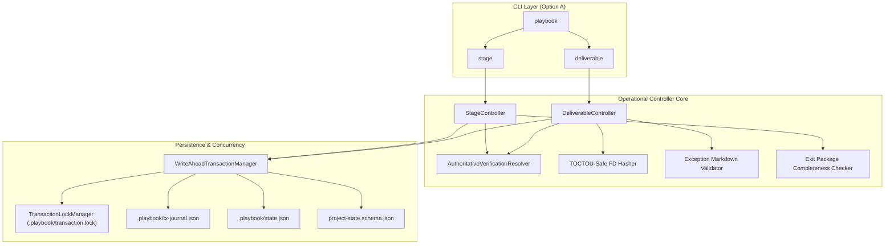

# Architecture Decision Record (ADR)

# ADR-20261109-001: Operational Controller CLI: Deterministic, WAL-Protected Management of Intra-Stage Deliverables, Evidence, Exceptions, and Review Handshakes

> **Template Version**: 1.0.0  
> **Applicable Stages**: Task 009 (Operational Controller Architecture & CLI Subsystem)  
> **Storage Location**: `docs/adr/ADR-20261109-001-operational-controller-cli.md`

---

## 1. Document Metadata

| Field | Value |
| :--- | :--- |
| **ADR ID** | `ADR-20261109-001` |
| **Title** | Operational Controller CLI: Deterministic, WAL-Protected Management of Intra-Stage Deliverables, Evidence, Exceptions, and Review Handshakes |
| **Status** | `Accepted` |
| **Date** | `2026-11-09` |
| **Author** | AI Systems Architect & Controller |
| **Approver** | Zain Ali (Lead Engineer & Architect) |
| **Traceable PRD / Requirements** | State Machine §3.2, §3.3, §3.4, §3.5, §3.8; `AGENTS.md` Steps 1–7; GAP-35 through GAP-42; ADR-20261031-001; ADR-20261102-002 |
| **Supersedes** | None |
| **Superseded By** | None |

---

## 2. Context & Problem Statement

The AI Engineering Playbook provides transactional Write-Ahead Log (`WAL`) protection, schema validation, and mutex concurrency locks for macro lifecycle state transitions: `approve` (§3.9), `advance` (§3.10), `reopen` (§3.12), and `recover` (§3.13). These macro transitions operate with rigorous atomic guarantees under `WriteAheadTransactionManager`.

However, an operational asymmetry existed for the intra-stage tasks executed by AI agents in daily engineering:
1. `START_STAGE` (§3.2): Transitioning a stage from `not_started` to `in_progress`.
2. `RECORD_DELIVERABLE` (§3.3): Registering or updating deliverables within `current_stage_detail.deliverables[]`.
3. `RECORD_EVIDENCE` (§3.4): Associating cryptographic proof files and test results with deliverables.
4. `RECORD_EXCEPTION` (§3.5): Logging authorized human waivers against required deliverables.
5. `INVALIDATE_DELIVERABLE` (§3.3/§3.4): Explicitly revoking verified status upon defect detection or scope changes.
6. `REQUEST_HUMAN_APPROVAL` (§3.8): Submitting a stage exit package for human review (Phase 1 of the Two-Phase Gate Handshake).

Because no dedicated CLI commands existed for these transitions, `AGENTS.md` instructed agents to directly modify `.playbook/state.json` via unstructured file editing. This manual JSON manipulation introduced seven severe hazards:
- **Concurrency Hazards**: Modifying `.playbook/state.json` without acquiring `.playbook/transaction.lock` or writing a WAL journal, risking race conditions and data corruption.
- **Evidence Integrity Hazards**: Registering evidence without computing or verifying SHA-256 hashes, leading to stale or broken evidence chains.
- **Ghost Deliverables**: Claiming deliverables are "completed" or "verified" without automated verification logs on disk.
- **Unverified Waivers**: Marking deliverables as waived without validating documentary human attribution, scope, or expiration dates on exception records.
- **Exit Package Incompleteness**: Moving stages to `pending_review` without verifying mandatory sections in the exit package markdown.
- **Authority Blurring**: The danger of agents attempting to self-approve gates rather than stopping at review submission.
- **Audit Deficits**: Bypassing the immutable `audit_trail[]` in `project-state.schema.json`.

The repository requires a unified, deterministic, transactionally protected CLI suite that exposes these transitions to agents and developers while upholding all constitutional principles.

---

## 3. Decision Drivers

The decision is guided by the following constitutional forces and engineering requirements:

- **Driver 1 (Principle 1: Human Sovereignty & Two-Phase Handshake)**: AI agents must be able to submit deliverables and exit packages for review (Phase 1), but cannot approve or advance gates (Phase 2). The CLI must enforce this authority boundary at the command layer.
- **Driver 2 (Principle 3: Determinism Over Heuristics)**: Every state mutation must be deterministic, schema-validated, and cryptographically verified using SHA-256 byte hashing.
- **Driver 3 (Principle 6: Explicit Contracts & Fail-Fast Validation)**: All mutations must pass pre- and post-validation against existing `schemas/project-state.schema.json` without requiring schema modifications.
- **Driver 4 (Principle 8: Defect Containment & Non-Silent State Changes)**: Evidence records are append-only. Appending failed evidence must not silently demote an already verified deliverable. Invalidation requires an explicit, auditable transition. Stage submission evaluates the authoritative current verification state, failing closed if the latest evidence is failed.
- **Driver 5 (ADR-20261102-002: ACID Atomicity & WAL Protection)**: Intra-stage state changes must use the existing `WriteAheadTransactionManager` and mutex locking infrastructure (`.playbook/transaction.lock` and `.playbook/tx-journal.json`).
- **Driver 6 (Developer Experience & Usability)**: The command taxonomy must be intuitive, predictable, and cleanly organized.

---

## 4. Considered Alternatives

### Alternative A: Continue Direct JSON Manipulation by Agents with Enhanced Prompting
- **Description**: Rely on expanded system prompts in `AGENTS.md` and stricter JSON Schema validation hooks to guide agents in modifying `.playbook/state.json` directly.
- **Advantages / Pros**:
  - Requires zero new CLI commands or codebase additions.
- **Disadvantages / Cons**:
  - Fails to provide transactional atomicity (WAL journaling) or concurrency locking.
  - Leaves cryptographic hashing to fallible LLM self-computation.
  - Fragile against agent hallucinations and syntax errors.
  - Provides no automated verification of exception file TTL or human signatures.
- **Reason for Rejection**: Unacceptable risk of state corruption, silent bypass of audit logging, and violation of Constitutional Principle 3.

### Alternative B: Flat CLI Command Taxonomy (`playbook record-deliverable`, etc.)
- **Description**: Add individual, top-level flags and commands to the root `playbook` CLI.
- **Advantages / Pros**: Direct 1:1 mapping with state machine transition names.
- **Disadvantages / Cons**: Clutters the top-level CLI namespace with 6 additional commands; poor ergonomics.
- **Reason for Rejection**: Inferior CLI ergonomics and namespace bloat.

### Alternative C: Grouped Noun-Verb CLI Command Taxonomy (Chosen)
- **Description**: Structure commands around two canonical lifecycle nouns:
  - `playbook stage <start|submit>`
  - `playbook deliverable <record|evidence|waive|invalidate>`
- **Advantages / Pros**:
  - Clean, hierarchical, and discoverable interface.
  - Encapsulates WAL transactions, streaming SHA-256 hashing, markdown parsing, and schema validation.
  - Models the Two-Phase Handshake (`stage submit` for Phase 1 vs `approve` for Phase 2).
  - Explicit invalidation command avoids silent state demotions while preserving strict submission gates.
- **Disadvantages / Cons**:
  - Requires implementing sub-command routers within `tooling/playbook-cli/src/commands/`.
- **Reason for Selection**: Optimal ergonomics, robust encapsulation of safety invariants, and strict architectural alignment.

---

## 5. Chosen Solution & Architectural Decisions

We adopt **Alternative C: Grouped Noun-Verb CLI Command Taxonomy** with full Write-Ahead Log (`WAL`) transaction integration.

### Core Architecture Components

### Key Architectural Decisions:
1. **Command Mapping**:
   - `playbook stage start` -> Implements `START_STAGE` (§3.2).
   - `playbook deliverable record` -> Implements `RECORD_DELIVERABLE` (§3.3).
   - `playbook deliverable evidence` -> Implements `RECORD_EVIDENCE` (§3.4).
   - `playbook deliverable waive` -> Implements `RECORD_EXCEPTION` (§3.5).
   - `playbook deliverable invalidate` -> Implements Candidate Transition §3.15 (`INVALIDATE_DELIVERABLE`).
   - `playbook stage submit` -> Implements `REQUEST_HUMAN_APPROVAL` (§3.8).
2. **Transactional Protection**:
   Every command executes inside `transactionManager.executeTransaction()` / `withTransaction()`, acquiring `.playbook/transaction.lock`, writing `.playbook/tx-journal.json`, validating against `schemas/project-state.schema.json`, executing atomic rename swaps, and appending to `audit_trail[]`.
3. **Evidence Failure Semantics & Non-Demotion**:
   - Evidence records in `evidence[]` are strictly append-only at the application level.
   - Recording a failed evidence record (`--result failed`) does NOT silently demote an already-verified deliverable.
   - Authoritative verification resolves against the canonical source of required disciplines (`.playbook/quality-gates.json`, fallback `governance/stage-gate-rules.md`), failing closed if missing, malformed, or inconsistent. Array index is strictly a local deterministic tie-breaker, not proof of chronological authenticity.
   - `playbook stage submit` evaluates authoritative verification, blocking submission fail-closed if the latest evidence for any required discipline is `failed`.
4. **Candidate Transition §3.15 (`INVALIDATE_DELIVERABLE`)**:
   `playbook deliverable invalidate --id <ID> --reason <REASON>` requires source status `verified` and transitions the deliverable to `in_progress` with `validation_status: "failed"`.
   - **Governance Prerequisite**: Authorizing document is `governance/state-machine.md`. Candidate Transition §3.15 requires a formal Human Governance Amendment committed to the repository with Lead Architect sign-off before implementation.
   - **Task 009B Implementation Fence**: Task 009B cannot implement this transition or CLI command without prior human authorization of that amendment. If withheld, Task 009B scope is restricted to the five authorized transitions (§3.2, §3.3, §3.4, §3.5, §3.8).
   - If passing evidence was human-attested or stage-approved, human authorization is mandatory (`HUMAN_AUTHORIZATION_REQUIRED`).
   - Logs `DELIVERABLE_INVALIDATED` to `audit_trail[]`. Prior passing evidence cannot satisfy future checks until fresh passing evidence is recorded after the invalidation timestamp.
5. **Defense-in-Depth Cryptographic Hashing**:
   Evidence hashing validates file properties (`stat.isFile()`, `stat.size > 0`) on open kernel descriptors and verifies that `size` and `mtimeMs` match before and after streaming to detect concurrent file modification. Platform-specific limitations (Windows reparse points / non-exclusive POSIX reads) are explicitly documented.
6. **Trust Boundaries & Authorization Dimensions**:
   The architecture strictly distinguishes: (1) documentary attribution (markdown heuristics), (2) TTY operator attestation (`isatty`), and (3) fingerprint integrity (`approval-fingerprint.json`) from (4) authenticated human identity (GPG/SSH or OAuth/OIDC signatures, which are external CI/VCS concerns excluded from `playbook-cli`).
7. **Strict UTC Expiration Boundaries**:
   Calendar dates (`YYYY-MM-DD`) expire strictly at `YYYY-MM-DDT23:59:59.999Z` (UTC). Malformed dates fail fail-closed.
8. **Strict Two-Phase Handshake Demarcation**:
   `playbook stage submit` performs Phase 1 review submission only. Gate approval (Phase 2) is strictly reserved for human authority via `playbook approve --gate <N>`.
9. **Zero Schema Modifications**:
   All states, evidence items, invalidations, and transitions are 100% representable in existing `project-state.schema.json`.

---

## 6. Consequences & Trade-Offs

### Positive Consequences
- **Eliminates Manual State Edits**: Eliminates unstructured edits on `.playbook/state.json`.
- **Eliminates Silent State Downgrades**: Verification state remains stable; failures are recorded append-only; regressions block submission fail-closed.
- **Guarantees ACID Concurrency**: State mutations are protected by WAL journals and file locks.
- **Cryptographic Evidence Chain**: Streamed directly from kernel file descriptors, immune to TOCTOU attacks.
- **Preserves Human Sovereignty**: Precludes agent self-approval and distinguishes attribution from authentication.
- **Grouped Ergonomics**: Intuitive syntax (`playbook stage ...`, `playbook deliverable ...`).

### Negative Consequences / Trade-Offs
- **Explicit Invalidation Discipline**: When a regression occurs, an engineer or agent must either fix the test and append passing evidence or explicitly invoke `deliverable invalidate`.
- **Tooling Footprint**: Adds modular controllers, CLI routers, and formatters to `tooling/playbook-cli`.

### Neutral Consequences
- State machine rules in `governance/state-machine.md` remain the single source of truth.
- `AGENTS.md` operational loops (Steps 1–7) will reference standard CLI commands instead of ad-hoc JSON instructions once implemented.

---

## 7. Reversibility & Migration Strategy

- **Reversibility**: High. The state file format is unchanged. If the Operational Controller commands need modification or rollback, existing `.playbook/state.json` files remain 100% compliant and readable.
- **Migration**: Once implemented in Task 009B, existing test repositories and agent prompts will be updated to replace manual state manipulation with the corresponding CLI commands without altering prior stage history or milestone archives.

---

## 8. Traceability & Invariant Mapping

| Requirement / Invariant | Implementation Mechanism in This ADR |
| :--- | :--- |
| **State Machine §3.2** (`START_STAGE`) | `playbook stage start` via `StageController.startStage()` |
| **State Machine §3.3** (`RECORD_DELIVERABLE`) | `playbook deliverable record` via `DeliverableController.recordDeliverable()` |
| **State Machine §3.4** (`RECORD_EVIDENCE`) | `playbook deliverable evidence` (append-only, non-demoting) |
| **State Machine §3.5** (`RECORD_EXCEPTION`) | `playbook deliverable waive` with UTC boundary and attribution check |
| **Candidate Transition §3.15** (`INVALIDATE_DELIVERABLE`) | `playbook deliverable invalidate` (source: `verified`, human auth guard) |
| **State Machine §3.8** (`REQUEST_HUMAN_APPROVAL`) | `playbook stage submit` with exit package & authoritative verification check |
| **Constitutional Principle 1** (Human Sovereignty) | Hard demarcation: `stage submit` stops at `pending_review`; only `approve` approves |
| **Constitutional Principle 3** (Determinism) | Defense-in-depth FD streaming SHA-256 byte hashing, exact AST parsing, schema validation |
| **Constitutional Principle 8** (Defect Containment) | Non-demoting evidence + authoritative submission guard + explicit invalidation |
| **ADR-20261102-002** (WAL & Atomicity) | Full integration with `WriteAheadTransactionManager` (`tx-journal.json`, `transaction.lock`) |

---

## 9. Approvals & Historical Sign-Off

- **Lead Architect**: Zain Ali (Lead Engineer & Architect)
- **Status**: `Accepted`
- **Date**: 2026-11-09
