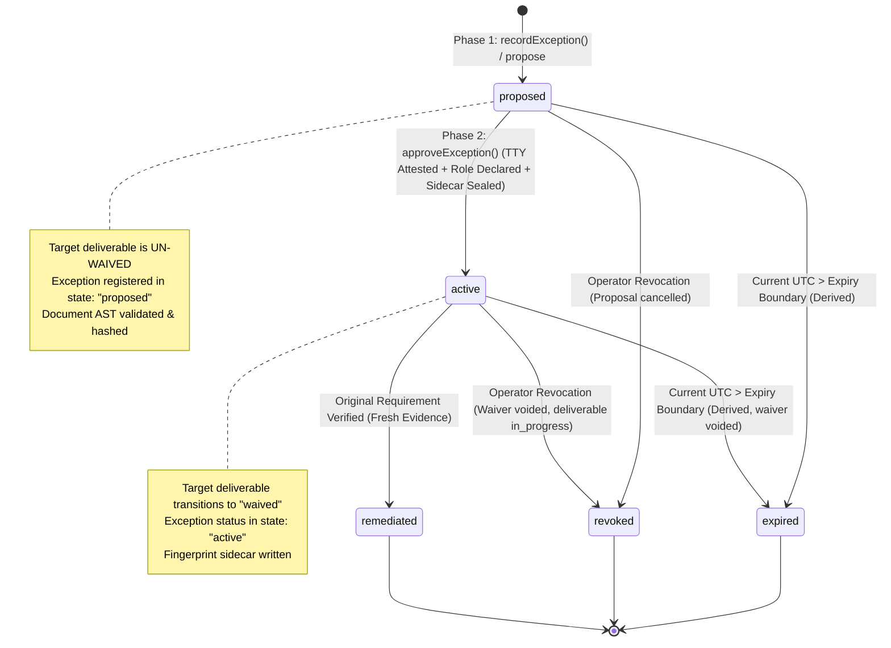

# Architecture Decision Record (ADR)

# ADR-20261110-001: Two-Phase Exception Lifecycle: Separation of Exception Proposal and Explicit Human Authorization (Option B)

> **Template Version**: 1.0.0  
> **Applicable Stages**: Task 009 (Operational Controller Architecture & CLI Subsystem)  
> **Storage Location**: `docs/adr/ADR-20261110-001-two-phase-exception-lifecycle.md`  
> **Amendment Reference**: `AMEND-20261110-001`  
> **Related ADRs**: `ADR-20261109-001` (Operational Controller CLI)

---

## 1. Document Metadata & Decision Status

| Field | Value |
| :--- | :--- |
| **ADR ID** | `ADR-20261110-001` |
| **Amendment ID** | `AMEND-20261110-001` |
| **Title** | Two-Phase Exception Lifecycle: Separation of Exception Proposal and Explicit Human Authorization (Option B) |
| **Status** | `Proposed Architecture Amendment (Pending Formal Human Ratification)` |
| **Date** | `2026-11-10` |
| **Author** | AI Systems Architect & Operational Controller |
| **Approver** | Zain Ali (Lead Engineer & Systems Architect) — *Pending Formal Sign-off* |
| **Traceable Governance** | `governance/state-machine.md` §3.5, §3.5a, §3.5b, §3.5c; `governance/stage-gate-rules.md` §4; `governance/ENGINEERING_CONTROLLER.md` §9; `templates/exception-record-template.md`; Task 009B.2.4 Audit Report; Task 009B.2.5; Task 009B.2.5.1 |
| **Supersedes** | Partially supersedes single-phase waiver recording in `ADR-20261109-001` (§2.5 / Transition §3.5) |
| **Superseded By** | None |

### 1.1 Governance Decision Boundaries & Distinctions
To maintain strict intellectual honesty and avoid ambiguous claims, the governance status of this architecture is defined across four distinct operational boundaries:
1. **Human-Selected Direction**: **Option B (Two-Phase Exception Lifecycle)** has been selected as the governing architecture direction.
2. **Architecture Amendment Status**: **`Proposed`**. Formal policy ratification across governing documents remains pending Lead Architect sign-off.
3. **Implementation Authorization**: **`Not Yet Granted`**. Production code refactoring, schema alterations, and CLI implementations are strictly deferred to future engineering phases.
4. **Authenticated Identity Status**: **`Unimplemented`**. Neither TTY presence nor SHA-256 integrity establishes authenticated human identity.

---

## 2. Context & Original Authorization Gap

In the accepted Task 009A.3 architecture (`docs/architecture/operational-controller/design.md` §2.5) and `ADR-20261109-001`, exception recording was modeled as a single-phase operational command:
```bash
playbook deliverable waive --id <DELIV-ID> --exception <EXC_FILE_PATH>
```
Under that model, an exception Markdown document containing documentary metadata (`Status: Approved`, `Authorized By (Human): <Human Name>`, and a non-placeholder `Sign-Off Reference`) allowed `recordException()` to immediately mutate the target deliverable to `status: "waived"`, `validation_status: "waived"`.

During the **Task 009B.2.4 Forensic Security Audit**, a fundamental governance contradiction was exposed:
1. **Documentary Metadata Alone Is Not Authorization Evidence**: An AI agent or script with filesystem write access can generate or modify a Markdown exception document, set `Status: Approved`, write an authorized human engineer's name, and append a plausible commit reference.
2. **Premature Deliverable Waiver**: Single-phase intake marked deliverables as waived inside repository state without any operator interaction, interactive confirmation, or cryptographic integrity binding having taken place.
3. **Delayed Detection**: Human review was deferred to the macro Stage Gate handshake (`playbook approve --gate <N>`). Throughout active intra-stage engineering, agents and tools operated under the false premise that the waiver was already authorized.

The user mandate for Task 009B.2.4, Task 009B.2.5, and Task 009B.2.5.1 established the non-negotiable principle:
> *A deliverable waiver must not become authorized merely because its Markdown document contains an Approved status, a human authorizer name, and a non-placeholder sign-off reference. The architecture must strictly separate proposing an exception from authorizing an exception.*

To resolve this vulnerability without fabricating unsupported external identity protocols, this ADR defines **Option B: Two-Phase Exception Lifecycle**.

---

## 3. Decision: Option B (Two-Phase Exception Lifecycle)

We formally propose amending the Operational Controller architecture to decouple exception handling into two distinct, sequential lifecycle phases:
1. **Phase 1 — Exception Proposal (`PROPOSE_EXCEPTION`, §3.5a)**: Non-privileged, intra-stage registration of an exception proposal. Validates document AST structure, scope, justification, compensating controls, and expiry, but **strictly forbids waiving the deliverable**.
2. **Phase 2 — Explicit Human Authorization (`AUTHORIZE_EXCEPTION`, §3.5b)**: Privileged, interactive operator-attested sign-off. Enforces an interactive terminal condition, rejects recognized automated agent patterns, requires an exact confirmation phrase, validates the declared role, cryptographically seals an exception approval fingerprint sidecar, transitions exception status to `active`, and **only then mutates the target deliverable to `waived`**.



---

## 4. Lifecycle and State Invariants

### 4.1 Exception States & Deliverable Impact

| Exception State | Authoritative Meaning | Impact on Target Deliverable | Permitted Next States |
| :--- | :--- | :--- | :--- |
| **`proposed`** | Exception record physically exists, passes AST parsing, and is recorded in state, but lacks operator authorization. | **NO WAIVER**. Deliverable remains in its existing status (`not_started`, `in_progress`, or `completed`). Cannot satisfy stage gate. | `active`, `revoked`, `expired` |
| **`active`** | Explicit operator authorization confirmed via interactive TTY, role declared, and fingerprint sidecar sealed. Not expired. | **WAIVED**. Deliverable transitions to `status: "waived"`, `validation_status: "waived"`, `exception_ref: "<EXC_ID>"`. Clears stage gate while valid. | `revoked`, `expired`, `remediated` |
| **`expired`** | Current UTC timestamp exceeds the mandatory boundary (`YYYY-MM-DDT23:59:59.999Z`). Dynamically derived by resolver. | **WAIVER VOIDED**. Deliverable cannot satisfy stage gate. Blocks `stage submit` and `gate approve`. | Terminal |
| **`revoked`** | Operator has formally cancelled or withdrawn the exception. | **WAIVER VOIDED**. Deliverable reverts to `in_progress`. `validation_status` dynamically re-evaluated. Blocks stage progression. | Terminal |
| **`remediated`** | The underlying waived requirement has been satisfied through implementation and fresh passing evidence. | **WAIVER RETIRED**. Deliverable transitions to `status: "verified"`, `validation_status: "passed"`. Exception retired. | Terminal |

### 4.2 State Storage Model: Persisted Exception Status
To maintain minimal schema delta and coherence with `schemas/project-state.schema.json`, **`proposed` will be integrated directly into `current_stage_detail.exceptions[].status`** as an allowed enum value:
```json
"status": {
  "type": "string",
  "enum": ["proposed", "active", "remediated", "expired", "revoked"]
}
```
**Rationale for Persisted Status vs. Separate Collection**:
- A single `current_stage_detail.exceptions[]` array avoids relational fragmentation and dual-write anomalies.
- All exception queries (linters, gate eligibility, inspect, submit) inspect one canonical list.
- Stage submission strictly enforces:
  $$\forall e \in \text{current\_stage\_detail.exceptions}, \; \text{status}(e) \neq \text{"proposed"}$$
- If any unresolved exception in the active stage has `status: "proposed"`, stage submission fails closed with `PROPOSED_EXCEPTIONS_PENDING`.

### 4.3 Deterministic Derived Expiry Semantics (Exclusive Midnight UTC Boundary)
To eliminate ambiguity and prevent reliance on non-existent background daemons, cron jobs, or scheduled state mutations:
1. **Exclusive Midnight UTC Boundary**: For an exception with expiration date `YYYY-MM-DD`, the exclusive expiry instant `expires_at_utc` is calculated as midnight UTC at the beginning of the following calendar day:
   $$\text{expires\_at\_utc} = \text{Date}(\text{YYYY-MM-DD}) + 1\text{ calendar day at }00:00:00.000\text{Z}$$
   - *Concrete Example*: An exception with date `2026-12-10` is valid throughout December 10 and expires at the exclusive instant `2026-12-11T00:00:00.000Z`.
2. **Effective Expiry Condition**:
   $$\text{current\_utc\_time} \ge \text{expires\_at\_utc}$$
   At the exact boundary instant $\text{current\_utc\_time} == \text{expires\_at\_utc}$, the exception is strictly expired.
3. **Parsing & Normalization Rules**:
   - Dates must strictly conform to `YYYY-MM-DD`. Sub-day times or arbitrary timezone offsets are rejected.
   - Calendar date validity is strictly verified: nonexistent calendar dates (e.g. `2026-02-30`, `2026-13-45`) fail closed with `EXCEPTION_DATE_INVALID`.
   - Missing or malformed expiration strings fail closed with `EXCEPTION_METADATA_INVALID`.
4. **Clock Source Assumptions, Separation of Responsibilities & Backward-Clock Scope**:
   - **Distinct Clock Responsibilities**:
     - *UTC Wall Clock* (`Date.now()`, `toISOString()`): Dedicated exclusively to calendar date parsing, format validation, ISO 8601 UTC string formatting, and date comparison against calendar expiry boundaries (`expires_at_utc`).
     - *Monotonic Clock* (`performance.now()`, `process.hrtime.bigint()`): Dedicated exclusively to tracking elapsed duration, lock timeouts, and operational controller execution intervals. Monotonic clock readings cannot be converted to calendar dates or UTC wall time.
   - **Temporal Anomaly Handling & Backward-Clock Detection Technical Scope**:
     - Non-parseable or malformed timestamp strings fail closed with `TIME_INVALID`.
     - *Backward-Clock Detection Scope*: During a single active, continuously running controller execution session, the controller can sample a monotonic clock alongside UTC wall-clock checks to detect if the local system wall clock moved backwards between sequential operations during that session, aborting fail-closed with `TEMPORAL_DRIFT_DETECTED`. However, monotonic time cannot independently authenticate UTC, determine real-world calendar time, or detect system clock tampering that occurred prior to process startup or across separate CLI invocations.
     - *Clock-Skew Normative Clarification*: There is no normative governance rule or schema requirement establishing a 60,000 ms threshold for exceptions or general state transitions. (The 60,000 ms threshold exists strictly as a local implementation heuristic in `resolver.ts` for filtering deliverable evidence during resolver evaluation). Future timestamps violating specific validity invariants fail closed without asserting an arbitrary normative skew threshold.
     - At the exact boundary instant $\text{current\_utc\_time} == \text{expires\_at\_utc}$, the exception is strictly expired.
   - **Documented Clock Limitation**: Local clock enforcement operates under the constraint of a cooperating OS kernel. A local privileged actor (OS administrator/root) modifying the host system clock can manipulate local wall-clock checks in the absence of an external trusted network time source (authenticated NTP) or cryptographically verified RFC 3161 timestamping authority.
5. **Immediate Waiver Invalidation**: The moment the clock reaches `expires_at_utc`, waiver authority is voided immediately across all evaluation paths (`playbook inspect`, `playbook stage submit`, `playbook approve --gate <N>`).
6. **Unified Authoritative Resolver**: Stage submission (`submitStage`) and gate eligibility (`checkGateEligibility`) invoke the exact same authoritative resolver function to evaluate expiry dynamically. Persisted status in `state.json` may remain `"active"` without breaking enforcement.

### 4.4 Revocation Safety Semantics & Audit Linkage
When an active exception is revoked (`playbook exception revoke --id <EXC-ID>`):
1. **Immediate Invalidation**: The exception's waiver authority is voided immediately.
2. **Deliverable Lifecycle Mutation**: Target deliverable `status` reverts from `"waived"` to `"in_progress"`; `exception_ref` is cleared to `null`.
3. **No Blind State Assignment**: `validation_status` is **NOT** blindly hardcoded to `"failed"`.
4. **Dynamic Authoritative Re-evaluation**: The authoritative evidence resolver evaluates the deliverable's actual `evidence[]` array:
   - If no eligible evidence exists: `validation_status` transitions to `"unvalidated"`.
   - If historical evidence exists but does not pass all required disciplines: `validation_status` transitions to `"failed"`.
5. **Evidence Preservation**: Historical evidence records in `evidence[]` and exception Markdown documents on disk are never deleted or truncated.
6. **Audit Linkage & Historical Discoverability**:
   - The exception record in `current_stage_detail.exceptions[]` transitions to `status: "revoked"`, with `revoked_at: <ISO_UTC>`, `revoked_by: <actor>`, and `revocation_reason: <reason>`. Target deliverable ID is permanently retained in `waived_requirement`.
   - An audit event `EXCEPTION_REVOKED` is appended to `state.audit_trail[]` recording strictly:
     - `action: "EXCEPTION_REVOKED"`
     - `exception_id: "<EXC_ID>"`
     - `deliverable_id: "<DELIVERABLE_ID>"`
     - `timestamp: "<ISO_8601_UTC>"`
     - `actor: "<ACTOR_STRING>"`
     - `actor_type: "human_interactive" | "agent_delegated"`
     - `reason: "<REVOCATION_REASON>"`
     - `prior_authorization_ref: "<FINGERPRINT_SHA256_OR_RATIFIED_BASELINE>"`
   - Downstream tools (`playbook inspect`, audit queries, gate exit packages) discover historical waiver linkage through `exceptions[]` and `audit_trail[]` even after `deliverable.exception_ref` is `null`.
   - **Audit Trail Guarantees & Tamper-Evidence Qualification**:
     - *Application-Enforced Append-Only*: The repository's `audit_trail[]` array is maintained as append-only solely by application convention; the CLI provides no deletion or truncation operations.
     - *Local Integrity Checking vs. Independently Trustworthy Tamper Evidence*: Comparing `state.json` against local fingerprints or local sealed milestone snapshots provides **local integrity checking** (detecting accidental corruption, partial writes, or out-of-band edits by uncoordinated tools). However, local snapshots and fingerprints provide independently trustworthy tamper evidence **only relative to an independently anchored verifiable reference** (e.g., pushed to a protected remote VCS, signed Git tag, or external append-only log) beyond the reach of the local writer. If no independent anchor exists, it represents local integrity checking, not independently trustworthy tamper evidence, because a local actor with write access can overwrite both state and local snapshots/sidecars simultaneously.
     - *Zero WORM Storage*: Standard local filesystems provide no hardware or kernel-level Write Once Read Many protection.
     - *Documentary Attribution*: Declared actor attribution (`operator:<name>`) is documentary attribution, not authenticated identity.
7. **Progression Blocker**: Stage progression remains blocked until the deliverable is satisfied with fresh passing evidence.

### 4.5 Remediation Safety & Evidence Freshness Rule
Remediation represents the retirement of an exception because the original engineering requirement has been genuinely satisfied through implementation and verification:
1. **No Direct State Assignment**: Remediation does **NOT** directly mutate deliverable fields to `verified` / `passed`.
2. **Remediation Initiation Event & Freshness Boundary**:
   - An active exception cannot be remediated by evidence that predates actual remediation intent.
   - Remediation initiation is marked by an explicit controller event `INITIATE_REMEDIATION` (or explicit recording of `remediation_started_at` timestamp on the exception record, where $T_{\text{remediation\_initiated}} \ge \text{authorized\_at}$).
   - **Freshness Boundary**:
     $$\text{verified\_at}_{\text{evidence}} > T_{\text{remediation\_initiated}}$$
   - Evidence recorded before remediation initiation ($T \le T_{\text{remediation\_initiated}}$), including evidence recorded between authorization and remediation initiation, cannot independently satisfy or remediate an active waiver.
3. **Discipline Coverage**: All required disciplines from the active canonical governance profile (`standard`, `strict`, `lightweight`) per Task 009B.1.2 must pass. Advisory or warning-only checks do not become mandatory disciplines.
4. **Historical Evidence Preservation**: All pre-existing evidence records in `deliverable.evidence[]` are preserved immutably. Evidence array index cannot be used as proof of chronological sequence.
5. **Failure Modes**: Missing, stale, malformed, or contradictory evidence fails closed.
6. **Resolver-Grounded Mutation**: When fresh passing evidence satisfies all required disciplines:
   - Deliverable transitions to `status: "verified"`, `validation_status: "passed"`, `exception_ref: null`.
   - The active exception transitions to `status: "remediated"`.
7. **Documented Schema Limitation**:
   - The current `schemas/project-state.schema.json` does NOT contain a `remediation_started_at` field within `exceptions[]`, nor does `evidence[]` contain an explicit `remediation_ref` or transaction counter binding.
   - Consequently, strict remediation initiation freshness cannot be enforced by the controller in the current implementation without schema modifications. This is an explicit architectural limitation requiring a future schema extension task.

### 4.6 Stage Submission Policy: Unresolved Proposed Exceptions
The architecture adopts the strict, fail-closed rule:
> **Any unresolved proposed exception in `current_stage_detail.exceptions[]` blocks stage submission (`PROPOSED_EXCEPTIONS_PENDING`).**

**Rationale**:
- A proposed exception represents an active, unresolved governance proposal. Allowing stage submission while proposals linger unaddressed introduces ambiguity regarding whether the deliverable was intended to be implemented, waived, or rejected.
- The engineering team must resolve all proposals prior to submission: either authorize them to `active` via Phase 2, or withdraw them to `revoked`.
- Furthermore, because a proposed exception confers zero waiver authority, any mandatory deliverable referencing a proposed exception remains un-waived, independently blocking submission under standard gate rules (`GATE_REQUIRED_DELIVERABLE_MISSING`).

---

## 5. Authorization Role and Trust Boundaries

To maintain scientific integrity and prevent false security claims, the architecture defines four distinct operational trust concepts:

| Trust Dimension | Technical Mechanism in CLI | What It Proves | What It Does NOT Guarantee |
| :--- | :--- | :--- | :--- |
| **1. Documentary Attribution** | AST parsing of metadata tables (`Authorized By (Human)` in `EXC-*.md`). Heuristic filter `isForbiddenAgentName()`. | Formats, fields, and human name strings are present; rejects obvious synthetic agent tokens. | **NOT** proof of identity. An agent can author a document containing a legitimate human name. **Insufficient to waive deliverables.** |
| **2. TTY Operator Attestation** | Interactive terminal verification (`process.stdin.isTTY === true`) + explicit confirmation phrase typing. | Guarantees an interactive terminal condition is attached to the CLI invocation. | **NOT** a guarantee of human operator identity or physical presence. (A terminal emulator, pty script, or automated harness can simulate a TTY). |
| **3. Approval Fingerprint Integrity** | Cryptographic JCS canonical serialization (RFC 8785) and SHA-256 sidecar generation. | Provides local integrity checking verifying that the recorded decision, document content, deliverable scope, and state hash have not drifted on disk. | **NOT** proof of authenticity or independently trustworthy tamper evidence unless independently anchored (e.g. remote protected VCS, signed Git tag). A local actor with write access to both state and sidecar files can alter both. |
| **4. Authenticated Human Identity** | External cryptographic verification (GPG/SSH commit signatures, OAuth/OIDC tokens via GitHub/GitLab PR review APIs). | Establishes that a particular private key or IdP token signed the exact content. Identity attribution depends on a trusted and current binding between that key/token and the designated Lead Architect, subject to key custody, compromise, expiration, revocation, and trust-store integrity. | Does **NOT** independently guarantee physical personhood or eliminate operational risks of private key compromise, stolen credentials, or corrupted local trust stores. **UNIMPLEMENTED in `playbook-cli` subsystem**. |

### 5.1 Declared Role and Governance Limitation
- **Normative Role Authority Finding**: Existing governance documents (`core/engineering-constitution.md`, `governance/ENGINEERING_CONTROLLER.md`, `governance/stage-gate-rules.md`) specify that exceptions require human engineering leadership approval (e.g., `Lead Architect`, `Engineering Manager`). However, `playbook-cli` contains **no machine-readable role registry or local identity database**.
- **Accurate Classification**: In the CLI subsystem, the authorizer's declared role is strictly **documentary attribution and TTY operator attestation**.
- **Documented Limitation**: The absence of an independently enforced, cryptographically validated role authorization mechanism is an explicit architectural limitation. Establishing machine-enforced role authorization requires a future human governance decision (e.g. repository ACL configuration or remote VCS integration).

### 5.2 Exception Approval Fingerprint Binding
Phase 2 human authorization creates a durable, cryptographic sidecar at `.playbook/exceptions/<EXC_ID>.fingerprint.json` using RFC 8785 JSON Canonicalization Scheme (JCS).

#### Canonical Digest Input Payload
The canonical input payload covers strictly the following sorted keys, with normalized relative paths (forward slashes) and lowercase hashes:
```typescript
interface ExceptionFingerprintProjection {
  algorithm: "sha256";
  authorized_at: string; // ISO 8601 UTC
  authorizer: {
    attestation_method: "interactive_tty_confirmation";
    confirmation_phrase: string; // "CONFIRM EXCEPTION EXC-YYYYMMDD-###"
    declared_role: string;
    name: string;
  };
  deliverable_id: string;
  document_path: string; // normalized relative path
  document_sha256: string; // lowercase sha256:hex
  exception_id: string;
  expiration_date: string; // YYYY-MM-DD
  milestone_id: string;
  project_id: string;
  stage: number;
  waived_requirement: string;
}
```

#### Strict Exclusion Rules
1. **Digest Field Exclusion**: The resulting `fingerprint` property itself is strictly **excluded** from the canonicalization input payload to eliminate recursive digest dependencies.
2. **State Decoupling**: The exception fingerprint binds strictly to the exception-specific scope, deliverable target, and document content. It does **NOT** bind global volatile state timestamps or unrelated deliverables. Recording evidence for an unrelated deliverable does **not** invalidate an existing exception fingerprint.

#### Drift Detection & Integrity Verification
During `playbook stage submit` and `playbook approve --gate <N>`:
1. Re-reads the exception document from `document_path`, re-computes its SHA-256 digest, and asserts `current_sha256 === document_sha256`.
2. Asserts target deliverable ID exists in the active stage and matches `deliverable_id`.
3. Canonicalizes the projection payload via RFC 8785 JCS, hashes it via SHA-256, and asserts `computed_fingerprint === recorded_fingerprint`.
4. If the sidecar is missing, malformed, or mismatched, validation fails closed with `EXCEPTION_FINGERPRINT_MISSING`, `EXCEPTION_FINGERPRINT_MALFORMED`, or `EXCEPTION_FINGERPRINT_STALE`.
5. **Immutability Boundary**: The sidecar is immutable by **application convention only**. The local filesystem provides no kernel WORM protection.

---

## 6. Rejected Alternatives

| Alternative | Architecture & Workflow | Reason for Rejection |
| :--- | :--- | :--- |
| **Option A: Interactive Single-Phase Exception Approval** | Force `playbook deliverable waive` to require interactive TTY and confirmation phrase at the time of waiver recording. | **Rejected**: Violates autonomous agent engineering loops. In automated workflows, AI agents must be able to draft exception records and register proposals during headless runs. Forcing interactive TTY at proposal time halts agent execution without creating an auditable proposal state. |
| **Option C: Documentary Intake with Deferred Gate Attestation** | Allow `recordException()` to waive the deliverable intra-stage based on Markdown metadata, relying solely on final `playbook approve --gate <N>` to validate waivers. | **Rejected**: Violates human sovereignty. Leaves the codebase in a "falsely waived" state for extended periods during active engineering. Downstream tools and linters see deliverables as waived before any human has reviewed the request, creating high unverified risk. |

---

## 7. Migration and Compatibility

### 7.1 Deterministic Historical Grandfathering Baseline (Authoritative Ratification Sequence & Assurance Levels)
1. **Insufficiency of Mutable Timestamps**: User-editable timestamps (`authorized_at`) in `state.json` or Markdown alone are **insufficient** proof of historical existence, as they can be backdated by local actors.
2. **Authoritative 5-Step Non-Circular Ratification Sequence**:
   1. *Define Canonical Inventory*: An explicit inventory of grandfathered exception IDs (e.g. `["EXC-20261109-001", ...]`) is declared as a canonical sorted string array.
   2. *Compute Inventory Digest*: Compute its RFC 8785 JCS SHA-256 digest:
      $$\text{inventory\_sha256} = \text{SHA-256}(\text{RFC 8785 JCS}(\text{grandfathered\_exceptions}))$$
      This content digest is computed strictly over the inventory array, independent of any Git commit metadata.
   3. *Commit Inventory & Content*: Commit the inventory and amendment specifications to Git, producing commit $C$ with repository root tree $T$. Tree $T$ deterministically seals the exact files on disk. (Commit $C$ does not and cannot contain its own commit SHA).
   4. *Create Ratification Record*: Create the separate ratification record (e.g. `RATIFY-20261110-001.md` or formal approval record) referencing strictly forward:
      - `ratified_commit_sha`: Git commit hash $C$.
      - `ratified_tree_sha`: Repository tree hash $T$.
      - `inventory_sha256`: Canonical JCS SHA-256 digest of the grandfathered inventory.
      - `ratified_at`: ISO 8601 UTC timestamp of ratification.
      - `ratifier`: Human Lead Architect declared identity and role.
      *(Direction of reference is strictly forward: Ratification Record $\rightarrow$ Commit $C$ $\rightarrow$ Tree $T$ $\rightarrow$ Inventory $\rightarrow$ `inventory_sha256`; commit $C$ never contains its own commit SHA, and the ratification record never precedes the commit it references).*
   5. *Independently Anchor / Verify Record*: Independently anchor or verify the ratification record if Level B assurance is required.

   - **Verification & Subsequent Change Detection**:
     - Verification reads the ratification record, confirms commit $C$ exists in Git history with tree $T$, extracts the inventory from that tree, computes its RFC 8785 JCS SHA-256 digest, and asserts $\text{computed\_digest} == \text{inventory\_sha256}$. Divergent trees, modified inventories, or rewritten history fail closed.
     - *Fail-Closed on Unavailable Ratification Evidence*: If the ratification record or binding Git objects are missing, unreadable, or corrupted, grandfathering is completely rejected. All active exceptions in state fail closed with `EXCEPTION_MIGRATION_UNVERIFIED` and require Phase 2 human TTY authorization (`playbook exception approve`). Zero exceptions receive grandfathered waiver authority without verifiable binding evidence.
3. **Two Ratification Assurance Levels**:
   - **Level A — Documentary Ratification**:
     - *Required Observable Human Approval Action*:
       1. **Interactive TTY Session**: Execution must occur within an interactive terminal session (`process.stdin.isTTY === true` and `process.stdout.isTTY === true`). Scripted, headless, piped, or automated executions are rejected fail-closed (`TTY_REQUIRED`).
       2. **Clear Presentation**: The interactive session presents the amendment ID (`AMEND-20261110-001`), the formal ratification decision, and the exact cryptographic references being approved: commit SHA $C$, repository tree SHA $T$, and canonical RFC 8785 JCS SHA-256 inventory digest `inventory_sha256`.
       3. **Explicit Confirmation Phrase**: The human operator must type an explicit confirmation phrase bound directly to the amendment ID and referenced content: `CONFIRM RATIFICATION AMEND-20261110-001`. Partial, approximate, or automated inputs are rejected.
       4. **Resulting Documentary Ratification Record**: Upon successful confirmation, a documentary ratification record (e.g. `RATIFY-20261110-001.md`) is written referencing commit SHA $C$, tree SHA $T$, and `inventory_sha256`, and containing the formal approval decision, declared ratifier name and role (`Lead Architect`), and ISO 8601 UTC timestamp.
     - *Assurance Scope & Trust Limitations*:
       - Establishes documentary attribution and repository content integrity only.
       - `process.stdin.isTTY` and `process.stdout.isTTY` establish terminal availability only; they do **not** prove human identity or physical presence. Human operator attestation remains a governance requirement rather than cryptographic identity verification.
       - Declared actor name and governance role constitute documentary attribution only.
       - Creating, editing, or committing a Markdown ratification file or state metadata without the prescribed interactive human interaction is strictly invalid and does **not** constitute Level A ratification.
       - An AI agent must not simulate, infer, generate out-of-band, or claim human approval. Any local process with filesystem write access can generate or modify Markdown files.
       - This specification is documentation-only; the interactive TTY ratification workflow is not implemented in code in this task.
   - **Level B — Independently Verifiable Ratification**:
     - Requires an acceptable external trust anchor establishing cryptographic verification of the signing key and authenticating the ratifier's identity:
       1. *Cryptographic Signature with Trusted Public-Key Identity*: A GPG or SSH commit/tag signature verified against an explicit public key ring (e.g. `.git/allowed_signers` or organizational trust store). Signature verification establishes that a particular private key signed the exact content. Identity attribution depends on a trusted and current binding between that key and the designated Lead Architect. Key custody, compromise, expiration, revocation, and trust-store integrity remain relevant operational factors.
       2. *Protected Remote Approval Record*: An authenticated human approval via remote VCS API (e.g. GitHub/GitLab signed PR review attestation, signed release tag with branch protection rules preventing force-pushes or unauthorized modification). A remote VCS approval is useful only when reviewer identity, approval event, referenced commit, and branch/reference protection policies can be independently verified.
     - *Verification Procedure*: The verifier validates the signature against the trusted public key, confirms the key is not expired or revoked, and verifies the cryptographic binding to $C$, $T$, and `inventory_sha256`.
     - *Failure Modes (Fail-Closed)*: Key revocation, unavailable verification material, untrusted signer, signature mismatch, or changed remote references fail closed immediately (`RATIFICATION_SIGNATURE_INVALID`, `RATIFICATION_ANCHOR_UNAVAILABLE`).
     - *Strict Non-Assumption*: A signed Git tag alone is **not** assumed sufficient without independent identity verification and reference protection. Authenticated identity is claimed only when the cryptographic verification actually establishes it.

4. **Operational Policy & Current Infrastructure Limitation**:
   - **Operational Policy**:
     - Formal Level A documentary ratification is sufficient to activate the proposed governance amendment strictly for isolated local single-developer use.
     - Level B (Independently Verifiable Ratification) is mandatory before the amendment can be activated in distributed/team or remote-CI governance environments.
     - The current repository has completed **neither Level A nor Level B ratification**.
     - No existing or future implementation may use the proposed two-phase exception lifecycle or candidate transitions before the relevant formal human approval is completed. The existence of a proposed specification, ADR, or local draft document does not constitute ratification.
   - **Current Project Limitation**: Because `playbook-cli` currently possesses no external PKI, GPG/SSH signature verification, or remote IdP trust infrastructure, Level B is explicitly classified as a **future capability**. The proposed amendment `AMEND-20261110-001` remains in status **`Proposed Architecture Amendment (Pending Formal Human Ratification)`** and all new lifecycle behavior remains unauthorized.

5. **Authority Retention & Invariant Preservation**:
   - Grandfathered exceptions retain waiver authority within their recorded milestone until stage completion, but cannot be modified without re-authorization.
   - Grandfathering does **not** bypass expiry, revocation, scope matching, or document-integrity checks.
6. **Future Schema Requirement**: Storing migration baseline inventory in `project-manifest.json` (such as `manifest.playbook.migration_baseline`) represents a **future schema requirement** and is not currently defined in `schemas/project-manifest.schema.json`. Current schemas remain unchanged.
7. **No Backdoor for New Records**: Newly authored exceptions must strictly adhere to the two-phase lifecycle (Phase 1 proposal $\rightarrow$ Phase 2 TTY authorization). Backdated metadata cannot bypass Phase 2.

---

## 8. Existing Infrastructure & Compatibility Analysis

### 8.1 State Machine Alignment
`governance/state-machine.md` §3.5 has been updated to reflect:
- Historical §3.5 preserved with explicit superseded notice (`SUPERSEDED BY AMEND-20261110-001 (PENDING FORMAL RATIFICATION)`).
- Proposed Transition §3.5a (`PROPOSE_EXCEPTION`).
- Proposed Transition §3.5b (`AUTHORIZE_EXCEPTION`).
- Proposed Transition §3.5c (Derived Expiry, Revocation, Remediation).

### 8.2 Deferred Schema and Implementation Tasks
The following implementation tasks are formally documented and **deferred** to future engineering phases following formal Lead Architect ratification:
1. **Schema Amendment Task**: Update `schemas/project-state.schema.json` to include `"proposed"` in `exceptions[].status`. Update deliverable `allOf` conditional to enforce `exception_ref` references strictly active exceptions.
2. **Core Controller Implementation Task**:
   - Refactor `deliverable-controller.ts:recordException()` into Phase 1 proposal handler (`status: "proposed"`, deliverable un-waived).
   - Implement `deliverable-controller.ts:authorizeException()` as Phase 2 handler (interactive TTY, confirmation phrase, sidecar creation, deliverable waived).
   - Implement `deliverable-controller.ts:revokeException()` (safe deliverable reversion to `in_progress`, dynamic evidence re-evaluation).
3. **CLI Command Routing Task**:
   - `playbook exception propose --deliverable <ID> --file <PATH>`
   - `playbook exception approve --id <EXC_ID>`
   - `playbook exception revoke --id <EXC_ID>`
4. **Security Regression Test Suite Task**: Implement the 9 required test scenarios defined in Task 009B.2.4 Section 4.

---

## 9. Governance Approval Status

| Authority Role | Designated Individual | Approval Decision | Attestation Mechanism |
| :--- | :--- | :--- | :--- |
| **Lead Systems Architect** | Zain Ali | `Proposed Architecture Amendment (Pending Formal Ratification)` | Interactive CLI Session Attestation (`playbook approve`) |
| **Operational Controller** | AI Systems Controller | `Documented & Submitted` | Architectural Record Formulation |

> **Architecture Review Disposition**: **Architecture review: COMPLETE — READY FOR FORMAL HUMAN RATIFICATION**  
> In accordance with the Engineering Constitution and Prime Directive 7, AI agents cannot self-approve architectural amendments. This record is committed in status **`Proposed Architecture Amendment (Pending Formal Human Ratification)`** awaiting explicit human Lead Architect sign-off. Under the defined Operational Policy (§7.1), Level A Documentary Ratification establishes local documentary attribution, while Level B Independently Verifiable Ratification is required for distributed CI activation once external trust infrastructure is provisioned. Neither Level A nor Level B can be self-asserted by an AI agent. This disposition represents architecture review completion only; it does not constitute formal governance ratification or implementation authorization. Task 009B.3 remains unauthorized.
