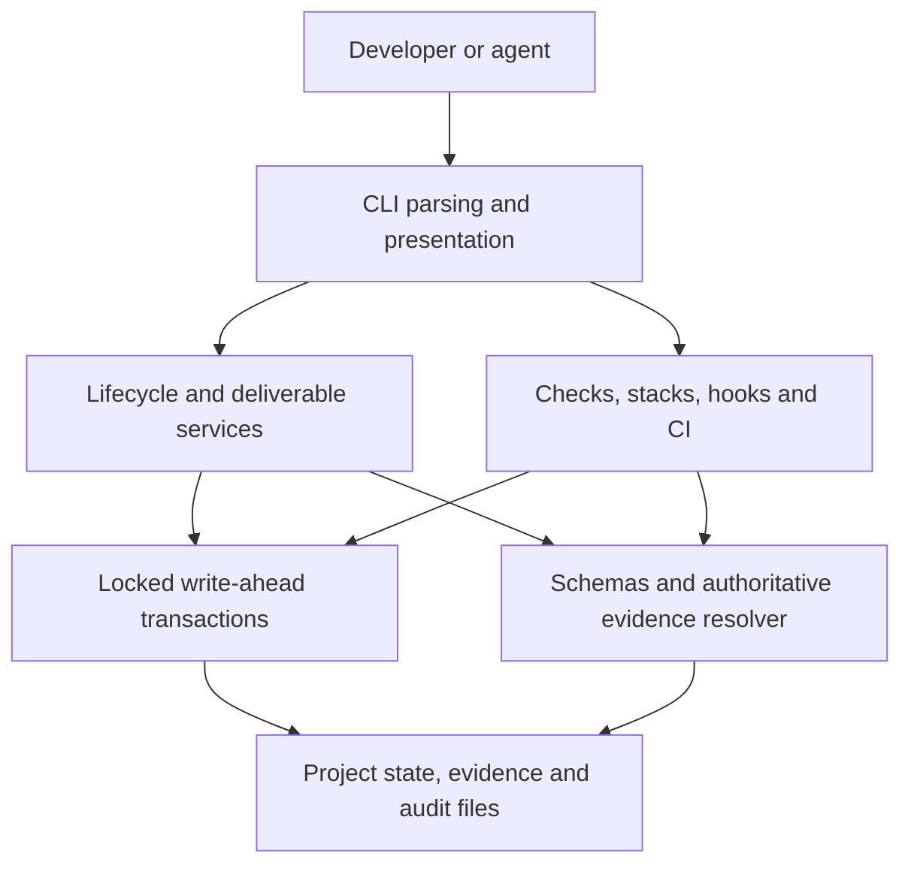

# Release Architecture Specification

Date: 2026-11-17. Stage 2. Milestone M-1.0.0. Author: Codex. Status: proposed for human review. Baseline: `1b4fb79`. Inputs: approved [requirements](../prd/REQUIREMENTS-SPEC.md) and [pilot](../prd/PILOT-SPEC.md). This specification changes no production code or schemas and asserts no human ratification.

## 1. System structure and boundaries

Keep the technology-agnostic core. The command layer parses inputs and formats outputs; it never assigns lifecycle statuses directly. Existing controller/approval/advance services own transition guards. The shared resolver owns evidence eligibility and exception effectiveness. SchemaValidator owns structural contracts. The transaction manager owns locks, compare-before-write, WAL, roll-forward/rollback, and cleanup. StackManager owns versioned resources/dependency composition. Hook engines evaluate isolated Git snapshots. CI adapters validate workflow/evidence provenance, not operator identity.

No new runtime dependency is selected. Use current Node built-ins, Ajv, YAML parser, and existing filesystem/process harnesses. Changes to dependency selection require a separate ADR.

## 2. Command and service contracts

All commands default `--cwd` to process cwd and accept an explicit target. Recorded paths remain relative to target. Validate syntax before filesystem mutation. Actor defaults to an agent label for headless authoring; it must never default to a human identity. Existing command error/exit contracts remain compatible; new commands use requirements section 2 (0 success, 2 invalid invocation, 1 rejected/failed operation).

| Command | Required arguments / optional arguments | Service and success data |
| --- | --- | --- |
| `stage start` | optional `--stage N` | `startStage`: current stage, stage name, start time, transaction ID |
| `stage submit` | optional `--stage N --package PATH` | `submitStage` with strict structural validation: stage status pending_review, exit package, pending human approval, transaction ID |
| `deliverable record` | `--id ID --artifact PATH`; optional `--status in_progress\|completed --name TEXT --description TEXT` | `recordDeliverable`: authored deliverable, unvalidated status, transaction ID |
| `deliverable evidence` | `--id ID --type TYPE --result passed\|failed\|inconclusive --evidence PATH --procedure TEXT`; optional `--summary TEXT --requirement ID --exit-code INT --commit SHA` | `recordEvidence`: appended record, promoted/demoted flags, authoritative resolution, transaction ID |
| `exception propose` | `--id DELIVERABLE_ID --document PATH` | Proposal service: proposed exception, unchanged target waiver authority, transaction ID |
| `exception approve` | `--id EXC_ID`; optional operator/role flags | Human-interactive authorization service: active exception, sealed binding, waived target, transaction ID |
| `exception revoke` | `--id EXC_ID --reason TEXT` | Human-interactive revocation service: revoked exception, target in_progress, recalculated validation, audit event |
| `exception remediation-start` | `--id EXC_ID` | Agent-safe remediation marker service: active exception plus new remediation ID/start time/sequence; target stays waived |
| `exception remediate` | `--id EXC_ID` | Retirement service: all fresh bound mandatory disciplines passed, target verified/passed, exception remediated |

Names are proposed release contracts. Approval of this design authorizes implementation of unfenced commands at the implementation stage; exception behavior remains subject to the separate ratification fence in section 5. No `deliverable invalidate` or legacy direct-waive command is exposed. Legacy programmatic direct waiver must fail closed with a diagnostic directing callers to proposal plus authorization after migration, rather than quietly retaining documentary authorization.

New JSON output is one stdout object: `{success:true, operation, data}` or `{success:false, operation, error:{code,message}, diagnostics?}`. stderr carries non-secret diagnostics. TTY prompts cannot share JSON stdout; human-only JSON mode still requires a TTY and writes prompts to stderr. Known enum/schema errors map to stable domain error codes. Never serialize raw environment, exception secret material, or stack traces by default. API callers receive typed domain failures; executable routing maps them to exit codes.

## 3. State, storage, and compatibility contracts

Keep manifest/state and canonical schemas under existing paths; bundled schemas are synchronized at build and tested for byte parity. Propose schema version 1.1.0 for exception/audit extensions, retain a 1.0.0 reader and explicit human-interactive migration. Do not silently change an existing project's schema version during inspect, validation, install, or stack application. Unsupported versions fail closed. A project may continue compatible non-exception operations under 1.0.0; it cannot use the new exception lifecycle until ratification and migration pass.

| Entity / path | Contract and owner |
| --- | --- |
| Manifest/state | Existing identity, paths, active stage and stage_history remain authoritative; invariant checks prevent pointer mismatch and Stage 7 |
| Exception record | Extend statuses with proposed; retain active/remediated/expired/revoked; add proposal hash/time/actor, authorization reference/time, revocation metadata and remediation ID/time/sequence as optional fields that become mandatory for their relevant new states |
| Evidence record | Preserve existing fields; add optional `remediation_ref` and nonnegative transaction sequence; retirement requires these bindings for new remediation evidence |
| State audit | Add optional append-only `audit_trail` with event ID/action/time/actor/actor_type/exception ID/deliverable ID/reason/prior authorization reference; required on new exception transitions |
| Authorization sidecar | `.playbook/exception-approvals/<EXC_ID>.json`: schema version, project, milestone, stage, target, exact document SHA-256, proposal hash, expiry, operator attestation and authorization time; canonical sorted-key serialization before hashing |
| Ratification records | `docs/adr/RATIFY-20261110-001.md` and committed inventory binding, as defined by the existing amendment; not created by this phase |
| Migration backups | `.playbook/migrations/<unique-id>/`: original manifest/state bytes and SHA-256 inventory, read-only best effort; do not overwrite an existing backup |

Define closed JSON schemas for the new sidecar and audit event in Phase 4, reviewed under this design. ISO times must be parseable UTC strings; exception dates require valid calendar `YYYY-MM-DD`. No ambient actor identity. No unknown extension field is accepted merely because an optional object exists.

Migration is preflight → backup hashes → lock → reread/compare → schema transform → validate → atomic commit with audit. Failure leaves original state or recoverable transaction. Existing active exceptions are never implicitly grandfathered. Without a verified ratified inventory containing the exact exception binding, migration refuses their authority and requires explicit operator reauthorization. This project's inventory is empty; that fact must be checked and bound at the actual ratification commit, not inferred from this document. No automatic irreversible downgrade: rollback reinstalls prior package against preserved original files in an isolated copy; original audit/evidence files remain intact.

## 4. Evidence and gate resolution

Use one resolver from record-evidence, inspect, submit, approve, advance and exception retirement so they cannot disagree on waiver expiry, freshness, profile, or required disciplines. Inputs: validated manifest/state, declarative quality-gates config, artifacts/evidence, current wall time; output: effective status, required/missing/failing disciplines, integrity/freshness diagnostics, and eligibility. Read-only callers must not persist derived status changes.

| Stage / baseline ID | Compiled fallback when no declarative config exists | Additional release verification |
| --- | --- | --- |
| 0 PRD-CORE | Document review; at least one eligible passing evidence record | Explicit goals/users/non-goals/metrics review |
| 1 REQ-SPEC | Document review; at least one eligible passing evidence record | Criteria and negative-flow traceability |
| 2 ARCH-SPEC | Document review; at least one eligible passing evidence record | Architecture/security/contract traceability |
| 3 CODE-IMPL | `automated_test` | Full suite, build/typecheck, active static checks as required by lifecycle |
| 4 INT-TESTS | `automated_test` | Requirements matrix, external installation and pilot evidence |
| 5 SEC-AUDIT | Document review; at least one eligible passing evidence record | Security/dependency audit, packaging, runbook and rollback |
| 6 DEPLOY-LOG | Document review; at least one eligible passing evidence record | Smoke/observation and human closure |

The fallback documents current baseline behavior; it does not waive lifecycle checks. Release implementation must supply explicit blocking checks for those additional release disciplines, rather than asserting the permissive fallback proves them. For configured gates, validate schema and all deliverable references before filtering checks; selected profile is manifest → config default → standard. All applicable blocking checks are mandatory. Advisory/warning checks remain visible but cannot establish mandatory proof. With a config present, a missing stage/mapping for a declared required deliverable must not silently return an empty requirement set: fall back to known baseline requirements or fail `REQUIRED_DISCIPLINES_INDETERMINATE` for custom IDs. Regression-test this existing resolver gap.

Each mandatory check ID must have successful current evidence, not merely another check of the same type. Bind gate/check ID, source inputs/RIF, evidence hash, and effective configuration/profile; recompute before gate approval/advance. Retain current deterministic latest-evidence tie-breaking rules but reject future timestamps outside the existing resolver tolerance. That tolerance is an implementation evidence heuristic, not proof of trusted time. Artifact modifications invalidate eligibility dynamically; no fenced invalidation mutation is needed. Recording authored work clears stale validation while preserving historical evidence.

## 5. Exception security and formal ratification fence

Authoritative proposal: [ADR-20261110-001](ADR-20261110-001-two-phase-exception-lifecycle.md). Status remains Proposed until its prescribed formal ratification. This architecture does not replace or relax it. Stage Gate 2 approval alone is not the amendment's special ratification.

Local exception flow: proposed gives no waiver → actual interactive operator authorizes exact proposal → active, while unexpired → revoke or fresh remediation retires authority. Unresolved proposals block submission. Calendar expiry is exclusive next-day midnight UTC; invalid dates fail closed. Remediation-start records a unique ID and increasing sequence; all mandatory remediation evidence must reference that ID and have a strictly later sequence/time than initiation and authorization. Old evidence cannot retire a waiver. Revocation clears exception_ref, returns target in_progress, derives validation from evidence (never blindly hardcodes failed), preserves linkage in audit. Expiry is derived immediately by every eligibility reader without needing a daemon. Revocation is human-interactive unless explicit delegation is formally specified in a future amendment; no delegation inferred here.

The amendment requires Level A for isolated local use and Level B for distributed/team/remote-CI use. No PKI or external identity implementation is added to this release. Therefore CI/team waiver evaluation must fail closed when any exception authority is required, and may not convert a local Level A sidecar into remotely trusted authority. Normal CI with all mandatory checks actually satisfied and no waiver reliance remains available. Report this limitation prominently; if remote waiver support is desired, reopen requirements through an RFC rather than expanding scope silently.

Phase 4 prerequisite sequence:

1. After Gate 2 approval, implement and test only a ratification bootstrap utility that performs the existing prescribed interaction; it must not enable new lifecycle behavior or mutate project schemas. This is a prerequisite tool, not an implicit policy approval.
2. Prepare and commit the sorted grandfathered-inventory array and exact amendment specifications; present commit C, tree T and RFC 8785 JCS SHA-256 inventory digest to the operator. For an empty string array, JSON `[]` is canonical. Reject non-string, duplicate, or unsorted inventory; no incomplete general-purpose JCS implementation.
3. Actual operator, in a TTY, declares Lead Architect role and types `CONFIRM RATIFICATION AMEND-20261110-001`. Utility records exact forward-binding documentary ratification; agent cannot perform this interaction. Verify commit/tree/inventory existence and binding on use. No Level B assurance claimed.
4. Only after valid Level A ratification may the affected local schema/controller changes proceed. No schema/lifecycle code is activated beforehand. Missing ratification stops the affected work; other already-authorized implementation may proceed only within its own boundaries.

The utility's role is proposed by [release closure ADR](ADR-20261117-001-release-closure.md). ADR status and governing policy documents can be marked ratified only with a reference to the actual resulting record. This phase adds no forged ratifier, signature, timestamp, or approved enum.

## 6. Package resources and downstream adoption

Build copies versioned stack resources, schemas and CI templates into published `dist` assets. Package `files` explicitly includes those runtime assets and command entrypoint. Runtime lookup uses module-relative installed paths via `import.meta.url`, never ancestor guesses back into this checkout. Keep explicit stack-directory overrides validated and diagnostic, not automatic untrusted fallback. CI source preparation must regenerate archive only from the reviewed source revision; record archive SHA-256 independently of later evidence commits.

Downstream keeps only its manifest/state/artifacts and a version-pinned CLI installation. Onboarding points to canonical versioned playbook guidance and documents availability requirements; no entire playbook copy is injected into application source. Pack/install tests move outside checkout and verify stack composition, commands and resource errors. Pilot path collision is a hard stop. Cleanup never removes an unverified computed path.

## 7. Security boundaries and verification design

| Boundary / threat | Control | Verification |
| --- | --- | --- |
| Agent versus operator | TTY guard, exact phrase, known-agent rejection, declared role, truthful attestation caveat | Guard tests plus genuine operator pilot steps |
| Repository content versus filesystem | Realpath containment, regular-file inspection, descriptor hash/stat checks, no traversal | Traversal/symlink/race tests |
| Concurrent writers | Shared exclusive lock and compare-before-write WAL for state, sidecars, audit | Concurrent stale-writer and prepare/commit/cleanup fault injection |
| Check subprocesses | Existing argv execution, environment allowlist, bounded output, secret masking, process-tree timeout | Synthetic secret, timeout, descendant termination, worker-restriction tests |
| Git snapshots versus working tree | Staged blob and pushed object isolation; no staging/reset/stash by validator | Partial-stage/dirty-tree/index-mutation tests |
| CI provenance versus claims | Revision-bound trusted workflow evidence; reject fabricated result and unsupported waiver assurance | Adapter tests and real workflow run |
| Local evidence versus independent trust | Hashes detect changed bytes relative to recorded references; local writer can replace both | Tamper tests and explicit limitations, no authentication claim |

Reference Windows suite/pilot, other OS smoke matrix, runtime majors, 100-deliverable performance fixture, 20-call observation window and rollback follow approved NFRs exactly. Platform/network restrictions remain blockers for required results, not reasons to skip assertions. Build fault tests run in disposable fixtures and never simulate real project human approval.

## 8. Requirements-to-design traceability

| Requirements | Design component / verification allocation |
| --- | --- |
| REQ-001–002 | Existing scaffold, SchemaValidator, diagnostics; init/inspect/validate CLI tests |
| REQ-003–006 | Command adapters, stage/deliverable controllers, strict AST, shared resolver, WAL |
| REQ-007–008 | Existing guarded approval and lifecycle services; approval-binding regression and actual pilot approval |
| REQ-009–011 | Ratification fence, versioned exception model, local proposal/authorization/revoke/remediation services; CI waiver rejection |
| REQ-012–014 | Existing process harness, quality-gate runner/verifier/RIF and linter engine; per-check resolution closure |
| REQ-015–016 | Existing snapshot hooks and CI adapters; revision provenance, real remote run with no waived checks |
| REQ-017–019 | Versioned installed assets, StackManager, onboarding, archive tests and documentation checklist |
| REQ-020–021 | Isolated pilot and transaction fault/concurrency suites |
| NFR-001–009 | Threat controls, reproducible matrix, command performance harness, rollback, operational smoke/observation |
| NEG-001–009 | Input/schema guards, stale bindings, failure evidence, TTY rejection, waiver safety, WAL, collisions, explicit capability errors, masking |
| P-001–008 | Pilot application requirements remain unchanged; implementation follows its own approved architecture/gates |

## 9. Implementation sequence and review disposition

Phase 4: ratification bootstrap prerequisite, actual operator ratification, approved migrations/controller safety, targeted behavior tests, then full suite. Phase 5: expose approved command contracts, formatters, help and onboarding; Stage 3 gate only after both batches. Phase 6: package/install/snapshot/CI/pilot integration. Phases 7–8: hardening and final operational checks.

No new lifecycle gate approval, ADR ratification, runtime implementation, schema change, or release passing result is asserted by this document. Human Gate 2 review must explicitly consider the local-only waiver boundary and the ratification prerequisite before implementation. Existing policy remains authoritative until that prerequisite is met.
