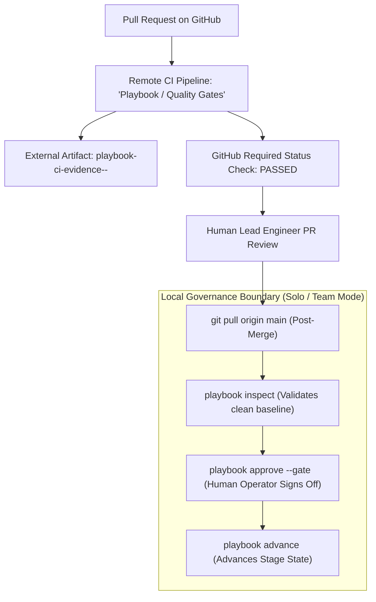

# Remote CI Evidence Model & Artifact Integrity

> **Specification Version**: 1.0.0  
> **Milestone**: Task 006C.3 — Remote CI Pipeline Architecture & GitHub Actions Adapter Design  
> **Status**: Approved Evidence Specification  
> **Parent Architecture**: [`docs/architecture/ci-integration/github-actions-design.md`](github-actions-design.md)  
> **Security Model**: [`docs/architecture/ci-integration/ci-security-model.md`](ci-security-model.md)  
> **Authoritative Decision**: [`docs/adr/ADR-20261103-002-remote-ci-evidence-and-enforcement.md`](../../adr/ADR-20261103-002-remote-ci-evidence-and-enforcement.md)

---

## 1. Executive Summary & Design Principles

The CI Evidence Model establishes how quality check results, telemetry, and execution logs produced during remote CI runs are structured, verified, and consumed.

Core Principles:
1. **Run-Scoped Isolation**: Every CI run produces a uniquely identifiable, isolated evidence package. Concurrent runs, PR updates, and workflow retries never collide or overwrite one another.
2. **Zero In-Repo State Mutation**: CI never mutates or commits to `.playbook/state.json`. CI writes run-scoped external artifacts.
3. **Cryptographic Input-to-Output Binding**: Execution outputs are bound to the exact Git commit tree via Reproducible Input Fingerprints (RIF).
4. **Intellectual Honesty on Immutability**: Cloud CI artifacts are subject to retention windows and administrative deletion; they are not tamper-proof ledgers. Long-term auditability is rooted in Git-committed hashes, not cloud runner storage.

---

## 2. CI Run Evidence Schema Proposal

The proposed JSON schema for the primary CI execution evidence report (`gate-report.json` encapsulated in `playbook-ci-evidence-<run_id>-<attempt>`):

```json
{
  "$schema": "https://ai-engineering-playbook.org/schemas/ci-run-evidence.schema.json",
  "schema_version": "1.0.0",
  "run_identity": {
    "provider": "github_actions",
    "repository": "owner/repo",
    "workflow_name": "Playbook Quality Gates & Verification",
    "run_id": "1122334455",
    "run_attempt": 1,
    "run_url": "https://github.com/owner/repo/actions/runs/1122334455/job/99887766",
    "trigger_event": "pull_request",
    "pull_request_number": 42,
    "head_branch": "feature/user-auth",
    "base_branch": "main",
    "head_commit_sha": "a1b2c3d4e5f67890123456789abcdef012345678",
    "head_tree_sha": "f0e1d2c3b4a567890123456789abcdef01234567"
  },
  "runtime_environment": {
    "os_platform": "linux",
    "os_release": "ubuntu-22.04",
    "node_version": "v20.18.0",
    "cli_version": "1.0.0",
    "runner_arch": "x64"
  },
  "governance_evaluation": {
    "stage": 1,
    "stage_name": "Requirements & Specification",
    "profile": "standard",
    "working_tree_clean": true,
    "overall_outcome": "passed",
    "started_at": "2026-11-03T16:00:00.000Z",
    "completed_at": "2026-11-03T16:01:45.000Z",
    "duration_ms": 105000
  },
  "summary": {
    "total": 4,
    "passed": 4,
    "failed": 0,
    "warning": 0,
    "skipped": 0
  },
  "checks": [
    {
      "check_id": "chk-req-spec-lint",
      "name": "Specification Markdown Linter",
      "type": "static_analysis",
      "deliverable_id": "DEL-REQ-001",
      "severity": "blocking",
      "command": "npm run lint:docs",
      "args": [],
      "exit_code": 0,
      "outcome": "passed",
      "duration_ms": 3200,
      "rif": "sha256:7f83b1657ff1fc53b92dc18148a1d65dfc2d4b1fa3d677284addd200126d9069",
      "tool_version": "markdownlint-cli@0.41.0",
      "canonical_log_path": ".playbook/logs/chk-req-spec-lint.log",
      "canonical_log_sha256": "sha256:e3b0c44298fc1c149afbf4c8996fb92427ae41e4649b934ca495991b7852b855"
    }
  ],
  "artifacts": [
    {
      "name": "playbook-ci-evidence-1122334455-1",
      "path": "gate-report.json",
      "sha256": "sha256:4a35edd8b48...",
      "retention_days": 30
    }
  ]
}
```

---

## 3. Run Identity & Disambiguation

To prevent races, collisions, and out-of-order completion:

```
┌────────────────────────────────────────────────────────────────────────┐
│ Canonical Run Identifier Formulation                                   │
├────────────────────────────────────────────────────────────────────────┤
│                                                                        │
│ Artifact Name: playbook-ci-evidence-<run_id>-<run_attempt>             │
│ Example:       playbook-ci-evidence-1122334455-1                       │
│                                                                        │
│ Components:                                                            │
│ • run_id:      Unique GitHub Actions workflow run identifier           │
│ • run_attempt: Sequential attempt index (1, 2, 3...)                  │
│                                                                        │
└────────────────────────────────────────────────────────────────────────┘
```

### 3.1 Disambiguation Guarantees:
1. **Concurrent Runs on Same Branch**:
   - Each push triggers a distinct workflow `run_id`.
   - Concurrency settings (`concurrency.cancel-in-progress: true` on PRs) cancel superseded runs, but any run that finishes uploads to its own unique `run_id` artifact.
2. **Multiple Commits in One PR**:
   - Every commit pushed to the PR branch initializes a new workflow execution with unique commit SHA and tree SHA.
3. **Workflow Retries**:
   - GitHub Actions allows users to "Re-run failed jobs".
   - GitHub increments `${{ github.run_attempt }}`.
   - The artifact is uploaded as `playbook-ci-evidence-${{ github.run_id }}-2`, preventing overwriting or colliding with attempt 1.
4. **Out-of-Order Completion**:
   - Because each artifact name is globally unique per attempt, out-of-order completion cannot corrupt or overwrite sibling evidence.

---

## 4. Stale Evidence & Expiration Invariants

### 4.1 What Constitutes Stale Evidence?
1. **Superseded Commit**:
   - An evidence report where `head_commit_sha != PR_HEAD_SHA` is **STALE**.
   - If a developer pushes a new commit while CI is evaluating an older commit, the older run's evidence is automatically marked stale upon PR inspection.
2. **Reproducible Input Fingerprint (RIF) Drift**:
   - An evidence log whose RIF does not match the current commit tree is **STALE**.
   - If code was modified without regenerating evidence logs, `playbook gate verify` rejects the run.
3. **Retention Purging**:
   - GitHub Actions automatically purges artifacts after the retention window (default 30 days).
   - Once purged, the ephemeral CI artifact is no longer retrievable. However, the committed logs in `.playbook/logs/` and the SHA-256 hashes recorded in Git history remain permanently accessible.

---

## 5. Trust Boundaries & Immutability Realities

### 5.1 The Artifact Trust Fallacy
> [!WARNING]
> **A matching SHA-256 hash does NOT prove evidence authenticity.**
> - A malicious developer can generate passing logs locally, commit them to `.playbook/logs/`, compute their valid SHA-256 hashes, and record them in `state.json`.
> - A hash match proves only that the file content has not changed since the hash was recorded; it does **not** prove that the tests were actually run or that the test runner was genuine.

### 5.2 The Authoritative Remote Boundary
Authenticity is established **not** by hashes alone, but by **who executed the validation and where**:
1. **Local Developer Workspace (Untrusted)**:
   - Hashes verify integrity against accidental disk corruption or editing.
   - Cannot prove that tests actually ran cleanly in a sandbox.
2. **Remote CI Environment (Authoritative Trust Anchor)**:
   - Runs in a clean virtual machine hosted by the provider.
   - Re-executes the quality gates (`playbook gate run --headless`).
   - GitHub Branch Protection rules require the **GitHub Status Check** reported directly by the runner (`Playbook / Quality Gates`) to be green.
   - PR authors cannot spoof GitHub Status Checks because status checks can only be emitted by workflows executing within that repository under GitHub's orchestration.

---

## 6. Consumption by Human-Controlled Stage Gates

How does a human lead engineer review and consume CI evidence before approving a stage gate?



### Protocol for Consuming Remote Evidence:
1. **Merge Gate**: Branch protection ensures unverified PRs cannot enter `main`.
2. **Local Inspection**: The human engineer pulls `main` and runs `playbook inspect`.
3. **Formal Approval**: The human operator signs off on the stage gate locally via interactive terminal (`playbook approve --gate <N>`) or team PR reference.
4. **Clean Separation**: CI enforces the PR merge barrier; the human engineer enforces stage gate advancement. Zero state contamination occurs between the two.
