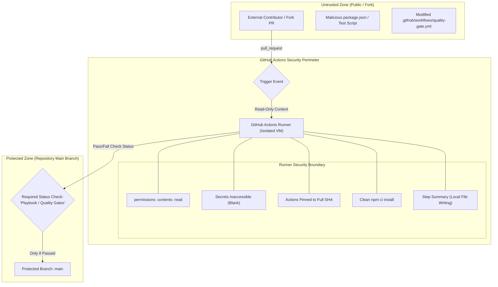

# Remote CI Security Architecture & Threat Model

> **Specification Version**: 1.0.0  
> **Milestone**: Task 006C.3 — Remote CI Pipeline Architecture & GitHub Actions Adapter Design  
> **Status**: Approved Security Specification  
> **Parent Architecture**: [`docs/architecture/ci-integration/github-actions-design.md`](github-actions-design.md)  
> **Authoritative Decision**: [`docs/adr/ADR-20261103-002-remote-ci-evidence-and-enforcement.md`](../../adr/ADR-20261103-002-remote-ci-evidence-and-enforcement.md)

---

## 1. Executive Summary & Security Philosophy

Remote CI executes in multi-tenant cloud runners and processes untrusted input from external contributors and autonomous AI agents. The security architecture must ensure:
1. **Untrusted Code Cannot Compromise Privileged Assets**: Pull requests submitted from external forks must never access repository secrets, cloud credentials, or write tokens.
2. **Least Privilege by Default**: Workflows must operate with the minimum permissions required to perform validation (strictly read-only).
3. **Execution Isolation**: Check commands execute in non-interactive, sandboxed environments where untrusted scripts cannot persist state, poison caches, or spoof validation evidence.

---

## 2. Threat Model & STRIDE Analysis



| STRIDE Category | Threat Scenario | Attack Vector | Severity | Architectural Mitigation |
| :--- | :--- | :--- | :--- | :--- |
| **Spoofing** | Attacker spoofs Playbook verification evidence. | Commit forged `.playbook/state.json` or `.playbook/logs/`. | **High** | Remote CI re-runs checks in Tier 3 headless mode and verifies input fingerprint (RIF) against actual commit tree bytes. |
| **Tampering** | PR author alters workflow file to bypass checks. | PR modifies `.github/workflows/quality-gate.yml` to remove test steps or inject `exit 0`. | **Critical** | Branch protection requires the exact status check name `Playbook / Quality Gates`. Code owners rule protects `.github/workflows/`. |
| **Repudiation** | Operator denies code modification in PR. | Attacker asserts evidence was generated from uncommitted edits. | **Medium** | RIF ties test output cryptographically to tree hash `<commit_oid>^{tree}`. Staged index validation prevents working-tree spoofing. |
| **Information Disclosure** | Secret theft from fork pull requests. | Untrusted PR scripts attempt to read `secrets.DEPLOY_KEY` or `GITHUB_TOKEN`. | **Critical** | Strict use of `on: pull_request` trigger; zero secrets passed; read-only `GITHUB_TOKEN`; absolute prohibition of `pull_request_target`. |
| **Denial of Service** | Infinite loop or CPU exhaustion in test scripts. | Malicious PR introduces blocking child process or unbounded memory allocation. | **High** | Job timeout enforced (`timeout-minutes: 20`); process runner tree-kill on timeout; step-level timeouts. |
| **Elevation of Privilege** | Supply-chain compromise of third-party Action. | Attacker compromises a mutable tag on a third-party GitHub Action (e.g. `actions/checkout@v4`). | **Critical** | Action SHA Pinning: Every third-party action is pinned to its full 40-character immutable commit SHA. |

---

## 3. Deep-Dive Security Controls

### 3.1 Untrusted Fork PR Security & The `pull_request_target` Trap

#### The Vulnerability:
GitHub Actions offers two primary triggers for pull requests:
- `on: pull_request`: Runs in the security context of the **merge commit** (or PR branch). It runs with a read-only `GITHUB_TOKEN` and has **zero access to repository secrets**.
- `on: pull_request_target`: Runs in the security context of the **base repository**. It has access to repository secrets and write tokens. If a workflow using `pull_request_target` checks out the PR branch (`refs/pull/${{ github.event.number }}/head`), untrusted PR code can execute with full access to the base repository's secrets!

#### The Playbook Invariant:
1. **Absolute Prohibition**: The Playbook generator **never** generates workflows using `pull_request_target`.
2. **Explicit Enforcement**: `playbook ci validate` flags `pull_request_target` as a critical security error:
   `[CI_SECURITY_VIOLATION] pull_request_target trigger detected. This allows untrusted PR code to exfiltrate repository secrets.`
3. **Safe Fork Evaluation**: All fork pull requests execute under standard `on: pull_request` with strictly `contents: read` permissions.

---

### 3.2 Token Permissions & Least Privilege

The workflow explicitly declares top-level permissions:

```yaml
permissions:
  contents: read
```

#### Why Other Permissions Are Prohibited:
- `pull-requests: write`: Prohibited. Writing PR comments or reviews creates noise and allows malicious dependencies to modify PR descriptions or post phishing links.
- `issues: write`: Prohibited.
- `actions: write` / `packages: write`: Prohibited.
- `id-token: write`: Prohibited on quality-gate workflows. OIDC tokens connecting to cloud providers must only exist on deployment workflows restricted to the protected `main` branch.

#### Zero API Scope for Step Summaries:
GitHub Actions allows writing Markdown step summaries by appending directly to the local runner file `$GITHUB_STEP_SUMMARY`. This requires **zero GitHub API tokens** or write scopes, ensuring rich reporting without security compromise.

---

### 3.3 Third-Party Action Immutable SHA Pinning

To prevent supply-chain attacks from compromised mutable tags (e.g. `@v4`), all actions in the generated workflow are pinned to immutable 40-character commit SHAs with inline comments documenting the semantic version:

```yaml
- name: Checkout Code
  uses: actions/checkout@11bd71901bbe5b1630ceea73d27597364c9af683 # v4.2.2

- name: Setup Node.js Runtime
  uses: actions/setup-node@39370e3970a6d050c480ffad4ff0ed4d3fdee5af # v4.1.0

- name: Upload CI Execution Evidence
  uses: actions/upload-artifact@b4b15b8c7c6ac21ea08fcf65892d2ee8f75cf882 # v4.4.3
```

---

### 3.4 Secret Exfiltration Defense & Sanitization

Even in internal repositories where secrets are present during push events, quality checks must not leak credentials into logs:
1. **Stream Scrubbing**: The Quality Gate execution harness (`runner.ts`) applies real-time regex stream scrubbing to child process stdout/stderr, redacting PATs, AWS keys, Bearer tokens, and custom `sensitive_patterns`.
2. **Runner Log Masking**: GitHub Actions runner native `::add-mask::<secret>` suppresses known secrets from job console logs.
3. **Restricted Environment Variables**: The Playbook runner strictly filters environment variables using `env_allowlist`. Arbitrary runner environment variables are never propagated into check subprocesses.

---

### 3.5 Cache Poisoning Mitigation

When dependency caching (`npm`, `yarn`, `pip`) is enabled:
- GitHub Actions scopes caches by branch. Fork PRs have read-only access to base branch caches and cannot modify base branch cache entries.
- To prevent poisoned dependencies from entering CI, `npm ci` (clean install from `package-lock.json`) is mandated over `npm install`.

---

## 4. Administrative Security Responsibilities

Certain security boundaries cannot be enforced by workflow YAML alone and must be enabled by repository administrators:

1. **GitHub Branch Protection Rules**:
   - Require a pull request before merging.
   - Require status checks to pass before merging: specify `Playbook / Quality Gates`.
   - Require branches to be up to date before merging.
   - Do not allow bypassing the above settings.
2. **GitHub Fork PR Execution Policy**:
   - In GitHub Settings > Actions > General > **Fork pull request workflows**:
   - Set to: **"Require approval for first-time contributors"** or **"Require approval for all outside contributors"**.
3. **CODEOWNERS Protection**:
   - Add `.github/workflows/` to `.github/CODEOWNERS` to ensure PR authors cannot modify CI workflows without security team approval.
