# Remote CI Workflow Lifecycle & Required-Check Enforcement

> **Specification Version**: 1.0.0  
> **Milestone**: Task 006C.3 — Remote CI Pipeline Architecture & GitHub Actions Adapter Design  
> **Status**: Approved Workflow Lifecycle Specification  
> **Parent Architecture**: [`docs/architecture/ci-integration/github-actions-design.md`](github-actions-design.md)  
> **Evidence Model**: [`docs/architecture/ci-integration/ci-evidence-model.md`](ci-evidence-model.md)  
> **Authoritative Decision**: [`docs/adr/ADR-20261103-002-remote-ci-evidence-and-enforcement.md`](../../adr/ADR-20261103-002-remote-ci-evidence-and-enforcement.md)

---

## 1. Executive Summary

This document specifies the end-to-end lifecycle of the Playbook remote CI workflow, from trigger events through execution phases to GitHub Status Check resolution and failure recovery.

It formalizes:
1. **Trigger Semantics**: How `pull_request`, `push`, and `workflow_dispatch` events initiate verification.
2. **Execution Phases**: The deterministic 7-step quality pipeline.
3. **Required Check Stability**: The immutable naming convention required for GitHub branch protection.
4. **Concurrency & Failure Recovery**: How cancelled runs, runner termination, and retries are resolved safely.

---

## 2. CI Pipeline Lifecycle Flowchart

```mermaid
flowchart TD
    Start["Git Event: PR Opened / Synchronized / Push to Main"] --> Concurrency["Evaluate Concurrency Group:<br>${{ github.workflow }}-${{ pr_num || ref }}"]
    
    Concurrency --> CancelCheck{"Is existing in-flight run active on PR?"}
    CancelCheck -- Yes --> CancelPrior["Cancel In-Flight Prior Run (cancel-in-progress: true)"]
    CancelCheck -- No --> Provision["Provision Ubuntu Runner VM"]
    CancelPrior --> Provision
    
    subgraph "Phase 1: Environment & Dependency Initialization"
        Provision --> Checkout["1. actions/checkout@v4 (fetch-depth: 0)"]
        Checkout --> SetupNode["2. actions/setup-node@v4 (node-version: 20, cache: npm)"]
        SetupNode --> InstallDeps["3. npm ci (Strict Clean Dependency Tree)"]
    end
    
    subgraph "Phase 2: Governance & State Verification"
        InstallDeps --> ValSchemas["4. playbook validate<br>(Manifest & State Schema Conformance)"]
        ValSchemas --> InspReadiness["5. playbook inspect --json<br>(Check Blockers & Active Stage)"]
        InspReadiness --> VerifyRif["6. playbook gate verify --json<br>(Assert RIF Freshness: Code Matches Evidence)"]
    end
    
    subgraph "Phase 3: Quality Gate Execution (Tier 3 Headless)"
        VerifyRif --> ExecGates["7. playbook gate run --headless --json > gate-report.json<br>(Clean Repo Asserted, Topological DAG Checks)"]
        ExecGates --> VerifyBytes["8. playbook verify-evidence --json<br>(Cryptographic SHA-256 Hash Matching)"]
    end
    
    subgraph "Phase 4: Telemetry, Reporting & Artifact Archival"
        VerifyBytes --> StepSummary["9. Publish GitHub Step Summary (Markdown)"]
        StepSummary --> UploadArtifact["10. actions/upload-artifact@v4<br>(playbook-ci-evidence-<run_id>-<attempt>)"]
    end
    
    UploadArtifact --> FinalStatus{"Did all checks pass?<br>(Exit Code == 0)"}
    FinalStatus -- Yes --> EmitSuccess["Status Check: 'Playbook / Quality Gates' -> SUCCESS<br>(PR Merge Barrier Cleared)"]
    FinalStatus -- No --> EmitFailure["Status Check: 'Playbook / Quality Gates' -> FAILURE<br>(PR Merge Blocked)"]
```



---

## 3. Workflow Triggers & Concurrency Policies

### 3.1 Trigger Configuration
The workflow responds to three explicit trigger events:
```yaml
on:
  pull_request:
    branches: [main, master, release/*]
    types: [opened, synchronize, reopened]
  push:
    branches: [main, master, release/*]
  workflow_dispatch:
    inputs:
      stage:
        description: "Target lifecycle stage to evaluate (leave empty for project state default)"
        required: false
        type: string
```

### 3.2 Event Behaviors:
- **`pull_request`**: Primary enforcement barrier. Evaluates the proposed changes before merging. Runs with read-only permissions and zero secrets.
- **`push` (on protected branches)**: Post-merge verification. Executes when a PR is merged into `main` or `release/*`. Ensures that the merged state on the primary branch is healthy and generates the baseline evidence snapshot.
- **`workflow_dispatch`**: Manual operator invocation. Permits re-running quality gates against specific commits or stages for diagnostic purposes.

### 3.3 Concurrency & Cancellation Rules
```yaml
concurrency:
  group: ${{ github.workflow }}-${{ github.event.pull_request.number || github.ref }}
  cancel-in-progress: ${{ github.event_name == 'pull_request' }}
```
- **PR Updates**: When a developer pushes a new commit to an active PR branch, `cancel-in-progress: true` cancels any running workflow for that PR. This eliminates redundant compute and prevents stale runs from reporting out-of-order results.
- **Main Branch Pushes**: When commits land on `main`, `cancel-in-progress` evaluates to `false` (`github.event_name == 'push'`). Post-merge runs on `main` are **never cancelled**, ensuring an unbroken, complete audit record in GitHub Actions history.

---

## 4. Required Status Check Specification

### 4.1 Immutable Naming Convention
To ensure that GitHub Branch Protection and Repository Rulesets remain 100% stable:
- **Canonical Status Check Name**: `Playbook / Quality Gates`
- **Specification Rule**: The job name in `.github/workflows/quality-gate.yml` must be exactly:
  ```yaml
  jobs:
    quality-gates:
      name: "Playbook / Quality Gates"
  ```
- **Prohibition of Dynamic Variables**: The job name must **never** include dynamic variables like `${{ matrix.stage }}`, `${{ github.sha }}`, or timestamps in the top-level job name. If a job name changes dynamically, GitHub's Branch Protection rules treat the required check as missing, permanently blocking merges.

### 4.2 Status Check Outcome Mapping

| Workflow Execution Result | GitHub Status Check State | PR Merge Action |
| :--- | :--- | :--- |
| **All Checks Passed (Exit code 0)** | `SUCCESS` (Green checkmark) | Merging permitted (subject to review rules). |
| **Quality Check Failure (Exit code 1)** | `FAILURE` (Red cross) | Merging blocked. Actionable logs in step summary. |
| **Schema Validation Error (Exit code 2)** | `FAILURE` (Red cross) | Merging blocked. Governance schema violation. |
| **Workflow Cancelled (by newer commit)** | `CANCELLED` (Grey circle) | Merging blocked until latest run completes. |
| **Workflow Timed Out (> 20 mins)** | `TIMED_OUT` (Red clock) | Merging blocked. Potential hang/infinite loop. |
| **Runner Infrastructure Crash** | `ERROR` / `STARTUP_FAILURE` | Merging blocked. Requires workflow re-run. |

---

## 5. Failure Recovery & Edge-Case Semantics

### 5.1 Handling Cancelled or Superseded Runs
- If a workflow run is cancelled because a new commit was pushed, its status check becomes `CANCELLED`.
- Branch protection treats `CANCELLED` as non-passing. The PR cannot be merged until the newest commit's workflow completes with `SUCCESS`.
- Cancelled workflows do not overwrite artifacts because artifact names are run-id scoped.

### 5.2 Handling Runner Crashes & Signal Traps
- If a runner VM experiences kernel panic, out-of-memory kill, or host termination:
  - GitHub automatically transitions the check to `FAILED`.
  - The job does not push or leave half-committed state in the repository because CI never writes to Git branches.
  - Recovery action: Click **"Re-run failed jobs"** in GitHub Actions UI.

### 5.3 Handling Remote Git Object Inaccessibility
- When `actions/checkout` runs on PR branches, it fetches `fetch-depth: 0` (full history).
- If the repository is a shallow clone or upstream branches were rebased out of history:
  - `playbook gate verify` clamps the traversal range to the head commit.
  - Logs an advisory warning in `$GITHUB_STEP_SUMMARY`.
  - Quality Gate execution evaluates the complete checked-out tree snapshot regardless of Git history depth.

---

## 6. Local Hook vs. Remote CI Authority Summary

| Dimension | Local Git Hooks (`pre-commit` / `pre-push`) | Remote CI (`Playbook / Quality Gates`) |
| :--- | :--- | :--- |
| **Authority** | Advisory / Protective Productivity Barrier | **Authoritative Legal & Merge Barrier** |
| **Bypassability** | Bypassable via `git commit --no-verify` | **Non-bypassable** (Enforced by GitHub API) |
| **Execution Tier** | Tier 1 (Dirty tree allowed) / Tier 2 (Staged index) | **Tier 3 (Clean, headless, pristine tree)** |
| **State Mutation** | Authors state files & evidence logs | **Read-only; Zero state mutation** |
| **Scope** | Current workspace & staged changes | Complete repository commit snapshot |
| **Execution Speed** | Fast (< 3-5 seconds target) | Comprehensive (Full build, test, linters) |
