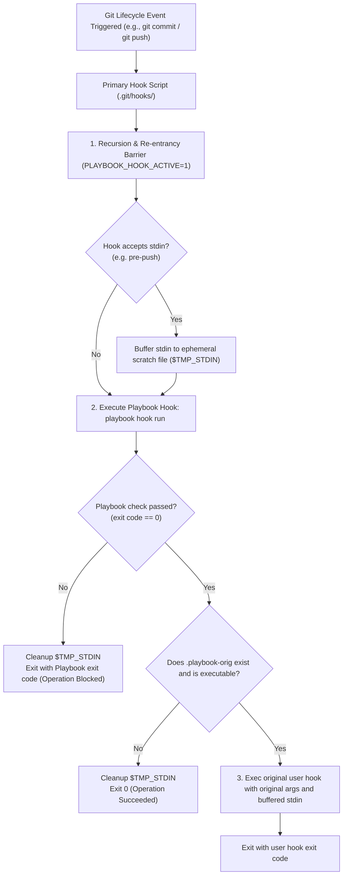
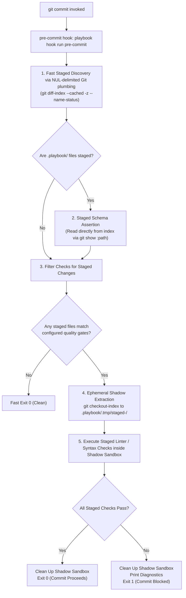
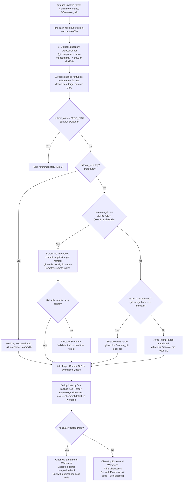

# CI/CD Pipeline Automation & Git Hook Integration: Architectural Specification

> **Specification Version**: 1.0.0  
> **Status**: Accepted Architectural Specification (Task 006B)  
> **Target Scope**: Local Git Hooks, Pre-commit/Pre-push Lifecycle, CI/CD Pipeline Integration, Branch Protection Boundaries  
> **Preceding ADRs**:
> - [`docs/adr/ADR-20261031-001-state-model-refinements.md`](../../adr/ADR-20261031-001-state-model-refinements.md)
> - [`docs/adr/ADR-20261102-002-quality-gate-atomicity-and-concurrency.md`](../../adr/ADR-20261102-002-quality-gate-atomicity-and-concurrency.md)
> - [`docs/adr/ADR-20261103-001-git-hooks-and-ci-enforcement.md`](../../adr/ADR-20261103-001-git-hooks-and-ci-enforcement.md)  
> **Preceding Specifications**:
> - [`core/engineering-constitution.md`](../../../core/engineering-constitution.md)
> - [`governance/ENGINEERING_CONTROLLER.md`](../../../governance/ENGINEERING_CONTROLLER.md)
> - [`governance/stage-gate-rules.md`](../../../governance/stage-gate-rules.md)
> - [`governance/state-machine.md`](../../../governance/state-machine.md)
> - [`docs/architecture/quality-gates/design.md`](../quality-gates/design.md)
> - [`docs/architecture/quality-gates/gap-analysis.md`](../quality-gates/gap-analysis.md)
> - [`docs/architecture/quality-gates/implementation-audit.md`](../quality-gates/implementation-audit.md)

---

## 1. Architectural Vision & Operational Triad

The **Playbook Enforcement Architecture** operates as a three-tier defense system that balances developer velocity with absolute repository integrity:

```
┌────────────────────────────────────────────────────────────────────────────────────────┐
│ The Three-Tier Enforcement Triad                                                       │
├────────────────────────────────────────────────────────────────────────────────────────┤
│                                                                                        │
│   TIER 1: LOCAL DEVELOPER WORKSPACE (Advisory & Iterative)                             │
│   ┌──────────────────────────────────────────────────────────────────────────────┐     │
│   │ • Manual CLI execution: playbook gate run, playbook inspect                  │     │
│   │ • Working-tree policy: DIRTY ALLOWED (Red-green refactoring, WIP state)      │     │
│   │ • Primary purpose: Rapid feedback loop during active implementation          │     │
│   └──────────────────────────────────────────────────────────────────────────────┘     │
│                                           │                                            │
│                                           ▼ git commit & git push                      │
│   TIER 2: NATIVE GIT LIFECYCLE HOOKS (Protective Gatekeeper)                           │
│   ┌──────────────────────────────────────────────────────────────────────────────┐     │
│   │ • Pre-commit: Staged index validation, schema sanity, fast linters           │     │
│   │ • Pre-push: Pushed ref-range evaluation, stage-gate readiness check          │     │
│   │ • Trust Boundary: ADVISORY / BYPASSABLE via --no-verify (Local convenience)   │     │
│   │ • Primary purpose: Prevent broken commits/pushes before leaving workstation  │     │
│   └──────────────────────────────────────────────────────────────────────────────┘     │
│                                           │                                            │
│                                           ▼ remote network push                        │
│   TIER 3: REMOTE CI/CD PIPELINE (Authoritative Barrier)                                │
│   ┌──────────────────────────────────────────────────────────────────────────────┐     │
│   │ • Clean checkout: 100% CLEAN WORKING TREE MANDATED                           │     │
│   │ • Cryptographic verification: playbook verify-evidence, playbook gate verify │     │
│   │ • Headless check execution: playbook gate run --headless                     │     │
│   │ • Trust Boundary: AUTHORITATIVE & NON-BYPASSABLE (Required PR status checks) │     │
│   │ • Primary purpose: Hard merge barrier protecting main and release branches   │     │
│   └──────────────────────────────────────────────────────────────────────────────┘     │
│                                                                                        │
└────────────────────────────────────────────────────────────────────────────────────────┘
```

### 1.1 Non-Negotiable Separation of Powers
To preserve human authority ([Principle 1](../../../core/engineering-constitution.md)) and prevent governance corruption:
- **Local Git Hooks** possess authority to:
  - Block local commit or push commands if staged content or pushed refs fail quality checks.
  - Inform the developer of exact check failures and remediation steps.
- **Remote CI Pipelines** possess authority to:
  - Assert that committed evidence matches disk files and reproducible fingerprints (RIF).
  - Execute quality checks in an isolated, clean runner environment.
  - Report status check outcomes (`PASS` / `FAIL`) to GitHub/GitLab to block pull request merges.
  - Generate run-scoped, hash-verifiable CI execution evidence.
- **Neither Hooks NOR CI are EVER Permitted to**:
  - Automatically mutate or commit to `.playbook/state.json`.
  - Self-approve lifecycle stage gates (`stage_status: "approved"`).
  - Advance lifecycle stages (`ADVANCE_STAGE` or `CLOSE_LIFECYCLE`).
  - Waive failing checks without an authorized human Exception Record (`EXC-*`).
  - Silently modify or re-stage user files in the working directory or index.

---

## 2. Native Git Hook Architecture (`playbook hook`)

### 2.1 Design Philosophy: Zero Third-Party Dependencies
The Playbook CLI strictly avoids wrapping or requiring third-party hook managers (e.g. Husky, Lefthook, simple-git-hooks).
- **Constitutional Alignment ([Principle 4](../../../core/engineering-constitution.md))**: Every external dependency is a liability. Native Git hooks require only standard Git and a POSIX-compliant shell (`/bin/sh`).
- **Cross-Ecosystem Portability**: Non-Node downstream projects (Python, Go, Rust) can adopt the Playbook without installing `npm` or `node_modules` into their root directory if using a standalone or global CLI.
- **Portability Contract**: Hooks are written in standard POSIX shell script (`#!/bin/sh`) executed by Git's built-in shell:
  - On POSIX (macOS/Linux): executed via `/bin/sh`.
  - On Windows: executed via Git for Windows' bundled `sh.exe` (`C:\Program Files\Git\bin\sh.exe`).

### 2.2 CLI Command Interface

```bash
# Install managed Git hooks into the current repository (.git/hooks or core.hooksPath)
playbook hook install [options]

# Safely remove managed Git hooks without damaging user hooks
playbook hook uninstall [options]

# Inspect installation status, target directory, and hook integrity
playbook hook status [options]
```

#### Flags & Options
| Flag | Description | Default |
| :--- | :--- | :--- |
| `--hooks-dir <path>` | Explicit override for target hooks directory. | Resolved via Git |
| `--dry-run` | Print proposed hook modifications without writing to disk. | `false` |
| `--force` | Overwrite or replace unmanaged hooks if conflicts occur. | `false` |
| `--json` | Output machine-readable JSON status summary. | `false` |
| `--cwd <path>` | Target project directory path. | `process.cwd()` |

### 2.3 Physical Directory & Worktree Resolution
To guarantee correct behavior in standard repositories, linked worktrees, and custom Git configurations, the target directory is resolved dynamically:

```typescript
// Architectural resolution algorithm
function resolveGitHooksDir(cwd: string): string {
  try {
    // Queries Git for authoritative hooks directory
    const stdout = execSync("git rev-parse --git-path hooks", {
      cwd,
      encoding: "utf-8",
      stdio: ["ignore", "pipe", "ignore"],
    }).trim();
    return path.resolve(cwd, stdout);
  } catch (err) {
    throw new HookError("NOT_A_GIT_REPOSITORY", "Target directory is not inside a Git repository.");
  }
}
```

#### Worktree & Configuration Realities:
1. **Standard Git Repository**: Resolves to `.git/hooks`.
2. **Linked Git Worktrees (`git worktree add`)**: `.git` is a file pointing to the main gitdir. `git rev-parse --git-path hooks` resolves to the shared hooks directory of the parent repository (`/path/to/parent/.git/hooks`), ensuring hooks apply across all worktrees.
3. **Custom `core.hooksPath`**: If the user or team configured `git config core.hooksPath .githooks`, `git rev-parse --git-path hooks` resolves to `.githooks`, respecting repository configuration.

### 2.4 Managed Execution Wrapper Architecture & Safe Coexistence

#### The Coexistence & Early-Exit Challenge
In production repositories, existing hooks often contain conditional branches or early terminations (e.g., `exit 0` when certain flags or bot identities are detected, or `exit 1` on linter failure).
- **The Append-Only Vulnerability**: Simply appending a managed block to an existing script means any prior `exit` terminates the shell before the Playbook block is ever reached, silently disabling governance.
- **The Prepend-Only Vulnerability**: Prepending a managed block directly inside the existing script risks variable contamination, unhandled signal overrides, and syntax incompatibility with complex existing shell scripts.
- **The Standard Input Problem**: Git hooks such as `pre-push` deliver target ref specifications over standard input (`stdin`). If the Playbook check consumes `stdin`, a subsequent or wrapped hook will receive an empty EOF, breaking existing hooks.

#### The Delegation Wrapper Pattern (`<hook>.playbook-orig`)
To guarantee execution without altering user hook semantics, `playbook hook install` adopts a **Delegation Wrapper Strategy**:



#### Managed Wrapper Implementation Specification:
```sh
#!/bin/sh
# >>> AI ENGINEERING PLAYBOOK HOOK (MANAGED WRAPPER - DO NOT EDIT) >>>
# Playbook CLI Version: 1.0.0
# Hook Type: pre-commit
# Installed At: 2026-11-03T12:00:00.000Z

# Recursion and re-entrancy barrier
if [ "$PLAYBOOK_HOOK_ACTIVE" = "1" ]; then
  exit 0
fi
export PLAYBOOK_HOOK_ACTIVE=1

# Resolve hook directory and original script companion
HOOK_DIR="$(cd "$(dirname "$0")" && pwd)"
ORIGINAL_HOOK="$HOOK_DIR/pre-commit.playbook-orig"

# Standard input handling for hooks that consume stdin (pre-push)
# Secure temporary file creation with restricted mode (0600) to prevent secret leakage
TMP_STDIN=""
if [ ! -t 0 ]; then
  TMP_STDIN="$(mktemp "${TMPDIR:-/tmp}/playbook-hook-stdin.XXXXXX" 2>/dev/null || mktemp -t 'playbook-hook-stdin')"
  if [ -n "$TMP_STDIN" ] && [ -f "$TMP_STDIN" ]; then
    chmod 0600 "$TMP_STDIN" 2>/dev/null || true
    cat > "$TMP_STDIN"
  fi
fi

# Cleanup trap for ephemeral standard input buffer
cleanup() {
  if [ -n "$TMP_STDIN" ] && [ -f "$TMP_STDIN" ]; then
    rm -f "$TMP_STDIN"
  fi
}
trap cleanup EXIT INT TERM HUP

# Resolve Playbook CLI executable
PLAYBOOK_BIN=""
if command -v playbook >/dev/null 2>&1; then
  PLAYBOOK_BIN="playbook"
elif [ -f "./node_modules/.bin/playbook" ]; then
  PLAYBOOK_BIN="./node_modules/.bin/playbook"
fi

# Step 1: Execute Playbook quality check first (Fail-Fast Gatekeeper)
# Delivers exact original arguments ("$@") and exact buffered stdin
if [ -n "$PLAYBOOK_BIN" ]; then
  if [ -n "$TMP_STDIN" ]; then
    "$PLAYBOOK_BIN" hook run pre-commit "$@" < "$TMP_STDIN"
  else
    "$PLAYBOOK_BIN" hook run pre-commit "$@"
  fi
  STATUS=$?
  if [ $STATUS -ne 0 ]; then
    # Playbook validation failed: block lifecycle operation immediately.
    # The original hook is strictly NOT executed to prevent unverified code propagation.
    exit $STATUS
  fi
else
  echo "[playbook hook] Warning: 'playbook' CLI not found on PATH. Skipping check." >&2
fi

# Step 2: Execute original companion hook if present
# Delivers exact original arguments ("$@") and exact buffered stdin
if [ -f "$ORIGINAL_HOOK" ]; then
  if [ -x "$ORIGINAL_HOOK" ]; then
    if [ -n "$TMP_STDIN" ]; then
      "$ORIGINAL_HOOK" "$@" < "$TMP_STDIN"
    else
      "$ORIGINAL_HOOK" "$@"
    fi
    exit $?
  else
    echo "[playbook hook] Warning: $ORIGINAL_HOOK is not executable. Skipping." >&2
  fi
fi

exit 0
# <<< AI ENGINEERING PLAYBOOK HOOK (MANAGED WRAPPER - DO NOT EDIT) <<<
```

#### Exact Delimiter Parsing & Ownership Rules:
1. **Marker Syntax**:
   - Start Marker: `# >>> AI ENGINEERING PLAYBOOK HOOK (MANAGED WRAPPER - DO NOT EDIT) >>>`
   - End Marker: `# <<< AI ENGINEERING PLAYBOOK HOOK (MANAGED WRAPPER - DO NOT EDIT) <<<`
2. **Malformed or Duplicate Marker Behavior**:
   - The installer scans the existing hook file for markers before performing operations:
     - If both start and end markers exist exactly once: file contains a valid managed wrapper.
     - If start exists without end, end exists without start, or multiple marker pairs exist: the file is classified as `CORRUPT_HOOK_STATE`.
     - In `CORRUPT_HOOK_STATE`, `playbook hook install` halts immediately with an error and refuses to modify the file unless `--force` is provided.
     - When `--force` is passed with `CORRUPT_HOOK_STATE`, the corrupted file is backed up to `<hook>.corrupted.<timestamp>` and a clean wrapper is installed.
3. **Crash-Safe Installation Ordering Protocol**:
   To prevent data loss or broken hook states during unexpected process termination (SIGKILL, power failure, OS crash), installation follows a strict atomic ordering:
   - **Phase 1: Staging the Wrapper**:
     - The installer generates the primary wrapper script and writes it to a staging file: `<hook>.playbook-new.tmp.<pid>` with mode `0o755`.
   - **Phase 2: Staging the Original Hook Backup**:
     - If an unmanaged `<hook>` exists: copy `<hook>` to `<hook>.playbook-orig.tmp.<pid>` with identical permissions, ownership, and timestamps.
     - Commit the backup via atomic rename: `fs.renameSync("<hook>.playbook-orig.tmp.<pid>", "<hook>.playbook-orig")`.
     - *Safety Point*: At this instant, the unmanaged original hook is completely preserved in `<hook>.playbook-orig`, while `<hook>` remains active and unchanged on disk.
   - **Phase 3: Committing the Managed Wrapper**:
     - Commit the primary wrapper via atomic rename: `fs.renameSync("<hook>.playbook-new.tmp.<pid>", "<hook>")`.
     - *Completion Point*: `<hook>` is now the managed wrapper; `<hook>.playbook-orig` is the preserved original.
4. **Crash Recovery & Existing File Edge Cases**:
   - **Interruption between Phase 2 and Phase 3**:
     - State on disk: `<hook>` is still the unmanaged hook, but `<hook>.playbook-orig` already exists.
     - *Recovery Detection*: When `playbook hook install` runs, it checks whether `<hook>` and `<hook>.playbook-orig` are identical (matching SHA-256). If identical, Phase 2 is verified complete; the installer skips backup and proceeds directly to Phase 3.
   - **Pre-Existing `.playbook-orig` Conflict**:
     - If `<hook>.playbook-orig` exists, BUT its SHA-256 differs from unmanaged `<hook>`:
       - Refuse installation immediately with error `ORIGINAL_HOOK_CONFLICT`.
       - *Non-Destructive `--force` Rule*: The `--force` flag **NEVER deletes or overwrites unmanaged hook content silently**.
       - When `--force` is provided, the installer moves the conflicting files to timestamped user archives before proceeding:
         - `<hook>.playbook-orig` $\rightarrow$ `<hook>.playbook-orig.user-backup.<timestamp>`
         - `<hook>` $\rightarrow$ `<hook>.user-backup.<timestamp>`
         - Then proceeds with clean Phase 1–3 installation.
   - **Manually Modified Wrappers**:
     - If `<hook>` contains valid Playbook markers but user commands were added *outside* the markers:
       - The installer preserves the surrounding user code and updates *only* the content between the start and end markers in-place.
     - If user edits occurred *inside* the managed block:
       - The installer overwrites the managed block to ensure governance integrity.
   - **Missing Backups**:
     - If `<hook>` is a managed wrapper referencing `<hook>.playbook-orig`, but `<hook>.playbook-orig` is missing:
       - The wrapper script handles missing originals gracefully: if `[ -f "$ORIGINAL_HOOK" ]` is false, it logs an advisory warning and exits `0` (or Playbook status), never crashing.
       - `playbook hook status` reports `MISSING_ORIGINAL_HOOK` diagnostic warning.
5. **Safe Uninstall Behavior**:
   - When `playbook hook uninstall` is executed:
     - **Case A: `<hook>.playbook-orig` exists**:
       - Atomic rename `fs.renameSync("<hook>.playbook-orig", "<hook>")`.
       - Restores the user's pre-existing hook file byte-for-byte with original permissions and timestamps.
     - **Case B: No `<hook>.playbook-orig` exists and `<hook>` is purely a Playbook wrapper**:
       - Safely delete (`fs.unlinkSync`) `<hook>`.
     - **Case C: Custom code exists outside managed markers**:
       - Surgically excise only the managed block between start and end markers.
       - Preserve the surrounding user script and permissions.
     - **Case D: `<hook>.playbook-orig` exists, but `<hook>` is unmanaged**:
       - Flags `UNMANAGED_HOOK_PRESENT` error. Never overwrites unmanaged `<hook>`.
6. **Pre-Push Standard Input Fidelity**:
   - The wrapper captures `stdin` into an ephemeral file with `chmod 0600`.
   - Arguments (`$@`: `$1` remote name, `$2` remote URL) and `stdin` are delivered byte-for-byte to both Playbook and the original hook.
   - **Execution Order & Failure Semantics**:
     1. Playbook executes first. If Playbook fails (`STATUS != 0`), execution halts immediately. The original hook is **NOT executed**, and the push is rejected with Playbook's exit code.
     2. If Playbook passes (`STATUS == 0`), the original hook executes with the identical arguments and standard input.
     3. If the original hook fails, its exact exit status is returned, and the push is rejected.
7. **Git Worktrees and `core.hooksPath` Support**:
   - The hook installer queries `git rev-parse --git-path hooks`.
   - In linked worktrees, this automatically resolves to the common repository hook directory (`/path/to/main/.git/hooks`), ensuring hooks apply globally across all linked worktrees.
   - If `core.hooksPath` is set (e.g., `.githooks`), Git reports that directory, and Playbook installs wrappers there.
   - On POSIX platforms, wrappers are created with executable bit `0o755`. On Windows, executable permissions are set and respected by Git Bash / MinGW `sh.exe`.

---

## 3. Critical Hook Snapshot Semantics

### 3.1 Pre-Commit: Staged Index Snapshot Validation

#### The Physical Working Tree vs. Staged Index Problem:
`git commit` commits the **Git index** (staged changes), while standard CLI tools run against physical filesystem paths in `process.cwd()`.
- **Physical Paths Expose Working Tree Content**: If a developer modifies 50 lines in `src/index.ts` but only stages 10 lines via `git add -p`, any tool opening `src/index.ts` from disk reads the unstaged 50 lines, not the staged 10 lines.
- **The False-Positive / False-Negative Trap**:
  - *False Positive*: An unstaged edit fixes a failing test in the working tree. The pre-commit hook runs on disk, passes, and commits broken code.
  - *False Negative*: Unstaged experimental edits break the build in the working tree. Staged code is pristine. The pre-commit hook rejects the commit erroneously.

#### The Architectural Solution: Content-Reading vs. Path-Metadata Split
The pre-commit validation engine strictly enforces a separation between **Path-Metadata Checks** and **Content-Reading Checks**:

```
┌────────────────────────────────────────────────────────────────────────┐
│ Pre-Commit Check Dispatch Architecture                                 │
├────────────────────────────────────────────────────────────────────────┤
│                                                                        │
│ 1. PATH-METADATA CHECKS (Direct Path Consumption Permitted)            │
│    • Consumes ONLY path strings, filenames, glob matches, extensions.  │
│    • Examples: File naming conventions, forbidden path linters.        │
│    • Execution: Evaluated directly against the list of staged paths.   │
│    • Invariant: NEVER opens or reads file bytes from the working tree. │
│                                                                        │
│ 2. CONTENT-READING CHECKS (Isolated Staged Snapshot Mandated)          │
│    • Consumes file contents: AST parsers, linters, compilers, tests.   │
│    • Examples: TypeScript build, ESLint, schema validators, unit tests.│
│    • Execution: Executed STRICTLY against extracted staged blobs or    │
│      within an ephemeral shadow sandbox (.playbook/.tmp/staged-<nonce>)│
│    • Invariant: ZERO access to physical working-tree files.            │
│                                                                        │
└────────────────────────────────────────────────────────────────────────┘
```



#### Detailed Pre-Commit Rules & Invariants:
1. **Index-Accurate Ephemeral Shadow Extraction**:
   - Content-reading checks that require on-disk directory structures execute within a temporary shadow directory (`.playbook/.tmp/staged-<nonce>/`).
   - Files are extracted strictly from the index:
     ```bash
     git checkout-index --prefix=.playbook/.tmp/staged-<nonce>/ -a
     ```
     Or for targeted check sets:
     ```bash
     git checkout-index --prefix=.playbook/.tmp/staged-<nonce>/ -- <staged_files...>
     ```
   - Partial staging (`git add -p`) is accurately preserved because `checkout-index` reads exclusively from the Git index tree, ignoring all uncommitted working-tree modifications.
2. **Plumbing Precision & Special File Handling**:
   - **NUL-Delimited Plumbing**: Path parsing utilizes `-z` flags (`git diff-index --cached -z --name-status`) to prevent word-splitting, tab corruption, or escape issues on filenames with whitespace, special characters, or newlines.
   - **Staged File Status Handling**:
     - `A` (Added), `M` (Modified), `C` (Copied): Extracted to shadow directory for content validation.
     - `D` (Deleted): Excluded from extraction; verified that dependent checks do not reference deleted symbols.
     - `R` (Renamed): Evaluated at the target destination path; source path is confirmed removed.
     - `T` (Type Change, e.g., regular file replaced by symlink): Mode change detected and extracted according to new type.
     - **Symlinks (Mode `120000`) & Cross-Platform Integrity**:
       - In Git, mode `120000` designates a symbolic link whose blob contents represent the target path string.
       - **Capability Probe**: The pre-commit engine probes whether the execution environment supports true filesystem symlinks (`fs.symlinkSync`).
       - **POSIX & Windows with Developer Mode**: True symlinks are created in the shadow sandbox via `fs.symlinkSync(target, destPath)`.
       - **Windows without Symlink Privileges (`core.symlinks = false`)**:
         - **Prohibition of Silent File Representation Substitution**: The engine **NEVER** silently falls back to writing a plain text pointer file and passing it to content-reading tools. Writing a text file fundamentally alters file type, AST resolution, module loaders, and linter behavior, creating false AST representations and masking runtime failures.
         - **Explicit Failure Mode**: If any configured check for the active stage is a **content-reading check** (TypeScript compiler, bundler, test runner, AST linter) that targets or imports the symlink, the hook fails closed immediately:
           `[UNSUPPORTED_PLATFORM_CAPABILITY] Staged symbolic link detected at '<path>', but host environment lacks true symlink privileges.`
           `Remediation: Enable Developer Mode in Windows Settings (Settings > Privacy & Security > For Developers) or execute inside a POSIX environment (WSL2/Linux).`
         - **Path-Metadata Exception**: Path-metadata checks (inspecting file names, glob filters, or schema files) that do not open file contents do not require physical symlink creation and evaluate the path and mode `120000` directly from the Git index tree.
     - **Submodules (Mode `160000`)**: Submodule entries are not regular files. They are skipped during file extraction; their staged commit hash is inspected via `git ls-files --stage` to ensure pointer validity.
3. **Governance Schema Guard**:
   - If `.playbook/manifest.json` or `.playbook/state.json` are staged, their staged content is validated directly from the index in memory:
     ```bash
     git show :.playbook/manifest.json
     git show :.playbook/state.json
     ```
   - Schema validation runs against this staged JSON. If invalid, the commit is rejected immediately before running heavier checks.
4. **Signal Trapping & Sandbox Cleanup**:
   - Ephemeral sandbox directories (`.playbook/.tmp/staged-<nonce>/`) are protected by POSIX signal handlers (`SIGINT`, `SIGTERM`, `SIGHUP`, `EXIT`).
   - If the pre-commit process is aborted by `Ctrl+C` or a linter timeout, the temporary sandbox is cleaned up immediately, leaving no stranded artifacts.
5. **Zero Working-Tree Mutation Invariant**:
   - The pre-commit hook **NEVER** runs `git stash` (eliminating stash-pop conflicts, merge states, and risk of data loss).
   - The pre-commit hook **NEVER** runs `git add` to automatically stage formatted code. If auto-formatters detect violations, the hook prints actionable instructions and exits with code `1`, requiring human or agent review prior to staging.
   - The active Git index and working tree remain 100% untouched.

---

### 3.2 Pre-Push: Pushed Git Object Validation & Ref-Range Semantics

#### The Decoupling from the Local Working Tree:
The pre-push hook must **NEVER** evaluate or rely on the local working tree:
- Developers push branches while their working tree is checked out to a different branch.
- Developers push commits while their working tree has dirty, uncommitted WIP changes.
- Developers execute remote branch deletions or push lightweight/annotated tags.
- Comparing pushed commits against the current working tree is an architectural fallacy that produces invalid gate results.

#### The Ephemeral Detached Snapshot Mechanism:
Pre-push validation operates **exclusively against the actual pushed Git commit and tree objects**.

To evaluate gates against pushed objects in an isolated environment without disturbing the user's active working tree:
1. An ephemeral scratch directory is provisioned (`.playbook/.tmp/push-eval-<nonce>/`).
2. An isolated, detached snapshot is created using Git's native worktree plumbing:
   ```bash
   git worktree add --detach .playbook/.tmp/push-eval-<nonce> <target_commit_oid>
   ```
   *Fallback for Environments Disallowing Linked Worktrees*: In sandboxed or restricted environments where worktrees cannot be added, extraction falls back to an archive pipe:
   ```bash
   mkdir -p .playbook/.tmp/push-eval-<nonce>
   git archive <target_commit_oid> | tar -x -C .playbook/.tmp/push-eval-<nonce>
   ```
3. Quality gates and evidence freshness checks execute strictly within the isolated snapshot directory.
4. Safe cleanup is guaranteed via trap handlers:
   ```bash
   git worktree remove --force .playbook/.tmp/push-eval-<nonce>
   git worktree prune
   ```

#### Pre-Push Protocol Specification (Standard Input & Arguments):
When Git invokes `pre-push`, it passes:
- Arguments: `$1` = `<remote_name>`, `$2` = `<remote_url>`
- Standard Input: Lines formatted as:
```
<local_ref> <local_oid> <remote_ref> <remote_oid>
```



#### Detailed Ref-Range Evaluation Rules:
1. **Dynamic Repository Object Format Awareness**:
   - The hook queries repository hash format dynamically via `git rev-parse --show-object-format`:
     - `sha1`: OID length is 40 hex characters. Zero-OID is `0`.repeat(40).
     - `sha256`: OID length is 64 hex characters. Zero-OID is `0`.repeat(64).
   - Zero-OID detection utilizes universal regex `^0+$` matching either 40 or 64 zeros.
   - Any OID failing hex validation or length requirements triggers `MALFORMED_GIT_OID` and aborts safely.
2. **Branch Deletions (`local_oid == ZERO_OID`)**:
   - When deleting a remote branch (`git push origin --delete feature-branch`), `local_oid` is all zeros.
   - Action: Skip immediately; deletions do not introduce code.
3. **Exact Commit Selection for Existing Branches & Normal Pushes**:
   - When updating an existing remote ref where both `<local_oid>` and `<remote_oid>` are valid non-zero hashes:
     - The exact commit range introduced is: `<remote_oid>..<local_oid>` (`git rev-list ^<remote_oid> <local_oid>`).
     - The hook never uses `--not --remotes` as a substitute for `<remote_oid>`. The `<remote_oid>` delivered on `stdin` represents the authoritative remote ref advertised during the protocol handshake.
4. **New Branch Pushes (`remote_oid == ZERO_OID`) & Base Fallbacks**:
   - When pushing a new branch (`git push -u origin feature-new`), `<remote_oid>` is all zeros because no upstream ref exists yet on the remote.
   - **Target Remote Boundary**: The engine queries commits reachable from `<local_oid>` that are not present on the specific target remote (`$1`):
     ```bash
     git rev-list <local_oid> --not --remotes="$1"
     ```
   - **Handling Indeterminable Remote Bases**:
     - If local tracking refs for `<remote_name>` do not exist (e.g. brand-new remote, first push to a fresh repository, or clone without fetched remotes), a reliable remote ref boundary cannot be determined.
     - **Fallback Rule**: The engine strictly refuses to perform unbounded commit traversal back to the repository's initial root commit. Instead:
       - **Quality Gate Execution** evaluates the **final pushed tree snapshot** of `<local_oid>^{tree}`.
       - **Commit-Range Audit** inspects commits bounded by the merge base with the upstream default branch (`git merge-base HEAD refs/remotes/<remote>/HEAD`) or falls back to auditing the single tip commit `<local_oid>`.
5. **Force Pushes & Non-Fast-Forward Updates**:
   - When force-pushing (`git push --force`), `<remote_oid>` is not an ancestor of `<local_oid>` (`git merge-base --is-ancestor <remote_oid> <local_oid>` exits non-zero).
   - The push overwrites the remote ref. Commits newly introduced by this push are precisely:
     ```bash
     git rev-list ^<remote_oid> <local_oid>
     ```
   - Commits reachable from existing tracking branches on that remote (`--not --remotes="$1"`) are also excluded to avoid re-evaluating historical commits already present on other remote branches.
6. **Shallow Repositories (`--depth`)**:
   - Detected via `git rev-parse --is-shallow-repository`.
   - In shallow clones, commit ancestry terminates at shallow graft points recorded in `.git/shallow`.
   - If `<remote_oid>` is severed beyond the shallow graft boundary, `git rev-list ^<remote_oid> <local_oid>` fails with revision errors.
   - **Shallow Fallback Rule**: Traversal boundaries are automatically clamped to commits between the shallow boundary root and `<local_oid>`, and Quality Gate execution evaluates the **final pushed tree** of `<local_oid>`.
7. **Validation Granularity: Final Pushed Tree vs. Commit-Range Audit**:
   - **Quality Gate Execution (`playbook gate run --headless`)**:
     - Heavy quality gates (TypeScript compiler, test suites, linters, schemas) evaluate complete filesystem tree states.
     - Gate execution runs **strictly once per unique final pushed tree** (`<local_oid>^{tree}`). Intermediate WIP commits within a multi-commit branch push are not evaluated through full gates, preventing false rejections on intermediate WIP commits that are resolved prior to the pushed tip.
   - **Commit-Range Audit & Freshness (`playbook gate verify` / metadata)**:
     - Evaluates each unique commit introduced in the push range for commit message conventions, forbidden secret patterns, and RIF freshness.
8. **Multiple Pushed Refs & Tree Deduplication**:
   - When pushing multiple refs in a single command (e.g., `git push origin main feature tag-v1.0`), Git delivers multiple lines on stdin.
   - The hook buffers all lines, parses target commits, and deduplicates by final tree object:
     - If two branch refs point to the same commit or have identical trees, Quality Gate execution runs only ONCE.
     - If any pushed ref fails validation, the entire push aborts with exit code `1`.
9. **Tag Pushes (`refs/tags/*`)**:
   - Lightweight tags point directly to a commit object.
   - Annotated tags point to a tag object. The target commit is peeled using Git plumbing:
     ```bash
     git rev-parse "<local_oid>^{commit}"
     ```
   - The target commit tree is evaluated to confirm that release tags point only to verified states.

---

### 3.3 Temporary Worktree Recovery & Lifecycle Architecture

#### The Worktree Contention & Orphan Problem:
Detached worktrees provisioned during pre-push evaluation (`git worktree add --detach`) reside on the local filesystem.
- If a pre-push validation process is forcibly terminated (e.g., `SIGKILL`, system reboot, terminal kill), the registered worktree and its metadata in `.git/worktrees/` remain on disk.
- Uncontrolled cleanup risks deleting user worktrees created for feature development, violating repository safety.

#### Safe Worktree Lifecycle Specification:

```
┌────────────────────────────────────────────────────────────────────────┐
│ Temporary Worktree Recovery Engine                                     │
├────────────────────────────────────────────────────────────────────────┤
│                                                                        │
│ 1. DEDICATED NAMESPACE ISOLATION                                       │
│    • Path: .playbook/.tmp/worktrees/push-<oid_prefix>-<nonce>/         │
│    • Git admin dir: .git/worktrees/push-<oid_prefix>-<nonce>/          │
│    • User worktrees outside .playbook/.tmp/ are NEVER touched.         │
│                                                                        │
│ 2. EXPLICIT OWNERSHIP MANIFEST (.playbook-worktree.json)               │
│    • Written immediately upon worktree creation inside worktree root.  │
│    • Records: component, owner_pid, created_at, nonce, commit_oid.     │
│                                                                        │
│ 3. IN-PROCESS SIGNAL TRAP CLEANUP                                      │
│    • Traps EXIT, SIGINT, SIGTERM, SIGHUP to remove worktree cleanly.   │
│                                                                        │
│ 4. ORPHAN GARBAGE COLLECTION PROTOCOL                                  │
│    • Invoked on any CLI hook run or inspect command.                   │
│    • Checks PID liveness and 30-minute staleness threshold.            │
│    • Prunes only verified Playbook-owned orphaned worktrees.           │
│                                                                        │
└────────────────────────────────────────────────────────────────────────┘
```

#### Detailed Recovery Rules & Invariants:
1. **Ownership Manifest Structure**:
   - Upon provisioning via `git worktree add --detach .playbook/.tmp/worktrees/push-<oid>-<nonce> <oid>`, the CLI immediately writes `.playbook-worktree.json` at the root of the temporary worktree:
     ```json
     {
       "schema_version": "1.0.0",
       "component": "playbook-git-integration",
       "worktree_type": "ephemeral_push_eval",
       "owner_pid": 12345,
       "owner_host": "DEVELOPER-WORKSTATION",
       "created_at": "2026-11-03T14:00:00.000Z",
       "target_commit_oid": "a1b2c3d4e5f6...",
       "nonce": "abc123xyz"
     }
     ```
2. **In-Process Trap Cleanup**:
   - In standard execution, signal handlers registered on `EXIT`, `INT`, `TERM`, `HUP` execute:
     ```bash
     git worktree remove --force ".playbook/.tmp/worktrees/push-<oid>-<nonce>"
     git worktree prune
     ```
3. **Orphan Worktree Garbage Collection**:
   - Before executing a pre-push evaluation (and during `playbook inspect` or `playbook gate run`), the garbage collection routine scans `.playbook/.tmp/worktrees/*`:
     - **Step 1: Manifest Verification**: Inspects `.playbook-worktree.json`. If missing, unreadable, or `component != "playbook-git-integration"`, the directory is strictly ignored and left untouched.
     - **Step 2: PID Liveness Check**: Reads `owner_pid` from manifest:
       - Uses `process.kill(owner_pid, 0)` (or Windows `tasklist` check) to verify if the owning process is still alive.
       - If the owning process is alive, the worktree is actively in use; it is **NOT touched**.
     - **Step 3: Staleness Evaluation**: If the owning process is dead OR `created_at` exceeds the 30-minute staleness threshold:
       - The worktree is classified as `ORPHANED_EPHEMERAL_WORKTREE`.
       - Cleanup executes:
         ```bash
         git worktree remove --force "<worktree_path>"
         # If directory remains on disk due to file locks:
         # Safely delete via fs.rmSync with retry
         git worktree prune
         ```
4. **Protection of Unrelated & User Worktrees**:
   - Playbook strictly restricts temporary worktree creation and cleanup to `.playbook/.tmp/worktrees/`.
   - Playbook **never executes wildcard cleanup** against `.git/worktrees/` and **never touches directories lacking a valid Playbook ownership manifest**. User worktrees are completely isolated and immune to Playbook cleanup operations.

---

## 4. CI/CD Adapter Architecture (GitHub Actions First)

### 4.1 CLI Scaffolding Command: `playbook ci init`

```bash
# Generate standard GitHub Actions quality-gate workflow
playbook ci init --provider github

# Specify custom workflow destination path
playbook ci init --provider github --output .github/workflows/quality-gate.yml

# Force overwrite existing workflow file
playbook ci init --provider github --force
```

### 4.2 GitHub Actions Architecture Specification

The generated workflow (`.github/workflows/quality-gate.yml`) implements an authoritative, least-privilege verification pipeline:

```yaml
name: Playbook Quality Gates & Verification

on:
  pull_request:
    branches: [main, master, release/*]
    types: [opened, synchronize, reopened]
  push:
    branches: [main, master, release/*]

# Least-privilege permissions: Strictly read-only for repository contents.
# Step summaries write directly to $GITHUB_STEP_SUMMARY on the runner and require zero API write scopes.
# pull-requests: write is explicitly omitted to enforce least privilege.
permissions:
  contents: read

jobs:
  quality-gates:
    name: "Playbook / Quality Gates (Stage ${{ matrix.stage || 'Active' }})"
    runs-on: ubuntu-latest
    timeout-minutes: 15

    steps:
      - name: Checkout Code
        uses: actions/checkout@11bd71901bbe5b1630ceea73d27597364c9af683 # v4.2.2 (Pinned immutable SHA)
        with:
          fetch-depth: 0 # Full history for accurate ref-range and git diffs

      - name: Setup Node.js Runtime
        uses: actions/setup-node@39370e3970a6d050c480ffad4ff0ed4d3fdee5af # v4.1.0 (Pinned immutable SHA)
        with:
          node-version: 20
          cache: "npm"

      - name: Install Project Dependencies
        run: npm ci

      # Step 1: Governance Schema Conformance
      - name: Validate Manifest and State Schemas
        run: npx @ai-engineering-playbook/cli validate

      # Step 2: Governance State & Blocker Inspection
      - name: Inspect Governance Readiness
        run: npx @ai-engineering-playbook/cli inspect --json

      # Step 3: Evidence Freshness Verification (RIF)
      - name: Verify Reproducible Input Fingerprints (RIF)
        run: npx @ai-engineering-playbook/cli gate verify --json

      # Step 4: Tier 3 Headless Gate Execution (Clean Repo Mandated)
      - name: Execute Quality Gates (Headless)
        run: npx @ai-engineering-playbook/cli gate run --headless --json > gate-report.json

      # Step 5: Cryptographic Evidence Byte-Hash Verification
      - name: Verify Evidence Hashes
        run: npx @ai-engineering-playbook/cli verify-evidence --json

      # Step 6: Step Summary & Markdown Annotation (Zero API scope required)
      - name: Publish Playbook Step Summary
        if: always()
        run: node -e '
          const fs = require("fs");
          if (fs.existsSync("gate-report.json")) {
            const report = JSON.parse(fs.readFileSync("gate-report.json", "utf-8"));
            const summary = [
              "## AI Engineering Playbook Quality Gates",
              `**Overall Outcome**: ${report.overall_outcome.toUpperCase()}`,
              `**Stage**: ${report.stage}`,
              `**Checks Evaluated**: ${report.summary.total} (Passed: ${report.summary.passed}, Failed: ${report.summary.failed})`,
              ""
            ].join("\n");
            fs.appendFileSync(process.env.GITHUB_STEP_SUMMARY, summary);
          }
        '

      # Step 7: Upload Run-Scoped Hash-Verifiable Evidence
      - name: Upload CI Execution Evidence
        if: always()
        uses: actions/upload-artifact@b4b15b8c7c6ac21ea08fcf65892d2ee8f75cf882 # v4.4.3 (Pinned immutable SHA)
        with:
          name: playbook-ci-evidence-${{ github.run_id }}
          path: |
            .playbook/logs/
            gate-report.json
          retention-days: 30
```

---

## 5. CI Evidence Model & Concurrency Architecture

### 5.1 Run-Scoped, Hash-Verifiable CI Evidence Model (No State Mutation in CI)
A fundamental architectural question: **Should CI mutate `.playbook/state.json` and push it back to the branch?**

**Decision**: **NO. CI MUST NEVER MUTATE OR COMMIT TO `.playbook/state.json`.**

```
┌────────────────────────────────────────────────────────────────────────┐
│ Why CI Must Never Mutate State In Git                                  │
├────────────────────────────────────────────────────────────────────────┤
│ 1. Merge Conflicts: Concurrent PRs pushing to state.json produce races │
│ 2. Security Escalation: CI would require Git write tokens on PRs       │
│ 3. Infinite Loops: Pushing state.json triggers recursive CI pipelines  │
│ 4. Separation of Powers: CI evaluates state; humans & agents author it│
└────────────────────────────────────────────────────────────────────────┘
```

#### Operational Mechanics:
1. **Developer / Agent Responsibility**:
   - The developer or AI agent runs `playbook gate run` locally during active engineering.
   - Passing checks update `.playbook/state.json` and generate canonical logs in `.playbook/logs/`.
   - The developer commits `.playbook/state.json` and `.playbook/logs/` to their branch.
2. **CI Pipeline Responsibility**:
   - CI clones the repository in a pristine, detached environment.
   - CI runs `playbook gate verify` to confirm that the RIF has not drifted (no code was modified after generating the evidence).
   - CI runs `playbook verify-evidence` to confirm that the byte hashes match the committed logs.
   - CI runs `playbook gate run --headless` to re-execute checks in clean Tier 3 isolation.
   - CI captures execution outcomes and outputs in a **run-scoped, hash-verifiable evidence artifact** (`playbook-ci-evidence-<run_id>`).
   - CI job status signals pass or fail directly to GitHub Status Checks, serving as a merge barrier.
3. **Artifact Retention, Deletion, and Provenance Realities**:
   - **Run-Scoped Scope**: GitHub Actions artifacts are scoped strictly to the lifecycle of the specific workflow run.
   - **Retention Limits**: Artifacts are automatically purged after the retention window (e.g. 30 days configured, maximum 90 days GitHub default).
   - **Deletion Policies**: Repository administrators or automation tokens with write scopes can delete workflow run artifacts manually or via API.
   - **Intellectual Honesty Regarding Immutability**:
     - Workflow artifacts are **not immutable ledgers**. They do not guarantee permanent non-repudiation or eternal storage.
     - Long-term auditability is provided by the committed evidence files (`.playbook/logs/`) and hash verification recorded in Git history.
     - CI artifacts serve as run-scoped verification telemetry, not permanent legal archives.
4. **Pull Request Status Check Barrier**:
   - GitHub branch protection rules require `Playbook / Quality Gates` to be green before the PR can be merged into `main`.
   - Merging incorporates the verified code and the developer-authored `state.json` without any CI race conditions.

---

## 6. Provider Extensibility & Abstraction Model

To prevent lock-in to GitHub Actions while avoiding premature over-engineering ([Principle 4](../../../core/engineering-constitution.md)), CI integration is structured through an explicit internal interface:

```typescript
export interface CiWorkflowOptions {
  provider: "github" | "gitlab";
  outputPath?: string;
  force?: boolean;
}

export interface CiAdapter {
  readonly provider: string;
  readonly defaultWorkflowPath: string;
  generateWorkflow(options: CiWorkflowOptions): string;
  validateWorkflow(content: string): { valid: boolean; errors?: string[] };
}
```

- **Phase 1 (Task 006)**: Implements `GitHubActionsAdapter` natively.
- **Phase 2 (Future)**: Implements `GitLabCiAdapter` (`.gitlab-ci.yml`) using the identical interface without altering the CLI or governance model.
