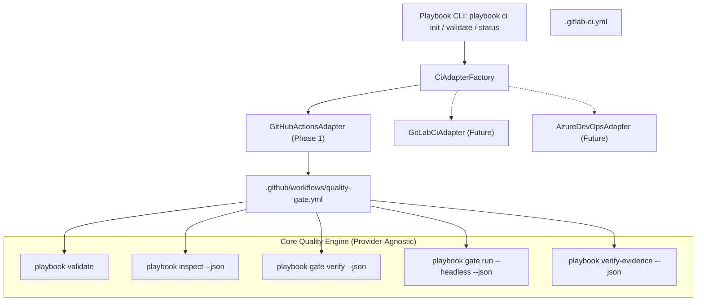
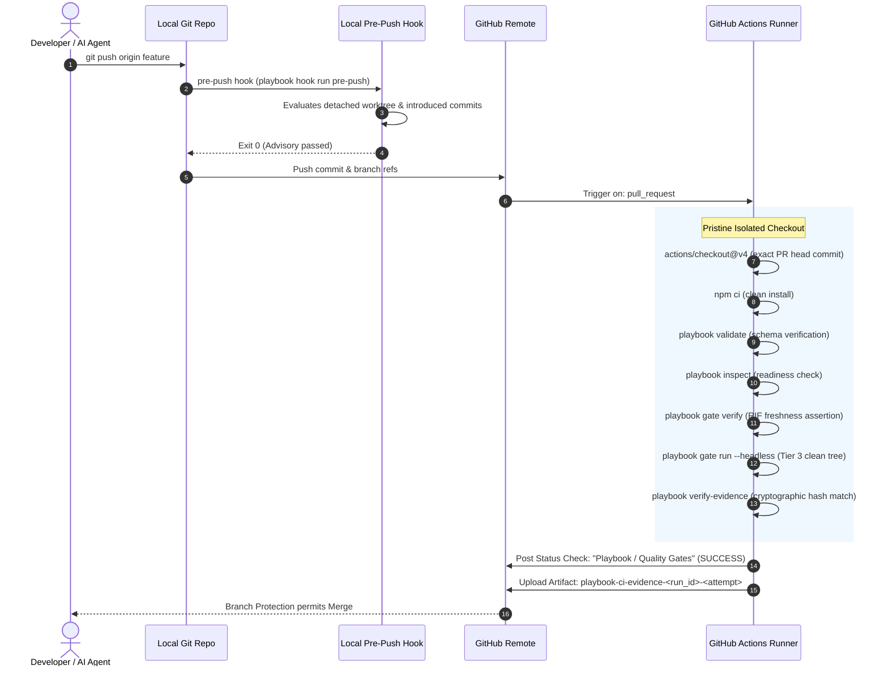

# Remote CI Pipeline Architecture & GitHub Actions Adapter Design

> **Specification Version**: 1.0.0  
> **Milestone**: Task 006C.3 — Remote CI Pipeline Architecture & GitHub Actions Adapter Design  
> **Status**: Approved Architecture & Design Specification  
> **Preceding Milestones**:
> - Task 006C.1: Native Git Hook Manager & Safe Installation
> - Task 006C.1.1 / Task 006C.1.2: Hook Manager Hardening & Re-entrancy Decoupling
> - Task 006C.2 / Task 006C.2.1: Git Pre-commit & Pre-push Validation Engines
> **Authoritative Decisions**:
> - [`docs/adr/ADR-20261103-001-git-hooks-and-ci-enforcement.md`](../../adr/ADR-20261103-001-git-hooks-and-ci-enforcement.md)
> - [`docs/adr/ADR-20261103-002-remote-ci-evidence-and-enforcement.md`](../../adr/ADR-20261103-002-remote-ci-evidence-and-enforcement.md)

---

## 1. Executive Summary & Problem Formulation

In the AI Engineering Playbook governance model:
1. **Local Git Hooks Are Non-Authoritative**: Pre-commit and pre-push hooks execute on developer workstations or autonomous agent environments. While they provide immediate, zero-latency feedback, they are inherently advisory and bypassable (`git commit --no-verify`, GUI clients, filesystem edits).
2. **Remote CI Is Authoritative**: The remote Continuous Integration environment executes in clean, isolated runners under branch protection rules. Remote CI is the **authoritative enforcement layer** that guards main branches from unverified, non-compliant, or drifting code.
3. **Zero Parallel Governance**: Remote CI must **not** implement a separate, divergent quality gate system. It must execute the identical Quality Gate engine, schema validators, Reproducible Input Fingerprints (RIF), and evidence verifiers as the local CLI, ensuring 100% behavioral parity between local development and remote enforcement.

This document specifies the provider-neutral remote CI integration architecture, focusing on the native **GitHub Actions Adapter** as the reference implementation.

---

## 2. Provider Adapter Architecture

To prevent vendor lock-in while avoiding premature over-abstraction ([Engineering Constitution Principle 4](../../../core/engineering-constitution.md)), the CI subsystem is structured around a provider-neutral interface.



### 2.1 Provider Interface Specification

```typescript
export type CiProviderType = "github" | "gitlab" | "azure_devops";

export interface CiWorkflowOptions {
  provider: CiProviderType;
  outputPath?: string;
  force?: boolean;
  dryRun?: boolean;
  stage?: number;
  profile?: "strict" | "standard" | "relaxed";
}

export interface CiWorkflowValidationResult {
  valid: boolean;
  provider: CiProviderType;
  filePath: string;
  errors: string[];
  warnings: string[];
  isPlaybookManaged: boolean;
  version?: string;
}

export interface CiAdapter {
  readonly provider: CiProviderType;
  readonly defaultWorkflowPath: string;
  readonly requiredCheckName: string;
  
  generateWorkflow(options: CiWorkflowOptions): string;
  validateWorkflow(content: string, filePath: string): CiWorkflowValidationResult;
  getRequiredCheckNames(): string[];
}
```

### 2.2 Provider Capability Model

| Capability | GitHub Actions (Phase 1) | GitLab CI (Future) | Azure DevOps (Future) |
| :--- | :--- | :--- | :--- |
| **Workflow Format** | YAML (`.github/workflows/`) | YAML (`.gitlab-ci.yml`) | YAML (`azure-pipelines.yml`) |
| **Trigger Events** | `pull_request`, `push`, `workflow_dispatch` | `merge_requests`, `push` | `pr`, `trigger` |
| **Concurrency Control** | `concurrency.group` + `cancel-in-progress` | `resource_group` / cancel | Pipelines concurrency |
| **Step Summaries** | Native `$GITHUB_STEP_SUMMARY` | Markdown Job Artifacts | Pipeline Task Attachment |
| **Run-Scoped Artifacts** | `actions/upload-artifact@v4` | `artifacts: paths` | `PublishPipelineArtifact@1` |
| **Token Permissions** | Granular per-job `permissions` | Granular `CI_JOB_TOKEN` | Agent pool capabilities |
| **Immutable Pinning** | Full 40-character commit SHAs | Project mirror tags | Task version pinning |

---

## 3. GitHub Actions Adapter Specification

### 3.1 Generated Workflow Specification (`quality-gate.yml`)

The generated workflow implements an authoritative, least-privilege verification pipeline:

```yaml
name: Playbook Quality Gates & Verification

on:
  pull_request:
    branches: [main, master, release/*]
    types: [opened, synchronize, reopened]
  push:
    branches: [main, master, release/*]
  workflow_dispatch:
    inputs:
      stage:
        description: "Target lifecycle stage to evaluate (leave empty for project state default)"
        required: false
        type: string

# Least-privilege permissions: Strictly read-only for repository contents.
# Zero write scopes. Step summaries write to runner environment without API tokens.
permissions:
  contents: read

# Concurrency policy: Cancel redundant in-flight runs on the same PR branch.
# Push events to main are never cancelled to guarantee complete audit trails.
concurrency:
  group: ${{ github.workflow }}-${{ github.event.pull_request.number || github.ref }}
  cancel-in-progress: ${{ github.event_name == 'pull_request' }}

jobs:
  quality-gates:
    name: "Playbook / Quality Gates"
    runs-on: ubuntu-latest
    timeout-minutes: 20

    steps:
      - name: Checkout Code Snapshot
        uses: actions/checkout@11bd71901bbe5b1630ceea73d27597364c9af683 # v4.2.2 (Pinned immutable SHA)
        with:
          fetch-depth: 0 # Full history required for RIF verification and diff boundary detection

      - name: Setup Node.js Runtime
        uses: actions/setup-node@39370e3970a6d050c480ffad4ff0ed4d3fdee5af # v4.1.0 (Pinned immutable SHA)
        with:
          node-version: 20
          cache: "npm"

      - name: Install Dependencies
        run: npm ci

      # Step 1: Governance Schema Conformance
      - name: Validate Manifest and State Schemas
        run: npx @ai-engineering-playbook/cli validate

      # Step 2: Governance Readiness & Blocker Inspection
      - name: Inspect Governance Readiness
        run: npx @ai-engineering-playbook/cli inspect --json

      # Step 3: Reproducible Input Fingerprint (RIF) Verification
      - name: Verify Reproducible Input Fingerprints (RIF)
        run: npx @ai-engineering-playbook/cli gate verify --json

      # Step 4: Tier 3 Headless Gate Execution (Clean Repo Mandated)
      - name: Execute Quality Gates (Headless)
        run: npx @ai-engineering-playbook/cli gate run --headless --json > gate-report.json

      # Step 5: Cryptographic Evidence Byte-Hash Verification
      - name: Verify Evidence Hashes
        run: npx @ai-engineering-playbook/cli verify-evidence --json

      # Step 6: Step Summary & Markdown Annotation (Zero API scope required)
      - name: Publish Playbook Step Summary
        if: always()
        run: node -e '
          const fs = require("fs");
          if (fs.existsSync("gate-report.json")) {
            const report = JSON.parse(fs.readFileSync("gate-report.json", "utf-8"));
            const summary = [
              "## AI Engineering Playbook Quality Gates",
              `**Overall Outcome**: ${report.overall_outcome.toUpperCase()}`,
              `**Stage**: Stage ${report.stage} (${report.stage_name})`,
              `**Checks Evaluated**: ${report.summary.total} (Passed: ${report.summary.passed}, Failed: ${report.summary.failed})`,
              ""
            ].join("\n");
            fs.appendFileSync(process.env.GITHUB_STEP_SUMMARY, summary);
          }
        '

      # Step 7: Upload Run-Scoped Hash-Verifiable Evidence
      - name: Upload CI Execution Evidence
        if: always()
        uses: actions/upload-artifact@b4b15b8c7c6ac21ea08fcf65892d2ee8f75cf882 # v4.4.3 (Pinned immutable SHA)
        with:
          name: playbook-ci-evidence-${{ github.run_id }}-${{ github.run_attempt }}
          path: |
            .playbook/logs/
            gate-report.json
          retention-days: 30
```

---

## 4. Proposed CLI Command Surface (`playbook ci`)

### 4.1 Command Registry Specification

```
playbook ci
  ci init [--provider <type>] [--output <path>] [--force] [--dry-run]
  ci validate [--provider <type>] [--file <path>] [--json]
  ci status [--provider <type>] [--json]
```

### 4.2 Command Responsibilities

#### 1. `playbook ci init`
- **Purpose**: Scaffolds or updates the native CI workflow file.
- **Options**:
  - `--provider <github|gitlab>`: Defaults to `github`.
  - `--output <path>`: Custom destination path (defaults to `.github/workflows/quality-gate.yml`).
  - `--force`: Overwrites existing workflow while archiving original to `.user-backup.<timestamp>`.
  - `--dry-run`: Prints the generated workflow without modifying filesystem.
- **Safety Invariant**: If the workflow file exists and contains user modifications outside Playbook markers, refuses overwrite without `--force`.

#### 2. `playbook ci validate`
- **Purpose**: Statically validates that the generated workflow adheres to the required Playbook specification:
  - Verifies presence of mandatory triggers (`pull_request`, `push`).
  - Verifies read-only permissions (`contents: read`).
  - Verifies action SHA-256 pinning.
  - Verifies required check name matches `Playbook / Quality Gates`.
- **Exit Code**: `0` if valid, `1` if invalid, `2` on configuration error.

#### 3. `playbook ci status`
- **Purpose**: Inspects local and repository CI readiness:
  - Reports whether workflow file exists and its integrity status (`valid`, `modified`, `outdated`, `missing`).
  - Compares generator version against current CLI version.
  - Documents required branch protection rules that must be configured in GitHub repository settings.

#### 4. Commands Explicitly Deferred:
- `playbook ci verify` (deferred to Task 006D): Verifying remote GitHub API runs requires network access and GitHub API credentials, which violates hermetic, offline-first execution.
- `playbook ci status --remote` (deferred): Querying live remote runs requires authentication.

---

## 5. Execution Model & Parity Invariants



### 5.1 Parity Rules Between Local and Remote Execution:
1. **Tier 3 Clean Tree Policy**: Remote CI always runs with `--headless`, enforcing `assertWorkingTreePolicy(cwd, "ci")`. Any unstaged, modified, or untracked files fail closed.
2. **Deterministic Inputs**: The RIF engine computes identical input hashes locally and in CI because:
   - Line endings are normalized (`LF`).
   - Secret keys are stripped.
   - Lockfiles (`package-lock.json`) are hashed byte-for-byte.
3. **Exact Commit Snapshot**: CI validates the exact commit checked out by `actions/checkout`. Working tree modifications in developer workstations cannot affect remote CI runs.

---

## 6. Versioning, Upgrade, and Compatibility Strategy

1. **Managed Header**: Generated workflows contain authoritative metadata:
   ```yaml
   # >>> AI ENGINEERING PLAYBOOK CI (MANAGED WORKFLOW - DO NOT EDIT) >>>
   # Playbook CLI Version: 1.0.0
   # Provider: github
   # Generated At: 2026-11-03T16:00:00.000Z
   ```
2. **Upgrade Detection**: When `playbook ci status` runs, it compares the embedded `Playbook CLI Version` with the executing CLI version. If newer templates exist, it prompts the operator to run `playbook ci init --force`.
3. **Non-Destructive Overwrite**: Similar to hook management, running `playbook ci init --force` moves the pre-existing workflow to `.github/workflows/quality-gate.yml.user-backup.<timestamp>` before writing the updated version.

---

## 7. Operational Boundaries & Administrative Responsibilities

The CLI generates the workflow file, but **cannot automatically enforce branch protection via Git**:
- **Branch Protection & Rulesets**: Repository administrators must manually configure GitHub Branch Protection or Repository Rulesets on `main` / `master`:
  1. Enable **"Require status checks to pass before merging"**.
  2. Select **"Playbook / Quality Gates"** as a mandatory required status check.
  3. Enable **"Require branches to be up to date before merging"** to prevent race conditions on stale bases.
- These controls require repository admin permissions and cannot be bypassed by PR authors.
