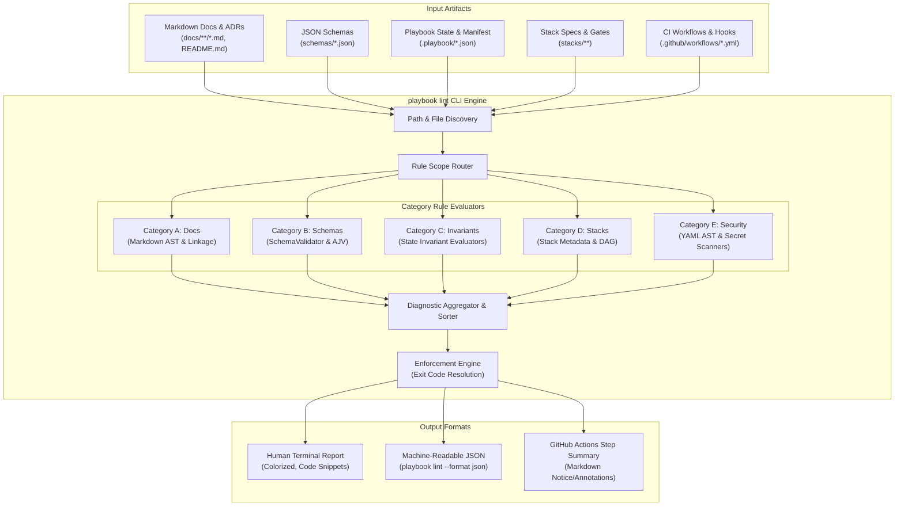

# Governance Linters Architecture & Subsystem Specification

> **Specification Version**: 1.0.0  
> **Milestone**: Task 008A — Governance Linters Architecture & Design  
> **Status**: APPROVED ARCHITECTURAL SPECIFICATION  
> **Target Status**: READY FOR IMPLEMENTATION  
> **Authoritative Decision**: [`docs/adr/ADR-20261106-001-governance-linters.md`](../../adr/ADR-20261106-001-governance-linters.md)  
> **Governing Constitution**: [`core/engineering-constitution.md`](../../../core/engineering-constitution.md)

---

## 1. Executive Summary

The AI Engineering Playbook establishes explicit governance rules, stage gates, state transitions, security perimeters, and architectural invariants for AI-assisted software development. Historically, verifying compliance with these governance standards relied heavily on:
1. Cognitive adherence by AI agents following prompt instructions (`AGENTS.md`),
2. Manual human review during stage-gate approvals and pull-request triage,
3. Isolated structural JSON Schema validation of project manifests and states.

As the Playbook has evolved to encompass modular technology stacks (`stacks/react-native`, `stacks/expo`, `stacks/nextjs`), multi-stage lifecycle reopening, reproducible input fingerprinting (RIF), and remote CI workflows, human and agent manual review alone is insufficient to guarantee consistency. Cognitive drift, conflicting cross-document directives, outdated template references, subtle stack configuration overrides, and unpinned CI actions can silently compromise governance integrity.

**Task 008 introduces the Governance Linter Engine**: a deterministic, extensible, machine-checkable static verification subsystem that inspects documentation, schemas, templates, configuration manifests, stage-gate definitions, and technology stacks.

```
┌────────────────────────────────────────────────────────────────────────┐
│                        AI ENGINEERING PLAYBOOK                         │
│                    GOVERNANCE LINTER ARCHITECTURE                      │
├────────────────────────────────────────────────────────────────────────┤
│                                                                        │
│  [ Category A: Documentation Consistency (DOC-*) ]                     │
│  - Cross-document links, ADR refs, stage numbering, mandatory sections │
│                                                                        │
│  [ Category B: Schema & Configuration Integrity (SCH-*, CFG-*) ]       │
│  - JSON Schema conformance, ID uniqueness, gate & deliverable refs     │
│                                                                        │
│  [ Category C: Governance Invariants (GOV-*) ]                         │
│  - Agent approval prohibition, WAL immutability, evidence validity     │
│                                                                        │
│  [ Category D: Technology Stack Governance (STK-*) ]                   │
│  - Canonical metadata, acyclic dependency DAGs, override safety       │
│                                                                        │
│  [ Category E: Security & Workflow Governance (SEC-*, WFL-*) ]         │
│  - GitHub Actions permissions, action pinning, public env secret leaks │
│                                                                        │
├────────────────────────────────────────────────────────────────────────┤
│                          CORE PRINCIPLE                                │
│    "Linters detect and report; they never self-approve or mutate."     │
└────────────────────────────────────────────────────────────────────────┘
```

---

## 2. Core Architectural Invariants

The Governance Linter subsystem is governed by six strict non-negotiable architectural invariants:

1. **Deterministic & Provider-Neutral Execution**:
   Rule evaluation is strictly deterministic. Given the same repository tree on disk, rule evaluation must produce the exact same findings, in the exact same order, with identical diagnostic codes across Windows, Linux, and macOS.
2. **Zero Project State Mutation**:
   The Governance Linter is strictly read-only. It must **never** mutate `.playbook/manifest.json`, `.playbook/state.json`, `.playbook/journal.json`, stage approval records, or evidence log files.
3. **Preservation of Human Sovereignty**:
   A linter cannot approve a stage, grant an exception, waive a gate, or certify a human decision. It reports findings to inform human operators and block non-compliant automation.
4. **Separation of Severity and Enforcement**:
   Severity (the inherent risk of a finding: `info`, `warning`, `error`) is decoupled from enforcement (the runner behavior: `advisory`, `blocking`). A warning cannot silently become a blocker unless `--strict` mode is explicitly engaged, and a blocking rule can never be silently bypassed.
5. **No NLP Hallucination / Bounded Heuristics**:
   The linter relies on concrete AST parsing, JSON Schema validation, structured markdown AST analysis, regex tokens, and filesystem existence checks. It avoids unrestricted natural-language semantic speculation.
6. **Strict Separation of Existing Subsystems**:
   The linter integrates with, but does not duplicate or subsume, existing subsystems:
   - JSON Schema handles direct JSON structural conformance.
   - `StackManager` handles stack discovery, topological sorting, and file overlays.
   - `QualityGateRunner` executes child-process check DAGs.
   - `rif.ts` computes input file fingerprints.
   - Mobile RIF evaluators (`rif-rules.ts`) remain bounded programmatic checkers.

---

## 3. Subsystem Architecture Document Index

The design and formal specification for the Governance Linter system are documented in the following authoritative architecture artifacts:

| Document | Purpose |
| :--- | :--- |
| [**`gap-analysis.md`**](gap-analysis.md) | Comprehensive audit of existing validation capabilities, missing governance boundaries, and operational disconnects. |
| [**`design.md`**](design.md) | Full architectural specification of the rule engine, diagnostic model, CLI command interface (`playbook lint`), CI integration, and performance bounds. |
| [**`rule-catalog.md`**](rule-catalog.md) | Exhaustive normative catalog of all initial rules across Categories A through E, including stable IDs, triggers, and remediations. |
| [**`audit-report.md`**](audit-report.md) | Architecture review, security and failure mode analysis, resource limits, and non-goals. |
| [**`ADR-20261106-001`**](../../adr/ADR-20261106-001-governance-linters.md) | Authoritative Architectural Decision Record establishing the subsystem. |

---

## 4. High-Level System Topology



---

## 5. Summary of Implementation Roadmap (Phases 1–7)

Implementation of Task 008 is structured into seven distinct, sequential engineering phases:

1. **Phase 1 (Task 008B.1)**: Core Rule Engine, Diagnostic Contracts, and Test Harness.
2. **Phase 2 (Task 008B.2)**: Category A — Documentation Consistency & Linkage Rules.
3. **Phase 3 (Task 008B.3)**: Category B — Schema & Configuration Integrity Rules.
4. **Phase 4 (Task 008B.4)**: Category C — Governance Invariants Rules.
5. **Phase 5 (Task 008B.5)**: Category D — Technology Stack Governance Rules.
6. **Phase 6 (Task 008B.6)**: Category E — Security & Workflow Governance Rules.
7. **Phase 7 (Task 008B.7)**: CLI Command (`playbook lint`), Remote CI Integration, and Regression Closure.

---

## 6. Operational CLI & CI Integration Guide (`playbook lint`)

### 6.1 CLI Command Usage & Flags

The production Governance Linter is invoked via `playbook lint`:

```bash
# Evaluate all 21 production rules across Categories A–E
playbook lint

# Filter by functional rule category
playbook lint --category documentation
playbook lint --category schema
playbook lint --category governance
playbook lint --category stack
playbook lint --category security

# Filter by specific rule ID
playbook lint --rule RULE-SEC-WORKFLOW-PERMS

# Machine-readable JSON output
playbook lint --format json
playbook lint --json

# Strict mode: elevate non-blocking warnings to blocking violations (CI mandated)
playbook lint --strict

# Combined options
playbook lint --category security --format json --strict
```

### 6.2 Supported Category Selectors & Aliases

The CLI category resolver supports the following standard names and aliases:

| Selector Flag | Canonical Category | Rules Evaluated | Focus Scope |
| :--- | :--- | :---: | :--- |
| `--category documentation` (alias: `docs`) | `documentation` | 5 | Markdown links, ADR references, lifecycle stage bounds (0–6), template sections, command deprecation. |
| `--category schema` (alias: `schemas`) | `schema` | 4 | JSON Schema conformance for `.playbook/manifest.json`, `state.json`, `quality-gates.json`, and stack declarations. |
| `--category governance` (alias: `invariant`, `gov`) | `invariant` | 5 | Agent self-approval prohibition, CI immutable WAL guarantees, evidence integrity, exception bounds, stack sovereignty. |
| `--category stack` (alias: `stacks`) | `stack` | 3 | Canonical stack metadata, acyclic dependency DAG, semver package overrides. |
| `--category security` (alias: `sec`) | `security` | 4 | GitHub Actions least-privilege permissions, commit SHA action pinning, PR target trigger isolation, public environment secret leakage. |
| `--category all` | *All Categories* | 21 | Complete evaluation across all registered production rules. |

### 6.3 Deterministic Exit-Code Contract

The CLI adheres to a deterministic, fail-closed exit-code contract:

| Exit Code | Classification | Trigger Condition |
| :---: | :--- | :--- |
| **`0`** | **Clean Success** | Rule evaluation completed with zero blocking violations. (Advisory findings or non-strict warnings permitted). |
| **`1`** | **Blocking Violations** | Rule evaluation completed, but one or more blocking violations were detected (or warning findings in `--strict` mode). |
| **`2`** | **CLI Usage / Argument Error** | Invalid command flags, unrecognized category selector, or missing target directory. |
| **`3`** | **Execution Failure / Incomplete** | Rule evaluation aborted, timed out, crashed, or encountered resource limit exhaustion (e.g. file size / count bounds). |

### 6.4 Strict-Mode Behavior (`--strict`)

- In standard mode, warning findings (e.g. missing optional sections or historical template placeholders) are reported as non-blocking (`blocksOperation: false`), returning exit code `0`.
- In strict mode (`--strict`), all warning findings are dynamically elevated to blocking (`blocksOperation: true`), returning exit code `1` if any warning is present.
- **Constitutional Guardrail**: `--strict` mode modifies only the runner enforcement behavior for the active invocation. It **never** mutates stored rule definitions, configuration files, or project state.

### 6.5 Output Formats

#### 1. Human-Readable Terminal Output (Default)
Displays a structured overview of registered vs evaluated rules, elapsed milliseconds, and findings grouped by category with 1-based source coordinates, expected vs actual values, and remediation instructions:

```
════════════════════════════════════════════════════════════════
         AI ENGINEERING PLAYBOOK — GOVERNANCE LINTER           
════════════════════════════════════════════════════════════════
 Target:           /path/to/project
 Execution Time:   84 ms
 Rules Registered: 21
 Rules Evaluated:  21 (20 passed, 1 failed)
 Total Findings:   1 (1 blocking, 0 warning, 0 advisory)
────────────────────────────────────────────────────────────────

▶ Category E: Security & Workflow Governance (1 finding)
  ✖ [BLOCKING] [RULE-SEC-ACTION-PINNING] UNPINNED_THIRD_PARTY_ACTION
    Severity:    error | Operational Enforcement: blocking
    Location:    .github/workflows/quality-gate.yml:42:15
    Message:     Third-party action 'actions/checkout' is not pinned to an immutable 40-character commit SHA (found '@v4').
    Expected:    Action 'actions/checkout' pinned to full 40-character commit SHA
    Actual:      actions/checkout@v4
    Remediation: Replace mutable tag '@v4' with the action's immutable 40-character commit SHA.

────────────────────────────────────────────────────────────────
 Verdict: FAILED (1 blocking violation detected)
════════════════════════════════════════════════════════════════
```

#### 2. Machine-Readable JSON Output (`--format json`)
Emits a structured JSON document conforming to `schema_version: "1.0"`:

```json
{
  "schema_version": "1.0",
  "status": "passed",
  "complete": true,
  "summary": {
    "rules_total": 21,
    "rules_evaluated": 21,
    "rules_passed": 21,
    "rules_failed": 0,
    "findings_total": 0,
    "blocking_findings": 0,
    "warning_findings": 0,
    "advisory_findings": 0
  },
  "categories": [
    "documentation",
    "schema",
    "invariant",
    "stack",
    "security"
  ],
  "findings": [],
  "execution_failures": [],
  "execution": {
    "started_at": "2026-11-09T05:35:32.066Z",
    "completed_at": "2026-11-09T05:35:32.113Z",
    "duration_ms": 47
  }
}
```

### 6.6 Remote CI Pipeline Integration

Governance linting is integrated into the canonical GitHub Actions pipeline as a dedicated, early verification step:

```yaml
      # Step 1: Governance Schema Conformance
      - name: Validate Manifest and State Schemas
        run: npx @ai-engineering-playbook/cli validate

      # Step 2: Governance Static Analysis & Policy Linting
      - name: Lint Governance Policies & Invariants
        run: npx @ai-engineering-playbook/cli lint --strict --format json > lint-raw-report.json

      # Step 3: Governance Readiness & Blocker Inspection
      - name: Inspect Governance Readiness
        run: npx @ai-engineering-playbook/cli inspect --json
```

**CI Reporting & False Pass Prevention**:
- `playbook ci report` inspects `lint-raw-report.json`.
- The SHA-256 byte-hash of `lint-raw-report.json` is computed and bound to `PlaybookCiRunEvidence.artifacts`.
- A dedicated summary table is rendered in the GitHub Step Summary markdown.
- If governance linting fails, times out, or reports blocking findings, `overall_outcome` is downgraded and `validateCiEvidenceReport` rejects the run as a **FALSE PASS**.

### 6.7 Read-Only Governance Invariants

The Governance Linter operates strictly under read-only constraints:
- **No State Mutation**: Never modifies `.playbook/manifest.json` or `.playbook/state.json`.
- **No WAL Creation**: Never acquires `.playbook/.lock` or generates `.playbook/journal.json`.
- **No Authority Usurpation**: Cannot approve stage gates, grant waivers, or advance milestones.
- **No Unsafe Execution**: Does not execute project build scripts or arbitrary shell commands during rule evaluation.
- **Offline / Hermetic**: Requires zero network access.

### 6.8 Common Violations & Remediation Examples

| Rule ID | Typical Defect | Actionable Remediation |
| :--- | :--- | :--- |
| `RULE-SEC-WORKFLOW-PERMS` | Missing top-level `permissions` block in `.github/workflows/*.yml`. | Add `permissions: { contents: read }` to the top level of the workflow. |
| `RULE-SEC-ACTION-PINNING` | Third-party action using tag `@v4`. | Pin to immutable 40-character commit SHA: `actions/checkout@11bd71901bbe5b1630ceea73d27597364c9af683 # v4.2.2`. |
| `RULE-SEC-PR-TARGET-BAN` | Workflow uses `pull_request_target` while checking out PR-head code. | Switch trigger to `pull_request`, or isolate untrusted fork code execution. |
| `RULE-SEC-PUBLIC-ENV-LEAK` | Private secret assigned to `NEXT_PUBLIC_API_SECRET`. | Strip public bundle prefix and move credential to server-side environment or secrets manager. |
| `RULE-DOC-REF-INTEGRITY` | Relative markdown link target does not exist on disk. | Correct relative path or restore the missing referenced file. |
| `RULE-DOC-STAGE-BOUNDS` | Reference to non-existent "Stage 7". | Correct reference to Stage 6 (milestone closure) or milestone reopening (`playbook reopen`). |

