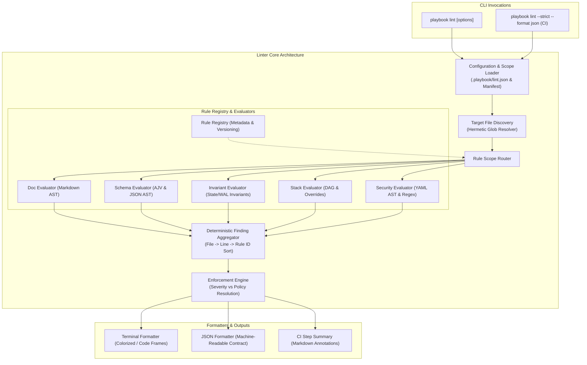

# Governance Linters Architecture & Technical Design

> **Specification Version**: 1.0.0  
> **Milestone**: Task 008A — Governance Linters Architecture & Design  
> **Status**: APPROVED ARCHITECTURAL SPECIFICATION  
> **Parent Document**: [`README.md`](README.md)  
> **Authoritative Decision**: [`docs/adr/ADR-20261106-001-governance-linters.md`](../../adr/ADR-20261106-001-governance-linters.md)  
> **Governing Constitution**: [`core/engineering-constitution.md`](../../../core/engineering-constitution.md)

---

## 1. System Architecture Overview

The Governance Linter subsystem is a deterministic, hermetic, read-only static analysis engine designed to verify repository compliance with Playbook governance specifications, constitutional invariants, schema constraints, technology-stack boundaries, and CI security policies.



---

## 2. Provider-Neutral Rule Model

Every rule registered in the Governance Linter engine must implement the standardized, provider-neutral `GovernanceRule` interface.

### 2.1 Rule Metadata Contract (TypeScript Definition)

```typescript
export type RuleCategory = "documentation" | "schema" | "invariant" | "stack" | "security";

export type RuleSeverity = "info" | "warning" | "error";

export type RuleEnforcement = "blocking" | "warning" | "advisory" | "disabled";

export type RuleEvaluationMethod =
  | "markdown_ast"
  | "json_schema"
  | "json_ast"
  | "yaml_ast"
  | "regex_pattern"
  | "filesystem_structural"
  | "cross_reference";

export interface GovernanceRule {
  /** Stable, unique rule identifier (e.g. RULE-DOC-REF-INTEGRITY) */
  readonly id: string;

  /** Category grouping */
  readonly category: RuleCategory;

  /** Concise human-readable title */
  readonly name: string;

  /** Comprehensive rule description and rationale */
  readonly description: string;

  /** Inherent defect severity */
  readonly severity: RuleSeverity;

  /** Default enforcement behavior if not overridden in project config */
  readonly defaultEnforcement: RuleEnforcement;

  /** Glob patterns defining targeted files */
  readonly targetGlobs: string[];

  /** Glob patterns defining excluded files */
  readonly excludeGlobs: string[];

  /** Primary evaluation technique */
  readonly evaluationMethod: RuleEvaluationMethod;

  /** Recognized diagnostic codes emitted by this rule */
  readonly diagnosticCodes: string[];

  /** Prescribed remediation guidance */
  readonly remediation: string;

  /** Whether the rule provides an automated safe fix (must be disabled by default) */
  readonly hasAutofix: boolean;

  /** Version of the rule specification */
  readonly version: string;

  /** Core evaluation logic */
  evaluate(context: RuleExecutionContext): Promise<RuleFinding[]> | RuleFinding[];

  /** Optional automated fix logic */
  autofix?(context: RuleExecutionContext, finding: RuleFinding): Promise<AutofixResult> | AutofixResult;
}
```

### 2.2 Execution Context Contract
Rules receive a sandboxed `RuleExecutionContext` providing read-only access to repository contents without raw filesystem side-effects:

```typescript
export interface RuleExecutionContext {
  readonly projectDir: string;
  readonly targetFiles: string[];
  readonly manifest: ProjectManifest | null;
  readonly state: ProjectState | null;
  
  /** Safely read file contents with byte-size and encoding bounds */
  readFile(relativeFilePath: string): string;
  
  /** Safely parse JSON with line/column sourcemap positions */
  readJsonAst(relativeFilePath: string): JsonAstNode;
  
  /** Safely parse Markdown into an AST */
  readMarkdownAst(relativeFilePath: string): MarkdownAstNode;
  
  /** Safely parse YAML into an AST */
  readYamlAst(relativeFilePath: string): YamlAstNode;
  
  /** Query registered stacks from StackManager */
  getRegisteredStacks(): StackInfo[];
}
```

---

## 3. Finding Structure & Diagnostics Model

### 3.1 Standardized Finding Contract

```typescript
export interface RuleFinding {
  /** Identifier of the rule that produced this finding */
  readonly ruleId: string;

  /** Specific diagnostic error code (e.g. UNRESOLVED_MARKDOWN_LINK) */
  readonly diagnosticCode: string;

  /** Inherent severity of the finding */
  readonly severity: RuleSeverity;

  /** Effective enforcement status after applying project overrides */
  readonly enforcement: RuleEnforcement;

  /** Relative POSIX path to the affected file (null for repository-wide issues) */
  readonly filePath: string | null;

  /** Line number (1-based, if applicable) */
  readonly line: number | null;

  /** Column number (1-based, if applicable) */
  readonly column: number | null;

  /** Human-readable explanation of the defect */
  readonly message: string;

  /** Description of what was expected */
  readonly expected: string;

  /** Description of what was actually discovered */
  readonly actual: string;

  /** Actionable remediation instruction */
  readonly remediation: string;

  /** Whether this specific finding blocks execution (based on enforcement & strict mode) */
  readonly isBlocking: boolean;

  /** Sourcemap code frame snippet for terminal rendering */
  readonly codeFrame?: string;
}
```

### 3.2 Deterministic Sorting Invariant
To ensure 100% reproducible reports across environments and CI runners, all findings are deterministically sorted by:
1. `filePath` ascending (null paths sorted first),
2. `line` ascending (null lines sorted first),
3. `column` ascending (null columns sorted first),
4. `ruleId` ascending,
5. `diagnosticCode` ascending.

---

## 4. Separation of Severity vs. Enforcement

A fundamental principle of the Governance Linter is the **strict architectural separation between Severity and Enforcement**:

- **Severity (`info`, `warning`, `error`)**: Represents the intrinsic engineering risk or defect criticality defined permanently in the rule specification.
- **Enforcement (`blocking`, `warning`, `advisory`, `disabled`)**: Represents the operational behavior applied to the finding during CLI/CI execution.

### Policy Resolution Matrix

| Inherent Severity | Default Enforcement | Strict Mode (`--strict`) | CI Status Check Impact |
| :--- | :--- | :--- | :--- |
| **`error`** | `blocking` | `blocking` | **Blocks merge (Exit Code 1)** |
| **`warning`** | `warning` | `blocking` | Non-blocking by default; **Blocks if `--strict` (Exit Code 1)** |
| **`info`** | `advisory` | `advisory` | Advisory only (Exit Code 0) |

**Non-Downgrade Guarantee**: Project configuration overrides cannot silently downgrade an inherent `error` severity rule to `advisory` or `disabled`. Furthermore, an exception file's physical existence or cryptographic hash alone cannot authorize an enforcement downgrade. A cryptographic hash proves only **record integrity** (that bytes have not been tampered with); it does **not** prove human approval, authority, or semantic validity. Downgrading or waiving an inherent `error` rule strictly requires satisfying all four governance tiers: (1) **record integrity** (tamper-evident committed record), (2) **approval evidence** (verifiable non-repudiable human sign-off), (3) **authorization** (human approver holds necessary role authority; AI agents cannot self-waive), and (4) **scope and expiry validation** (exact rule/deliverable target match and unexpired `expires_at` timestamp). Until an automated exception evaluation system is formally integrated, runtime downgrades are disabled and fail closed.

---

## 5. CLI Command & Execution Interface

### 5.1 Command Syntax
The linter is invoked via the `playbook lint` command:

```bash
playbook lint [options] [paths...]
```

### 5.2 Command Options & Flags

| Flag | Type | Description | Default |
| :--- | :--- | :--- | :--- |
| `--category <cat>` | string | Filter rules by category (`docs`, `schema`, `invariant`, `stack`, `security`, `all`) | `all` |
| `--rule <id>` | string | Filter by specific rule ID (repeatable) | All rules |
| `--format <type>` | string | Output format (`terminal`, `json`, `step-summary`) | `terminal` |
| `--strict` | boolean | Treat all warnings as blocking errors (mandatory in CI) | `false` |
| `--max-warnings <N>`| number | Maximum permissible non-blocking warnings before failing | Unlimited (`-1`) |
| `--fix` | boolean | Perform safe autofix on supported rules (requires `--write` to mutate disk) | `false` (dry-run) |
| `--write` | boolean | Required in combination with `--fix` to persist autofix changes | `false` |
| `--cwd <path>` | string | Target repository root directory | `process.cwd()` |

### 5.3 Exit Code Semantics
The linter strictly adheres to deterministic exit codes:

- **`0` — Clean Success**: Zero blocking violations found. (Warnings permitted unless `--strict` or `--max-warnings` threshold exceeded).
- **`1` — Blocking Violations Detected**: One or more blocking governance, schema, or invariant violations detected.
- **`2` — CLI Usage Error**: Invalid command arguments, non-existent category, or invalid flag syntax.
- **`3` — Environment / Precondition Error**: Target directory missing or required configuration unreadable.
- **`4` — Engine Crash / Critical Failure**: Uncaught exception or file system I/O error during execution.

---

## 6. Read-Only Execution & Security Boundaries

### 6.1 State and WAL Immutability Invariant
The Governance Linter operates under a strict read-only guarantee:
- **No Lifecycle Mutation**: The linter **never** modifies `.playbook/manifest.json` or `.playbook/state.json`. It never advances stages, reverts stages, or records deliverables.
- **No WAL Creation**: The linter does not acquire write locks (`.playbook/.lock`) or write transaction journals (`.playbook/journal.json`).
- **No Evidence Forgery**: The linter does not write to `.playbook/logs/` or claim to register proof evidence in state.
- **Autofix Isolation**: `--fix` without `--write` is strictly a dry-run reporting planned diffs. If `--write` is supplied, modifications are strictly confined to source files (e.g., formatting markdown links or pinning action SHAs); governance state files remain strictly untouched.

### 6.2 Performance and Resource Budgets
To enable frictionless execution in developer pre-commit hooks and CI status checks:
- **Execution Time**: Full repository lint across all 5 categories must complete in **< 3.0 seconds** on standard developer hardware.
- **Memory Consumption**: Memory usage must remain bounded below **256 MB** RSS.
- **File System Bounds**: Large binary assets and files matching `.gitignore` or `exclude_patterns` are skipped before reading into memory.
- **Offline / Hermetic**: The linter requires **zero network access**. Remote network calls are forbidden during rule evaluation.

---

## 7. Preservation of Human Sovereignty & Authority Boundaries

```
┌─────────────────────────────────────────────────────────────┐
│                 GOVERNANCE AUTHORITY BOUNDARY               │
├─────────────────────────────────────────────────────────────┤
│  LINTER SCOPE (Automated)                                   │
│  ✔ Detect broken references and missing documents           │
│  ✔ Validate schema structural conformance                   │
│  ✔ Flag agent self-approval violations                      │
│  ✔ Block unpinned CI actions and secret leaks               │
│                                                             │
│  HUMAN AUTHORITY BOUNDARY (Non-Automatable)                 │
│  ✖ A linter CANNOT approve a stage gate                     │
│  ✖ A linter CANNOT waive a mandatory deliverable            │
│  ✖ A linter CANNOT grant or renew a governance exception    │
│  ✖ A linter CANNOT certify the authenticity of an actor     │
└─────────────────────────────────────────────────────────────┘
```

The Governance Linter serves as an automated gatekeeper that detects non-compliance. A clean lint report (`exitCode 0`) indicates that all automated structural and invariant checks passed; it does **not** substitute for human stage review or authorized human sign-off.
