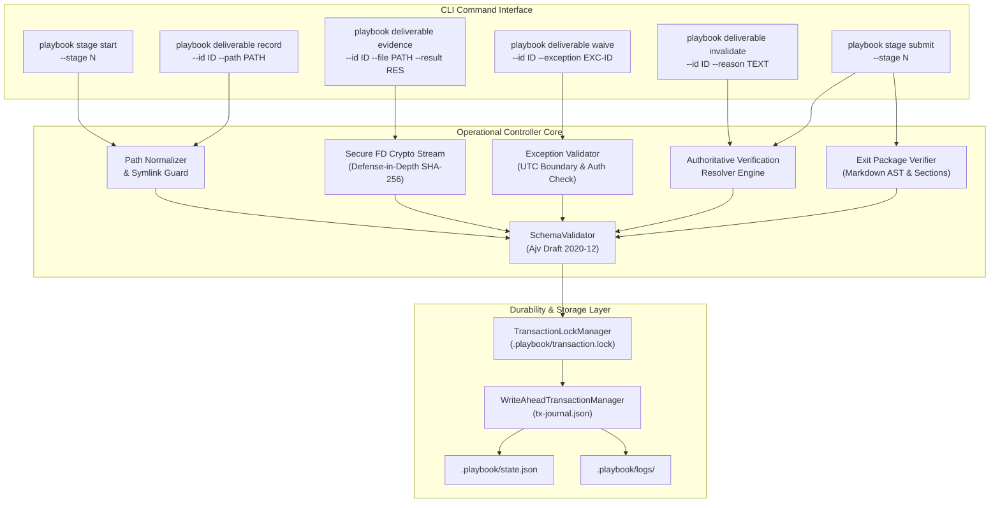

# Operational Controller Architecture & Subsystem Specification

> **Specification Version**: 1.0.0  
> **Milestone**: Task 009A — Operational Controller CLI Architecture & Design  
> **Status**: APPROVED ARCHITECTURAL SPECIFICATION  
> **Target Implementation**: Task 009B  
> **Authoritative Decision**: [`docs/adr/ADR-20261109-001-operational-controller-cli.md`](../../adr/ADR-20261109-001-operational-controller-cli.md)  
> **Governing Documents**: [`core/engineering-constitution.md`](../../../core/engineering-constitution.md), [`governance/state-machine.md`](../../../governance/state-machine.md), [`governance/ENGINEERING_CONTROLLER.md`](../../../governance/ENGINEERING_CONTROLLER.md)

---

## 1. Executive Summary

The **AI Engineering Playbook** enforces rigorous lifecycle governance for software co-authored by human engineers and AI coding agents. Prior milestones established the core state machine, atomic Write-Ahead Logging (WAL) durability, quality gate execution, native git hooks, remote CI verification, technology stacks, and static governance linters.

However, an **operational asymmetry** exists in the current system:
- **Macro Lifecycle Transitions** (approvals, stage advancements, milestone reopenings, stage pivots, and emergency recovery) are fully automated, atomic, and protected by the Write-Ahead Transaction Manager (`WriteAheadTransactionManager`):
  - `playbook approve` (`APPROVE_GATE`, `REJECT_GATE`)
  - `playbook advance` (`ADVANCE_STAGE`, `CLOSE_LIFECYCLE`)
  - `playbook reopen` (`REOPEN_LIFECYCLE`)
  - `playbook pivot` (`PIVOT_TO_STAGE_0`)
  - `playbook gate recover` (`RESOLVE_HALT`)
- **Micro Intra-Stage Transitions** (the operational steps executed repeatedly by agents and human engineers *inside* an active stage) currently have **zero CLI tooling**:
  - `START_STAGE` (§3.2): Commencing active work in a stage.
  - `RECORD_DELIVERABLE` (§3.3): Registering an authored artifact file.
  - `RECORD_EVIDENCE` (§3.4): Cryptographically hashing proof and recording evidence.
  - `RECORD_EXCEPTION` (§3.5): Linking human-authorized waivers (`EXC-*.md`).
  - `REQUEST_HUMAN_APPROVAL` (§3.8): Handover submission and Phase 1 of the two-phase handshake.

Because no CLI commands exist for intra-stage operations, AI agents and engineers are forced to **manually edit `.playbook/state.json` directly on disk**. This direct editing bypasses the Write-Ahead Transaction Log, bypasses mutex lock acquisition, risks concurrent write corruption, lacks automated schema validation at write time, requires error-prone manual calculation of SHA-256 evidence hashes, and creates an untenable governance loophole.

**Task 009 establishes the Operational Controller CLI**: an atomic, WAL-backed, schema-validated command subsystem that provides safe, deterministic operations for all intra-stage lifecycle transitions.

```
┌────────────────────────────────────────────────────────────────────────┐
│                        AI ENGINEERING PLAYBOOK                         │
│                 OPERATIONAL CONTROLLER CLI TOPOLOGY                    │
├────────────────────────────────────────────────────────────────────────┤
│                                                                        │
│  [ Stage Management (`playbook stage ...`) ]                           │
│  - playbook stage start   ──► Validates prereqs, transitions in_prog   │
│  - playbook stage submit  ──► Phase 1 Handover: validates 100% proofs,  │
│                               checks exit package, transitions pending │
│                                                                        │
│  [ Deliverable Management (`playbook deliverable ...`) ]               │
│  - deliverable record     ──► Asserts file on disk, marks completed    │
│  - deliverable evidence   ──► Computes sha256 hash, binds Git metadata,│
│                               appends evidence without silent demotion │
│  - deliverable waive      ──► Validates EXC-*.md TTL, marks waived     │
│  - deliverable invalidate ──► Explicitly revokes verified status       │
│                                                                        │
│  [ Backing Transaction & Storage Architecture ]                        │
│  - WriteAheadTransactionManager (exclusive mutex, atomic rollback)     │
│  - SchemaValidator (Draft 2020-12 state and manifest validation)       │
│  - POSIX relative path normalization & defense-in-depth FD streaming   │
│                                                                        │
├────────────────────────────────────────────────────────────────────────┤
│                          CORE PRINCIPLE                                │
│    "Every state mutation is atomic, journaled, and cryptographically   │
│     verifiable. Direct filesystem tampering of state.json is barred."  │
└────────────────────────────────────────────────────────────────────────┘
```

---

## 2. Core Architectural Invariants

The Operational Controller CLI subsystem is governed by seven non-negotiable architectural invariants:

1. **Mandatory WAL Mediation**:
   Every state mutation to `.playbook/state.json` must be mediated exclusively through `WriteAheadTransactionManager.withTransaction()`. Zero direct unjournaled writes to `state.json` are permitted by any CLI command.
2. **Schema Invariance & Schema Evolution Separation**:
   All state mutations must produce outputs that strictly validate against `schemas/project-state.schema.json`. Existing schema contracts are 100% compatible with Task 009; zero schema mutations or evolutions are permitted without a separate formal decision.
3. **Preservation of the Two-Phase Handshake**:
   `playbook stage submit` executes Phase 1 (`REQUEST_HUMAN_APPROVAL`), transitioning `stage_status` to `pending_review`. It is strictly barred from approving a stage or advancing the lifecycle. Human authority in Phase 2 (`playbook approve`) remains absolute and requires an interactive terminal (`isatty`).
4. **Cryptographic Integrity & Automatic Hashing**:
   Evidence records must automatically compute the SHA-256 byte hash (`sha256:<64 hex chars>`) of local proof files under `.playbook/logs/` or `docs/`. Manual hash entry is eliminated to prevent drift, truncation, and formatting errors.
5. **Path Boundary & Symlink Traversal Protection**:
   Deliverable artifact paths and evidence references must be safe relative paths within the project root. Absolute paths, drive-relative paths, UNC paths, null bytes, and path traversal (`..` escaping root) are rejected fail-closed. Realpath resolution protects against symlink escape attacks.
6. **Exception Authority & TTL Enforcement**:
   A deliverable cannot be waived merely because an exception file exists or matches a hash. `playbook deliverable waive` actively validates documentary human authorizer metadata, scope alignment, and strict UTC expiration boundaries (`current_utc_timestamp <= expiration_boundary_utc`). Documentary attribution is explicitly distinguished from authenticated cryptographic identity.
7. **Append-Only Evidence & Explicit Invalidation**:
   Evidence records are strictly append-only. Appending failed evidence does NOT silently demote an already verified deliverable. Revoking verified status requires an explicit, auditable invalidation command (`playbook deliverable invalidate`). Stage submission evaluates the authoritative current verification state, failing closed if the latest evidence for any required discipline is failing.

---

## 3. Subsystem Document Index

The design and formal specification for the Operational Controller CLI are documented in the following authoritative architecture artifacts:

| Document | Purpose |
| :--- | :--- |
| [**`gap-analysis.md`**](gap-analysis.md) | Forensic analysis of intra-stage operational gaps, direct state editing hazards, and state-machine transition coverage. |
| [**`design.md`**](design.md) | Exhaustive normative specification of the command taxonomy, arguments, transition mapping, evidence hashing, exception validation, and handover protocols. |
| [**`audit-report.md`**](audit-report.md) | Architecture audit, security threat model, failure mode analysis, recovery mechanics, and Task 009B implementation phasing. |
| [**`ADR-20261109-001`**](../../adr/ADR-20261109-001-operational-controller-cli.md) | Authoritative Architectural Decision Record establishing the subsystem. |

---

## 4. High-Level Command Topology



---

## 5. Security & Trust Boundaries

The Operational Controller enforces strict separation of privileges:

- **AI Agents**: Permitted to run `playbook stage start`, `playbook deliverable record`, `playbook deliverable evidence`, and `playbook stage submit`. Agents act as autonomous task executors within the active stage.
- **Candidate Transition §3.15 Invalidation Boundary**: `playbook deliverable invalidate` is fenced under Candidate Transition §3.15. Task 009B cannot implement it without prior formal human approval amending `governance/state-machine.md`. Even if approved, agents cannot invalidate human-attested deliverables without human authority.
- **Human Engineers**: Sole authority permitted to grant exceptions (`docs/exceptions/EXC-*.md`) and execute gate approvals (`playbook approve`).
- **Interactive TTY Boundary**: While intra-stage commands support headless CI/automation (`--non-interactive` / JSON mode), Phase 2 gate approvals strictly enforce interactive terminal sessions (`isatty`).
- **Four Trust Dimensions**: System strictly distinguishes documentary attribution, TTY attestation, and fingerprint integrity from authenticated external identity.
