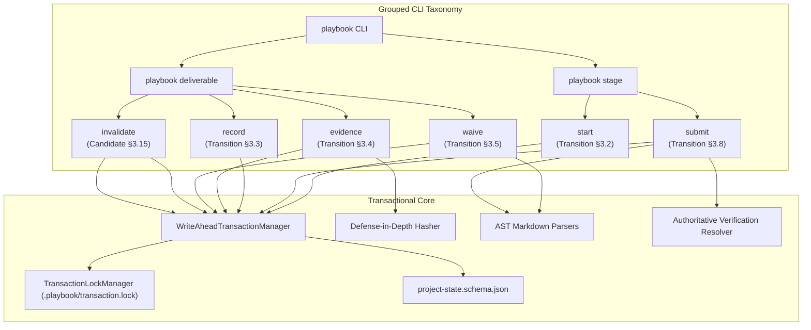
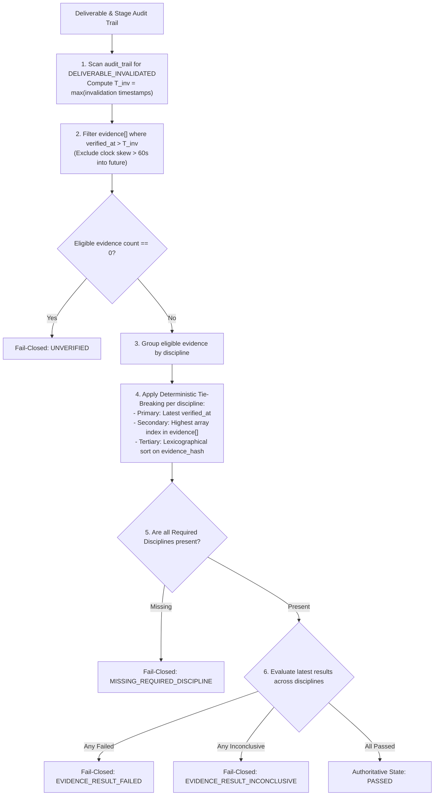

# Operational Controller CLI: Detailed System Architecture & Design Specification

> **Document Version**: 1.3.0  
> **Status**: PROPOSED ARCHITECTURE AMENDMENT (AMEND-20261110-001: Pending Formal Human Ratification)  
> **System Scope**: `tooling/playbook-cli` Operational Subsystem & CLI Commands  
> **Applicable Lifecycle Transitions**: `START_STAGE` (§3.2), `RECORD_DELIVERABLE` (§3.3), `RECORD_EVIDENCE` (§3.4), `PROPOSE_EXCEPTION` / `AUTHORIZE_EXCEPTION` (§3.5 amended), `REQUEST_HUMAN_APPROVAL` (§3.8), and Candidate Extension `INVALIDATE_DELIVERABLE`  
> **Target Subsystem Path**: `tooling/playbook-cli/src/core/controller/` and `tooling/playbook-cli/src/commands/`  
> **Authoritative Amendment Reference**: [`AMEND-20261110-001`](../adr/ADR-20261110-001-two-phase-exception-lifecycle.md) / [`ADR-20261110-001`](../adr/ADR-20261110-001-two-phase-exception-lifecycle.md)

> [!IMPORTANT]
> **Governance Boundaries & Decision Status**:  
> 1. **Human-Selected Direction**: **Option B (Two-Phase Exception Lifecycle)** has been selected as the governing architectural direction.  
> 2. **Architecture Amendment Status**: **`Proposed`**. Formal policy ratification across governing documents remains pending Lead Architect sign-off.  
> 3. **Implementation Authorization**: **`Not Yet Granted`**. Production code refactoring, schema alterations, and CLI implementations are strictly deferred to future engineering phases.  
> 4. **Authenticated Identity Status**: **`Unimplemented`**. Neither interactive TTY conditions nor SHA-256 sidecar integrity establishes authenticated human identity.  
> 5. **Architecture Review Disposition**: **Architecture review: COMPLETE — READY FOR FORMAL HUMAN RATIFICATION**. (Review complete; Task 009B.3 remains unauthorized; candidate transitions remain inactive).  
> Exception processing is strictly partitioned into **Phase 1: Exception Proposal** (which registers a proposed exception without waiving the deliverable) and **Phase 2: Explicit Operator Authorization** (which requires an interactive terminal condition, role declaration, and cryptographic fingerprint sealing before the deliverable may transition to `waived`). Historical single-phase specifications are preserved below with explicit superseded notices.

---

## 1. System Vision & Architectural Invariants

### 1.1 Executive Summary
The Operational Controller CLI bridges the operational asymmetry in the AI Engineering Playbook between macro lifecycle state transitions (`approve`, `advance`, `reopen`, `recover`, `pivot`) and intra-stage task execution (`record`, `evidence`, `waive`, `invalidate`, `submit`).

Previously, AI agents operating under `AGENTS.md` micro-execution loops (Steps 1–7) were instructed to perform direct manual edits to `.playbook/state.json`. This manual state manipulation created seven severe systemic hazards:
1. **Unprotected Concurrent Mutations**: Bypassing the transactional Write-Ahead Log (`WAL`) journal (`tx-journal.json`) and mutex locks (`transaction.lock`).
2. **Hash Drift & Corrupted Evidence Chains**: Recording inaccurate, unhashed, or unverified evidence files.
3. **Ghost Deliverables**: Marking items as `"verified"` without meeting minimum evidence thresholds.
4. **Unvalidated Exception Record Linking**: Claiming waivers without verifying documentary attribution, scope, or expiration dates.
5. **Incomplete Exit Package Submission**: Transitioning stage status to `pending_review` without fulfilling mandatory exit package sections.
6. **Premature Gate Approval & Authority Erosion**: Agents conflating deliverable verification with stage gate sign-off.
7. **Loss of Deterministic Audit Trails**: Unlogged state mutations erasing operational provenance.

The Operational Controller CLI eliminates these hazards by encapsulating intra-stage mutations within a deterministic, transactionally protected command suite that enforces strict schema conformance, cryptographic hashing, and human authority boundaries.

### 1.2 Core Architectural Invariants
All commands and subsystems designed herein strictly enforce nine non-negotiable invariants:

1. **Mandatory WAL Transaction Mediation**: Every state mutation to `.playbook/state.json` must be executed via `WriteAheadTransactionManager.withTransaction()`. Direct unjournaled writes to `state.json` are prohibited.
2. **Schema Invariance & Zero Drift**: All state mutations must produce outputs conforming 100% to existing `schemas/project-state.schema.json` and `schemas/project-manifest.schema.json`. No schema modifications or extensions are permitted.
3. **Application-Level Append-Only Evidence History**: Evidence records in `current_stage_detail.deliverables[].evidence[]` are strictly append-only. Historical evidence entries are immutable at the application layer and never modified or deleted by CLI operations.
4. **No Silent State Downgrades**: A failed evidence record appended to `evidence[]` does **NOT** silently demote or downgrade an already verified deliverable. Deliverable lifecycle status remains stable until an explicit, authorized invalidation transition is executed.
5. **Deterministic Authoritative Verification State Resolution**: The system deterministically resolves the current empirical verification state by evaluating the latest eligible evidence per required discipline relative to explicit invalidation timestamps. Stage submission evaluates this authoritative state and fails closed if any required discipline is failing or missing.
6. **Explicit, Authorized Deliverable Invalidation**: Revoking the verification of an already-verified deliverable requires an explicit command (`playbook deliverable invalidate`) transitioning deliverable status from `verified` to `in_progress`. An agent cannot unilaterally invalidate human-attested deliverables merely by providing a string.
7. **Defense-in-Depth Filesystem Inspection**: Automated evidence verification requires streaming SHA-256 byte hashing. Path validation enforces repository containment, and open file descriptor (`fd`) inspection with pre- and post-stream `fstat` checks detects concurrent file modifications. Platform-specific limitations are explicitly documented.
8. **Documentary Attribution vs. Authenticated Identity**: The system strictly distinguishes documentary human attribution (parsed from markdown exception records) from authorization validation (TTY session checks and fingerprint sidecars) and authenticated identity (cryptographic signatures). Heuristic checks on agent names are never mischaracterized as cryptographic authentication.
9. **Two-Phase Handshake Preservation (Phase 1 Submission Boundary)**: Agents can request human review via `playbook stage submit` (Phase 1), which validates deliverable completeness and formats the exit package. However, agents are strictly forbidden from approving or advancing the gate. Phase 2 approval remains exclusively within human authority via `playbook approve --gate <N>`.

---

## 2. Command Taxonomy & Interface Specification

Following the authorized **Grouped Command Taxonomy (Option A)**, the Operational Controller exposes six production commands organized under two primary noun groups: `playbook stage` and `playbook deliverable`.

```
playbook
├── stage
│   ├── start           # Transition §3.2: START_STAGE
│   └── submit          # Transition §3.8: REQUEST_HUMAN_APPROVAL (Phase 1 Handshake)
└── deliverable
    ├── record          # Transition §3.3: RECORD_DELIVERABLE
    ├── evidence        # Transition §3.4: RECORD_EVIDENCE (Append-Only)
    ├── waive           # Transition §3.5: RECORD_EXCEPTION
    └── invalidate      # Candidate Transition §3.15: INVALIDATE_DELIVERABLE
```



---

### 2.1 `playbook stage start`

#### Purpose
Transitions the active stage status from `not_started` to `in_progress` (State Machine §3.2, `START_STAGE`). Initializes `current_stage_detail.deliverables` from canonical stage requirements, establishes stage entry timestamp, and registers baseline audit events.

#### Syntax
```bash
playbook stage start [--stage <N>] [--format <text|json>] [--quiet]
```

#### Preconditions
1. Active lifecycle is not terminated (`lifecycle_status != "completed_terminal"`).
2. Lifecycle is not in a paused or halted state (`stage_status != "halted"`).
3. Current stage status must be exactly `not_started` (`stage_status == "not_started"`).
4. Manifest and state pass JSON Schema validation.
5. If `stage > 0`, preceding stage `stage - 1` must be recorded in `stage_history[]` with `approval_status == "approved"`.

#### State Mutations
- `stage_status` -> `"in_progress"`.
- `current_stage_detail.stage_number` -> `<N>`.
- `current_stage_detail.started_at` -> Current UTC ISO 8601 timestamp.
- `current_stage_detail.deliverables` -> Initialized with mandatory deliverables defined in `stage-gate-rules.md` (each with `status: "not_started"`, `validation_status: "unvalidated"`, `evidence: []`).
- `audit_trail[]` -> Appends event `STAGE_STARTED` with user and timestamp.

---

### 2.2 `playbook deliverable record`

#### Purpose
Declares, updates, or transitions a lifecycle deliverable within `current_stage_detail.deliverables[]` (State Machine §3.3, `RECORD_DELIVERABLE`).

#### Syntax
```bash
playbook deliverable record --id <DELIV-ID> --path <PATH> [--name <NAME>] [--status <in_progress|completed>] [--format <text|json>]
```

#### Preconditions
1. Active stage status must be `in_progress` (`stage_status == "in_progress"`).
2. Deliverable path must be inside repository boundaries (`validateCanonicalPath`).
3. If `--status completed`: The target path must physically exist on disk as a readable file or directory.
4. Cannot transition deliverable to `verified` or `waived` via this command (requires `playbook deliverable evidence` and `playbook deliverable waive`, respectively).

#### State Mutations
- Finds existing deliverable by `id` or creates a new entry in `current_stage_detail.deliverables[]`.
- Sets `artifact_path` -> `<PATH>`.
- Sets `name` -> `<NAME>` (or derives from ID).
- Sets `status` -> `<STATUS>` (`"in_progress"` or `"completed"`).
- Sets `validation_status` -> `"unvalidated"` (recording code completion resets validation status until verified).
- Updates `audit_trail[]` with `DELIVERABLE_RECORDED`.

---

### 2.3 `playbook deliverable evidence`

#### Purpose
Attaches an append-only verification proof record to a deliverable (State Machine §3.4, `RECORD_EVIDENCE`). Promotes an unverified deliverable to `verified` if the evidence is passing. If evidence is failing, records the empirical failure in `evidence[]` without silently demoting an already verified deliverable.

#### Syntax
```bash
playbook deliverable evidence --id <DELIV-ID> --type <TYPE> --result <passed|failed|inconclusive> --file <PATH> [--requirement <REQ-ID>] [--summary <TEXT>] [--procedure <CMD>] [--format <text|json>]
```

#### Allowed Types
`automated_test`, `build_typecheck`, `static_analysis`, `schema_validation`, `security_audit`, `manual_functional`, `visual_review`, `accessibility_audit`, `architecture_review`.

#### Preconditions
1. Active stage status must be `in_progress` (`stage_status == "in_progress"`).
2. Deliverable with `--id` must exist in `current_stage_detail.deliverables[]`.
3. Deliverable cannot be in `waived` status (waivers take precedence).
4. Evidence file must physically exist within repository boundaries.
5. Evidence file cannot be empty (0 bytes) for automated disciplines.
6. File opened and streamed with pre/post stat checks to detect concurrent modification.

#### State Mutations & Evidence Failure Semantics
1. **Append-Only Evidence Recording**:
   A new entry is constructed and appended to `deliverable.evidence[]`:
   ```json
   {
     "type": "<TYPE>",
     "requirement_id": "<REQ-ID | null>",
     "procedure": "<PROCEDURE>",
     "result": "<passed|failed|inconclusive>",
     "summary": "<SUMMARY>",
     "exit_code": 0,
     "commit_sha": "<HEAD_COMMIT_SHA>",
     "evidence_hash": "sha256:<64 hex chars>",
     "evidence_ref": "<RELATIVE_PATH>",
     "verified_at": "<CURRENT_UTC_ISO>",
     "verified_by": "agent:controller",
     "actor_type": "agent"
   }
   ```
2. **Status Promotion vs. Non-Demotion Rules**:
   - **Case A: Passing Evidence (`--result passed`)**:
     - If deliverable `status` is `not_started`, `in_progress`, or `completed`:
       - `status` -> `"verified"`.
       - `validation_status` -> `"passed"`.
     - If deliverable `status` is already `verified`:
       - `status` remains `"verified"`.
       - `validation_status` remains `"passed"`.
   - **Case B: Failing Evidence (`--result failed`)**:
     - **NO SILENT DOWNGRADE**: If deliverable `status` is already `"verified"`, its `status` **REMAINS `"verified"`** and `validation_status` **REMAINS `"passed"`**.
     - If deliverable `status` was `completed` or `in_progress`:
       - `validation_status` -> `"failed"`.
       - `status` -> `"in_progress"`.
     - In both scenarios, the failure is immutably appended to `evidence[]`.
3. **Authoritative Verification Impact**:
   - The failing record becomes the latest empirical observation for that discipline.
   - Subsequent `playbook stage submit` will detect that the authoritative current verification is failing and block review submission fail-closed until resolved or explicitly invalidated.

---

### 2.4 `playbook deliverable invalidate`

#### Purpose
Executes an explicit, auditable invalidation of an already-verified deliverable. Models the transition `verified → in_progress` when defects, regressions, scope shifts, or requirements changes revoke deliverable readiness.

> [!CRITICAL]
> **Candidate Governance Transition §3.15 — Formal Human Approval Prerequisite**:
> 1. **Classification**: Invalidation of an already-verified deliverable is a **Proposed / Candidate Governance Transition §3.15 (`INVALIDATE_DELIVERABLE`)**. It is NOT currently an active transition in `governance/state-machine.md`.
> 2. **Authorizing Governance Document**: The authoritative governing document is [`governance/state-machine.md`](../../../governance/state-machine.md).
> 3. **Approval Mechanism**: Candidate Transition §3.15 requires a formal **Human Governance Amendment** committed to the repository with Lead Architect sign-off, amending `governance/state-machine.md` to add Section 3.15 before implementation.
> 4. **Task 009B Implementation Fence**: **Task 009B CANNOT implement this transition or the `playbook deliverable invalidate` CLI command in production code without prior formal human authorization of the state machine amendment.** If human authorization is withheld, Task 009B scope is strictly restricted to the five authorized transitions: `START_STAGE` (§3.2), `RECORD_DELIVERABLE` (§3.3), `RECORD_EVIDENCE` (§3.4), `RECORD_EXCEPTION` (§3.5), and `REQUEST_HUMAN_APPROVAL` (§3.8).

#### Syntax
```bash
playbook deliverable invalidate --id <DELIV-ID> --reason <REASON_TEXT> [--actor <ACTOR>] [--format <text|json>]
```

#### Transition Specifications
- **Permitted Source Status**: Deliverable `status` MUST be strictly **`verified`**. (Stage status must be `in_progress` or `pending_review`).
- **Resulting Status & Validation Status**:
  - `deliverable.status` transitions to **`"in_progress"`**.
  - `deliverable.validation_status` transitions to **`"failed"`**.
  - If `stage_status` was `pending_review`, it reverts to `in_progress` (review handshake is revoked).
- **Behavior for Already Invalidated Deliverables**:
  - If deliverable `status` is `in_progress` or `completed`: Rejected fail-closed with error `DELIVERABLE_NOT_VERIFIED` ("Deliverable is not in verified status; cannot invalidate"). Idempotent repeat invalidations are rejected.
- **Behavior for Waived Deliverables**:
  - If deliverable `status` is `waived`: Rejected fail-closed with error `DELIVERABLE_WAIVED_CANNOT_INVALIDATE` ("Deliverable is waived under an active exception record. Waivers must be expired or formally revoked via exception governance, not deliverable invalidation").
- **Authorization Requirements**:
  - **Automated Agent-Verified Deliverables**: If all passing evidence records on the deliverable were performed by agents (`actor_type: "agent"`), an agent or human operator may execute invalidation with a valid `--reason`.
  - **Human-Attested / Accepted Deliverables**: If any passing evidence record was performed by a human (`actor_type: "human"`), or if the deliverable was approved in a prior stage, **HUMAN AUTHORIZATION IS MANDATORY**. An agent cannot unilaterally revoke human-verified deliverables merely by providing a string. In headless agent runs, attempting to invalidate a human-attested deliverable aborts fail-closed with error `HUMAN_AUTHORIZATION_REQUIRED`.
- **Required Audit Event Fields**:
  ```json
  {
    "action": "DELIVERABLE_INVALIDATED",
    "timestamp": "<CURRENT_UTC_ISO>",
    "actor": "<ACTOR>",
    "actor_type": "<agent | human>",
    "details": {
      "deliverable_id": "<DELIV-ID>",
      "previous_status": "verified",
      "new_status": "in_progress",
      "reason": "<REASON_TEXT (min 10 chars)>",
      "superseded_evidence_count": 3,
      "invalidated_at": "<CURRENT_UTC_ISO>",
      "human_authorized": true
    }
  }
  ```
- **Post-Invalidation Verification Guard**:
  - Historical passing evidence entries remain preserved in `evidence[]` (append-only).
  - Any historical evidence with $\text{verified\_at} \le \text{invalidated\_at}$ is permanently superseded.
  - To return to `verified`, a new passing evidence record with $\text{verified\_at} > \text{invalidated\_at}$ must be recorded.

---

### 2.5 Two-Phase Exception Lifecycle (`AMEND-20261110-001`)

> [!IMPORTANT]
> **Superseded Model Notice (Single-Phase Waiver)**:  
> The single-phase waiver model previously documented in this section—wherein a deliverable transitioned directly to `waived` based on AST parsing of Markdown documentary metadata—is **SUPERSEDED by AMEND-20261110-001 (ADR-20261110-001: Option B)**.  
> As proven in Task 009B.2.4, documentary Markdown attribution alone cannot establish human authorization. The amended specification partitions exception handling into **Phase 1: Exception Proposal** (which registers a proposed exception without waiving the deliverable) and **Phase 2: Explicit Human Authorization** (which requires interactive TTY attestation, role validation, and cryptographic fingerprint sealing).

#### Phase 1: `playbook exception propose` (or `playbook deliverable waive --propose`)
- **Purpose**: Registers an AST-validated exception proposal against a required deliverable without modifying deliverable status (State Machine §3.5a, `PROPOSE_EXCEPTION`).
- **Syntax**:
  ```bash
  playbook exception propose --deliverable <DELIV-ID> --file <EXC_FILE_PATH> [--format <text|json>]
  ```
- **Preconditions**:
  1. Active stage status must be `in_progress` (`stage_status == "in_progress"`).
  2. Deliverable `<DELIV-ID>` exists in `current_stage_detail.deliverables[]`.
  3. Exception file physically exists under `docs/exceptions/` or `governance/exceptions/` within the repository root.
  4. Exception file conforms to `templates/exception-record-template.md`:
     - Mandatory metadata: `Exception ID`, `Title`, `Status`, `Waived Requirement / Deliverable`, `Authorized By (Human)`, `Expiration Date`.
     - Syntactic attribution: `Authorized By (Human)` non-empty, contains human name and role, does not match forbidden synthetic agent tokens (`isForbiddenAgentName()`).
     - Scope Check: `Waived Requirement / Deliverable` matches `<DELIV-ID>` or stage scope.
     - Strict UTC Expiry: `Expiration Date` ISO 8601, current time $\le$ `YYYY-MM-DDT23:59:59.999Z`.
     - Substantive justification and compensating controls (no unresolved placeholders).
- **State Mutations**:
  - Appends/updates entry in `current_stage_detail.exceptions[]` with `status: "proposed"`.
  - Records document content digest (`document_sha256`).
  - **NON-NEGOTIABLE INVARIANT**: Target deliverable status is **NOT** modified (`status` remains `not_started`, `in_progress`, or `completed`; `validation_status` unchanged; `exception_ref` remains null).
  - A proposed exception **cannot** satisfy stage gate criteria or authorize gate progression.
  - Appends audit event `EXCEPTION_PROPOSED`.

#### Phase 2: `playbook exception approve`
- **Purpose**: Executes explicit operator authorization for a previously proposed exception, transitioning exception status to `active` and mutates the target deliverable to `waived` (State Machine §3.5b, `AUTHORIZE_EXCEPTION`).
- **Syntax**:
  ```bash
  playbook exception approve --id <EXC-ID> [--format <text|json>]
  ```
- **Preconditions**:
  1. Active stage status must be `in_progress` (`stage_status == "in_progress"`).
  2. Exception `<EXC-ID>` exists in `current_stage_detail.exceptions[]` with `status: "proposed"`.
  3. Interactive Terminal Condition: Evaluates `process.stdin.isTTY === true` and `process.stdout.isTTY === true`. Automated/scripted invocations rejected fail-closed (`TTY_REQUIRED`).
  4. Agent Prohibition: Reject known automated agent identifiers (`isForbiddenAgentName(reviewerName)`).
  5. Exact Confirmation Phrase: Operator must enter `CONFIRM EXCEPTION <EXC-ID>` exactly.
  6. Document Integrity & Re-validation: Exception document on disk re-evaluated via AST; must match recorded `document_sha256` and pass all structural checks.
  7. Deterministic Expiry Check: Current UTC timestamp $\le$ expiration boundary (`YYYY-MM-DDT23:59:59.999Z`).
  8. Role Declaration: Declared authorizer role must match required engineering governance authority (e.g. `Lead Architect`, `Engineering Manager`). *(Trust Boundary: Role is documentary attribution and operator attestation; no independent local registry exists).*
- **State Mutations**:
  - Exception object in `current_stage_detail.exceptions[]` transitions to `status: "active"`, with `authorized_by`, `authorized_at`, and `signature_reference`.
  - Target deliverable `status` -> `"waived"`.
  - Target deliverable `validation_status` -> `"waived"`.
  - Target deliverable `exception_ref` -> Exception ID (`<EXC-ID>`).
  - Generates cryptographic sidecar at `.playbook/exceptions/<EXC-ID>.fingerprint.json` sealing the approval decision, document hash, deliverable binding, and state hash.
  - Appends audit event `EXCEPTION_AUTHORIZED`.

---

#### Exception Lifecycle Rules: Expiry, Revocation, Remediation & Migration (`AMEND-20261110-001`)

1. **Deterministic Derived Expiry & Clock Separation (Exclusive Midnight UTC Boundary)**:
   - For an exception with expiration date `YYYY-MM-DD`, the exclusive expiry instant `expires_at_utc` is calculated as midnight UTC at the beginning of the following calendar day:
     $$\text{expires\_at\_utc} = \text{Date}(\text{YYYY-MM-DD}) + 1\text{ calendar day at }00:00:00.000\text{Z}$$
   - **Effective Expiry Condition**: $\text{current\_utc\_time} \ge \text{expires\_at\_utc}$. At the exact boundary instant $\text{current\_utc\_time} == \text{expires\_at\_utc}$, the exception is strictly expired.
   - **Distinct Clock Responsibilities**:
     - *UTC Wall Clock* (`Date.now()`, `toISOString()`): Dedicated exclusively to calendar date parsing, format validation, ISO 8601 UTC string formatting, and date comparison against calendar expiry boundaries (`expires_at_utc`).
     - *Monotonic Clock* (`performance.now()`, `process.hrtime.bigint()`): Dedicated exclusively to tracking elapsed duration, lock timeouts, and operational controller execution intervals. Monotonic clock readings cannot be converted to calendar dates or UTC wall time.
   - **Temporal Anomaly Handling & Backward-Clock Detection Technical Scope**:
     - Non-parseable or malformed timestamp strings fail closed with `TIME_INVALID`.
     - *Backward-Clock Detection Scope*: During a single active, continuously running controller execution session, the controller can sample a monotonic clock alongside UTC wall-clock checks to detect if the local system wall clock moved backwards between sequential operations during that session, aborting fail-closed with `TEMPORAL_DRIFT_DETECTED`. However, monotonic time cannot independently authenticate UTC, determine real-world calendar time, or detect clock tampering that occurred prior to process startup or across separate CLI invocations.
     - *Clock-Skew Normative Clarification*: There is no normative governance rule or schema requirement establishing a 60,000 ms threshold for exceptions or general state transitions. (The 60,000 ms threshold exists strictly as a local implementation heuristic in `resolver.ts` for filtering deliverable evidence during resolver evaluation). Future timestamps violating specific validity invariants fail closed without asserting an arbitrary normative skew threshold.
   - **Documented Clock Limitation**: Local clock enforcement operates under the constraint of a cooperating OS kernel. A local privileged actor (OS administrator/root) modifying the host system clock can manipulate local wall-clock checks in the absence of an external trusted network time source (authenticated NTP) or cryptographically verified RFC 3161 timestamping authority.
   - The authoritative resolver derives effective status `expired` dynamically across `submitStage`, `checkGateEligibility`, and `inspect`, voiding waiver eligibility immediately without requiring background daemons. Persisted status in `state.json` may remain `"active"`.

2. **Controlled Revocation & Audit Linkage**:
   - Operator executes `playbook exception revoke --id <EXC-ID>`.
   - Target deliverable waiver is voided: `exception_ref` set to `null`; `status` reverts to `"in_progress"`.
   - `validation_status` is **not** blindly set to `"failed"`. The authoritative evidence resolver re-evaluates actual `evidence[]`: if no evidence exists, it becomes `"unvalidated"`; if failing evidence exists, `"failed"`. Historical evidence in `evidence[]` and exception files on disk are never erased.
   - Exception record transitions to `status: "revoked"`, with `revoked_at`, `revoked_by`, and `revocation_reason`. Target deliverable ID is retained in `waived_requirement`.
   - Audit event `EXCEPTION_REVOKED` is appended to `state.audit_trail[]` recording strictly:
     - `action: "EXCEPTION_REVOKED"`
     - `exception_id: "<EXC_ID>"`
     - `deliverable_id: "<DELIVERABLE_ID>"`
     - `timestamp: "<ISO_8601_UTC>"`
     - `actor: "<ACTOR_STRING>"`
     - `actor_type: "human_interactive" | "agent_delegated"`
     - `reason: "<REVOCATION_REASON>"`
     - `prior_authorization_ref: "<FINGERPRINT_SHA256_OR_RATIFIED_BASELINE>"`
   - Downstream tools query `exceptions[]` and `audit_trail[]` to surface historical waiver linkage even after `deliverable.exception_ref` is `null`.
   - **Audit Trail Guarantees & Tamper-Evidence Qualification**:
     - *Application-Enforced Append-Only*: The repository's `audit_trail[]` array is maintained as append-only solely by application convention; the CLI provides no deletion or truncation operations.
     - *Local Integrity Checking vs. Independently Trustworthy Tamper Evidence*: Comparing `state.json` against local fingerprints or local sealed milestone snapshots provides **local integrity checking** (detecting accidental corruption, partial writes, or out-of-band edits by uncoordinated tools). However, local snapshots and fingerprints provide independently trustworthy tamper evidence **only relative to an independently anchored verifiable reference** (e.g., pushed to a protected remote VCS, signed Git tag, or external append-only log) beyond the reach of the local writer. If no independent anchor exists, it represents local integrity checking, not independently trustworthy tamper evidence, because a local actor with write access can overwrite both state and local snapshots/sidecars simultaneously.
     - *Zero WORM Storage*: Standard local filesystems provide no hardware or kernel-level Write Once Read Many protection.
     - *Documentary Attribution*: Declared actor attribution (`operator:<name>`) is documentary attribution, not authenticated identity.
   - Stage progression remains blocked until fresh passing evidence is recorded.

3. **Remediation Initiation & Evidence Freshness Boundary**:
   - Remediation does **not** directly assign `verified` or `passed`.
   - Remediation initiation is marked by an explicit controller event `INITIATE_REMEDIATION` (or explicit recording of `remediation_started_at` timestamp on the exception record, where $T_{\text{remediation\_initiated}} \ge \text{authorized\_at}$).
   - An active exception transitions to `status: "remediated"` **only after** fresh passing evidence satisfying all canonical required verification disciplines has been recorded and verified by the authoritative evidence resolver.
   - **Freshness Precondition**:
     $$\text{verified\_at}_{\text{evidence}} > T_{\text{remediation\_initiated}}$$
   - Evidence recorded before remediation initiation ($T \le T_{\text{remediation\_initiated}}$), including evidence recorded between authorization and remediation initiation, cannot independently satisfy or remediate an active waiver.
   - All required disciplines from the active canonical governance profile (`standard`, `strict`, `lightweight`) per Task 009B.1.2 must pass. Advisory or warning-only checks do not become mandatory disciplines.
   - Historical evidence records in `evidence[]` are preserved immutably; array index cannot be used as proof of chronological sequence.
   - Missing, stale, malformed, or contradictory evidence fails closed.
   - **Documented Schema Limitation**: Current `schemas/project-state.schema.json` does NOT contain `remediation_started_at` in exceptions, nor does `evidence[]` contain an explicit `remediation_ref` or transaction counter binding. Therefore, strict remediation initiation freshness cannot be enforced by the controller in the current implementation without schema modifications. This is an explicit architectural limitation requiring a future schema extension task.

4. **Historical Exception Migration & Grandfathering Baseline (Authoritative Ratification Sequence & Assurance Levels)**:
   - User-editable timestamps (`authorized_at`) alone are **insufficient** proof of historical existence.
   - **Authoritative 5-Step Non-Circular Ratification Sequence**:
     1. *Define Canonical Inventory*: An explicit inventory of grandfathered exception IDs (e.g. `["EXC-20261109-001", ...]`) is declared as a canonical sorted string array.
     2. *Compute Inventory Digest*: Compute its RFC 8785 JCS SHA-256 digest:
        $$\text{inventory\_sha256} = \text{SHA-256}(\text{RFC 8785 JCS}(\text{grandfathered\_exceptions}))$$
        This content digest is computed strictly over the inventory array, independent of any Git commit metadata.
     3. *Commit Inventory & Content*: Commit the inventory and amendment specifications to Git, producing commit $C$ with repository root tree $T$. Tree $T$ deterministically seals the exact files on disk. (Commit $C$ does not and cannot contain its own commit SHA).
     4. *Create Ratification Record*: Create the separate ratification record (e.g. `RATIFY-20261110-001.md` or formal approval record) referencing strictly forward:
        - `ratified_commit_sha`: Git commit hash $C$.
        - `ratified_tree_sha`: Repository tree hash $T$.
        - `inventory_sha256`: Canonical JCS SHA-256 digest of the grandfathered inventory.
        - `ratified_at`: ISO 8601 UTC timestamp of ratification.
        - `ratifier`: Human Lead Architect declared identity and role.
        *(Direction of reference is strictly forward: Ratification Record $\rightarrow$ Commit $C$ $\rightarrow$ Tree $T$ $\rightarrow$ Inventory $\rightarrow$ `inventory_sha256`; commit $C$ never contains its own commit SHA, and the ratification record never precedes the commit it references).*
     5. *Independently Anchor / Verify Record*: Independently anchor or verify the ratification record if Level B assurance is required.
   - **Verification & Subsequent Change Detection**:
     - Verification reads the ratification record, confirms commit $C$ exists in Git history with tree $T$, extracts the inventory from that tree, computes its RFC 8785 JCS SHA-256 digest, and asserts $\text{computed\_digest} == \text{inventory\_sha256}$. Divergent trees, modified inventories, or rewritten history fail closed.
     - *Fail-Closed on Unavailable Ratification Evidence*: If the ratification record or binding Git objects are missing, unreadable, or corrupted, grandfathering is completely rejected. All active exceptions in state fail closed with `EXCEPTION_MIGRATION_UNVERIFIED` and require Phase 2 human TTY authorization (`playbook exception approve`). Zero exceptions receive grandfathered waiver authority without verifiable binding evidence.
   - **Ratification Assurance Levels**:
     - *Level A — Documentary Ratification*:
       - *Required Observable Human Approval Action*:
         1. **Interactive TTY Session**: Execution must occur within an interactive terminal session (`process.stdin.isTTY === true` and `process.stdout.isTTY === true`). Scripted, headless, piped, or automated executions are rejected fail-closed (`TTY_REQUIRED`).
         2. **Clear Presentation**: The interactive session presents the amendment ID (`AMEND-20261110-001`), the formal ratification decision, and the exact cryptographic references being approved: commit SHA $C$, repository tree SHA $T$, and canonical RFC 8785 JCS SHA-256 inventory digest `inventory_sha256`.
         3. **Explicit Confirmation Phrase**: The human operator must type an explicit confirmation phrase bound directly to the amendment ID and referenced content: `CONFIRM RATIFICATION AMEND-20261110-001`. Partial, approximate, or automated inputs are rejected.
         4. **Resulting Documentary Ratification Record**: Upon successful confirmation, a documentary ratification record (e.g. `RATIFY-20261110-001.md`) is written referencing commit SHA $C$, tree SHA $T$, and `inventory_sha256`, and containing the formal approval decision, declared ratifier name and role (`Lead Architect`), and ISO 8601 UTC timestamp.
       - *Trust Limitations & Non-Guarantees*:
         - `process.stdin.isTTY` and `process.stdout.isTTY` establish terminal availability only; they do **not** prove human identity or physical presence. Human operator attestation remains a governance requirement rather than cryptographic identity verification.
         - Declared actor name and governance role constitute documentary attribution only.
         - Creating, editing, or committing a Markdown ratification file or state metadata without the prescribed interactive human interaction is strictly invalid and does **not** constitute Level A ratification.
         - An AI agent must not simulate, infer, generate out-of-band, or claim human approval.
         - This specification is documentation-only; the interactive TTY ratification workflow is not implemented in code in this task.
     - *Level B — Independently Verifiable Ratification*: Requires an acceptable external trust anchor, such as a verified cryptographic signature with a trusted public-key identity (e.g. GPG/SSH commit signature verified against `.git/allowed_signers` or organizational keyring) or a protected remote approval record (e.g. GitHub/GitLab signed PR review API attestation). Signature verification establishes that a particular private key signed the exact content. Identity attribution depends on a trusted and current binding between that key and the designated Lead Architect. Key custody, compromise, expiration, revocation, and trust-store integrity remain relevant operational factors. A remote VCS approval is useful only when reviewer identity, approval event, referenced commit, and branch/reference protection policies can be independently verified. Any verification failure, key revocation, missing verification material, or altered remote reference fails closed immediately (`RATIFICATION_SIGNATURE_INVALID`, `RATIFICATION_ANCHOR_UNAVAILABLE`). A signed Git tag alone is not assumed sufficient without independent identity verification and reference protection.
   - **Operational Policy & Current Infrastructure Limitation**:
     - *Operational Policy*:
       - Formal Level A documentary ratification is sufficient to activate the proposed governance amendment strictly for isolated local single-developer use.
       - Level B (Independently Verifiable Ratification) is mandatory before the amendment can be activated in distributed/team or remote-CI governance environments.
       - The current repository has completed **neither Level A nor Level B ratification**.
       - No existing or future implementation may use the proposed two-phase exception lifecycle or candidate transitions before the relevant formal human approval is completed. The existence of a proposed specification, ADR, or local draft document does not constitute ratification.
     - *Current Project Limitation*: Because `playbook-cli` currently possesses no external PKI, GPG/SSH signature verification, or remote IdP trust infrastructure, Level B is explicitly classified as a **future capability**. The proposed amendment `AMEND-20261110-001` remains in status **`Proposed Architecture Amendment (Pending Formal Human Ratification)`** and all new lifecycle behavior remains unauthorized.
   - **Authority Retention & Invariant Preservation**:
     - Grandfathered exceptions retain waiver authority within their recorded milestone until stage completion, but cannot be modified without re-authorization.
     - Grandfathered exceptions do **not** bypass expiry, revocation, scope matching, or document-integrity checks.
   - **Future Schema Requirement**: Storing migration baseline inventory in `project-manifest.json` (such as `manifest.playbook.migration_baseline`) represents a **future schema requirement** and is not currently defined in `schemas/project-manifest.schema.json`. Current schemas remain unchanged.

5. **Stage Submission Policy for Proposed Exceptions**:
   - **Normative Rule**: Any unresolved proposed exception in `current_stage_detail.exceptions[]` blocks stage submission (`PROPOSED_EXCEPTIONS_PENDING`).
   - All proposals must be either authorized to `active` via Phase 2 or withdrawn to `revoked` prior to submission.
   - Proposed exceptions confer zero waiver authority.

---

#### Historical Reference: Pre-Amendment Single-Phase Specification
*(Preserved for historical context and traceability to Task 009A.3 and early Task 009B.1 controllers; superseded by Two-Phase Lifecycle above).*
- Under the pre-amendment design, `playbook deliverable waive --id <DELIV-ID> --exception <EXC_PATH>` directly mutated deliverable `status` to `"waived"` upon checking AST metadata in the Markdown file alone.
- This design was deemed insufficient in Task 009B.2.4 because it allowed unverified AI agents to waive mandatory deliverables by generating Markdown text claiming human sign-off without human interaction.

---

### 2.6 `playbook stage submit`

#### Purpose
Executes Phase 1 of the Two-Phase Gate Handshake (State Machine §3.8, `REQUEST_HUMAN_APPROVAL`). Evaluates deliverable status, authoritative current verification states, and exit package completeness, updating state to `pending_review` and awaiting human sign-off.

> [!CRITICAL]
> **Strict Authority Demarcation**: `playbook stage submit` is the absolute limit of AI agent authority. It does **NOT** approve the gate, advance the lifecycle, or mutate `stage_history[]`. Phase 2 approval is strictly reserved for human authority via `playbook approve --gate <N>`.

#### Syntax
```bash
playbook stage submit [--stage <N>] [--package <EXIT_PACKAGE_PATH>] [--format <text|json>]
```

#### Preconditions & Authoritative Verification Check
1. Active stage status must be `in_progress` (`stage_status == "in_progress"`).
2. Deliverable Status Check: Every deliverable in `current_stage_detail.deliverables[]` must have `status == "verified"` or `status == "waived"`.
3. **Authoritative Current Verification Evaluation**:
   Evaluates each verified deliverable through the deterministic resolver algorithm (§3):
   - Missing required disciplines fail-closed (`DELIVERABLE_MISSING_REQUIRED_DISCIPLINE`).
   - Latest eligible evidence with `result == "failed"` fails-closed (`EVIDENCE_RESULT_FAILED`).
   - Latest eligible evidence with `result == "inconclusive"` fails-closed (`EVIDENCE_RESULT_INCONCLUSIVE`).
4. Zero open blocking RFCs (`is_blocking == true` and `status == "pending_decision"`).
5. Zero unresolved proposed exceptions (`status == "proposed"` blocks submission with `PROPOSED_EXCEPTIONS_PENDING`).
6. Zero expired exceptions (re-evaluates derived exclusive UTC expiration boundary `current_utc_time < expires_at_utc` at submission time via authoritative resolver).
7. Exit Package markdown file physically exists at `docs/gates/GATE-<N>-EXIT-PACKAGE.md` with sections 1 through 8 structurally complete and zero unpopulated `[TODO]` / `[TBD]` placeholders in sections 1–6.
8. Computes SHA-256 hash of the Exit Package file.

#### State Mutations
- `stage_status` -> `"pending_review"`.
- `exit_package`:
  - `path` -> `<PATH>`.
  - `file_hash` -> `"sha256:<64 hex chars>"`.
  - `status` -> `"submitted_for_review"`.
  - `submitted_at` -> Current UTC ISO 8601 timestamp.
- `human_approval`:
  - `status` -> `"pending_review"`.
  - `submitted_at` -> Current UTC ISO 8601 timestamp.
  - `decision` -> `null`.
  - `approved_by` -> `null`.
- Appends audit event `STAGE_SUBMITTED_FOR_REVIEW`.

---

## 3. Deterministic Authoritative Evidence Resolution Contract

The Operational Controller resolves the current authoritative verification state using a strict, deterministic contract:



### Deterministic Contract Rules:
1. **Canonical Source of Required Verification Disciplines**:
   - **Primary Authority**: [`.playbook/quality-gates.json`](../../../schemas/quality-gates.schema.json). Under `gates[stage].checks[]`, each check binds to a `deliverable_id`, declares a verification `type` (discipline), and specifies its profile-based requirement status (`strict`, `standard`, `lightweight`).
   - **Fallback Baseline**: [`governance/stage-gate-rules.md`](../../../governance/stage-gate-rules.md) and compiled stage baseline deliverables in `tooling/playbook-cli/src/core/stage-defaults.ts`.
   - **Handling Missing, Malformed, or Inconsistent Sources (Fail-Closed)**:
     - *Missing Configuration*: If `.playbook/quality-gates.json` is missing and stage defaults provide no explicit discipline mappings for a custom deliverable: **FAIL-CLOSED** with error `REQUIRED_DISCIPLINES_INDETERMINATE`. The resolver must never guess or assume default disciplines.
     - *Malformed Configuration*: If `.playbook/quality-gates.json` fails JSON Schema validation against `schemas/quality-gates.schema.json` or contains invalid JSON: **FAIL-CLOSED** with error `QUALITY_GATE_DEFINITION_INVALID`.
     - *Inconsistent Configuration*: If `.playbook/quality-gates.json` references a deliverable not declared in `current_stage_detail.deliverables[]`, or contains conflicting requirement policies: **FAIL-CLOSED** with error `QUALITY_GATE_INCONSISTENT`.
2. **Invalidation Cutoff ($T_{\text{inv}}$)**:
   - Evaluates all `audit_trail[]` entries where `action === "DELIVERABLE_INVALIDATED"` and `details.deliverable_id === deliverable.id`.
   - $T_{\text{inv}}$ is the maximum parsed UTC millisecond timestamp among matching events. If none exist, $T_{\text{inv}} = 0$.
   - Any historical evidence with `verified_at` $\le T_{\text{inv}}$ is permanently superseded and excluded from consideration.
3. **Clock Anomaly Protection**:
   - If an evidence record has `verified_at` $> \text{current\_utc\_time} + 60\,000\,\text{ms}$, it is rejected as a clock inconsistency anomaly (`CLOCK_SKEW_DETECTED`).
4. **Partitioning & Tie-Breaking (Array Index Clarification)**:
   - Eligible evidence is grouped by `type` (discipline).
   - If multiple eligible records exist for the same discipline, the authoritative record is chosen by:
     1. **Primary**: Highest parsed `verified_at` timestamp (latest in time).
     2. **Secondary**: Highest array index in `evidence[]` (the later append operation).
        > [!NOTE]
        > **Array Index Boundary**: Array index in `deliverable.evidence[]` is **strictly a deterministic local tie-breaker for algorithmic sorting stability** across CLI invocations when timestamps are identical. It is **NOT** cryptographic proof of real-world chronological authenticity or immutable event ordering, as on-disk JSON arrays can be edited out-of-band. Real-world chronological provenance is anchored to Git commit SHAs and milestone snapshot seals.
     3. **Tertiary**: Lexicographical tie-breaker on `evidence_hash` followed by `evidence_ref`.
   - This ensures 100% deterministic, order-independent selection even when timestamps are identical.
5. **Required vs. Optional Disciplines**:
   - For every required discipline declared in the canonical quality gate source, at least one eligible passing evidence record must exist.
   - If any required discipline has zero eligible evidence entries, the resolver fails closed: `DELIVERABLE_MISSING_REQUIRED_DISCIPLINE`.
   - If an optional discipline is recorded, its latest record is evaluated. A failed optional discipline creates contention and fails closed until resolved or invalidated.
6. **Fail-Closed Resolution States**:
   - **`PASSED`**: All required disciplines are present, and the latest eligible record for every evaluated discipline has `result == "passed"`.
   - **`FAILED`**: Any evaluated discipline's latest eligible record has `result == "failed"`.
   - **`INCONCLUSIVE`**: Any evaluated discipline's latest eligible record has `result == "inconclusive"`.
   - **`UNVERIFIED`**: No eligible evidence records exist after $T_{\text{inv}}$.

---

## 4. Filesystem Security: Guarantees & Platform Limitations

### 4.1 Implemented Defenses
The evidence ingestion and hashing pipeline implements defense-in-depth measures against filesystem attacks:
1. **Repository Containment**: `validateCanonicalPath()` resolves relative paths and rejects directory traversal sequences (`..`), null-byte injections, and absolute drives.
2. **Symlink Boundary Checks**: `fs.realpathSync.native()` verifies that symbolic links resolve strictly within the repository working directory.
3. **Descriptor Inspection**: Files are opened via `fs.openSync(absPath, 'r')`. `fstatSync(fd)` verifies `stat.isFile() === true` and `stat.size > 0`.
4. **Concurrent Modification Detection**: `fstatSync(fd)` records `size` and `mtimeMs` before streaming, and re-checks them immediately after stream completion. If size or modification time changed during read, the transaction aborts fail-closed with `CONCURRENT_FILE_MODIFICATION_DETECTED`.

### 4.2 Documented Platform Limitations & Non-Claims
- **No Claim of Complete TOCTOU Elimination**: Complete elimination of Time-of-Check to Time-of-Use races is technically impossible on user-space Node.js across heterogeneous operating systems without OS-level mandatory file locks or kernel sandbox isolation.
- **Symlink Replacement Race**: On POSIX systems, `O_NOFOLLOW` prevents following a symlink on the final path component. However, Node.js on Windows does not support POSIX `O_NOFOLLOW` semantics for NTFS reparse points and directory junctions. An adversary with concurrent local write access could alter directory junctions between path validation and open.
- **Concurrent In-Place Overwrites**: While post-stream stat checks detect modifications that alter file size or timestamp, in-place overwrites with identical length and identical mtime within timer resolution (1ms) could theoretically escape detection without OS-level mandatory file locking (`flock` / `LockFileEx`).

---

## 5. Append-Only Evidence: Guarantee Boundaries

To eliminate ambiguity, the guarantee boundaries for "append-only" evidence are explicitly delineated:

```
┌────────────────────────────────────────────────────────────────────────┐
│ LEVEL 1: Application-Level CLI Contract (GUARANTEED)                   │
│  - playbook deliverable evidence only appends to evidence[]            │
│  - No CLI command provides delete, overwrite, or truncation flags      │
├────────────────────────────────────────────────────────────────────────┤
│ LEVEL 2: Transactional Crash Consistency (GUARANTEED)                  │
│  - State mutations are committed atomically via tx-journal.json        │
│  - Partial writes roll back; state file is never left truncated        │
├────────────────────────────────────────────────────────────────────────┤
│ LEVEL 3: Audit Trail & Integrity Detection (GUARANTEED)                │
│  - DELIVERABLE_INVALIDATED events log timestamps and reasons           │
│  - Historical evidence precedes invalidation timestamps in audit trail │
├────────────────────────────────────────────────────────────────────────┤
│ LEVEL 4: Direct Filesystem Tampering (NO GUARANTEE)                    │
│  - .playbook/state.json is a plain JSON file on disk                   │
│  - Direct edits outside the CLI can modify or delete array elements    │
│  - Plain JSON files possess no cryptographic WORM or hardware security │
└────────────────────────────────────────────────────────────────────────┘
```

- **Application Invariant**: The Operational Controller CLI never mutates or deletes existing evidence items.
- **No Cryptographic WORM Claim & Tamper-Evidence Qualification**: A JSON array is not cryptographically immutable by itself. Comparing against local fingerprints or local milestone snapshots provides **local integrity checking** (detecting accidental disk corruption, partial writes, or uncoordinated out-of-band edits). However, local snapshots and fingerprints provide independently trustworthy tamper evidence **only relative to an independently anchored verifiable reference** (e.g., pushed to a protected remote VCS, signed Git tag, or external append-only log) beyond the reach of the local writer. If no independent anchor exists, it represents local integrity checking, not independently trustworthy tamper evidence. The local filesystem has zero hardware or kernel WORM protection.

---

## 6. Human Authorization, Attribution, and Trust Boundaries

The architecture explicitly establishes four distinct operational trust concepts to prevent ambiguity:

| Trust Dimension | Technical Concept | Concrete Verification Mechanism | What It Does NOT Guarantee |
| :--- | :--- | :--- | :--- |
| **1. Documentary Attribution** | Syntactic Attribution Metadata | AST parsing of metadata tables (`Authorized By (Human)` in `EXC-*.md`). Validates non-empty string and filters synthetic agent names (`isForbiddenAgentName()`). | **NOT** a verification of physical human identity. An agent can record a human's name in text. **Insufficient to waive deliverables.** |
| **2. TTY Operator Attestation** | Interactive Terminal Check | Evaluates `process.stdin.isTTY === true` during `playbook approve` and `playbook exception approve`. Ensures an interactive terminal condition is attached. | **NOT** a guarantee of human operator identity or physical presence. (A terminal emulator, pty script, or automated harness can simulate a TTY). |
| **3. Fingerprint Integrity** | Cryptographic Sidecar Sealing | Computes SHA-256 sidecars binding reviewer metadata, decision, timestamp, document content, and state hash (`.playbook/approval-fingerprint.json` for stage gates, `.playbook/exceptions/<EXC_ID>.fingerprint.json` for exceptions per `AMEND-20261110-001`). | Provides **local integrity checking** against drift/corruption. **NOT** independently trustworthy tamper evidence unless independently anchored outside the local writer's reach. An actor with write access to both state and sidecar files on disk can alter both. |
| **4. Authenticated Human Identity** | External Cryptographic Identity | Signature verification establishes that a particular private key or IdP token signed the exact content. Identity attribution depends on a trusted and current binding between that key/token and the designated Lead Architect, subject to key custody, compromise, expiration, revocation, and trust-store integrity. | Does **NOT** independently guarantee physical personhood or eliminate operational risks of private key compromise, stolen credentials, or corrupted local trust stores. **UNIMPLEMENTED in `playbook-cli` subsystem**. |

### 6.1 Two-Phase Exception Trust Demarcation (`AMEND-20261110-001`)
Per **ADR-20261110-001**, the architecture establishes that:
- **Phase 1 (Proposal)** operates strictly at **Trust Level 1 (Documentary Attribution)**. It verifies that an exception document exists, follows canonical templates, contains non-agent metadata, and adheres to UTC bounds. Crucially, **Level 1 trust is insufficient to waive a deliverable**.
- **Phase 2 (Authorization)** elevates exception verification to **Trust Level 2 (TTY Operator Attestation)** and **Trust Level 3 (Fingerprint Integrity)**. An operator must attest the decision at an interactive terminal session with an exact confirmation phrase (`CONFIRM EXCEPTION <EXC_ID>`), generating `.playbook/exceptions/<EXC_ID>.fingerprint.json`.
- Only upon achieving Level 2 & 3 trust may a deliverable transition to `status: "waived"`.
- Gate submission (`playbook stage submit`) verifies the cryptographic integrity of all active exception fingerprints before allowing stage transition to `pending_review`.

### 6.2 Declared Role and Governance Limitation
Existing governance documents specify that exceptions require human engineering leadership approval (e.g., `Lead Architect`, `Engineering Manager`). However, `playbook-cli` currently contains **no machine-readable role registry or local identity database**. 
- In the CLI subsystem, the authorizer's declared role is strictly **documentary attribution and TTY operator attestation**.
- The absence of an independently enforced, cryptographically validated role authorization mechanism is an explicit architectural limitation. Establishing machine-enforced role authorization requires a future human governance decision (e.g. repository ACL configuration or remote VCS integration).

### 6.3 Exception Fingerprint Canonicalization & Scope Binding
Phase 2 human authorization creates a durable sidecar at `.playbook/exceptions/<EXC_ID>.fingerprint.json` using RFC 8785 JSON Canonicalization Scheme (JCS):
1. **Canonical Payload Coverage**: Covers strictly sorted keys (`algorithm`, `authorized_at`, `authorizer` { `attestation_method`, `confirmation_phrase`, `declared_role`, `name` }, `deliverable_id`, `document_path`, `document_sha256`, `exception_id`, `expiration_date`, `milestone_id`, `project_id`, `stage`, `waived_requirement`).
2. **Digest Field Exclusion**: The `fingerprint` property itself is strictly **excluded** from the canonicalization input payload to eliminate recursive digest dependencies.
3. **State Decoupling**: The fingerprint binds to exception-specific scope, deliverable target, and document content. It does **not** bind global volatile state timestamps or unrelated deliverables. Recording evidence for an unrelated deliverable does not invalidate the exception fingerprint.
4. **Drift Detection**: Verification re-reads the document from `document_path`, computes SHA-256, verifies target deliverable ID, and checks projection hash. Any drift fails closed (`EXCEPTION_FINGERPRINT_STALE`).
5. **Immutability Boundary**: The sidecar is immutable by **application convention only**; the local filesystem provides no kernel WORM protection.

---

## 7. Write-Ahead Transaction Log (WAL) Compatibility

All six operational commands execute strictly using the production transaction manager in `tooling/playbook-cli/src/core/transaction/`:

```typescript
const txManager = new WriteAheadTransactionManager({
  targetDir: repoRoot,
  lockTimeoutMs: 10000,
});

await txManager.withTransaction(
  "RECORD_EVIDENCE",
  [
    {
      operation: "write",
      targetPath: ".playbook/state.json",
      content: JSON.stringify(updatedState, null, 2),
      expectedPreviousSha256: currentSha256,
    },
  ],
  async (journal) => {
    // Optional callback prior to commit
  },
  {
    deliverableId: "DELIV-01",
    actor: "agent:controller",
  }
);
```

- **Lock Mechanism**: `TransactionLockManager` acquires `.playbook/transaction.lock` with a default 10,000ms timeout and stale-lock recovery.
- **Journal**: Staged in `.playbook/tx-journal.json` across phases `PREPARING` -> `PREPARED` -> `COMMITTING` -> `COMMITTED`.
- **Atomic Renames**: Multi-file atomic writes with rollback on failure.

---

## 8. Canonical Implementation Breakdown for Task 009B

The four sequential, dependency-ordered implementation phases:

1. **Phase 009B.1 — Core Transactional Controllers & Security Utilities**:
   - `StageController` (`startStage`, `submitStage`).
   - `DeliverableController` (`recordDeliverable`, `recordEvidence`, `recordWaiver`).
   - `DeliverableController.invalidateDeliverable()`: **Fenced under Candidate Transition §3.15**. Cannot be implemented in production code unless `governance/state-machine.md` is formally amended and approved by human authority prior to Phase 009B.1.
   - `AuthoritativeVerificationResolver` (canonical quality gates binding, deterministic tie-breaking, fail-closed handling).
   - `FsSecurityUtils` (path containment, realpath checks, pre/post stat descriptor hashing).
2. **Phase 009B.2 — Markdown AST Governance Validators**:
   - `ExceptionValidator` (documentary attribution heuristics, UTC boundary `23:59:59.999Z`, scope checks).
   - `ExitPackageValidator` (sections 1–8 completeness, placeholder rejection).
3. **Phase 009B.3 — CLI Command Layer & Terminal Formatters**:
   - Command routers for `playbook stage <start|submit>` and `playbook deliverable <record|evidence|invalidate>`.
   - Command routers for `playbook exception <propose|approve>` per **AMEND-20261110-001** (or `playbook deliverable waive --propose` / `playbook deliverable waive --approve`).
   - Text and JSON output formatters with standard exit codes (`0`–`6`).
4. **Phase 009B.4 — Automated Verification Suite & Playbook Integration**:
   - Unit and integration tests covering happy paths, edge cases, tie-breaking, contention, and the two-phase exception lifecycle.
   - WAL fault-injection tests (crash during prepare, commit, cleanup).
   - Update `AGENTS.md` operational execution loops.

> [!NOTE]
> **Implementation Phasing for AMEND-20261110-001**:  
> In accordance with Task 009B.2.5 constraints, schema changes and production controller refactoring to support `status: "proposed"` and explicit TTY exception authorization are deferred to future implementation phases following formal Lead Architect sign-off. Production code in Phase 009B.1 and 009B.2 maintains current baseline AST validation until formally upgraded.
