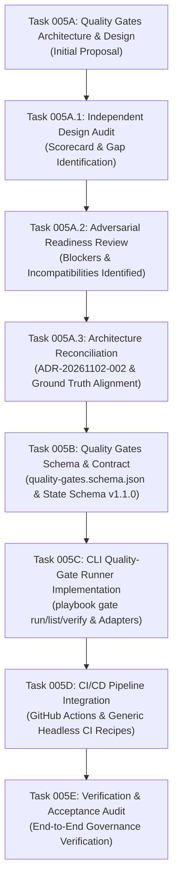

# Quality Gates & CI Integration: Architecture Overview & Roadmap

> **Specification Version**: 2.0.0  
> **Status**: Accepted Architectural Specification (Reconciled & Verifiable Blueprint)  
> **Scope**: Stages 0–6 Quality Verification, Automated Enforcement, CLI Architecture, CI Integration  
> **Target Audience**: Human Engineers, System Architects, AI Coding Agents, Tooling Authors  
> **Audit Reference**: [`docs/architecture/quality-gates/audit-report.md`](audit-report.md)  
> **Authoritative ADR**: [`docs/adr/ADR-20261102-002-quality-gate-atomicity-and-concurrency.md`](../../adr/ADR-20261102-002-quality-gate-atomicity-and-concurrency.md)  
> **Preceding Specifications**:
> - [`core/engineering-constitution.md`](../../core/engineering-constitution.md)
> - [`governance/ENGINEERING_CONTROLLER.md`](../../governance/ENGINEERING_CONTROLLER.md)
> - [`governance/stage-gate-rules.md`](../../governance/stage-gate-rules.md)
> - [`governance/state-machine.md`](../../governance/state-machine.md)
> - [`governance/downstream-storage-convention.md`](../../governance/downstream-storage-convention.md)
> - [`schemas/project-manifest.schema.json`](../../schemas/project-manifest.schema.json)
> - [`schemas/project-state.schema.json`](../../schemas/project-state.schema.json)
> - [`tooling/playbook-cli/README.md`](../../tooling/playbook-cli/README.md)

---

## 1. Executive Summary

The **AI Engineering Playbook** enforces a disciplined, sequential 7-stage engineering lifecycle (Stage 0 to Stage 6). While the foundational phase established cognitive compliance protocols and machine-readable state schemas (`manifest.json` and `state.json`), manual execution of quality checks introduces friction, human cognitive fatigue, and verification gaps.

This architectural blueprint specifies the **Playbook Quality-Gate System & CI Integration**. It bridges the gap between *state inspection* and *deterministic quality execution*. It provides an automated, stack-agnostic execution engine that orchestrates local checks, executes test suites, performs static analysis, runs security audits, captures cryptographic evidence logs, updates deliverable verification states atomically, and integrates seamlessly into Continuous Integration (CI) pipelines.

Following a thorough architectural reconciliation ([ADR-20261102-002](../../adr/ADR-20261102-002-quality-gate-atomicity-and-concurrency.md)), this design is strictly grounded in the physical implementation of `@ai-engineering-playbook/cli`, utilizing the real multi-file `WriteAheadTransactionManager.executeTransaction()` engine, unlocked process execution to prevent mutex starvation, and strict schema compliance.

```
┌────────────────────────────────────────────────────────────────────────────────────────┐
│ The Quality-Gate System: The Operational Bridge                                        │
├────────────────────────────────────────────────────────────────────────────────────────┤
│                                                                                        │
│   [Specification & Code] ──► [Quality-Gate Engine] ──► [Cryptographic Evidence Logs]   │
│                                      │ (Unlocked Phase 4)            │                 │
│                                      ▼                               ▼                 │
│                        [Multi-File Atomic WAL Commit]   [.playbook/logs/*.log]         │
│                                      │ (Sub-second Phase 5)          │                 │
│                                      ▼                               ▼                 │
│                          [.playbook/state.json]  ◄─── [SHA-256 Integrity Verification] │
│                                      │                                                 │
│                                      ▼                                                 │
│                         [Stage Exit Package Draft]                                     │
│                                      │                                                 │
│                                      ▼                                                 │
│                         [HUMAN SOVEREIGNTY GATE]                                       │
│                        (playbook approve --gate N)                                     │
│                                                                                        │
└────────────────────────────────────────────────────────────────────────────────────────┘
```

---

## 2. Architectural Principles & Non-Negotiables

The design adheres strictly to the [Engineering Constitution](../../core/engineering-constitution.md) and Playbook governance model:

1. **Human Sovereignty Inviolability (Principle 1)**: Automated quality checks can execute commands, validate exit codes, produce logs, compute SHA-256 hashes, and transition deliverable `validation_status` to `passed` or `failed`. However, **automated tools and CI pipelines are strictly forbidden from approving stage gates**. Human gate approval (`stage_status: "approved"`, `human_approval.status: "approved"`) remains strictly reserved for authorized human engineers through interactive terminal execution (`playbook approve --gate <N>`) or formal Pull Request sign-offs.
2. **Technology-Agnostic Core (Principle 5)**: The quality gate architecture is 100% stack-agnostic. It assumes no specific programming language (TypeScript, Python, Go, Rust, Java), no specific build tool, and no proprietary CI vendor (GitHub Actions, GitLab CI, CircleCI, Jenkins). Stack specifics are expressed through declarative check definitions and modular command execution adapters.
3. **Fail-Closed Determinism (Principle 3 & 6)**: Any verification failure, unexpected error, timeout, missing log, cyclic dependency, or hash mismatch halts progression immediately. No check fails silently or defaults to success.
4. **Reproducible Input Fingerprints & Freshness (Principle 7)**: Claims of task completion require fresh, reproducible proof. Evidence freshness is governed by a **Reproducible Input Fingerprint (RIF)** computed over input file contents (with LF newline normalization), lockfiles, runtime tool versions, declared environment variables, and working-tree cleanliness.
5. **Three-Tier Working-Tree Policy**: Local iterative development permits uncommitted changes so developers can run tests freely during red-green refactoring. In contrast, formal Stage Gate Handover and headless CI pipeline execution mandate clean deliverable and repository trees.
6. **Multi-File WAL Log & State Atomicity (Principle 8)**: To guarantee that state never references an incomplete or unpromoted evidence log, the canonical log file write and `state.json` mutation are committed **in the same atomic transaction** via `WriteAheadTransactionManager.executeTransaction()`.
7. **Unlocked Execution & Concurrency Safety**: Long-running child processes in Phase 4 run completely unlocked, preventing lock starvation against the 10-second mutex timeout. Lock acquisition is strictly confined to Phase 5 sub-second state registration.
8. **Strict Schema Compatibility (Principle 6)**: No undeclared fields are written to `state.json`. RIF and freshness metadata are durably stored in the canonical log header, sealed by `evidence_hash`. Formal schema evolution adding first-class `rif` properties is assigned to Task 005B.
9. **Zero Playbook Duplication & Composition (Principle 4)**: The quality gate subsystem does not invent parallel state systems, alternative RFC protocols, or duplicate approval mechanisms. It directly builds upon the existing Write-Ahead Log (`TransactionManager`), Process Mutex (`LockManager`), Evidence Verifier (`EvidenceVerifier`), and State Diagnostics (`DiagnosticsEngine`).

---

## 3. The Quality Assurance Spectrum

The Playbook governs quality through three complementary, non-overlapping pillars:

| Pillar | Responsibility | Mechanism | Authority |
| :--- | :--- | :--- | :--- |
| **Pillar 1: Data Contract** | Defines valid schema shapes, lifecycle states, and deliverable metadata. | `schemas/project-manifest.schema.json`<br>`schemas/project-state.schema.json` | Deterministic Schema Engine (Ajv Draft 2020-12) |
| **Pillar 2: Quality Execution** | Orchestrates commands, executes tests, captures logs, computes hashes, and evaluates readiness. | `playbook gate run`<br>Local & CI Execution Adapters | Deterministic Tooling Layer (Quality-Gate Runner) |
| **Pillar 3: Human Governance** | Evaluates exit packages, verifies residual risks, grants exceptions, and authorizes progression. | `playbook approve`<br>`playbook advance` | Human Sovereignty (Interactive TTY / PR Review) |

---

## 4. Document Navigation

This architectural specification is organized into four reconciled documents:

```
docs/architecture/quality-gates/
│
├── README.md             # High-level architecture, principles, system context, and roadmap (this file)
├── audit-report.md       # Final implementation readiness review & adversarial scorecard (Task 005A.2 / 005A.3)
├── gap-analysis.md       # Comprehensive audit of existing CLI capabilities, missing mechanisms, and check taxonomy
└── design.md             # Detailed engineering specification: schemas, CLI commands, adapters, CI, and safety controls
```

### Document Manifest

1. **[audit-report.md](audit-report.md)**:
   - Full adversarial evaluation across 8 critical domains with explicit PASS/PARTIAL/FAIL ratings.
   - Evaluates blockers, ground truth verifications, and records the revised implementation-readiness verdict.
2. **[gap-analysis.md](gap-analysis.md)**:
   - Audits existing CLI capabilities (`inspect`, `validate`, `verify-evidence`, `approve`, `advance`, `WAL`, `LockManager`).
   - Analyzes gaps across local execution, automated test reporting, static analysis, security scanning, CI integration, process asymmetry, and failure handling.
   - Formulates a definitive taxonomy distinguishing **Mandatory Universal Checks** (universal to all Playbook projects) from **Pluggable Stack-Specific Checks** (configured per ecosystem).
3. **[design.md](design.md)**:
   - Defines the Quality-Gate execution model, 6-phase runner lifecycle, and state machine integration.
   - Specifies the multi-file WAL registration protocol, unlocked Phase 4 execution, and Three-Tier Working-Tree Policy.
   - Specifies the configuration schema (`schemas/quality-gates.schema.json` and `.playbook/quality-gates.json`).
   - Details CLI commands (`playbook gate run`, `list`, `verify`), adapters, process group tree-killing, and security boundaries.
4. **[ADR-20261102-002](../../adr/ADR-20261102-002-quality-gate-atomicity-and-concurrency.md)**:
   - Authoritative architecture decision record establishing multi-file WAL atomicity, unlocked execution, and schema compatibility protocols.

---

## 5. Integration Roadmap



- **Task 005A / 005A.1 / 005A.2 / 005A.3 (Completed)**: Discovery, adversarial audits, and reconciled architectural blueprint.
- **Task 005B (Upcoming)**: JSON Schema definition for quality gates configuration and formal non-breaking state schema evolution.
- **Task 005C (Upcoming)**: Implementation of `playbook gate` command suite, execution runner, log capture, and WAL state synchronization in `@ai-engineering-playbook/cli`.
- **Task 005D (Upcoming)**: Reusable CI workflows (GitHub Actions reusable workflows, container definitions, and PR protection checks).
- **Task 005E (Upcoming)**: Full lifecycle verification, test coverage assertions, and security audit report.
