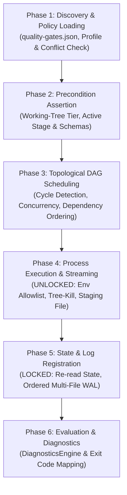

# Quality Gates & CI Integration: Architectural & Governance Specification

> **Document Version**: 2.3.0  
> **Status**: Accepted Architectural Specification (Frozen Architecture for Task 005B)  
> **Target Scope**: CLI Command Engine, Process Execution Harness, CI/CD Adapters, Governance Invariants  
> **Audit Reference**: [`docs/architecture/quality-gates/audit-report.md`](audit-report.md)  
> **Authoritative ADR**: [`docs/adr/ADR-20261102-002-quality-gate-atomicity-and-concurrency.md`](../../adr/ADR-20261102-002-quality-gate-atomicity-and-concurrency.md)  
> **Preceding Specifications**:
> - [`core/engineering-constitution.md`](../../core/engineering-constitution.md)
> - [`governance/ENGINEERING_CONTROLLER.md`](../../governance/ENGINEERING_CONTROLLER.md)
> - [`governance/stage-gate-rules.md`](../../governance/stage-gate-rules.md)
> - [`governance/state-machine.md`](../../governance/state-machine.md)
> - [`governance/downstream-storage-convention.md`](../../governance/downstream-storage-convention.md)
> - [`schemas/project-manifest.schema.json`](../../schemas/project-manifest.schema.json)
> - [`schemas/project-state.schema.json`](../../schemas/project-state.schema.json)
> - [`tooling/playbook-cli/src/core/transaction/transaction-manager.ts`](../../tooling/playbook-cli/src/core/transaction/transaction-manager.ts)
> - [`tooling/playbook-cli/src/core/lock/lock-manager.ts`](../../tooling/playbook-cli/src/core/lock/lock-manager.ts)
> - [`tooling/playbook-cli/src/core/lock/liveness.ts`](../../tooling/playbook-cli/src/core/lock/liveness.ts)
> - [`tooling/playbook-cli/src/core/evidence/verifier.ts`](../../tooling/playbook-cli/src/core/evidence/verifier.ts)

---

## 1. Architectural Vision & Operational Model

The **Playbook Quality-Gate System** provides the deterministic execution layer for the AI Engineering Playbook. It converts static governance policies into active verification workflows that execute locally during engineering iterations and continuously within automated CI pipelines.

```
┌────────────────────────────────────────────────────────────────────────────────────────┐
│ Quality-Gate Architecture & Trust Boundaries                                           │
├────────────────────────────────────────────────────────────────────────────────────────┤
│                                                                                        │
│   DEVELOPER / AI AGENT WORKSPACE (Local Iteration Boundary)                            │
│   ┌──────────────────────────────────────────────────────────────────────────────┐     │
│   │ 1. Code / Spec Changes ──► playbook gate run ──► ProcessHarness              │     │
│   │                                                         │ (Unlocked Execution)│    │
│   │                                                         ▼                    │     │
│   │ 2. Unlocked Staging Stream ──► .playbook/.tmp/proc-<pid>-<nonce>.log         │     │
│   │                                                         │                    │     │
│   │                                                         ▼ (Acquire Lock)     │     │
│   │ 3. Ordered Multi-File WAL ──► WriteAheadTransactionManager.executeTransaction│     │
│   │      ├── files[0]: Canonical Log (.playbook/logs/gate-stage-*.log)           │     │
│   │      └── files[1]: Updated State (.playbook/state.json)                      │     │
│   └──────────────────────────────────────────────────────────────────────────────┘     │
│                                           │                                            │
│                                           ▼                                            │
│   CI / CD AUTOMATION PIPELINE (Independent Verification Boundary)                      │
│   ┌──────────────────────────────────────────────────────────────────────────────┐     │
│   │ 4. Git Push / PR ──► playbook gate run --headless ──► Assert Clean Tree     │     │
│   │                                                         │                    │     │
│   │                                                         ▼                    │     │
│   │ 5. Cryptographic Evidence Verification ◄── playbook verify-evidence          │     │
│   │            │                                                                 │     │
│   │            ▼                                                                 │     │
│   │ 6. Status Check / Step Summary (PASS/FAIL) ──► Blocks PR Merge on Failure    │     │
│   └──────────────────────────────────────────────────────────────────────────────┘     │
│                                           │                                            │
│                                           ▼                                            │
│   HUMAN SOVEREIGNTY BOUNDARY (Mandatory Terminal Review)                               │
│   ┌──────────────────────────────────────────────────────────────────────────────┐     │
│   │ 7. Stage Exit Package Review ──► playbook approve --gate <N> (Interactive TTY)│     │
│   │                                                         │                    │     │
│   │                                                         ▼                    │     │
│   │ 8. Atomic Lifecycle Advancement ◄── playbook advance ──► Next Stage / Seal   │     │
│   └──────────────────────────────────────────────────────────────────────────────┘     │
│                                                                                        │
└────────────────────────────────────────────────────────────────────────────────────────┘
```

### 1.1 Non-Negotiable Separation of Powers & Zero Duplication
To preserve human authority ([Principle 1](../../core/engineering-constitution.md)) and prevent governance duplication ([Principle 4](../../core/engineering-constitution.md)):
- **The Quality-Gate Engine** possesses authority to:
  - Execute configured commands, capture logs, and evaluate process exit codes.
  - Compute Reproducible Input Fingerprints (RIF) and calculate non-circular cryptographic hashes.
  - Transition deliverable `validation_status` to `"passed"` or `"failed"`.
  - Transition deliverable `status` to `"verified"` (if passed) or `"in_progress"` (if failed).
  - Append verifiable evidence records into `deliverables[].evidence[]` strictly conforming to `schemas/project-state.schema.json`.
- **The Quality-Gate Engine is STRICTLY FORBIDDEN from**:
  - Granting human approval (`stage_status: "approved"`).
  - Setting `human_approval.status: "approved"`.
  - Advancing lifecycle stages (`ADVANCE_STAGE` or `CLOSE_LIFECYCLE`).
  - Self-waiving failing quality checks without an authorized human Exception Record (`EXC-*`).
  - Defining parallel RFC, Exception, or approval models. All exceptions remain governed by `governance/exceptions/` and all approvals remain governed by `playbook approve`.

---

## 2. Quality-Gate Execution Model & Lifecycle

The quality-gate engine executes checks through a deterministic, 6-phase pipeline designed to fail fast, preserve evidence, prevent lock starvation, and guarantee atomic state updates:



### 2.1 Phase 1: Discovery & Policy Loading
1. Resolve target workspace directory (`--cwd` or `process.cwd()`).
2. Read `.playbook/manifest.json` to identify active stage, governance profile (`strict`, `standard`, `lightweight`), and declared capabilities.
3. Read `.playbook/quality-gates.json`. Validate configuration against `schemas/quality-gates.schema.json`.
4. **Pattern Conflict Validation**:
   - Assert that no glob pattern appears in both `text_patterns` and `binary_patterns`.
   - If a file path matches both an explicit text pattern and an explicit binary pattern, configuration loading **fails closed immediately with code `CONFIG_PATTERN_CONFLICT` (exit code 2)**.
5. Filter checks applicable to the current active lifecycle stage and active governance profile.

### 2.2 Phase 2: Precondition Assertion & Three-Tier Working-Tree Policy
The system applies a context-aware **Three-Tier Working-Tree Policy** to eliminate the conflict between local developer velocity and release determinism:

```
┌────────────────────────────────────────────────────────────────────────────────────────┐
│ Three-Tier Working-Tree Policy Matrix                                                  │
├────────────────────────────────────────────────────────────────────────────────────────┤
│                                                                                        │
│ Tier 1: Local Development Iteration (`playbook gate run`)                              │
│  - Dirty working tree PERMITTED.                                                       │
│  - Hashes real-time uncommitted file contents on disk.                                 │
│  - Captured evidence log header records `dirty_tree: true`.                            │
│  - Enables fast local red-green-refactor loop without forcing premature commits.       │
│                                                                                        │
│ Tier 2: Stage Gate Handover (`playbook inspect` / Exit Package Submission)             │
│  - Deliverables mapped to code and architecture MUST HAVE CLEAN WORKING TREE.          │
│  - Governing project manifests (`package.json`, `Cargo.toml`, etc.) MUST BE CLEAN.    │
│  - Uncommitted changes in target deliverable paths prevent Exit Package submission.    │
│  - Guarantees human reviewer evaluates committed, immutable artifacts.                │
│                                                                                        │
│ Tier 3: Headless CI Pipeline & Release (`playbook gate run --headless` / Stages 5 & 6) │
│  - Entire repository MUST BE 100% CLEAN (`git status --porcelain` is empty).           │
│  - Checked prior to running test execution.                                            │
│  - Any untracked or modified files immediately abort with exit code 3.                 │
│  - Test runners must output generated artifacts to ignored paths (.gitignore).        │
│                                                                                        │
└────────────────────────────────────────────────────────────────────────────────────────┘
```

1. **Schema Integrity**: Assert that `manifest.json` and `state.json` conform to Draft 2020-12 schemas via `AjvValidator`.
2. **Stage Status Invariant**: Assert that `stage_status` is `in_progress` or `pending_review`. If `blocked`, abort with instructions to resolve the blocking RFC.

### 2.3 Phase 3: Topological DAG Scheduling & Cycle Detection
1. Construct directed acyclic graph (DAG) of configured checks based on `depends_on` declarations (e.g. `format_check` $\rightarrow$ `lint_check` $\rightarrow$ `type_check` $\rightarrow$ `unit_tests`).
2. **Static Cycle Detection**: Execute Kahn's algorithm or Tarjan's cycle detection before any process is executed. If a circular dependency is detected (e.g., $A \rightarrow B \rightarrow A$), abort immediately with exit code `2` (`CONFIG_CYCLIC_DEPENDENCY`).
3. Schedule independent checks concurrently up to `max_concurrency` (default: 4; 1 in CI for absolute determinism).
4. If `--fail-fast` is specified, cancel remaining checks immediately upon the first blocking check failure.

### 2.4 Phase 4: Process Execution, Isolation & Streaming (UNLOCKED)
> [!IMPORTANT]
> **Locking Boundary**: Phase 4 executes completely **unlocked**. No lock is held during command execution, ensuring that long-running test suites never induce lock starvation or exceed the 10-second mutex timeout.

1. **Subprocess Isolation & Environment Allowlist**:
   - Do **NOT** blindly inherit host ambient `process.env`.
   - Inject only an explicit base allowlist (`PATH`, `HOME`, `USER`, `LANG`, `TERM`, `SYSTEMROOT`, `TMPDIR`, `NODE_ENV`) plus explicitly declared `env: {}` keys from the check configuration.
   - Forbid raw shell interpretation (`child_process.spawn()` with explicit argument array; no `sh -c` or `cmd.exe /c`).
2. **Process Tree Termination & Graceful Escalation**:
   - Spawn child processes in an isolated process group (`detached: true` on POSIX).
   - On timeout or cancellation:
     - Stage 1 (Graceful): Send `SIGTERM` (POSIX) or `taskkill /pid <PID> /T` (Windows) with a 3,000 ms grace period to permit buffer flushing.
     - Stage 2 (Forceful Escalation): Escalate to `SIGKILL` (`process.kill(-pid, 'SIGKILL')` on POSIX; `taskkill /pid <PID> /T /F` on Windows).
     - Catch POSIX `ESRCH` gracefully if the group leader already exited.
     - Catch Windows error code 128 ("process not found") as benign.
   - Signal Trapping: CLI runner traps `SIGINT` (Ctrl+C) and `SIGTERM` to reap active child trees before terminating.
3. **Atomic Staging Stream & Ownership Metadata**:
   - Write `.playbook/.tmp/proc-<pid>-<nonce>.meta.json` **atomically first** via temporary write and rename before process execution begins.
   - Output streams to an isolated staging file: `.playbook/.tmp/proc-<pid>-<nonce>.log`.
   - Pass stream chunks through `SecretScrubber` (best-effort regex masking of credentials).
   - Upon process termination, capture exit code and duration.
4. **Reproducible Input Fingerprint (RIF) Computation**: Compute the RIF over input files, lockfiles, runtime tool versions, and env keys with deterministic classification and LF newline normalization.

### 2.5 Phase 5: State & Evidence Registration (LOCKED Multi-File WAL)
> [!IMPORTANT]
> **Atomic Multi-File WAL Registration**: State mutation and canonical log file creation occur **in the same atomic WAL transaction** via `WriteAheadTransactionManager.executeTransaction()`.

1. **Lock Acquisition & State Revalidation**:
   - `executeTransaction()` acquires `.playbook/transaction.lock` via `TransactionLockManager.withLock()`.
   - Under the lock, read fresh `.playbook/state.json` from disk.
   - **State Concurrency Check**:
     - If `current_stage` changed or `stage_status` transitioned to `blocked` during Phase 4, the check results are invalidated with diagnostic code `CHECK_RESULT_SUPERSEDED`.
     - Otherwise, merge the new evidence into `current_stage_detail.deliverables[]`.
2. **Log Assembly, Truncation & Non-Circular Hashing**:
   - Read staged log from `.playbook/.tmp/proc-<pid>-<nonce>.log`.
   - Prepend structured metadata header (recording Check ID, Command, Timestamp, Git Commit, RIF, Tool Version, Clean Tree).
   - **Log Middle-Truncation Policy**: If total assembled log exceeds 2 MB (`max_journaled_log_bytes`), apply middle-truncation preserving the first 1 MB (head) and last 1 MB (tail) with an explicit notice.
   - Append execution footer (Exit Code, Duration, Outcome, Completed Timestamp).
   - **Non-Circular Hash Calculation**: Compute `canonical_log_sha256 = SHA256(finalizedLogBytes)`. Notice that the log does **NOT** contain its own SHA-256 hash field inside its body, eliminating circularity.
3. **Ordered Multi-File Transaction**:
   - Construct `fileOperations` with strict ordering:
     - `files[0]`: Canonical log `.playbook/logs/gate-stage-<N>-<check_id>-<timestamp>.log` (`createOnly: true`, `content: finalizedLogBytes`).
     - `files[1]`: `.playbook/state.json` (`content: serializedStateJson`, `expectedPreviousSha256: currentDiskHash`).
   - Call `WriteAheadTransactionManager.executeTransaction("RECORD_QUALITY_GATE_EVIDENCE", fileOperations)`.
4. **Staging Cleanup**:
   - Unlink `.playbook/.tmp/proc-<pid>-<nonce>.log` and its `.meta.json`.

### 2.6 WAL Crash-State Analysis Matrix

The table below analyzes system recoverability and external observer visibility across every failure point in the multi-file transaction:

| WAL Journal Phase | Crash Moment | Disk State at Crash | Recovery Action (`this.recover()`) | Post-Recovery Result | External Reader Visibility During Crash Window |
| :--- | :--- | :--- | :--- | :--- | :--- |
| **PREPARING** | Writing `tx-journal.json` or staging `.tmp.<txId>` files. | Pre-transaction state; staging files may exist. | Unlinks staging `.tmp.<txId>` files; deletes journal. | Clean Rollback | Reader observes valid pre-transaction state. |
| **PREPARED** | Journal is `PREPARED`; live targets untouched. | Pre-transaction state; staging files exist. | Unlinks staging `.tmp.<txId>` files; deletes journal. | Clean Rollback | Reader observes valid pre-transaction state. |
| **COMMITTING (Step A)**| `files[0]` (canonical log) is renamed into place; `files[1]` (`state.json`) not yet touched. | Canonical log exists on disk; `state.json` is still in pre-transaction state. | Reads `target_content` from journal, writes and renames `files[1]` (`state.json`), transitions to `COMMITTED`. | **Clean Roll Forward** | **Safe Intermediate State**: Reader of `state.json` sees old state. It does NOT observe a broken pointer because old `state.json` does not reference the new log. |
| **COMMITTING (Step B)**| Both `files[0]` and `files[1]` are renamed; journal not yet updated to `COMMITTED`. | Both log and `state.json` exist on disk with committed contents. | Verifies target hashes, transitions journal to `COMMITTED`, unlinks backup files and journal. | **Clean Roll Forward Confirmed** | Reader observes committed state. |
| **COMMITTED** | Crash during cleanup of `.bak.<txId>` files or journal deletion. | Both log and `state.json` exist; leftover `.bak` files. | Finalizes deletion of `.bak` files and removes journal. | Complete Cleanup | Reader observes committed state. |
| **DURING RECOVERY** | Crash while `recover()` is rolling forward or backward. | Partially restored or rolled-forward files. | Re-running `recover()` is 100% idempotent; it re-reads journal and completes recovery. | Consistent State Guaranteed | Reader without lock observes intermediate state until recovery finishes. |

### 2.7 Reader Consistency Protocol
To obtain a guaranteed consistent state/log pair:
1. **Lock Acquisition**: Readers requiring strict consistency acquire `.playbook/transaction.lock` via `lockManager.withLock()`.
2. **Journal Inspection**: Read-only observers inspect `.playbook/tx-journal.json`:
   - If `tx-journal.json` does not exist: the pair is fully committed and consistent.
   - If `tx-journal.json` exists: a transaction is actively committing or in recovery. Readers must wait for completion or execute `recover()`.
3. **Ordered Visibility Protection**: Committing `files[0]` = log and `files[1]` = `state.json` guarantees that an uncoordinated reader of `state.json` never observes a dangling pointer to a missing log.
4. **No Simultaneous Multi-File Visibility**: On POSIX and Windows, multi-file renames are not a single hardware atomic syscall. Ordering `files[0]` = log and `files[1]` = state guarantees that uncoordinated readers never observe dangling references.

---

## 3. Machine-Readable Configuration & Schema Evolution Boundary

### 3.1 Strict Schema Compatibility & Migration Boundary
`schemas/project-state.schema.json` line 195 strictly enforces `"additionalProperties": false` on `evidence` objects.

```
┌────────────────────────────────────────────────────────────────────────────────────────┐
│ Schema Evolution & Migration Boundary Matrix                                          │
├────────────────────────────────────────────────────────────────────────────────────────┤
│                                                                                        │
│ Schema Version v1.0.0 (Current Baseline):                                              │
│  - evidence[] strictly permits ONLY 12 declared fields (additionalProperties: false).  │
│  - rif, dirty_tree, inputs_hash CANNOT be written to state.json.                       │
│  - RIF is encapsulated in canonical log header and sealed by evidence_hash.            │
│  - State summary optionally includes tag: [rif:sha256:... clean:true].                 │
│                                                                                        │
│ Schema Version v1.1.0 (Formal Task 005B Specification):                                │
│  - project-state.schema.json adds OPTIONAL properties:                                 │
│    - rif: { type: "string", pattern: "^sha256:[a-f0-9]{64}$" }                        │
│    - working_tree_clean: { type: "boolean" }                                           │
│  - Backward Compatibility: All existing v1.0.0 state files are 100% valid in v1.1.0    │
│    because new fields are strictly OPTIONAL.                                           │
│  - Forward Compatibility Limitation: Older CLI tools running v1.0.0 validator WILL     │
│    FAIL on state files containing v1.1.0 evidence fields due to additionalProperties.  │
│    Therefore, CLI v1.1.0 maintains dual-mode support: writing log-header RIF keeps     │
│    v1.0.0 tools functional; direct property writing requires CLI v1.1.0+.              │
│                                                                                        │
└────────────────────────────────────────────────────────────────────────────────────────┘
```

### 3.2 Proposed Configuration Schema (`schemas/quality-gates.schema.json`)

```json
{
  "$schema": "https://json-schema.org/draft/2020-12/schema",
  "$id": "https://ai-engineering-playbook.org/schemas/quality-gates.schema.json",
  "title": "AI Engineering Playbook - Quality Gates Configuration Schema",
  "description": "Declarative, stack-agnostic configuration specifying quality-gate checks, execution commands, input patterns, timeout policies, severity levels, and deliverable bindings across Stages 0 through 6.",
  "type": "object",
  "required": [
    "$schema",
    "schema_version",
    "project_id",
    "default_profile",
    "global_settings",
    "gates"
  ],
  "additionalProperties": false,
  "properties": {
    "$schema": { "type": "string" },
    "schema_version": { "type": "string", "pattern": "^[0-9]+\\.[0-9]+\\.[0-9]+$" },
    "project_id": { "type": "string", "pattern": "^[a-z0-9]+(-[a-z0-9]+)*$" },
    "default_profile": { "type": "string", "enum": ["strict", "standard", "lightweight"] },
    "global_settings": {
      "type": "object",
      "required": [
        "default_timeout_ms",
        "max_concurrency",
        "mask_secrets",
        "log_retention_runs",
        "max_journaled_log_bytes",
        "env_allowlist"
      ],
      "additionalProperties": false,
      "properties": {
        "default_timeout_ms": { "type": "integer", "minimum": 1000, "maximum": 600000, "default": 120000 },
        "max_concurrency": { "type": "integer", "minimum": 1, "maximum": 32, "default": 4 },
        "mask_secrets": { "type": "boolean", "default": true },
        "log_retention_runs": { "type": "integer", "minimum": 1, "maximum": 50, "default": 10 },
        "max_journaled_log_bytes": { "type": "integer", "minimum": 1024, "maximum": 10485760, "default": 2097152 },
        "env_allowlist": {
          "type": "array",
          "items": { "type": "string" },
          "description": "Base environment variables permitted into subprocess environments."
        },
        "sensitive_patterns": {
          "type": "array",
          "items": { "type": "string" },
          "description": "Additional custom regex patterns to scrub from log streams."
        }
      }
    },
    "gates": {
      "type": "array",
      "items": {
        "type": "object",
        "required": ["stage", "stage_name", "checks"],
        "additionalProperties": false,
        "properties": {
          "stage": { "type": "integer", "minimum": 0, "maximum": 6 },
          "stage_name": { "type": "string" },
          "checks": {
            "type": "array",
            "items": {
              "type": "object",
              "required": [
                "id",
                "name",
                "type",
                "deliverable_id",
                "command",
                "args"
              ],
              "additionalProperties": false,
              "properties": {
                "id": { "type": "string", "pattern": "^[a-z0-9]+(-[a-z0-9]+)*$" },
                "name": { "type": "string" },
                "type": {
                  "type": "string",
                  "enum": [
                    "automated_test",
                    "build_typecheck",
                    "static_analysis",
                    "schema_validation",
                    "security_audit",
                    "manual_functional",
                    "visual_review",
                    "accessibility_audit",
                    "architecture_review"
                  ]
                },
                "deliverable_id": { "type": "string" },
                "requirement_ids": { "type": "array", "items": { "type": "string" } },
                "inputs": {
                  "type": "array",
                  "items": { "type": "string" },
                  "description": "Glob patterns defining input files that affect this check (used for RIF freshness)."
                },
                "exclude": {
                  "type": "array",
                  "items": { "type": "string" },
                  "description": "Glob patterns to exclude from RIF computation (e.g. dist/**, coverage/**)."
                },
                "text_patterns": {
                  "type": "array",
                  "items": { "type": "string" },
                  "description": "Glob patterns explicitly classified as text for LF normalization."
                },
                "binary_patterns": {
                  "type": "array",
                  "items": { "type": "string" },
                  "description": "Glob patterns explicitly classified as binary (hashed as raw bytes)."
                },
                "lockfiles": {
                  "type": "array",
                  "items": { "type": "string" },
                  "description": "Dependency lockfiles tracked for this check (e.g. package-lock.json, Cargo.lock)."
                },
                "tool_version_command": {
                  "type": "string",
                  "description": "Command to determine tool version (e.g. 'node --version', 'tsc --version')."
                },
                "command": { "type": "string" },
                "args": { "type": "array", "items": { "type": "string" } },
                "working_dir": { "type": "string" },
                "env": { "type": "object", "additionalProperties": { "type": "string" } },
                "timeout_ms": { "type": "integer", "minimum": 1000, "maximum": 600000 },
                "severity": { "type": "string", "enum": ["blocking", "warning", "advisory"], "default": "blocking" },
                "depends_on": { "type": "array", "items": { "type": "string" } },
                "retry": {
                  "type": "object",
                  "required": ["count", "delay_ms"],
                  "additionalProperties": false,
                  "properties": {
                    "count": { "type": "integer", "minimum": 1, "maximum": 5 },
                    "delay_ms": { "type": "integer", "minimum": 100, "maximum": 30000 }
                  }
                },
                "profiles": {
                  "type": "array",
                  "items": { "type": "string", "enum": ["strict", "standard", "lightweight"] }
                }
              }
            }
          }
        }
      }
    }
  }
}
```

---

## 4. CLI Command Interface Specification

### 4.1 `playbook gate run`
Executes quality-gate checks, captures logs, computes RIF and SHA-256 hashes, and records verification evidence in `.playbook/state.json` via atomic WAL transactions.

```bash
# Execute all quality checks for the active stage
playbook gate run

# Execute checks for a specific stage
playbook gate run --stage 3

# Execute a single targeted check by ID
playbook gate run --check unit-tests

# Run in headless CI mode (enforces clean tree and emits CI summary)
playbook gate run --headless

# Machine-readable JSON output for CI pipelines
playbook gate run --json

# Fail fast upon first blocking check failure
playbook gate run --fail-fast

# Automatically trigger Controller Halt if a blocking check fails
playbook gate run --halt-on-failure
```

#### Exit Code Taxonomy
- `0`: All executed checks passed; deliverables transitioned to `verified`; evidence registered.
- `1`: One or more blocking checks failed; deliverables reverted to `in_progress`.
- `2`: Configuration or schema syntax error (e.g. malformed JSON, cyclic dependency, pattern conflict).
- `3`: Precondition failure (e.g. dirty working tree under `--headless`, missing manifest/state).
- `4`: Execution timeout, process group termination error, or system execution failure.

### 4.2 `playbook gate list`
Lists configured quality gates, checks, dependency DAGs, and profile bindings across stages.

```bash
playbook gate list --stage 3
playbook gate list --all --json
```

### 4.3 `playbook gate verify`
Fast, read-only assertion checking whether all required quality checks for the active stage currently have fresh, valid, unexpired evidence without re-executing processes.

```bash
playbook gate verify
playbook gate verify --json
```

---

## 5. Evidence Freshness & Deterministic RIF Canonicalization

### 5.1 The Reproducible Input Fingerprint (RIF) Formulation
To eliminate the limitations of naive Git commit tracking, evidence freshness is computed via a mathematical **Reproducible Input Fingerprint (RIF)**:

$$\text{RIF} = \text{SHA256}\Big(\text{Hash}(\text{InputFiles}) \,\|\, \text{Hash}(\text{Lockfiles}) \,\|\, \text{ToolVersion} \,\|\, \text{Hash}(\text{EnvKeys}) \,\|\, \text{CleanState}\Big)$$

#### Detailed Classification & Canonicalization Rules:
1. **Explicit File Classification Policy (Zero Silent Normalization)**:
   - Content heuristics alone (e.g. searching for null bytes) are fundamentally unreliable: binary formats without null bytes in initial windows or valid UTF-8 binary streams can be corrupted by silent normalization.
   - Classification Hierarchy:
     - **Tier 1 (Explicit Check Declaration)**: Check configuration explicit `binary_patterns: []` or `text_patterns: []`.
       - *Conflict Precedence*: If a file path matches both `text_patterns` and `binary_patterns`, configuration loading **fails closed immediately with `CONFIG_PATTERN_CONFLICT`**.
       - *Override*: Tier 1 explicit check patterns take absolute precedence over built-in extensions.
     - **Tier 2 (Well-Known Extensions)**: Built-in source/doc extensions (`.ts`, `.tsx`, `.js`, `.jsx`, `.json`, `.md`, `.py`, `.go`, `.rs`, `.java`, `.c`, `.cpp`, `.css`, `.html`, `.xml`, `.yaml`, `.toml`, `.sh`, `.ps1`).
     - **Tier 3 (Safe Default for Unknown Files)**: Any unclassified file is treated as **BINARY (RAW BYTES)**.
     - **Non-Negotiable Invariant**: **Unknown extensions ALWAYS use raw-byte hashing without newline conversion. NEVER silently normalize an unclassified file.**
2. **Text Canonicalization Specification**:
   - **Strict UTF-8 Validation**: Text-classified files must be strictly valid UTF-8. If decoding encounters invalid byte sequences, RIF calculation fails closed with `INVALID_UTF8_ENCODING`.
   - **UTF-8 BOM Handling**: Leading UTF-8 Byte Order Marks (`0xEF, 0xBB, 0xBF` / `\uFEFF`) are stripped prior to newline normalization.
   - **Newline Normalization**: All occurrences of CRLF (`\r\n`) and lone CR (`\r`) are converted to LF (`\n`).
   - **Hashing Bytes**: The normalized UTF-8 string is encoded to UTF-8 bytes and hashed with SHA-256.
3. **Binary Canonicalization**:
   - Binary files are hashed strictly as raw, unaltered byte buffers.
4. **Path Ordering & Normalization**:
   - Matched relative POSIX paths (`path.relative(projectDir, f).replace(/\\/g, '/')`) are sorted strictly by UTF-16 code units.
   - Symlinks resolving outside the project root are rejected with `INVALID_SYMLINK_TRAVERSAL`. Internal symlinks have their relative target path string hashed (`symlink:-> relative/path`), avoiding circular directory traversal loops.
5. **Deleted Files Handling**:
   - RIF input manifest is an array of `{ path, sha256 }`. A deleted file is absent from the manifest, altering the resulting hash deterministically.
6. **Generated Output Exclusions**:
   - Check definitions must declare `exclude: []` globs (`dist/**`, `coverage/**`, `*.tsbuildinfo`). Files matching exclude patterns are skipped, preventing self-invalidation loops.

### 5.2 Canonicalization Design Test Vectors (Verified Cryptographic Hashes)

All cryptographic test vectors below have been verified using Node.js `crypto.createHash('sha256')`:

| Test Vector ID | Input Description | Raw Input Bytes (Hex) | Canonical Output Bytes (Hex) | Canonicalization Transformation | Exact Expected SHA-256 Digest |
| :--- | :--- | :--- | :--- | :--- | :--- |
| **VEC-01** | Pure ASCII CRLF Text | `68 65 6c 6c 6f 0d 0a 77 6f 72 6c 64 0d 0a` | `68 65 6c 6c 6f 0a 77 6f 72 6c 64 0a` (12 bytes) | Decoded UTF-8 $\rightarrow$ CRLF normalized to LF $\rightarrow$ `hello\nworld\n` | `4a1e67f2fe1d1cc7b31d0ca2ec441da4778203a036a77da10344c85e24ff0f92` |
| **VEC-02** | Pure ASCII LF Text | `68 65 6c 6c 6f 0a 77 6f 72 6c 64 0a` | `68 65 6c 6c 6f 0a 77 6f 72 6c 64 0a` (12 bytes) | Decoded UTF-8 $\rightarrow$ LF preserved $\rightarrow$ `hello\nworld\n` | `4a1e67f2fe1d1cc7b31d0ca2ec441da4778203a036a77da10344c85e24ff0f92` *(Matches VEC-01)* |
| **VEC-03** | UTF-8 BOM & Mixed Newlines | `ef bb bf 6c 69 6e 65 31 0d 6c 69 6e 65 32 0d 0a 6c 69 6e 65 33 0a` | `6c 69 6e 65 31 0a 6c 69 6e 65 32 0a 6c 69 6e 65 33 0a` (18 bytes) | BOM stripped $\rightarrow$ lone CR & CRLF normalized to LF $\rightarrow$ `line1\nline2\nline3\n` | `66663af9c7aa341431a8ee2ff27b72abd06c9218f517bb6fef948e4803c19e03` |
| **VEC-04** | Binary File (Contains `\r\n` without null bytes) | `01 02 0d 0a 03 04` | `01 02 0d 0a 03 04` (6 bytes) | Classified as binary (Tier 1/3) $\rightarrow$ NO normalization $\rightarrow$ raw bytes hashed | `05222511c09b8166ff3d26f0cbef77da9ad216015c3e67695f7698da60698327` |
| **VEC-05** | Invalid UTF-8 in Text File | `68 65 6c 6c 6f 20 ff fe 77 6f 72 6c 64` | N/A (Execution halted) | Fails closed with error `INVALID_UTF8_ENCODING` | `N/A` (Execution halted) |

### 5.3 Canonical Log Format & Reproducible Hash-Verification Example

The canonical log file on disk does **not** contain a self-referential hash line. The authoritative hash is stored in `state.json` and verified by reading the raw file buffer:

```
=== PLAYBOOK QUALITY-GATE EXECUTION LOG ===
Check ID:        unit-tests
Check Name:      Automated Unit Test Suite
Check Type:      automated_test
Stage:           3 (Implementation & Unit Verification)
Deliverable ID:  DELIV-302
Requirement IDs: REQ-001, REQ-002
Command:         npm test -- --coverage
Working Dir:     .
Git Commit:      a1b2c3d4e5f67890123456789012345678901234
Working Tree:    clean
RIF:             sha256:8f4e2b1a9c3d5e7f0b2a4c6e8d0f1a3b5c7e9d1f3a5b7c9e1d3f5a7b9c1d3e5f
Tool Version:    v20.18.0
Truncated:       false
Started At:      2026-11-02T14:00:15.120Z
=================================================

> test
> vitest run --coverage

 ✓ tests/unit/payment.test.ts (14 tests) 142ms
 ✓ tests/unit/auth.test.ts (8 tests) 95ms

 Test Files  2 passed (2)
      Tests  22 passed (22)
   Duration  1.42s

=================================================
=== EXECUTION RESULT ===
Exit Code:       0
Outcome:         PASSED
Duration:        1420 ms
Completed At:    2026-11-02T14:00:16.540Z
=================================================
```

#### Reproducible Verification Algorithm (`EvidenceVerifier`):
```typescript
// Verified implementation in src/core/evidence/verifier.ts
const buffer = fs.readFileSync(targetPath);
const hexDigest = crypto.createHash("sha256").update(buffer).digest("hex");
const calculatedHash = `sha256:${hexDigest}`.toLowerCase();

// Compare against state.json deliverable evidence record
const isMatch = calculatedHash === recordedHashInStateJson;
```

---

## 6. Process Staging-File Reaping & Crash Recovery

### 6.1 Conservative PID Staging-File Reaping Protocol
To prevent accidental deletion of live process outputs or PID reuse races:
1. **Atomic Metadata Creation**: Every staging stream `.playbook/.tmp/proc-<pid>-<nonce>.log` is accompanied by `.playbook/.tmp/proc-<pid>-<nonce>.meta.json` written atomically via temporary write and rename before process execution begins:
   ```json
   {
     "schema_version": "1.0.0",
     "pid": 12345,
     "run_nonce": "a1b2c3d4-e5f6-4789-a012-34567890abcd",
     "hostname": "workstation-1",
     "created_at": "2026-11-02T16:00:00.000Z",
     "started_at_ms": 1793616000000,
     "command": "npm",
     "args": ["test"]
   }
   ```
2. **Crash Window Behavior (Strictly Conservative Retention)**:
   - *Crash Window A (Log exists, `.meta.json` missing)*: If the process crashed before creating `.meta.json`, process ownership cannot be proven. **The `.log` file is preserved on disk**; a diagnostic warning `UNVERIFIABLE_STAGING_FILE` is logged.
   - *Crash Window B (`.meta.json` exists, `.log` missing)*: If `.meta.json` exists but `.log` does not, the reaper verifies liveness via `defaultProcessLivenessChecker`. If `isVerifiedDead === true`, the orphaned `.meta.json` is unlinked. If alive or indeterminate, it is preserved.
   - *Crash Window C (Malformed `.meta.json`)*: Invalid JSON or missing `pid`/`run_nonce` triggers **conservative retention** (never delete).
3. **Strict Liveness Verification (`liveness.ts`)**: Staging cleanup reuses `defaultProcessLivenessChecker` (`src/core/lock/liveness.ts`):
   - Validates PID integer.
   - Cross-host check: remote hostname staging files are never touched.
   - Probes `process.kill(pid, 0)`:
     - `ESRCH`: Process is definitively dead (`isVerifiedDead: true`).
     - `EPERM`: Process exists in another context; treated as **ALIVE**.
   - Process start-time check: on supported platforms, verifies process start time against `created_at` to prevent PID reuse races.
4. **Conservative Deletion Invariants**:
   - Staging files are unlinked **only if `isVerifiedDead === true`**.
   - If `isAlive === true` or `isIndeterminate === true`, the file is left untouched.
   - **Never delete files in `.playbook/logs/` using heuristics or unrestricted glob patterns.** Existing logs in `.playbook/logs/` are permanent evidence artifacts managed only by explicit retention policies.

---

## 7. Security & Trust Boundaries

### 7.1 Intellectual Honesty Regarding Secret Redaction
- **Scientific Limitation**: Regular-expression-based stream scrubbing is an imperfect, best-effort mitigation. It **cannot guarantee** that proprietary keys, base64-encoded strings, or custom credentials are fully redacted.
- **Operational Rule**: The system explicitly warns developers and CI administrators: **Do not rely on log redaction for secret protection.** Secrets, tokens, and private keys must be excluded from the test execution environment entirely.

### 7.2 Subprocess Execution & Untrusted Workspace Boundaries
- **Command Argument Array**: Commands are spawned using `args: string[]` without a subshell, preventing argument-level shell injection.
- **Untrusted Script Risk**: Tools like `npm test` or `cargo test` execute scripts defined inside `package.json` or `Cargo.toml`. The Playbook Quality Gate Runner requires a **trusted repository context**; it does not provide OS-level containerization. For untrusted agent code, CI pipelines must execute `playbook gate run` within an isolated, disposable container (Docker/Podman).
- **Environment Allowlisting**: Only an explicit baseline of harmless system variables (`PATH`, `HOME`, `USER`, `LANG`, `TMPDIR`) plus declared `env` keys are exposed to child processes.

---

## 8. Stage 0–6 Quality Gate Integration Matrix

| Stage | Stage Name | Mandatory Universal Checks | Pluggable Stack-Specific Checks | Exit Gate Deliverable |
| :--- | :--- | :--- | :--- | :--- |
| **Stage 0** | Discovery & Problem Formulation | - Manifest & State schema validation<br>- Zero blocking RFCs | - Markdown structure linter<br>- Spec completeness validator | `PRD-CORE.md` |
| **Stage 1** | Requirements & Specification | - PRD core existence & assessment<br>- Acceptance criteria syntax check | - Requirements-to-testability linter<br>- RFC resolution auditor | `PRD-SPEC.md` |
| **Stage 2** | Architecture & System Design | - ADR structural validation<br>- Interface contract schema check | - OpenAPI / JSON Schema validator<br>- Architectural dependency scan | System Architecture & ADRs |
| **Stage 3** | Implementation & Unit Verification | - Clean working tree check at handover<br>- Zero expired exceptions | - AST Linter (zero warnings in strict)<br>- Static Typecheck<br>- Automated Unit Tests | Source Code & Unit Test Suite |
| **Stage 4** | Integration & System Verification | - Evidence hash integrity<br>- Freshness binding via RIF | - Integration test suite<br>- Contract verification tests<br>- E2E API tests | Integration Test Suites |
| **Stage 5** | Review, Hardening & Release Readiness | - Hermetic build clean check (Tier 3)<br>- Changelog / release note sync | - Security vulnerability audit<br>- Secret scanning check<br>- Production bundle build | Release Bundle & Security Audit |
| **Stage 6** | Deployment & Operational Monitoring | - Milestone snapshot collision check<br>- Post-deploy health assertion | - Deployment smoke tests<br>- APM error rate check<br>- Synthetic canary probe | Deployment Log & Telemetry Baseline |

---

## 9. Architectural Invariants Checklist for Task 005B

Task 005B must preserve the following non-negotiable architectural invariants:

1. [x] **Schema Integrity**: Zero undeclared fields written to `project-state.schema.json` v1.0.0; formal schema evolution introduces optional `rif` and `working_tree_clean` in v1.1.0.
2. [x] **Non-Circular Byte Hashing**: The canonical evidence log on disk does not contain a self-hash field; `evidence_hash` covers the raw file buffer on disk.
3. [x] **Ordered Multi-File WAL Operations**: `files[0]` is canonical log (`createOnly: true`), `files[1]` is `state.json` (`expectedPreviousSha256`).
4. [x] **Execution Locking Boundary**: Phase 4 command execution runs completely unlocked; Phase 5 mutex acquisition is sub-second.
5. [x] **Deterministic RIF Classification**: Never silently normalize unclassified files; text-classified files use LF newline normalization and strip BOM; unknown files are hashed as raw bytes.
6. [x] **Conservative Staging Reaping**: Staging files pair `.log` and `.meta.json`; deletion requires `isVerifiedDead === true`; missing/unverifiable metadata triggers conservative retention; zero wildcard cleanup.
7. [x] **Three-Tier Working Tree Policy**: Local dev permits dirty tree; Handover mandates clean deliverable paths and manifests; CI enforces 100% clean repository.
8. [x] **Human Sovereignty**: Quality gates verify deliverable evidence (`validation_status: "passed"`), but never grant human stage approval (`stage_status: "approved"`).
