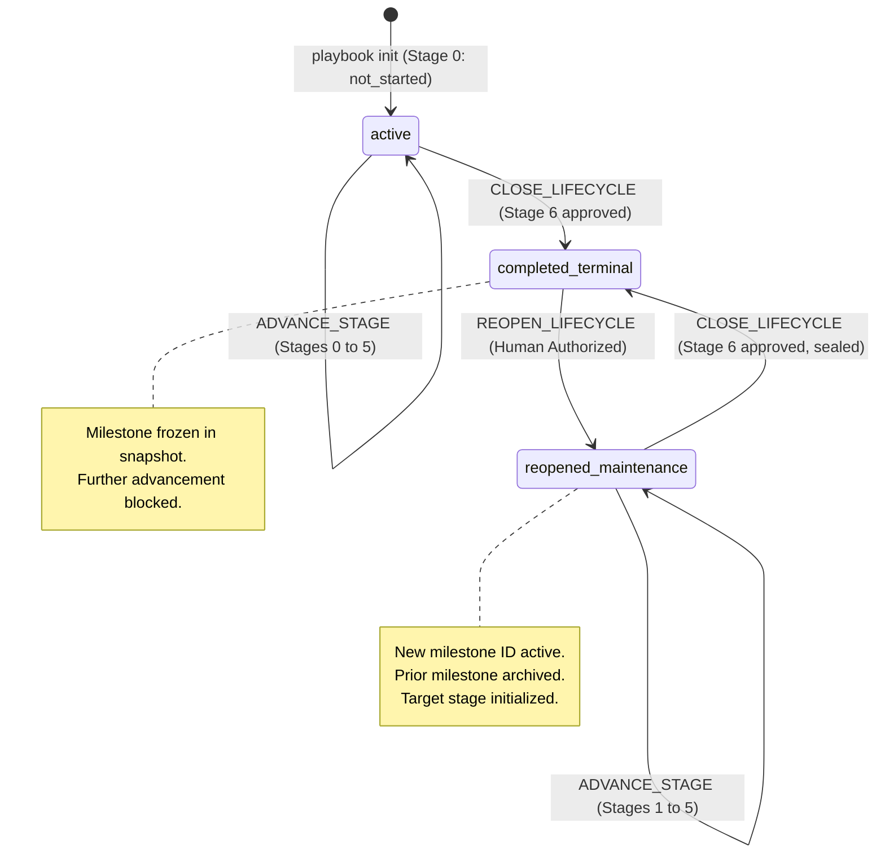
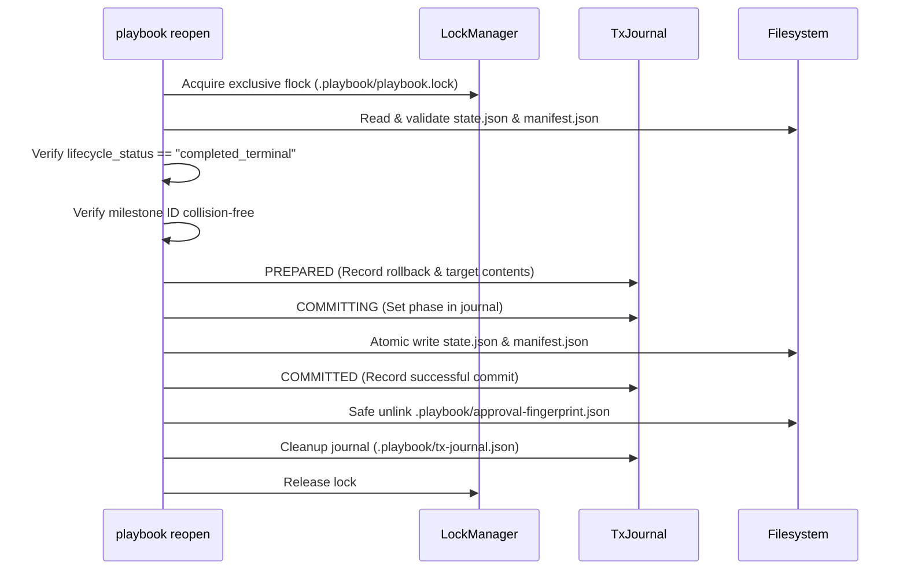

# Controlled Lifecycle Reopening: Architecture & State-Transition Design

> **Document Version**: 1.0.0  
> **Status**: Accepted Architectural Specification (Design Only)  
> **Target Package**: `@ai-engineering-playbook/cli`  
> **Preceding Specifications**:
> - [`governance/state-machine.md`](state-machine.md)
> - [`governance/approval-and-advancement-design.md`](approval-and-advancement-design.md)
> - [`governance/downstream-storage-convention.md`](downstream-storage-convention.md)
> - [`schemas/project-state.schema.json`](../schemas/project-state.schema.json)
> - [`schemas/project-manifest.schema.json`](../schemas/project-manifest.schema.json)

---

## 1. Executive Summary & Purpose

The AI Engineering Playbook enforces a deterministic, sequential 7-stage lifecycle (Stage 0 to Stage 6). Upon formal human approval and execution of `CLOSE_LIFECYCLE` at Stage 6, the project transitions to `lifecycle_status: "completed_terminal"`, the milestone state is frozen into an immutable snapshot, and further stage advancement is severed.

However, production software is never truly "finished." Real systems require ongoing maintenance, bug fixes, non-breaking feature enhancements, performance optimizations, and subsequent major version iterations. 

While the state machine specification ([`state-machine.md`](state-machine.md) Section 3.13) conceptually defines `REOPEN_LIFECYCLE` and the state schema supports `lifecycle_status: "reopened_maintenance"`, the Playbook CLI currently lacks an operational command to execute this transition safely.

This document defines the architectural contract, state transitions, transaction guarantees, milestone preservation model, human authorization requirements, and CLI contract for **Controlled Lifecycle Reopening (`REOPEN_LIFECYCLE`)**.

---

## 2. Existing Architecture Audit & Ground Truth

An audit of the existing codebase and governance artifacts reveals the following architectural baseline:

```
┌────────────────────────────────────────────────────────────────────────┐
│ Current Implemented Invariants vs. Reopening Gaps                     │
├────────────────────────────────────────────────────────────────────────┤
│ 1. Terminal State Invariant: Stage 6 advancement locks current_stage=6 │
│    and sets lifecycle_status="completed_terminal".                     │
│ 2. Anti-Stage-7 Invariant: Stage advancement beyond 6 is permanently  │
│    rejected with ADVANCEMENT_BLOCKED.                                  │
│ 3. Snapshot Preservation: Sealed state is written to                   │
│    .playbook/milestones/state-<milestone_id>.json and set to 0o444.   │
│ 4. Snapshot Collision Defense: If snapshot file exists with differing  │
│    contents, SNAPSHOT_CONFLICT is thrown.                              │
│ 5. Sidecar Severance: .playbook/approval-fingerprint.json is safely   │
│    unlinked upon Stage 6 closure.                                      │
│ 6. Inspection Diagnostics: `playbook inspect` detects terminal state   │
│    and reports code LIFECYCLE_COMPLETED_TERMINAL.                      │
│ 7. GAPS:                                                               │
│    - No CLI command exists to execute REOPEN_LIFECYCLE.                │
│    - state.archived_milestones[] is defined in schema, but currently   │
│      remains empty [] across Stage 0 to 6 closure.                     │
│    - Reopening currently requires error-prone manual JSON editing.     │
└────────────────────────────────────────────────────────────────────────┘
```

### 2.1 State & Manifest Schemas
- `schemas/project-state.schema.json`:
  - `lifecycle_status` allows: `"active"`, `"completed_terminal"`, `"reopened_maintenance"`, `"paused"`.
  - `archived_milestones` is an array of objects requiring: `milestone_id`, `milestone_name`, `completed_at`, `final_stage`, `stage_history`, `exit_package_ref`, and optional `state_snapshot_ref`.
- `schemas/project-manifest.schema.json`:
  - Requires `active_milestone_id` (`^M-[a-zA-Z0-9.-]+$`).
  - Requires `active_lifecycle_stage` (`0` to `6`).

### 2.2 Transaction & Lock Engine
- [`src/core/transaction/transaction-manager.ts`](file:///f:/workspace/ai-engineering-playbook/tooling/playbook-cli/src/core/transaction/transaction-manager.ts) provides two-phase commit write-ahead logging (WAL) via `.playbook/tx-journal.json`.
- [`src/core/lock/lock-manager.ts`](file:///f:/workspace/ai-engineering-playbook/tooling/playbook-cli/src/core/lock/lock-manager.ts) provides advisory POSIX/Windows flock concurrency protection via `.playbook/playbook.lock`.
- Transactions support atomic multi-file operations (`PREPARED` -> `COMMITTING` -> `COMMITTED`) with roll-forward and rollback recovery.

---

## 3. Reopening Semantics & State Machine Specification

### 3.1 State Transition Diagram



### 3.2 Permitted and Prohibited Transitions

| Current Lifecycle Status | Target Lifecycle Status | Permitted? | Transition Trigger | Failure Code if Rejected |
| :--- | :--- | :---: | :--- | :--- |
| `completed_terminal` | `reopened_maintenance` | **YES** | `playbook reopen` (Human Authorized) | N/A |
| `completed_terminal` | `active` | **NO** | Reopening greenfield active state directly is invalid. | `INVALID_LIFECYCLE_TRANSITION` |
| `completed_terminal` | `paused` | **NO** | Must reopen to maintenance before pausing. | `INVALID_LIFECYCLE_TRANSITION` |
| `active` | `reopened_maintenance` | **NO** | Project is already active; cannot reopen unsealed project. | `LIFECYCLE_NOT_TERMINAL` |
| `paused` | `reopened_maintenance` | **NO** | Must resume active lifecycle, not reopen. | `LIFECYCLE_NOT_TERMINAL` |
| `reopened_maintenance`| `reopened_maintenance` | **NO** | Project is already in maintenance; cannot reopen active milestone. | `LIFECYCLE_ALREADY_REOPENED` |

### 3.3 Iterative Reopening (Multiple Milestone Cycles)
A project is not limited to a single reopening. Lifecycles may iterate across multiple milestones over time:

$$\text{M-1.0.0 (Greenfield)} \xrightarrow{\text{Close}} \text{Terminal} \xrightarrow{\text{Reopen}} \text{M-1.1.0} \xrightarrow{\text{Close}} \text{Terminal} \xrightarrow{\text{Reopen}} \text{M-2.0.0} \dots$$

Each subsequent closure freezes a new milestone snapshot (`state-M-1.1.0.json`, `state-M-2.0.0.json`), and each reopening appends the preceding sealed milestone to `archived_milestones[]`.

---

## 4. Stage Continuation & Target Stage Selection

When a project is sealed at Stage 6, its `current_stage` remains `6` (locked). Reopening must transition the project to an active engineering stage.

### 4.1 Permitted Target Stages

Reopening permits exactly two entry stages, determined by the scope of the maintenance work:

```
┌────────────────────────────────────────────────────────────────────────┐
│ Reopening Target Stage Selection                                       │
├────────────────────────────────────────────────────────────────────────┤
│ Target Stage 1: Requirements & Specification (RECOMMENDED / DEFAULT)   │
│ - Applicable to: Incremental features, enhancements, bug fixes,       │
│   refactoring, performance optimizations, dependency upgrades.         │
│ - Rationality: The foundational Problem Statement (PRD-CORE) remains   │
│   valid from the previous milestone. Re-discovering the domain in      │
│   Stage 0 is unnecessary overhead. Engineering begins with new         │
│   feature specifications (REQ-SPEC).                                   │
├────────────────────────────────────────────────────────────────────────┤
│ Target Stage 0: Discovery & Problem Formulation (EXPLICIT OPT-IN)      │
│ - Applicable to: Fundamental architectural pivots, major domain        │
│   expansion, new business models, or complete system rewrites.        │
│ - Rationality: Requires authoring a new or overhauled PRD Core.        │
└────────────────────────────────────────────────────────────────────────┘
```

### 4.2 Prohibited Target Stages
- **Stage 6**: Strictly prohibited. Maintenance work cannot resume at deployment without requirements, design, implementation, and verification.
- **Stages 2, 3, 4, 5**: Strictly prohibited. Resuming directly at Architecture (2), Implementation (3), Integration (4), or Hardening (5) skips mandatory requirements specification, violating the core sequential lifecycle rules.

### 4.3 Baseline Deliverables Initialization
Upon reopening:
- **If Target is Stage 1**: `current_stage_detail.deliverables` is populated with Stage 1 baseline deliverables (`REQ-SPEC`, `TEST-STRATEGY`). In addition, the Stage 0 Problem Statement (`docs/prd/PRD-CORE.md`) is linked as an inherited prerequisite.
- **If Target is Stage 0**: `current_stage_detail.deliverables` is populated with Stage 0 baseline deliverables (`PRD-CORE`).

---

## 5. Milestone Preservation & Historical Archival

### 5.1 Mandatory New Milestone Identifier
Reopening **must never continue under the existing milestone ID**. A new milestone identifier is required.

**Rationale**:
1. **Cryptographic & Snapshot Integrity**: The previous milestone snapshot (`.playbook/milestones/state-<old_milestone>.json`) is frozen and checksummed. Reusing the ID would trigger `SNAPSHOT_CONFLICT` during the next closure or overwrite historical evidence.
2. **Audit Traceability**: Commits, test logs, and pull requests must distinguish between work delivered in `M-1.0.0` versus `M-1.1.0`.
3. **Non-Negotiable Immutability**: Governance rules prohibit altering the historical record of an approved, deployed release.

### 5.2 Milestone Archival Data Structure
During reopening, the completed milestone currently in `state.json` is archived into `state.archived_milestones[]`:

```json
{
  "milestone_id": "M-1.0.0",
  "milestone_name": "MVP Production Release",
  "completed_at": "2026-10-31T12:30:00.000Z",
  "final_stage": 6,
  "stage_history": [
    /* Exact 7 completed stage history entries from Stages 0 through 6 */
  ],
  "exit_package_ref": "docs/gates/GATE-6-EXIT-PACKAGE.md",
  "state_snapshot_ref": ".playbook/milestones/state-M-1.0.0.json"
}
```

### 5.3 Active Milestone State Reset
Once the prior milestone is appended to `archived_milestones[]`:
1. `state.milestone_id` is set to `<new_milestone_id>`.
2. `state.milestone_name` is set to `<new_milestone_name>`.
3. `state.stage_history` is re-initialized to `[]` for the active milestone.
4. `manifest.active_milestone_id` is synchronized to `<new_milestone_id>`.
5. `manifest.active_lifecycle_stage` is synchronized to `<target_stage>`.

---

## 6. Approval & Evidence Invalidation Rules

To guarantee that previous approvals cannot authorize new maintenance work:

```
┌────────────────────────────────────────────────────────────────────────┐
│ Approval & Evidence Invalidation Boundary                              │
├────────────────────────────────────────────────────────────────────────┤
│ 1. Approval Sidecar Invalidation:                                      │
│    - .playbook/approval-fingerprint.json is explicitly unlinked if     │
│      present.                                                          │
│    - Any lingering sidecar from prior milestone is destroyed.          │
│ 2. Stage Approval Reset:                                               │
│    - current_stage_detail.human_approval is reset to status:           │
│      "not_requested" with all fields nullified.                        │
│    - stage_status is reset to "not_started".                           │
│ 3. Exit Package Reset:                                                 │
│    - current_stage_detail.exit_package is reset to "not_drafted".      │
│    - Prior exit packages under docs/gates/ remain preserved as         │
│      historical artifacts.                                             │
│ 4. Deliverables & Evidence Freshness:                                  │
│    - All deliverables for the new stage start with status "not_started"│
│      and empty evidence: [].                                           │
│    - Prior evidence logs in .playbook/logs/ remain on disk for         │
│      historical audit, but cannot satisfy new deliverables.            │
│ 5. Active Exceptions & RFCs Severance:                                 │
│    - Prior exceptions and RFCs are archived with the previous          │
│      milestone.                                                        │
│    - active rfcs: [] and exceptions: [] are initialized to empty arrays│
│      for the new milestone. No inherited waivers.                      │
└────────────────────────────────────────────────────────────────────────┘
```

---

## 7. Human Authorization Model

Reopening a production lifecycle expands project scope, incurs engineering costs, and modifies governance boundaries. It must never be triggered by an unattended script or an AI agent.

### 7.1 Anti-Agent Guardrails
1. **Mandatory Interactive TTY**: The command requires `process.stdin.isTTY === true`. Background daemon processes, headless subagents, or automated CI pipelines cannot execute `playbook reopen` without human presence.
2. **Forbidden Agent Name Filtering**: Reviewer/authorizer names matching AI agent patterns (`isForbiddenAgentName`) are strictly rejected with `AGENT_REOPEN_PROHIBITED`.
3. **Explicit Typed Confirmation Phrase**: The human engineer must manually type:
   ```
   CONFIRM REOPEN MILESTONE <NEW_MILESTONE_ID>
   ```
4. **Mandatory Business Justification**: The human must supply a non-empty `--reason` string documenting the objective of the new milestone.

### 7.2 Human Identity Realities
> [!IMPORTANT]
> **Heuristic Guardrails vs. Cryptographic Identity**
> Interactive TTY checks and confirmation phrases prevent automated, unattended AI agent triggering. They are **heuristic operational execution safeguards**, not cryptographic proofs of human identity. True human authentication and non-repudiation are enforced at the version control and git forge boundaries via GPG/SSH commit signatures, branch protection rules, and required PR reviews.

---

## 8. Transaction & Recovery Engine Integration

The reopening operation executes as an atomic Write-Ahead Log (WAL) transaction using the existing `WriteAheadTransactionManager`.

### 8.1 Transaction Specification
- **Action Identifier**: `"REOPEN_LIFECYCLE"`
- **Locking**: Exclusive flock lock on `.playbook/playbook.lock`.
- **Files Committed Under WAL**:
  1. `.playbook/state.json`: State mutation payload.
  2. `.playbook/manifest.json`: Synchronized manifest payload.
- **Post-Commit Hook**:
  - Safe deletion of `.playbook/approval-fingerprint.json` if present.

### 8.2 WAL Journal Lifecycle



### 8.3 Crash Recovery Guarantees
- **Crash in `PREPARED`**: The recovery engine detects the incomplete journal and rolls back `state.json` and `manifest.json` to their original `completed_terminal` state.
- **Crash in `COMMITTING`**: The recovery engine rolls forward, ensuring both `state.json` and `manifest.json` are committed cleanly with matching milestone IDs.
- **Idempotency**: Running `playbook reopen` twice fails on the second execution with `LIFECYCLE_ALREADY_REOPENED` because `lifecycle_status` is no longer `completed_terminal`.

---

## 9. CLI Interface & Contract Proposal

### 9.1 Command Synopsis
```bash
playbook reopen [options]
```

### 9.2 Command Options
| Option | Short | Type | Required? | Description | Default |
| :--- | :--- | :--- | :---: | :--- | :--- |
| `--milestone <id>` | `-m` | String | **Yes** | New milestone ID (matches `^M-[a-zA-Z0-9.-]+$`). | Prompted in TTY |
| `--name <name>` | | String | No | Human-readable name for new milestone. | Derived or prompted |
| `--stage <0\|1>` | `-s` | Number | No | Entry stage for maintenance (`0` or `1`). | `1` |
| `--reason <text>` | `-r` | String | **Yes** | Business/technical rationale for reopening. | Prompted in TTY |
| `--authorized-by <name>` | | String | **Yes** | Claimed name of authorizing human engineer. | Prompted in TTY |
| `--role <role>` | | String | No | Role or title of human authorizer. | `"Lead Architect"` |
| `--confirmation-phrase <text>`| | String | No | Exact confirmation phrase (bypasses prompt if valid). | Prompted in TTY |
| `--cwd <path>` | | String | No | Target project root directory. | `process.cwd()` |
| `--json` | | Flag | No | Output machine-readable JSON result. | `false` |

### 9.3 Error Diagnostic Codes
| Code | Severity | Description | Remediation |
| :--- | :---: | :--- | :--- |
| `LIFECYCLE_NOT_TERMINAL` | `error` | Current `lifecycle_status` is not `completed_terminal`. | Only completed and sealed projects can be reopened. |
| `MILESTONE_ID_COLLISION` | `error` | Milestone ID already exists in `archived_milestones` or snapshot files. | Specify a unique, incremented milestone ID. |
| `INVALID_REOPEN_STAGE` | `error` | Requested target stage is not `0` or `1`. | Reopen must resume at Stage 1 (default) or Stage 0 (major pivot). |
| `TTY_REQUIRED` | `error` | Reopening invoked in non-interactive terminal without TTY. | Interactive human session required. |
| `AGENT_REOPEN_PROHIBITED` | `error` | Authorizer name matches AI agent pattern. | Reopening must be authorized by a human engineer. |
| `CONFIRMATION_PHRASE_MISMATCH`| `error` | Entered confirmation phrase does not match expected phrase. | Re-enter exact confirmation phrase. |
| `SNAPSHOT_MISSING` | `error` | Preceding milestone snapshot file does not exist on disk. | Verify milestone snapshot before reopening. |

### 9.4 Terminal Output Example
```
┌──────────────────────────────────────────────────────────┐
│        AI Engineering Playbook — Lifecycle Reopen        │
└──────────────────────────────────────────────────────────┘

 Target Directory: /workspace/my-service
 Project ID:       my-service
 Current Status:   COMPLETED_TERMINAL
 Sealed Milestone: M-1.0.0 (MVP Release)

 Authorizing Engineer:  Alice Human (Principal Architect)
 New Milestone ID:      M-1.1.0 ("Q1 Performance & Maintenance")
 Entry Stage:           Stage 1: Requirements & Specification
 Reopening Rationale:   Implement distributed caching and resolve NFR-003.

 Notice: Preceding milestone M-1.0.0 will be permanently archived.
 Active stage history will be re-initialized for M-1.1.0.

 Type the confirmation phrase to authorize:
 > CONFIRM REOPEN MILESTONE M-1.1.0

✔ Lifecycle successfully reopened into maintenance mode.
  Status:           reopened_maintenance
  Active Milestone: M-1.1.0
  Active Stage:     Stage 1: Requirements & Specification (not_started)
  Archived History: 1 milestone (M-1.0.0, 7 stages preserved)
  Transaction ID:   tx-1793521000000-reopen-a1b2
```

---

## 10. Test Strategy & Verification Matrix

| Test ID | Test Scenario | Automated / Manual | Verification Method |
| :--- | :--- | :---: | :--- |
| **TEST-REOPEN-01** | Happy path reopening of completed project to Stage 1 | Automated (CLI runner) | Assert state `reopened_maintenance`, `milestone_id: "M-1.1.0"`, `current_stage: 1`. |
| **TEST-REOPEN-02** | Happy path reopening of completed project to Stage 0 | Automated (CLI runner) | Assert state `current_stage: 0`, deliverables baseline initialized to `PRD-CORE`. |
| **TEST-REOPEN-03** | Snapshot preservation and immutability check | Automated | Verify `state-M-1.0.0.json` exists on disk with unchanged SHA-256 and 7 historical stages. |
| **TEST-REOPEN-04** | Non-TTY / headless invocation rejection | Automated | Child process without TTY asserts failure with `TTY_REQUIRED` and zero mutations. |
| **TEST-REOPEN-05** | AI agent name rejection | Automated | Reviewer name `AI-Agent-3000` asserts failure with `AGENT_REOPEN_PROHIBITED`. |
| **TEST-REOPEN-06** | Confirmation phrase mismatch abort | Automated | Mismatched phrase asserts exit code 1 and zero state mutations. |
| **TEST-REOPEN-07** | Milestone ID collision defense | Automated | Reopening with existing `M-1.0.0` asserts `MILESTONE_ID_COLLISION`. |
| **TEST-REOPEN-08** | Ineligible lifecycle rejection (active project) | Automated | Attempting reopen on Stage 3 `active` asserts `LIFECYCLE_NOT_TERMINAL`. |
| **TEST-REOPEN-09** | Ineligible lifecycle rejection (paused project) | Automated | Attempting reopen on `paused` asserts `LIFECYCLE_NOT_TERMINAL`. |
| **TEST-REOPEN-10** | Approval sidecar destruction | Automated | Verify `.playbook/approval-fingerprint.json` is unlinked and absent post-reopen. |
| **TEST-REOPEN-11** | Stale approval immunity | Automated | Assert `playbook advance` immediately post-reopen fails with `ADVANCEMENT_BLOCKED`. |
| **TEST-REOPEN-12** | Manifest and state synchronization | Automated | Verify `manifest.active_milestone_id === state.milestone_id` and stage pointers match. |
| **TEST-REOPEN-13** | Multi-cycle sequential reopening (M-1 -> M-1.1 -> M-2) | Automated | Progress M-1.1 to Stage 6, seal, reopen to M-2.0, verify `archived_milestones.length === 2`. |
| **TEST-REOPEN-14** | WAL rollback on prepared crash | Automated (Fault injection)| Injected fault in `PREPARED` verifies rollback to `completed_terminal`. |
| **TEST-REOPEN-15** | WAL roll-forward on committing crash | Automated (Fault injection)| Injected fault in `COMMITTING` verifies completion of reopen transaction. |
| **TEST-REOPEN-16** | Lock contention during reopen | Automated | Concurrent reopen attempts serialize or reject second process with lock timeout. |
| **TEST-REOPEN-17** | Real human terminal UX and prompt layout | Manual Review | Interactive terminal review verifying prompt readability, context display, and typing flow. |

---

## 11. Unresolved Decisions & Architectural Trade-offs

1. **Trade-off: Stage 1 Reopening vs. Stage 0 Re-Discovery**:
   - *Decision*: Stage 1 is the default for maintenance milestones; Stage 0 requires explicit `--stage 0`.
   - *Rationale*: Forcing projects through Stage 0 Problem Discovery for routine maintenance causes artificial paperwork friction, tempting agents to hallucinate trivial PRD documents. Defaulting to Stage 1 aligns with real-world engineering while preserving Stage 0 for major pivots.
2. **Trade-off: In-Place Exit Package Naming vs. Versioned Exit Packages**:
   - *Decision*: Exit packages in `current_stage_detail` point to standard canonical paths (`docs/gates/GATE-1-EXIT-PACKAGE.md`). Historical exit packages from prior milestones are preserved in git and referenced by commit/snapshot ref. If teams desire separate markdown files, they may configure `exit_package.path` to `docs/gates/GATE-1-EXIT-PACKAGE-M-1.1.0.md`.
3. **Trade-off: CLI Helper Command vs. Direct JSON Mutation**:
   - *Decision*: Implementing `playbook reopen` in Task 004F.2 as an atomic WAL-backed command is strongly recommended over manual state editing. Manual state edits are prone to missing `archived_milestones` fields, creating invalid manifest drift, or forgetting sidecar cleanup.

---

## 12. Conclusion & Next Steps

This architectural design establishes the complete formal contract for `REOPEN_LIFECYCLE`. It maintains all existing governance invariants, enforces two-phase human authorization, leverages the unified WAL transaction engine, and protects historical milestone snapshots against accidental overwrites.

Proceed to review and approval under **Task 004F.1** before runtime implementation in Task 004F.2.
