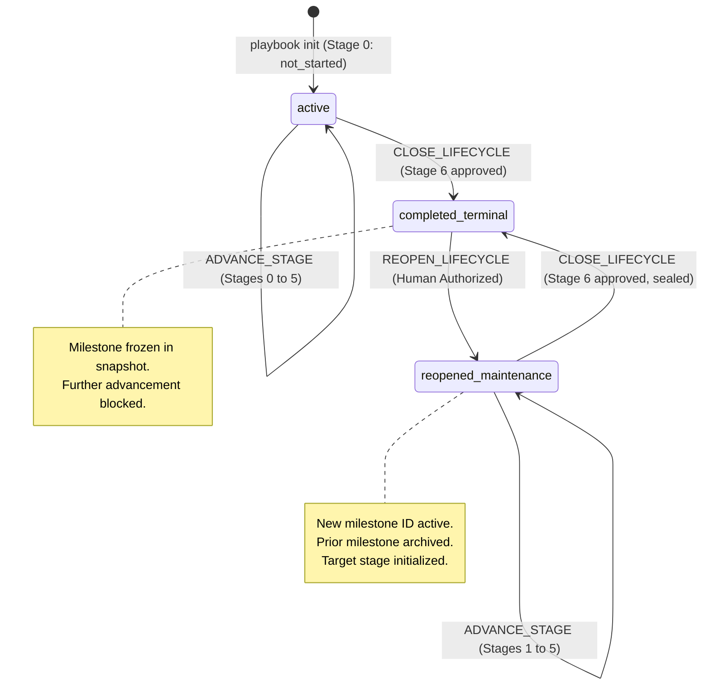
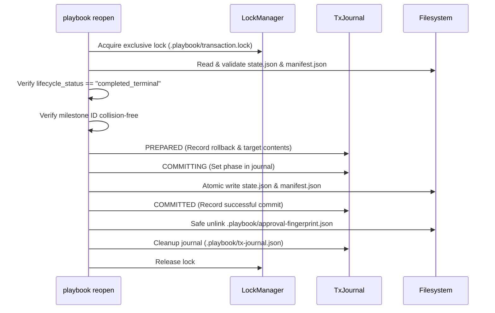

# Controlled Lifecycle Reopening: Architecture & State-Transition Design

> **Document Version**: 1.1.0  
> **Status**: Accepted Architectural Specification (Design Only)  
> **Target Package**: `@ai-engineering-playbook/cli`  
> **Preceding Specifications**:
> - [`governance/state-machine.md`](state-machine.md)
> - [`governance/approval-and-advancement-design.md`](approval-and-advancement-design.md)
> - [`governance/downstream-storage-convention.md`](downstream-storage-convention.md)
> - [`schemas/project-state.schema.json`](../schemas/project-state.schema.json)
> - [`schemas/project-manifest.schema.json`](../schemas/project-manifest.schema.json)

---

## 1. Executive Summary & Purpose

The AI Engineering Playbook enforces a deterministic, sequential 7-stage lifecycle (Stage 0 to Stage 6). Upon formal human approval and execution of `CLOSE_LIFECYCLE` at Stage 6, the project transitions to `lifecycle_status: "completed_terminal"`, the milestone state is sealed into a governance-frozen snapshot, and further stage advancement is severed.

However, production software is never truly "finished." Real systems require ongoing maintenance, bug fixes, non-breaking feature enhancements, performance optimizations, and subsequent major version iterations. 

While the state machine specification ([`state-machine.md`](state-machine.md) Section 3.13) conceptually defines `REOPEN_LIFECYCLE` and the state schema supports `lifecycle_status: "reopened_maintenance"`, the Playbook CLI currently lacks an operational command to execute this transition safely.

This document defines the architectural contract, state transitions, transaction guarantees, milestone preservation model, inherited prerequisite semantics, human authorization requirements, and CLI contract for **Controlled Lifecycle Reopening (`REOPEN_LIFECYCLE`)**.

---

## 2. Existing Architecture Audit & Ground Truth

An audit of the existing codebase and governance artifacts reveals the following architectural baseline:

```
┌────────────────────────────────────────────────────────────────────────┐
│ Current Implemented Invariants vs. Reopening Gaps                     │
├────────────────────────────────────────────────────────────────────────┤
│ 1. Terminal State Invariant: Stage 6 advancement locks current_stage=6 │
│    and sets lifecycle_status="completed_terminal".                     │
│ 2. Anti-Stage-7 Invariant: Stage advancement beyond 6 is permanently  │
│    rejected with ADVANCEMENT_BLOCKED.                                  │
│ 3. Snapshot Preservation: Sealed state is written to                   │
│    .playbook/milestones/state-<milestone_id>.json and set to 0o444.   │
│ 4. Snapshot Collision Defense: If snapshot file exists with differing  │
│    contents, SNAPSHOT_CONFLICT is thrown.                              │
│ 5. Sidecar Severance: .playbook/approval-fingerprint.json is safely   │
│    unlinked upon Stage 6 closure.                                      │
│ 6. Inspection Diagnostics: `playbook inspect` detects terminal state   │
│    and reports code LIFECYCLE_COMPLETED_TERMINAL.                      │
│ 7. GAPS:                                                               │
│    - No CLI command exists to execute REOPEN_LIFECYCLE.                │
│    - state.archived_milestones[] is defined in schema, but currently   │
│      remains empty [] across Stage 0 to 6 closure.                     │
│    - Reopening currently requires error-prone manual JSON editing.     │
└────────────────────────────────────────────────────────────────────────┘
```

### 2.1 State & Manifest Schemas
- `schemas/project-state.schema.json`:
  - `lifecycle_status` allows: `"active"`, `"completed_terminal"`, `"reopened_maintenance"`, `"paused"`.
  - `archived_milestones` is an array of objects requiring: `milestone_id`, `milestone_name`, `completed_at`, `final_stage`, `stage_history`, `exit_package_ref`, and optional `state_snapshot_ref`.
- `schemas/project-manifest.schema.json`:
  - Requires `active_milestone_id` (`^M-[a-zA-Z0-9.-]+$`).
  - Requires `active_lifecycle_stage` (`0` to `6`).

### 2.2 Transaction & Lock Engine Ground Truth
- **Lock Manager ([`src/core/lock/lock-manager.ts`](file:///f:/workspace/ai-engineering-playbook/tooling/playbook-cli/src/core/lock/lock-manager.ts))**:
  - The lock file path is `.playbook/transaction.lock` (configured in `DEFAULT_PATHS.lockFile`).
  - The mechanism uses atomic filesystem file creation with `O_CREAT | O_EXCL` flags (`wx` mode in Node.js), writing structured JSON `LockMetadata` (`pid`, `hostname`, `created_at`, `nonce`).
  - It does **not** use the operating system `flock` syscall or an arbitrary `.playbook/playbook.lock` file.
  - Concurrency contention retries with exponential backoff and jitter up to `lockTimeoutMs` (default 10,000 ms). If held by an active process, it fails with `LOCK_HELD_BY_ACTIVE_PROCESS`.
  - Stale lock recovery uses an atomic secondary lock `.playbook/reclaim.lock` to serialize competing recovery processes, verifying PID liveness via `process.kill(pid, 0)` on POSIX / `tasklist` on Windows, checking process start-time where supported to avoid killing recycled PIDs.
  - Cross-host locks fail closed (`CROSS_HOST_LOCK_UNVERIFIABLE`) requiring human intervention.
- **Write-Ahead Log ([`src/core/transaction/transaction-manager.ts`](file:///f:/workspace/ai-engineering-playbook/tooling/playbook-cli/src/core/transaction/transaction-manager.ts))**:
  - Two-phase commit write-ahead logging via `.playbook/tx-journal.json`.
  - Transactions support atomic multi-file operations (`PREPARED` $\rightarrow$ `COMMITTING` $\rightarrow$ `COMMITTED`) with roll-forward and rollback recovery.
  - **WAL Engine Limitation**: The WAL engine currently only supports `FileWriteSpec` (`targetPath`, `content`) for file creation and overwrites. It does **not** natively support atomic file deletion entries in the transaction journal.

---

## 3. Reopening Semantics & State Machine Specification

### 3.1 State Transition Diagram



### 3.2 Permitted and Prohibited Transitions

| Current Lifecycle Status | Target Lifecycle Status | Permitted? | Transition Trigger | Failure Code if Rejected |
| :--- | :--- | :---: | :--- | :--- |
| `completed_terminal` | `reopened_maintenance` | **YES** | `playbook reopen` (Human Authorized) | N/A |
| `completed_terminal` | `active` | **NO** | Reopening greenfield active state directly is invalid. | `INVALID_LIFECYCLE_TRANSITION` |
| `completed_terminal` | `paused` | **NO** | Must reopen to maintenance before pausing. | `INVALID_LIFECYCLE_TRANSITION` |
| `active` | `reopened_maintenance` | **NO** | Project is already active; cannot reopen unsealed project. | `LIFECYCLE_NOT_TERMINAL` |
| `paused` | `reopened_maintenance` | **NO** | Must resume active lifecycle, not reopen. | `LIFECYCLE_NOT_TERMINAL` |
| `reopened_maintenance`| `reopened_maintenance` | **NO** | Project is already in maintenance; cannot reopen active milestone. | `LIFECYCLE_ALREADY_REOPENED` |

### 3.3 Iterative Reopening (Multiple Milestone Cycles)
A project is not limited to a single reopening. Lifecycles iterate across multiple milestones over time:

$$\text{M-1.0.0 (Greenfield)} \xrightarrow{\text{Close}} \text{Terminal} \xrightarrow{\text{Reopen}} \text{M-1.1.0} \xrightarrow{\text{Close}} \text{Terminal} \xrightarrow{\text{Reopen}} \text{M-2.0.0} \dots$$

Each subsequent closure seals a new governance-frozen milestone snapshot (`state-M-1.1.0.json`, `state-M-2.0.0.json`), and each reopening appends the preceding sealed milestone to `archived_milestones[]`.

### 3.4 Verification Against Existing Closure Implementation
Inspection of [`src/core/advancement.ts`](file:///f:/workspace/ai-engineering-playbook/tooling/playbook-cli/src/core/advancement.ts) confirms that the existing implementation already accommodates multiple reopening cycles:
- Line 101 checks: `if (state.lifecycle_status === "completed_terminal")`. When `lifecycle_status` is `reopened_maintenance`, stage advancement across Stages 1 through 5 is fully permitted without code modifications.
- At Stage 6, `advancement.ts` executes `CLOSE_LIFECYCLE`:
  1. Sets `nextState.lifecycle_status = "completed_terminal"`.
  2. Sets `nextState.current_stage = 6` (retains 6).
  3. Appends the final Stage 6 history entry to `nextState.stage_history`.
  4. Preserves existing `nextState.archived_milestones` (retaining prior sealed milestones).
  5. Creates a new governance-frozen snapshot at `.playbook/milestones/state-${state.milestone_id}.json` (e.g. `state-M-1.1.0.json`).
  6. Safely unlinks the approval sidecar.
- **Documented Gap**: While the closure engine cleanly closes a maintenance milestone, `archived_milestones[]` is only populated when `REOPEN_LIFECYCLE` is called. The CLI must implement `playbook reopen` to execute this archival step.

---

## 4. Stage Continuation & Target Stage Selection

When a project is sealed at Stage 6, its `current_stage` remains `6` (locked). Reopening transitions the project to an active engineering stage.

### 4.1 Permitted Target Stages

Reopening permits exactly two entry stages, determined by the scope of the maintenance work:

```
┌────────────────────────────────────────────────────────────────────────┐
│ Reopening Target Stage Selection                                       │
├────────────────────────────────────────────────────────────────────────┤
│ Target Stage 1: Requirements & Specification (RECOMMENDED / DEFAULT)   │
│ - Applicable to: Incremental features, enhancements, bug fixes,       │
│   refactoring, performance optimizations, dependency upgrades.         │
│ - Rationality: The foundational Problem Statement (PRD-CORE) remains   │
│   valid from the previous milestone. Re-discovering the domain in      │
│   Stage 0 is unnecessary overhead. Engineering begins with new         │
│   feature specifications (REQ-SPEC).                                   │
├────────────────────────────────────────────────────────────────────────┤
│ Target Stage 0: Discovery & Problem Formulation (EXPLICIT OPT-IN)      │
│ - Applicable to: Fundamental architectural pivots, major domain        │
│   expansion, new business models, or complete system rewrites.        │
│ - Rationality: Requires authoring a new or overhauled PRD Core.        │
└────────────────────────────────────────────────────────────────────────┘
```

### 4.2 Prohibited Target Stages
- **Stage 6**: Strictly prohibited. Maintenance work cannot resume at deployment without requirements, design, implementation, and verification.
- **Stages 2, 3, 4, 5**: Strictly prohibited. Resuming directly at Architecture (2), Implementation (3), Integration (4), or Hardening (5) skips mandatory requirements specification, violating the core sequential lifecycle rules.

### 4.3 Inherited Stage 0 Prerequisite Behavior (Stage 1 Reopening)

When reopening at Stage 1, the relationship with the foundational Stage 0 Problem Statement (`PRD-CORE`) is governed by the following rules:

1. **Artifact Referencing**:
   - The original problem statement artifact resides under `docs/prd/PRD-CORE.md` (or the versioned path recorded in the preceding milestone snapshot).
   - In `state.current_stage_detail`, Stage 1 baseline deliverables are freshly populated: `REQ-SPEC` (Requirements Specification) and `TEST-STRATEGY` (System Verification & Test Strategy).
2. **Continued Applicability Assessment**:
   - The author of `REQ-SPEC` and the human reviewer at Gate 1 must explicitly assess whether the foundational problem statement in `PRD-CORE` remains valid for the scope of the new maintenance milestone.
   - `REQ-SPEC` must contain an explicit traceability reference linking new requirements to the foundational problem statement.
3. **Outdated Prerequisite & Blocking Progression**:
   - If the foundational problem statement in `PRD-CORE` is outdated, invalidated by market changes, or no longer reflects the product's true problem formulation, Stage 1 progression is **BLOCKED**.
   - The human engineer must halt the maintenance milestone and re-open at **Stage 0** (`playbook reopen --stage 0`) to re-formulate the core problem statement through a formal Stage 0 gate exit package and human sign-off.
4. **Recording Changes to the Foundational Problem Statement**:
   - *Minor refinements / scope clarifications*: Documented as an explicitly marked amendment section within `docs/prd/PRD-CORE.md`, or captured via a Clarification RFC (`docs/rfcs/RFC-YYYYMMDD-###.md`).
   - *Fundamental pivots / scope invalidation*: Prohibited in Stage 1. Requires Stage 0 reopening.
5. **Separation of Inherited Prerequisites from Active Deliverables**:
   - **Never automatically mark inherited material as verified**: Stage 1 deliverables (`REQ-SPEC`, `TEST-STRATEGY`) are initialized with `status: "not_started"`, `validation_status: "unvalidated"`, and empty `evidence: []`.
   - Inherited artifacts from prior milestones are contextual baselines, not newly satisfied deliverables for the active milestone. All active deliverables must produce fresh verifiable evidence.

---

## 5. Milestone Preservation & Historical Archival

### 5.1 Mandatory New Milestone Identifier
Reopening **must never continue under the existing milestone ID**. A new milestone identifier is required.

**Rationale**:
1. **Integrity & Collision Defense**: The previous milestone snapshot (`.playbook/milestones/state-<old_milestone>.json`) is frozen and checksummed. Reusing the ID would trigger `SNAPSHOT_CONFLICT` during the next closure or overwrite historical evidence.
2. **Audit Traceability**: Commits, test logs, and pull requests must distinguish between work delivered in `M-1.0.0` versus `M-1.1.0`.
3. **Governance-Level Preservation**: Governance rules prohibit altering the historical record of an approved, deployed release.

### 5.2 Milestone Archival Data Structure
During reopening, the completed milestone currently in `state.json` is archived into `state.archived_milestones[]`:

```json
{
  "milestone_id": "M-1.0.0",
  "milestone_name": "MVP Production Release",
  "completed_at": "2026-10-31T12:30:00.000Z",
  "final_stage": 6,
  "stage_history": [
    /* Exact 7 completed stage history entries from Stages 0 through 6 */
  ],
  "exit_package_ref": "docs/gates/GATE-6-EXIT-PACKAGE.md",
  "state_snapshot_ref": ".playbook/milestones/state-M-1.0.0.json"
}
```

### 5.3 Complete Historical Record Accessibility
The full historical record of previous milestones remains accessible through three distinct, complementary layers:

1. **`archived_milestones[]` in `state.json`**:
   - Provides an in-state summary of prior milestones, timestamps, final stage (6), exit package references, and the complete preserved `stage_history` array (including approver names, roles, decisions, timestamps, and signature references for each stage).
2. **The Governance-Frozen Milestone Snapshot (`.playbook/milestones/state-<milestone_id>.json`)**:
   - **Authoritative Source**: The snapshot file is the authoritative, complete machine-readable record for all granular data not duplicated in `archived_milestones[]`, including:
     - Exact deliverable configurations, verification statuses, and requirement IDs.
     - Granular evidence records (`procedure`, `evidence_ref`, `evidence_hash`, `verified_at`).
     - Stage-level RFCs and their resolution decision summaries.
     - Authorized exceptions, waiver expiration dates, and justification references.
     - The complete audit log (`last_updated`).
3. **Historical Filesystem & Git-Backed Artifacts**:
   - Historical markdown artifacts under `docs/rfcs/`, `docs/adr/`, `docs/exceptions/`, `docs/gates/`, and `.playbook/logs/` physically remain in the repository.
   - Git-backed version history provides cryptographic commit hashes, commit messages, author signatures, and diffs for every lifecycle change.

### 5.4 Accurate Terminology on Snapshot Preservation
> [!IMPORTANT]
> **Governance-Frozen Preservation vs. Technical Mutability Realities**
> The milestone snapshot (`.playbook/milestones/state-<milestone_id>.json`) is a **governance-frozen snapshot**. The Playbook CLI applies local filesystem read-only permissions (`chmod 0o444`) and enforces SHA-256 collision detection (`SNAPSHOT_CONFLICT`) as operational safeguards against accidental modification or overwriting.
> Files stored on a standard mutable filesystem do **not** possess hardware-enforced immutability (such as WORM media or cloud compliance Object Lock). Technical tamper-resistance and non-repudiation rely on **Git-backed history**, GPG-signed commits, and protected repository branches.

---

## 6. Approval & Evidence Invalidation Rules

To guarantee that previous approvals cannot authorize new maintenance work:

```
┌────────────────────────────────────────────────────────────────────────┐
│ Approval & Evidence Invalidation Boundary                              │
├────────────────────────────────────────────────────────────────────────┤
│ 1. Approval Sidecar Invalidation:                                      │
│    - .playbook/approval-fingerprint.json is safely unlinked.           │
│    - Lingering sidecars fail closed (gate mismatch & stale hash).     │
│ 2. Stage Approval Reset:                                               │
│    - current_stage_detail.human_approval is reset to status:           │
│      "not_requested" with all fields nullified.                        │
│    - stage_status is reset to "not_started".                           │
│ 3. Exit Package Reset:                                                 │
│    - current_stage_detail.exit_package is reset to "not_drafted".      │
│    - Prior exit packages under docs/gates/ remain preserved as         │
│      historical artifacts.                                             │
│ 4. Deliverables & Evidence Freshness:                                  │
│    - All deliverables for the new stage start with status "not_started"│
│      and empty evidence: [].                                           │
│    - Prior evidence logs in .playbook/logs/ remain on disk for         │
│      historical audit, but cannot satisfy new deliverables.            │
│ 5. Active Exceptions & RFCs Severance:                                 │
│    - Prior exceptions and RFCs are archived with the previous          │
│      milestone.                                                        │
│    - active rfcs: [] and exceptions: [] are initialized to empty arrays│
│      for the new milestone. No inherited waivers.                      │
└────────────────────────────────────────────────────────────────────────┘
```

---

## 7. Human Authorization Model

Reopening a production lifecycle expands project scope, incurs engineering costs, and modifies governance boundaries. It must never be triggered by an unattended script or an AI agent.

### 7.1 Anti-Agent Guardrails
1. **Mandatory Interactive TTY**: The command requires `process.stdin.isTTY === true`. Background daemon processes, headless subagents, or automated CI pipelines cannot execute `playbook reopen` without human presence. Headless execution rejects immediately with `TTY_REQUIRED`.
2. **Forbidden Agent Name Filtering**: Authorizer names matching known AI agent patterns (`isForbiddenAgentName`) are strictly rejected with `AGENT_REOPEN_PROHIBITED`.
3. **Explicit Typed Confirmation Phrase**: The human engineer must interactively type:
   ```
   CONFIRM REOPEN MILESTONE <NEW_MILESTONE_ID>
   ```
   This phrase is prompted in the interactive TTY session to prevent accidental or automated triggering.
4. **Mandatory Business Justification**: The human must supply a non-empty `--reason` string documenting the objective of the new milestone.
5. **No Default Organizational Roles**: The CLI must never invent a default organizational role (e.g. `"Lead Architect"`). The authorizer must provide or confirm their real role interactively.

### 7.2 Human Identity Realities
> [!IMPORTANT]
> **Heuristic Guardrails vs. Cryptographic Identity**
> Interactive TTY checks and confirmation phrases prevent automated, unattended AI agent triggering. They are **heuristic operational execution safeguards**, not cryptographic proofs of human identity. True human authentication and non-repudiation are enforced at the version control and git forge boundaries via GPG/SSH commit signatures, branch protection rules, and required PR reviews.

---

## 8. Transaction & Recovery Engine Integration

The reopening operation executes under the existing transaction and lock architecture.

### 8.1 Transaction Specification
- **Action Identifier**: `"REOPEN_LIFECYCLE"`
- **Concurrency Locking**: Exclusive lock on `.playbook/transaction.lock` managed by `TransactionLockManager`.
- **Files Committed Under WAL**:
  1. `.playbook/state.json`: State mutation payload (archived milestone appended, milestone ID updated, status `reopened_maintenance`, stage reset, deliverables initialized).
  2. `.playbook/manifest.json`: Synchronized manifest payload (`active_milestone_id`, `active_lifecycle_stage`).

### 8.2 Approval Sidecar Deletion & WAL Recovery
Because the existing WAL transaction journal only supports file writes (`FileWriteSpec`) and not file deletions:
1. **Idempotent Post-Commit Cleanup**: Sidecar deletion (`safeUnlink(DEFAULT_PATHS.approvalFingerprintFile)`) is executed as part of the transaction finalization.
2. **Crash Recovery & Fail-Closed Defense**:
   - If a crash occurs after `state.json` and `manifest.json` are committed but before sidecar deletion occurs:
     - The lingering sidecar on disk has `gate: 6` (from the prior milestone closure).
     - The active stage in `state.json` is `1` (or `0`).
     - If `playbook advance` is invoked, it checks `state.stage_status !== "approved"` and rejects with `ADVANCEMENT_BLOCKED`.
     - Even if `state.stage_status` were tampered with, `advance` detects that `sidecar.gate !== state.current_stage` and rejects with `APPROVAL_FINGERPRINT_MALFORMED`.
     - Furthermore, re-verifying the sidecar fingerprint against current state and evidence fails with `APPROVAL_STALE` because `milestone_id` and deliverables have changed.
   - When `playbook approve` is eventually executed for the new stage, it atomically overwrites `.playbook/approval-fingerprint.json` with the new valid fingerprint.
   - Therefore, a lingering sidecar **always fails closed**. No second transaction mechanism is introduced.

### 8.3 WAL Journal Lifecycle



### 8.4 Crash Recovery Guarantees
- **Crash in `PREPARED`**: The recovery engine detects the incomplete journal and rolls back `state.json` and `manifest.json` to their original `completed_terminal` state.
- **Crash in `COMMITTING`**: The recovery engine rolls forward, ensuring both `state.json` and `manifest.json` are committed cleanly with matching milestone IDs.
- **Idempotency**: Running `playbook reopen` twice fails on the second execution with `LIFECYCLE_ALREADY_REOPENED` because `lifecycle_status` is no longer `completed_terminal`.

---

## 9. CLI Interface & Contract Proposal

### 9.1 Command Synopsis
```bash
playbook reopen [options]
```

### 9.2 Command Options & Argument Handling
Consistent with the existing `playbook approve` design:

| Option | Short | Type | Interactive Behavior if Omitted | Description |
| :--- | :--- | :--- | :--- | :--- |
| `--milestone <id>` | `-m` | String | Prompted via terminal (`"New Milestone ID"`) | New milestone ID (must match `^M-[a-zA-Z0-9.-]+$`). |
| `--name <name>` | | String | Prompted via terminal (`"Milestone Title"`) | Human-readable title for the new milestone. |
| `--stage <0\|1>` | `-s` | Number | Defaults to `1` (interactive selection offered) | Entry stage for maintenance (`1` default, `0` for pivot). |
| `--reason <text>` | `-r` | String | Prompted via terminal (`"Reopening Rationale"`) | Mandatory business or technical justification. |
| `--authorized-by <name>` | | String | Prompted via terminal (`"Authorizing Engineer"`) | Claimed full name of human authorizer. |
| `--role <role>` | | String | Prompted via terminal (`"Engineering Role"`) | Professional title (no default invented). |
| `--confirmation-phrase <text>`| | String | Prompted via terminal | Test harness override only; rejected if non-TTY. |
| `--cwd <path>` | | String | Defaults to `process.cwd()` | Target project root directory. |
| `--json` | | Flag | Output machine-readable JSON at conclusion | Formats command result as JSON. Requires TTY. |

### 9.3 Error Diagnostic Codes
| Code | Severity | Description | Remediation |
| :--- | :---: | :--- | :--- |
| `LIFECYCLE_NOT_TERMINAL` | `error` | Current `lifecycle_status` is not `completed_terminal`. | Only completed and sealed projects can be reopened. |
| `MILESTONE_ID_COLLISION` | `error` | Milestone ID already exists in `archived_milestones` or snapshot files. | Specify a unique, incremented milestone ID. |
| `INVALID_REOPEN_STAGE` | `error` | Requested target stage is not `0` or `1`. | Reopen must resume at Stage 1 (default) or Stage 0 (major pivot). |
| `TTY_REQUIRED` | `error` | Reopening invoked in non-interactive terminal without TTY. | Interactive human session required. Automated calls prohibited. |
| `AGENT_REOPEN_PROHIBITED` | `error` | Authorizer name matches AI agent pattern. | Reopening must be authorized by a human engineer. |
| `CONFIRMATION_PHRASE_MISMATCH`| `error` | Entered confirmation phrase does not match expected phrase. | Re-enter exact confirmation phrase interactively. |
| `SNAPSHOT_MISSING` | `error` | Preceding milestone snapshot file does not exist on disk. | Verify milestone snapshot before reopening. |

### 9.4 Terminal Output Example
```
┌──────────────────────────────────────────────────────────┐
│        AI Engineering Playbook — Lifecycle Reopen        │
└──────────────────────────────────────────────────────────┘

 Target Directory: /workspace/my-service
 Project ID:       my-service
 Current Status:   COMPLETED_TERMINAL
 Sealed Milestone: M-1.0.0 (MVP Release)

 Authorizing Engineer:  Alice Human
 Professional Role:     Principal Systems Architect
 New Milestone ID:      M-1.1.0
 Milestone Title:       Q1 Performance & Maintenance
 Entry Stage:           Stage 1: Requirements & Specification
 Reopening Rationale:   Implement distributed caching and resolve NFR-003.

 Notice: Preceding milestone M-1.0.0 will be permanently archived.
 Active stage history will be re-initialized for M-1.1.0.
 Authoritative historical state remains in .playbook/milestones/state-M-1.0.0.json.

 Type the confirmation phrase to authorize:
 > CONFIRM REOPEN MILESTONE M-1.1.0

✔ Lifecycle successfully reopened into maintenance mode.
  Status:           reopened_maintenance
  Active Milestone: M-1.1.0
  Active Stage:     Stage 1: Requirements & Specification (not_started)
  Archived History: 1 milestone (M-1.0.0, 7 stages preserved)
  Transaction ID:   tx-1793521000000-reopen-a1b2
```

---

## 10. Test Strategy & Verification Matrix

| Test ID | Test Scenario | Automated / Manual | Verification Method |
| :--- | :--- | :---: | :--- |
| **TEST-REOPEN-01** | Happy path reopening of completed project to Stage 1 | Automated (CLI runner) | Assert state `reopened_maintenance`, `milestone_id: "M-1.1.0"`, `current_stage: 1`. |
| **TEST-REOPEN-02** | Happy path reopening of completed project to Stage 0 | Automated (CLI runner) | Assert state `current_stage: 0`, deliverables baseline initialized to `PRD-CORE`. |
| **TEST-REOPEN-03** | Snapshot preservation and integrity verification | Automated | Verify `state-M-1.0.0.json` exists on disk with unchanged SHA-256 and 7 historical stages. |
| **TEST-REOPEN-04** | Non-TTY / headless invocation rejection | Automated | Child process without TTY asserts failure with `TTY_REQUIRED` and zero mutations. |
| **TEST-REOPEN-05** | AI agent name rejection | Automated | Authorizer name `AI-Agent-3000` asserts failure with `AGENT_REOPEN_PROHIBITED`. |
| **TEST-REOPEN-06** | Confirmation phrase mismatch abort | Automated | Mismatched phrase asserts exit code 1 and zero state mutations. |
| **TEST-REOPEN-07** | Milestone ID collision defense | Automated | Reopening with existing `M-1.0.0` asserts `MILESTONE_ID_COLLISION`. |
| **TEST-REOPEN-08** | Ineligible lifecycle rejection (active project) | Automated | Attempting reopen on Stage 3 `active` asserts `LIFECYCLE_NOT_TERMINAL`. |
| **TEST-REOPEN-09** | Ineligible lifecycle rejection (paused project) | Automated | Attempting reopen on `paused` asserts `LIFECYCLE_NOT_TERMINAL`. |
| **TEST-REOPEN-10** | Approval sidecar destruction & fail-closed defense | Automated | Verify `.playbook/approval-fingerprint.json` is unlinked. Injected lingering sidecar fails `advance` with `APPROVAL_FINGERPRINT_MALFORMED`. |
| **TEST-REOPEN-11** | Stale approval immunity | Automated | Assert `playbook advance` immediately post-reopen fails with `ADVANCEMENT_BLOCKED`. |
| **TEST-REOPEN-12** | Manifest and state synchronization | Automated | Verify `manifest.active_milestone_id === state.milestone_id` and stage pointers match. |
| **TEST-REOPEN-13** | Multi-cycle sequential reopening (M-1 $\rightarrow$ M-1.1 $\rightarrow$ M-2) | Automated | Progress M-1.1 to Stage 6, seal, reopen to M-2.0, verify `archived_milestones.length === 2`. |
| **TEST-REOPEN-14** | WAL rollback on prepared crash | Automated (Fault injection)| Injected fault in `PREPARED` verifies rollback to `completed_terminal`. |
| **TEST-REOPEN-15** | WAL roll-forward on committing crash | Automated (Fault injection)| Injected fault in `COMMITTING` verifies completion of reopen transaction. |
| **TEST-REOPEN-16** | Lock contention during reopen (`transaction.lock`) | Automated | Concurrent reopen attempts serialize or reject second process with `LOCK_HELD_BY_ACTIVE_PROCESS`. |
| **TEST-REOPEN-17** | Inherited prerequisite verification | Automated | Verify `PRD-CORE.md` remains readable, but Stage 1 deliverables start with `unvalidated` and empty evidence. |
| **TEST-REOPEN-18** | Real human terminal UX and prompt layout | Manual Review | Interactive terminal review verifying prompt readability, context display, and typing flow. |

---

## 11. Unresolved Decisions & Architectural Trade-offs

1. **Trade-off: Stage 1 Reopening vs. Stage 0 Re-Discovery**:
   - *Decision*: Stage 1 is the default for maintenance milestones; Stage 0 requires explicit `--stage 0`.
   - *Rationale*: Forcing projects through Stage 0 Problem Discovery for routine maintenance causes artificial paperwork friction, tempting agents to hallucinate trivial PRD documents. Defaulting to Stage 1 aligns with real-world engineering while preserving Stage 0 for major pivots.
2. **Trade-off: In-Place Exit Package Naming vs. Versioned Exit Packages**:
   - *Decision*: Exit packages in `current_stage_detail` point to standard canonical paths (`docs/gates/GATE-1-EXIT-PACKAGE.md`). Historical exit packages from prior milestones are preserved in git and referenced by commit/snapshot ref. If teams desire separate markdown files, they may configure `exit_package.path` to `docs/gates/GATE-1-EXIT-PACKAGE-M-1.1.0.md`.
3. **Trade-off: CLI Helper Command vs. Direct JSON Mutation**:
   - *Decision*: Implementing `playbook reopen` in Task 004F.2 as an atomic WAL-backed command is strongly recommended over manual state editing. Manual state edits are prone to missing `archived_milestones` fields, creating invalid manifest drift, or forgetting sidecar cleanup.

---

## 12. Conclusion & Next Steps

This revised architectural design establishes the complete formal contract for `REOPEN_LIFECYCLE`. It aligns with the real implemented lock manager (`.playbook/transaction.lock`), correctly defines WAL single-phase write limitations and fail-closed sidecar defense, specifies inherited Stage 0 prerequisite rules, articulates multi-milestone closure compatibility, and adopts precise governance terminology.

Proceed to review and approval under **Task 004F.1.1** before runtime implementation in Task 004F.2.
