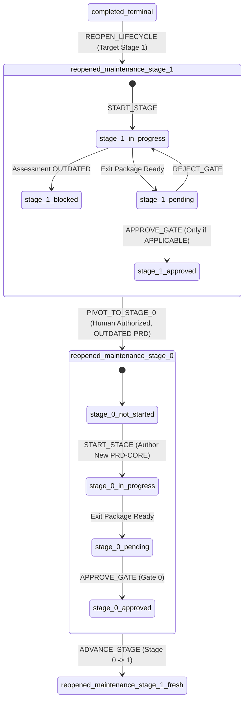

# Active Maintenance Milestone Stage Pivot Governance Design

> **Specification Version**: 1.1.0  
> **Status**: Accepted Architectural Specification (Design Only)  
> **Target Package**: `@ai-engineering-playbook/cli`  
> **Preceding Specifications**:
> - [`governance/state-machine.md`](state-machine.md) v1.3.0
> - [`governance/lifecycle-reopening-design.md`](lifecycle-reopening-design.md) v1.2.0
> - [`governance/approval-and-advancement-design.md`](approval-and-advancement-design.md)
> - [`schemas/project-state.schema.json`](../schemas/project-state.schema.json)
> - [`schemas/project-manifest.schema.json`](../schemas/project-manifest.schema.json)

---

## 1. Executive Summary & Purpose

The AI Engineering Playbook enforces a deterministic, sequential 7-stage lifecycle (Stage 0 to Stage 6). Through Controlled Lifecycle Reopening ([`governance/lifecycle-reopening-design.md`](lifecycle-reopening-design.md)), a project in `completed_terminal` can begin a new maintenance milestone (e.g. `M-1.1.0`) at Stage 1 (Requirements & Specification), inheriting the foundational problem formulation (`docs/prd/PRD-CORE.md`) from the prior milestone.

During Stage 1 of a maintenance milestone, the author and human reviewer evaluate whether the inherited `PRD-CORE.md` remains applicable to the new milestone scope. If this assessment concludes that the core problem formulation is **`OUTDATED`**, progressing through Gate 1 is strictly blocked.

Under the baseline state machine, an active maintenance milestone cannot execute `playbook reopen --stage 0` because reopening an already reopened lifecycle is rejected with `LIFECYCLE_ALREADY_REOPENED`. Furthermore, the state machine strictly prohibits arbitrary backward jumps during normal engineering progression.

This document establishes the architectural contract, state transitions, transaction guarantees, historical preservation model, human authorization protocol, and CLI contract for **Active Maintenance Milestone Stage Pivot (`PIVOT_TO_STAGE_0`)**.

```
┌────────────────────────────────────────────────────────────────────────┐
│ Cardinal Governance Distinction                                        │
├────────────────────────────────────────────────────────────────────────┤
│ 1. ADVANCE_STAGE: Strictly monotonic forward progression (0 -> 1...6) │
│ 2. REJECT_GATE: Reverts pending_review -> in_progress within same stage│
│ 3. CLOSE_LIFECYCLE: Seals completed Stage 6 into completed_terminal    │
│ 4. REOPEN_LIFECYCLE: completed_terminal -> reopened_maintenance        │
│ 5. PIVOT_TO_STAGE_0: Explicit, human-authorized recovery transition   │
│    returning an unapproved Stage 1 maintenance milestone to Stage 0   │
│    when its foundational problem statement is OUTDATED.                │
└────────────────────────────────────────────────────────────────────────┘
```

The pivot transition is **not** ordinary stage advancement, **not** an automated rollback, and **not** a lifecycle reopening. It is a strictly controlled, emergency recovery transition requiring explicit human authority and full historical audit preservation.

---

## 2. State Transition Specification

### 2.1 State Tuple Transformation

The pivot transition executes the following deterministic mutation:

$$\Big(\text{lifecycle\_status: } \texttt{"reopened\_maintenance"},\, \text{current\_stage: } 1,\, \text{stage\_status: } \sigma\Big) \xrightarrow{\text{PIVOT\_TO\_STAGE\_0}} \Big(\text{lifecycle\_status: } \texttt{"reopened\_maintenance"},\, \text{current\_stage: } 0,\, \text{stage\_status: } \texttt{"not\_started"}\Big)$$

Where $\sigma \in \{\texttt{"not\_started"}, \texttt{"in\_progress"}, \texttt{"blocked"}, \texttt{"pending\_review"}\}$.



### 2.2 Mandatory Guard Preconditions (Authoritative Validation)

To eliminate Time-Of-Check to Time-Of-Use (TOCTOU) races, all authoritative validations are executed **exclusively under the transaction lock** against freshly read on-disk state. Every invocation of `PIVOT_TO_STAGE_0` must satisfy all six mandatory preconditions. If any condition fails, the operation **fails closed** with zero modifications to disk or state:

| Condition # | Precondition | Authoritative Check Under Lock | Rejection Code |
| :---: | :--- | :--- | :--- |
| **C1** | **Lifecycle Status Guard** | `state.lifecycle_status === "reopened_maintenance"` | `LIFECYCLE_NOT_MAINTENANCE` |
| **C2** | **Stage Boundary Guard** | `state.current_stage === 1` | `PIVOT_INVALID_STAGE` |
| **C3** | **Unapproved Stage Guard** | `state.stage_status !== "approved"` and `state.current_stage_detail.human_approval.decision !== "GATE_APPROVED"` | `STAGE_ALREADY_APPROVED` |
| **C4** | **Assessment Status Guard** | `evaluatePrdApplicability(targetDir, state.milestone_id).status === "outdated"` | `PIVOT_PRD_NOT_OUTDATED` |
| **C5** | **Interactive Authority Guard** | `isatty(stdin) === true` with authorizer identity, role, and confirmation phrase | `TTY_REQUIRED` |
| **C6** | **Justification Guard** | Non-empty string explaining the necessity of problem reformulation | `PIVOT_REASON_REQUIRED` |

### 2.3 Prohibited Transitions & Failure Matrix

Any attempt to pivot outside the explicit preconditions must be deterministically rejected:

| Attempted Context | Prohibited Reason | Diagnostic Code |
| :--- | :--- | :--- |
| `lifecycle_status: "active"` (Greenfield) | Greenfield project is already bound to Stage 0 origin; pivot is only for maintenance. | `LIFECYCLE_NOT_MAINTENANCE` |
| `lifecycle_status: "completed_terminal"` | Terminal projects must use `playbook reopen --stage 0`, not pivot. | `LIFECYCLE_NOT_MAINTENANCE` |
| `lifecycle_status: "paused"` | Paused projects cannot execute state pivots without resuming. | `LIFECYCLE_NOT_MAINTENANCE` |
| `current_stage: 0` | Project is already at Stage 0; pivoting to Stage 0 is invalid recursion. | `PIVOT_INVALID_STAGE` |
| `current_stage: 2, 3, 4, 5, 6` | Late-stage recovery requires human exception or milestone abort; skipping backward across multiple stages is strictly barred. | `PIVOT_INVALID_STAGE` |
| `stage_status: "approved"` (Gate 1 passed) | Once Gate 1 receives formal human approval, the requirements baseline is sealed. It cannot be retroactively unapproved via pivot. | `STAGE_ALREADY_APPROVED` |
| PRD Assessment is `APPLICABLE` | If the PRD remains valid, pivoting to Stage 0 is unjustified and rejected. | `PIVOT_PRD_NOT_OUTDATED` |
| PRD Assessment is `MISSING` | Missing assessment indicates incomplete Stage 1 work, not proven obsolescence. Must author assessment before pivoting. | `PIVOT_PRD_NOT_OUTDATED` |
| PRD Assessment is from prior milestone | Stale milestone assessment cannot justify a pivot in the active milestone. | `PIVOT_PRD_NOT_OUTDATED` |
| State changed during prompt wait | State was modified concurrently between prompt display and lock acquisition. | `STATE_CONCURRENTLY_MODIFIED` |
| Automated / Headless Invocation | Bypasses human sovereignty. Piped or scripted execution rejected. | `TTY_REQUIRED` |
| Empty or Whitespace-only Reason | Unaudited actions violate governance accountability. | `PIVOT_REASON_REQUIRED` |

---

## 3. Human Authorization & Interactive Protocol

### 3.1 CLI Command Contract

The pivot transition is executed exclusively through the Playbook CLI:

```bash
playbook pivot --stage 0 [OPTIONS]
```

#### Command Options
- `--stage <N>`: Required integer. Must be exactly `0`. Passing any value other than `0` rejects with `PIVOT_TARGET_UNSUPPORTED`.
- `--authorized-by <NAME>`: Optional string. Human reviewer full name (e.g. `"Alice Engineer"`). Prompted interactively if omitted.
- `--role <ROLE>`: Optional string. Professional title (e.g. `"Lead Architect"`). Prompted interactively if omitted.
- `--reason <REASON>`: Optional string. Detailed rationale for why the foundational PRD is outdated. Prompted interactively if omitted.

### 3.2 Interactive TTY Guard & Confirmation Protocol

Regardless of flags supplied, the CLI command **strictly enforces an interactive TTY**:

```typescript
if (!process.stdin.isTTY) {
  throw new GovernanceError(
    "TTY_REQUIRED",
    "Stage pivot requires an interactive terminal session. Automated, scripted, or piped execution is strictly prohibited."
  );
}
```

#### Exact Confirmation Phrase
To eliminate accidental invocations, the human operator must type an exact confirmation phrase bound to the active milestone:

$$\texttt{"CONFIRM PIVOT TO STAGE 0 "} + \texttt{state.milestone\_id}$$

For example, if active milestone is `M-1.1.0`:
```text
Confirm Stage Pivot to Stage 0:
This will archive current Stage 1 work, archive the outdated PRD-CORE.md,
and return the active milestone M-1.1.0 to Stage 0 for foundational problem reformulation.
Type exact phrase 'CONFIRM PIVOT TO STAGE 0 M-1.1.0' to confirm:
> CONFIRM PIVOT TO STAGE 0 M-1.1.0
```

Any discrepancy in character casing, spacing, or milestone ID immediately aborts the transaction with `PIVOT_ABORTED` and zero filesystem or state mutations.

### 3.3 Non-Cryptographic Trust Model Disclosure

> [!NOTE]
> **Trust Boundary Disclosure**:
> Identity inputs (`--authorized-by`, `--role`) represent **asserted human identities** captured within an interactive terminal session. The system verifies interactive human agency via TTY checks and explicit typed confirmation phrases; it does **not** perform cryptographic signature validation, OIDC token exchange, or PKI verification. In solo developer environments, the trust boundary relies on the integrity of the local workstation and Git commit history. Writing an audit document to `docs/pivots/` creates the file in the local working directory; it does **not** automatically commit it to Git. Committing working tree files requires explicit human Git operations (`git add` and `git commit`).

---

## 4. Historical Preservation Architecture

A foundational rule of the AI Engineering Playbook is that **no engineering work is silently discarded or erased**. Before transitioning `current_stage` from 1 to 0, all Stage 1 artifacts, evidence, outdated problem statements, and assessment determinations must be permanently archived.

### 4.1 Unique Pivot Event Identity

Every stage pivot is assigned a unique, deterministic, non-reusable identifier:

$$\texttt{PVT-}<\text{MILESTONE\_ID}>\texttt{-}<\text{SEQ}>$$

Where `<SEQ>` is a zero-padded 3-digit monotonic sequence number within the milestone (e.g. `PVT-M-1.1.0-001`).

#### Sequence Discovery & Collision Handling
1. Under the exclusive transaction lock, the engine scans `.playbook/pivots/` for existing snapshot files matching:
   `state-<MILESTONE_ID>-pivot-*.json`
2. It identifies the maximum existing sequence number $N$ for the active milestone, and computes $N+1$ (defaulting to `001` if no prior pivots exist).
3. **Collision Defense**: If any target artifact path (`state-<PIVOT_ID>.json`, `<PIVOT_ID>.md`, or `PRD-CORE.<PIVOT_ID>.outdated.md`) already exists on disk, the engine increments the sequence. If an unresolvable collision occurs, the engine aborts with `PIVOT_EVENT_ID_COLLISION`. Existing pivot records are **never overwritten**.
4. **Repeated Pivots Supported**: If a project pivots to Stage 0 (`PVT-M-1.1.0-001`), re-advances to Stage 1, and again discovers an obsolete problem formulation, a second pivot can be authorized and recorded as `PVT-M-1.1.0-002`. Both snapshots, both audit documents, and both archived PRD baselines are preserved side-by-side.

### 4.2 Preservation Topology

```
.playbook/
├── pivots/
│   ├── state-PVT-M-1.1.0-001.json                    <-- OS write-protected snapshot (0o444)
│   └── state-PVT-M-1.1.0-002.json                    <-- Preserved on subsequent pivot
docs/
├── pivots/
│   ├── PVT-M-1.1.0-001.md                            <-- Markdown audit record (working tree)
│   └── PVT-M-1.1.0-002.md
└── prd/
    ├── archive/
    │   └── PRD-CORE.PVT-M-1.1.0-001.outdated.md      <-- Archived outdated PRD with warning banner
    ├── PRD-CORE.md                                   <-- REMOVED / Fresh authoring required in Stage 0
    ├── PRD-CORE-ASSESSMENT.md                        <-- Retained Stage 1 assessment record
    └── REQUIREMENTS-SPEC.md                          <-- Retained on disk & Git tracked
```

### 4.3 Pre-Pivot State Snapshot Specification (`.playbook/pivots/`)

Under the exclusive transaction lock, the full in-memory `state` object representing the pre-pivot Stage 1 context is serialized to:
```text
.playbook/pivots/state-<PIVOT_ID>.json
```
This snapshot captures:
- All Stage 1 deliverables, validation statuses, and evidence references.
- All evidence records and SHA-256 integrity hashes.
- All RFCs, ADRs, and Exceptions active in Stage 1.
- The `current_stage_detail.human_approval` state (rejection conditions, RFCs).

The snapshot is written via atomic staging (`.tmp.<PID>`), flushed, renamed, and set to **operating-system file write protection** (`0o444` on POSIX / read-only attribute on Windows). This provides application-level write protection against accidental mutation, but does not claim immutable hardware-level optical storage.

### 4.4 Governance Audit Document Specification (`docs/pivots/`)

A dedicated markdown audit record is written to:
```text
docs/pivots/<PIVOT_ID>.md
```

#### Required Content Structure
```markdown
# Stage Pivot Audit Record: <PIVOT_ID>

## 1. Pivot Execution Metadata
- **Pivot Event ID**: `<PIVOT_ID>`
- **Milestone ID**: `<MILESTONE_ID>`
- **Source Stage**: Stage 1 (Requirements & Specification)
- **Target Stage**: Stage 0 (Discovery & Problem Formulation)
- **Executed At**: `<ISO_8601_TIMESTAMP>`
- **Authorized By**: `<HUMAN_NAME>`
- **Role / Authority**: `<HUMAN_ROLE>`
- **State Snapshot Reference**: `.playbook/pivots/state-<PIVOT_ID>.json`
- **Archived PRD Reference**: `docs/prd/archive/PRD-CORE.<PIVOT_ID>.outdated.md`

## 2. Invalidation Rationale & Assessment
- **Assessment Artifact**: `<PATH_TO_ASSESSMENT>`
- **Assessment Determination**: `OUTDATED`
- **Assessment Author**: `<ASSESSMENT_AUTHOR>`
- **Invalidation Summary**: `<SUMMARY_FROM_ASSESSMENT>`
- **Human Authorizer Justification**:
  > <EXPLICIT_REASON_STRING>

## 3. Preserved Stage 1 Artifacts & Evidence
| Deliverable ID | Name | Artifact Path | Status | Validation Status |
| :--- | :--- | :--- | :--- | :--- |
| REQ-SPEC | Requirements Specification | docs/prd/REQUIREMENTS-SPEC.md | completed | unvalidated |
...

## 4. Historical RFC, ADR, and Exception Dispositions
- **Active Exceptions in Stage 1**:
  - `EXC-20261101-001`: Disposed as `invalidated_by_pivot`. (Stage 1 exceptions do NOT carry over to Stage 0 or future Stage 1 scopes).
- **Active RFCs in Stage 1**:
  - `RFC-20261101-001`: Disposed as `superseded_by_pivot`.
- **ADRs Recorded in Stage 1**:
  - `ADR-0001`: Preserved on disk; architectural decisions flagged for re-evaluation against new Stage 0 problem formulation.

## 5. Remediation Directives for Stage 0
1. Foundational discovery must be conducted for the revised problem domain.
2. Fresh `PRD-CORE.md` must be authored from scratch (cannot reuse outdated content).
3. Fresh Exit Package must be compiled and submitted for human Gate 0 sign-off (`playbook approve --gate 0`).
```

### 4.5 PRD-CORE Historical Preservation & Fresh Stage 0 Authoring

To prevent an outdated Problem Statement from silently becoming the authoritative problem statement for Stage 0, the pivot engine enforces explicit archival and removal:

1. **Archival to Historical Path**:
   The existing `docs/prd/PRD-CORE.md` is copied to:
   ```text
   docs/prd/archive/PRD-CORE.<PIVOT_ID>.outdated.md
   ```
   A prominent governance archival banner is prepended:
   ```markdown
   > [!WARNING]
   > **ARCHIVED & OUTDATED PROBLEM STATEMENT**
   > This document was declared OUTDATED during Stage 1 under Pivot Event `<PIVOT_ID>` on `<TIMESTAMP>` by `<AUTHOR>`.
   > It is preserved strictly for audit and historical context. It is NOT the active problem statement.
   ```
2. **Active Path Unlinking**:
   The active file `docs/prd/PRD-CORE.md` is safely unlinked (removed) from the active path.
3. **Fresh Authoring Mandate**:
   Upon entering Stage 0, `fs.existsSync("docs/prd/PRD-CORE.md")` returns `false`. Deliverable `PRD-CORE` is initialized with:
   - `status: "not_started"`
   - `validation_status: "unvalidated"`
   - `evidence: []`
   An AI agent or engineer cannot pass Gate 0 without authoring a genuinely fresh `PRD-CORE.md`. Gate 0 eligibility checks assert that the new file exists, contains required structural sections, and has a SHA-256 hash that differs from all archived outdated PRDs.

### 4.6 RFC, ADR, and Exception Dispositions

1. **File Retention**: Markdown records in `docs/rfcs/`, `docs/adrs/`, and `governance/exceptions/` are permanent project records tracked in Git. The pivot engine **never unlinks or deletes** these files.
2. **Exception Invalidation**: Any active exception recorded in Stage 1 is marked `invalidated_by_pivot` in the pivot audit record. A human waiver granting an exception for Stage 1 requirements has zero legal standing in Stage 0.
3. **Stage-Scoping in State**: In `state.current_stage_detail`, the `rfcs`, `adrs`, and `exceptions` arrays are initialized empty `[]` for Stage 0. This matches the standard lifecycle scoping convention in `advancement.ts`.

### 4.7 Preservation of Stage History Ledger Integrity

The state schema (`schemas/project-state.schema.json`) defines `stage_history` as:
> *"Immutable ledger of previously completed and approved lifecycle stages for the active milestone."*

Every entry in `stage_history` strictly requires:
- `status: "approved"` or `"waived"`.
- `exit_package_ref`.
- Valid `human_approval` record with `signature_reference`.

#### Why Stage 1 MUST NOT be Appended to `stage_history[]`
1. **Schema Violation**: The pivoted Stage 1 was never approved or waived. Inserting an unapproved entry violates `enum: ["approved", "waived"]`.
2. **Sequence Invariant Violation**: The lifecycle sequence requires monotonically increasing stages ($0 \to 1 \to 2 \to \dots$). Inserting Stage 1 before Stage 0 creates an illegal non-monotonic sequence ($[1, 0, 1, \dots]$) that breaks downstream consumers and progress visualizers.
3. **Duplicate Stage Anomaly**: When the milestone subsequently progresses from Stage 0 to Stage 1 and legitimately completes Gate 1, `stage_history` would contain duplicate Stage 1 records with conflicting timestamps.

#### State Model Schema Evolution Path
For runtime implementation, historical pivot events are recorded in an explicit, dedicated structure:
- **Phase 1 (Immediate Design Contract)**: File-based persistence under `.playbook/pivots/`, `docs/pivots/`, and `docs/prd/archive/`. This guarantees complete auditability without modifying `schemas/project-state.schema.json` prematurely.
- **Phase 2 (Schema Extension in Implementation Task)**: An optional top-level array `pivots: []` added to `schemas/project-state.schema.json`:
  ```json
  "pivots": {
    "type": "array",
    "description": "Audit ledger of human-authorized stage recovery pivots within the active milestone.",
    "items": {
      "type": "object",
      "required": ["pivot_id", "milestone_id", "from_stage", "to_stage", "pivoted_at", "authorized_by", "role", "reason", "snapshot_ref", "audit_ref", "archived_prd_ref"],
      "properties": {
        "pivot_id": { "type": "string", "pattern": "^PVT-M-[a-zA-Z0-9.-]+-[0-9]{3}$" },
        "milestone_id": { "type": "string" },
        "from_stage": { "type": "integer", "enum": [1] },
        "to_stage": { "type": "integer", "enum": [0] },
        "pivoted_at": { "type": "string", "format": "date-time" },
        "authorized_by": { "type": "string" },
        "role": { "type": "string" },
        "reason": { "type": "string" },
        "snapshot_ref": { "type": "string" },
        "audit_ref": { "type": "string" },
        "archived_prd_ref": { "type": "string" }
      }
    }
  }
  ```

---

## 5. Stage 0 Re-Initialization Semantics

Following the successful authorization, archival, and lock validation, the runtime initializes Stage 0 under the active maintenance milestone:

```
┌────────────────────────────────────────────────────────────────────────┐
│ State Fields After PIVOT_TO_STAGE_0                                    │
├────────────────────────────────────────────────────────────────────────┤
│ milestone_id:                 <RETAINED_UNCHANGED> (e.g. M-1.1.0)      │
│ milestone_name:               <RETAINED_UNCHANGED>                      │
│ lifecycle_status:             "reopened_maintenance" (RETAINED)         │
│ current_stage:                0 (MUTATED)                               │
│ stage_status:                 "not_started" (MUTATED)                   │
│ stage_history:                [] (RETAINED EMPTY)                       │
│ archived_milestones:          [<PRIOR_MILESTONES>] (PRESERVED INTACT)   │
│ manifest.active_lifecycle_stage: 0 (SYNCHRONIZED)                      │
│ sidecar (fingerprint):        PURGED / DELETED                          │
└────────────────────────────────────────────────────────────────────────┘
```

### 5.1 Deliverables Initialization Rules

`current_stage_detail` is reset cleanly with Stage 0 mandatory deliverables:
- **Baseline Deliverable**: `PRD-CORE` (Problem Statement Document).
- **Initial Status**: `status: "not_started"`.
- **Validation Status**: `validation_status: "unvalidated"`.
- **Evidence Array**: `evidence: []` (strictly empty).
- **Exit Package**: `exit_package: { status: "not_started", ... }`.
- **Human Approval**: `human_approval: { status: "not_requested", ... }`.
- **RFCs / ADRs / Exceptions**: Reset to empty arrays `[]` for the new Stage 0 scope.

### 5.2 Strict Non-Inheritance Invariant

> [!CAUTION]
> **No Inheritance of Old Verification or Approval Evidence**:
> Under no circumstances may Stage 0 deliverables inherit verification hashes, validation statuses, or approval signatures from Milestone 1.0 or the pivoted Stage 1. 
> 
> The entire purpose of pivoting to Stage 0 is that the old problem formulation was found to be obsolete. The author must draft a fresh `PRD-CORE.md`, verify it against Stage 0 quality criteria, compile an Exit Package, and obtain fresh human approval at Gate 0.

---

## 6. Transaction Integrity, Locking Order & Crash Recovery

The stage pivot mutates multiple files across the repository (`.playbook/state.json`, `project.manifest.json`, `.playbook/pivots/`, `docs/pivots/`, `docs/prd/archive/`, `.playbook/approval-fingerprint.json`). To prevent torn writes, corrupted state, or race conditions, the operation enforces strict lock ordering and two-phase write-ahead logging.

### 6.1 Transaction Lock Ordering Architecture

To prevent TOCTOU vulnerabilities, checks are split into preliminary non-mutating pre-checks and authoritative checks under the lock:

```
┌────────────────────────────────────────────────────────────────────────┐
│ Canonical Pivot Execution Sequence                                     │
├────────────────────────────────────────────────────────────────────────┤
│ 1. ADVISORY PRE-CHECK: Fast-fail if not TTY or project uninitialized.  │
│ 2. OPERATOR PROMPT: Collect name, role, reason, confirmation phrase.   │
│ 3. ACQUIRE TRANSACTION LOCK: Exclusive acquire .playbook/trans.lock.   │
│ 4. AUTHORITATIVE RE-READ & VALIDATION: Under lock, re-read state.json, │
│    manifest.json, and PRD applicability assessment. Assert C1–C6.      │
│    If state drifted while prompt was open, reject CONCURRENT_MODIFIED. │
│ 5. DISCOVER UNIQUE PIVOT ID: Compute PVT-<MILESTONE>-<SEQ>.            │
│ 6. ATOMIC ARTIFACT STAGING:                                            │
│    a. Write snapshot to .playbook/pivots/state-<PVT_ID>.json.tmp.<PID> │
│    b. Write audit doc to docs/pivots/<PVT_ID>.md.tmp.<PID>             │
│    c. Copy PRD-CORE.md to docs/prd/archive/...outdated.md.tmp.<PID>    │
│    d. Rename all .tmp files to final paths; set 0o444 on snapshot.     │
│    e. Safely unlink active docs/prd/PRD-CORE.md.                       │
│ 7. PREPARE WAL: Write .playbook/tx-journal.json (status: PREPARED).    │
│      - state.json mutated (current_stage: 0, deliverables reset)       │
│      - project.manifest.json mutated (active_lifecycle_stage: 0)       │
│ 8. COMMIT PHASE: Transition journal status to COMMITTING.              │
│ 9. APPLY WAL WRITES: Atomically overwrite state.json and manifest.json.│
│ 10. PURGE SIDECAR: Safely unlink .playbook/approval-fingerprint.json.  │
│ 11. FINALIZE TRANSACTION: Transition journal to COMMITTED, unlink WAL. │
│ 12. RELEASE LOCK: Unlink .playbook/transaction.lock.                   │
└────────────────────────────────────────────────────────────────────────┘
```

### 6.2 Lock Contention & Concurrency Control

- The pivot engine acquires the primary exclusive transaction lock at:
  ```text
  .playbook/transaction.lock
  ```
  using atomic `wx` flag creation via [`src/core/lock/lock-manager.ts`](file:///f:/workspace/ai-engineering-playbook/tooling/playbook-cli/src/core/lock/lock-manager.ts).
- If the lock is currently held by an active process, it retries with exponential backoff up to `lockTimeoutMs` (10,000 ms).
- If the timeout expires, the operation immediately aborts with `LOCK_HELD_BY_ACTIVE_PROCESS`.
- Stale lock detection and reclamation via `.playbook/reclaim.lock` is inherited transparently.
- **No new lock files or alternative locking protocols (e.g. `flock`) are introduced.**

### 6.3 Boundary-by-Boundary Crash Interruption & Recovery Matrix

| Transaction Boundary | State on Disk at Crash | Recovery Behavior on Next CLI Invocation | Fail-Closed Guarantee |
| :--- | :--- | :--- | :--- |
| **Boundary A: Crash during Step 6 (Staging Artifacts)** | Staging `.tmp.<PID>` files present; `state.json` and `manifest.json` untouched. Stale lock remains. | Stale lock reclaimed. Transaction manager scans `.playbook/pivots/` and `docs/pivots/`, unlinking any uncommitted `*.tmp.*` files. Project remains safely at Stage 1. | Zero state mutation; partial artifacts purged. |
| **Boundary B: Crash during Step 7 (`PREPARED` WAL)** | Snapshot, audit doc, and archived PRD finalized. Journal written in `PREPARED`. State and manifest untouched. | Transaction manager detects uncommitted `PREPARED` journal. Rolls back: deletes journal, unlinks archived PRD, restores `docs/prd/PRD-CORE.md` if needed, reclaims lock. Project remains at Stage 1. | Fail-closed rollback; zero partial state transition. |
| **Boundary C: Crash during Step 9 (`COMMITTING` WAL)** | Journal in `COMMITTING`. `state.json` written or partially written; `manifest.json` possibly unwritten. | Transaction manager detects `COMMITTING` phase, **rolls forward**, re-writes both files to guaranteed final state, unlinks journal, reclaims lock. Consistency guaranteed. | State and manifest guaranteed synchronized to Stage 0. |
| **Boundary D: Crash during Step 10 (Sidecar Purge)** | State and manifest committed at Stage 0; stale Stage 1 sidecar remains on disk. | **Defense-in-depth**: `checkGateEligibility` and `verifyApprovalFingerprint` detect `fingerprint.gate !== state.current_stage` ($1 \neq 0$), rejecting the sidecar with `APPROVAL_FINGERPRINT_MALFORMED`. Subsequent approval cleanly replaces or unlinks it. | Stale approval cannot authorize Stage 0. |

---

## 7. Comprehensive Design Test Matrix

The following 22 test scenarios define the automated verification criteria required for runtime implementation:

| Test # | Scenario Name | Test Setup & Invariants | Expected Result |
| :---: | :--- | :--- | :--- |
| **T1** | **Valid Stage 1-to-Stage 0 Pivot** | `reopened_maintenance`, `current_stage: 1`, `PRD-CORE-ASSESSMENT.md` marked `OUTDATED`, valid TTY, correct phrase. | Success. Unique event ID generated (`PVT-M-1.1.0-001`). `current_stage` is 0. Snapshot in `.playbook/pivots/`, audit doc in `docs/pivots/`, PRD archived, manifest synced. |
| **T2** | **Pivot Rejected from Stage 2** | `reopened_maintenance`, `current_stage: 2`. | Rejects with `PIVOT_INVALID_STAGE`. Zero disk or state mutations. |
| **T3** | **Pivot Rejected After Gate 1 Approval** | `reopened_maintenance`, `current_stage: 1`, `stage_status: "approved"`. | Rejects with `STAGE_ALREADY_APPROVED`. Zero mutations. |
| **T4** | **Pivot Rejected for Non-Maintenance** | `lifecycle_status: "active"` or `"completed_terminal"`. | Rejects with `LIFECYCLE_NOT_MAINTENANCE`. Zero mutations. |
| **T5** | **Pivot Rejected without OUTDATED Assessment** | Assessment is `APPLICABLE`, `MISSING`, or bound to older milestone. | Rejects with `PIVOT_PRD_NOT_OUTDATED`. Zero mutations. |
| **T6** | **Non-TTY Invocation Rejected** | Stdin mocked as non-interactive (`isTTY = false`). | Rejects with `TTY_REQUIRED`. Zero mutations. |
| **T7** | **Incorrect Confirmation Phrase Rejected** | Typo or wrong milestone ID in confirmation prompt. | Rejects with `PIVOT_ABORTED`. Zero mutations. |
| **T8** | **Missing Justification Rejected** | `--reason` omitted or empty string. | Rejects with `PIVOT_REASON_REQUIRED`. Zero mutations. |
| **T9** | **Historical Stage 1 Preservation** | Pivot executes successfully. Inspect snapshot file and audit markdown. | Snapshot matches pre-pivot state exactly. Authored files on disk preserved. |
| **T10** | **Fresh Stage 0 Initialization** | Pivot executes successfully. Inspect `state.current_stage_detail`. | `PRD-CORE` deliverable is `not_started`, `unvalidated`, zero evidence, exit package clean. |
| **T11** | **Stale Approval Rejection** | Stale Stage 1 approval sidecar left on disk. Run `playbook advance` or inspect. | Sidecar gate mismatch rejected (`APPROVAL_FINGERPRINT_MALFORMED`). Stage 0 cannot advance without Gate 0 approval. |
| **T12** | **Transaction Interruption & Recovery** | Process simulated crash during `COMMITTING` phase of WAL. | WAL rolls forward cleanly on next execution. Both `state.json` and `manifest.json` are consistent. |
| **T13** | **Normal Stage 0 Progression & Closure** | Pivot to Stage 0, author fresh `PRD-CORE`, approve Gate 0, advance 1..6, approve Gate 6. | Lifecycle completes normally. Milestone seals into snapshot; transitions to `completed_terminal`. |
| **T14** | **Concurrent Pivot Attempts (Lock Contention)** | Process A holds `.playbook/transaction.lock`; Process B executes pivot. | Process B times out and rejects with `LOCK_HELD_BY_ACTIVE_PROCESS`. Zero mutations. |
| **T15** | **TOCTOU State Modification Under Prompt** | State is valid at prompt display, but modified concurrently (e.g. Gate 1 approved) before phrase typed. | Authoritative check under lock detects drift; rejects with `STATE_CONCURRENTLY_MODIFIED`. |
| **T16** | **Repeated Pivot Without Historical Overwrite** | Pivot 1 executed (`PVT-M-1.1.0-001`), advance to Stage 1, second pivot executed. | Pivot 2 assigned `PVT-M-1.1.0-002`. Both snapshots and both audit docs exist side-by-side. Zero overwrites. |
| **T17** | **Snapshot Staging / Write Failure** | Simulated disk error or permission failure during snapshot staging write. | Staging `.tmp` files unlinked; transaction aborted; state remains at Stage 1. |
| **T18** | **Audit Document Write Failure** | Simulated disk error during audit markdown write. | Snapshot staging rolled back; transaction aborted; state remains at Stage 1. |
| **T19** | **WAL Preparation Failure** | Simulated error creating `tx-journal.json`. | Transaction aborted; lock released; state remains at Stage 1. |
| **T20** | **Crash Recovery with Incomplete Artifacts** | Stale `*.tmp.*` files left in `.playbook/pivots/` after simulated crash. | Subsequent CLI operation cleans up orphaned `.tmp` files during lock recovery. |
| **T21** | **PRD-CORE Archival & Freshness Enforcement** | Old PRD archived to `docs/prd/archive/`; active PRD unlinked; attempted Gate 0 with old PRD hash. | Gate 0 rejects identical PRD content; accepts only genuinely fresh problem formulation. |
| **T22** | **Historical RFC, ADR, Exception Dispositions** | Pivot executed with active RFC, ADR, and Exception in Stage 1. | Audit document records dispositions; Stage 1 exceptions marked `invalidated_by_pivot`; Stage 0 arrays initialized empty. |

---

## 8. Operational Boundaries, Scientific Limitations & Non-Negotiables

1. **Asserted Identity Limitation**: Identity validation is strictly terminal-level. The CLI asserts human presence through interactive prompts and exact phrase matching; it cannot cryptographically guarantee physical user authenticity.
2. **Local Repository Boundary**: State, snapshots, and audit documents live within the repository work-tree. Trust boundaries are co-extensive with Git repository write access.
3. **No Automatic Problem Reformulation**: The pivot resets the project to Stage 0; it does **not** generate or modify `PRD-CORE.md`. Human and agent authoring must occur explicitly.
4. **Strict Forward Progression Following Pivot**: After pivoting to Stage 0, the project must re-traverse the lifecycle sequentially ($0 \to 1 \to 2 \to \dots \to 6$). Stage skipping is strictly forbidden.
5. **Irreversibility of Pivot**: Once a pivot transaction is committed, returning to Stage 1 requires normal Stage 0 completion, exit package submission, and Gate 0 human approval.

---

## 9. Next Steps & Governance Handshake

Upon review and acceptance of this design specification:
1. Ensure [`governance/state-machine.md`](state-machine.md) and [`governance/lifecycle-reopening-design.md`](lifecycle-reopening-design.md) align with v1.1.0 terminology.
2. Schedule implementation task (Task 004F.2.4) to implement `src/core/pivot.ts`, `src/commands/pivot.ts`, schema extensions, and the 22 automated tests.
