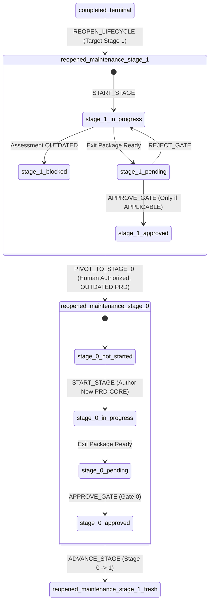

# Active Maintenance Milestone Stage Pivot Governance Design

> **Specification Version**: 1.0.0  
> **Status**: Accepted Architectural Specification (Design Only)  
> **Target Package**: `@ai-engineering-playbook/cli`  
> **Preceding Specifications**:
> - [`governance/state-machine.md`](state-machine.md)
> - [`governance/lifecycle-reopening-design.md`](lifecycle-reopening-design.md)
> - [`governance/approval-and-advancement-design.md`](approval-and-advancement-design.md)
> - [`schemas/project-state.schema.json`](../schemas/project-state.schema.json)
> - [`schemas/project-manifest.schema.json`](../schemas/project-manifest.schema.json)

---

## 1. Executive Summary & Purpose

The AI Engineering Playbook enforces a deterministic, sequential 7-stage lifecycle (Stage 0 to Stage 6). Through Controlled Lifecycle Reopening ([`governance/lifecycle-reopening-design.md`](lifecycle-reopening-design.md)), a project in `completed_terminal` can begin a new maintenance milestone (e.g. `M-1.1.0`) at Stage 1 (Requirements & Specification), inheriting the foundational problem formulation (`docs/prd/PRD-CORE.md`) from the prior milestone.

During Stage 1 of a maintenance milestone, the author and human reviewer evaluate whether the inherited `PRD-CORE.md` remains applicable to the new milestone scope. If this assessment concludes that the core problem formulation is **`OUTDATED`**, progressing through Gate 1 is strictly blocked.

Under the baseline state machine, an active maintenance milestone cannot execute `playbook reopen --stage 0` because reopening an already reopened lifecycle is rejected with `LIFECYCLE_ALREADY_REOPENED`. Furthermore, the state machine strictly prohibits arbitrary backward jumps during normal engineering progression.

This document establishes the architectural contract, state transitions, transaction guarantees, historical preservation model, human authorization protocol, and CLI contract for **Active Maintenance Milestone Stage Pivot (`PIVOT_TO_STAGE_0`)**.

```
┌────────────────────────────────────────────────────────────────────────┐
│ Cardinal Governance Distinction                                        │
├────────────────────────────────────────────────────────────────────────┤
│ 1. ADVANCE_STAGE: Strictly monotonic forward progression (0 -> 1...6) │
│ 2. REJECT_GATE: Reverts pending_review -> in_progress within same stage│
│ 3. CLOSE_LIFECYCLE: Seals completed Stage 6 into completed_terminal    │
│ 4. REOPEN_LIFECYCLE: completed_terminal -> reopened_maintenance        │
│ 5. PIVOT_TO_STAGE_0: Explicit, human-authorized recovery transition   │
│    returning an unapproved Stage 1 maintenance milestone to Stage 0   │
│    when its foundational problem statement is OUTDATED.                │
└────────────────────────────────────────────────────────────────────────┘
```

The pivot transition is **not** ordinary stage advancement, **not** an automated rollback, and **not** a lifecycle reopening. It is a strictly controlled, emergency recovery transition requiring explicit human authority and full historical audit preservation.

---

## 2. State Transition Specification

### 2.1 State Tuple Transformation

The pivot transition executes the following deterministic mutation:

$$\Big(\text{lifecycle\_status: } \texttt{"reopened\_maintenance"},\, \text{current\_stage: } 1,\, \text{stage\_status: } \sigma\Big) \xrightarrow{\text{PIVOT\_TO\_STAGE\_0}} \Big(\text{lifecycle\_status: } \texttt{"reopened\_maintenance"},\, \text{current\_stage: } 0,\, \text{stage\_status: } \texttt{"not\_started"}\Big)$$

Where $\sigma \in \{\texttt{"not\_started"}, \texttt{"in\_progress"}, \texttt{"blocked"}, \texttt{"pending\_review"}\}$.



### 2.2 Mandatory Guard Preconditions

Every invocation of `PIVOT_TO_STAGE_0` must satisfy all six mandatory preconditions. If any condition fails, the operation **fails closed** with zero modifications to disk or state:

| Condition # | Precondition | Validation Rule | Rejection Code |
| :---: | :--- | :--- | :--- |
| **C1** | **Lifecycle Status Guard** | `state.lifecycle_status === "reopened_maintenance"` | `LIFECYCLE_NOT_MAINTENANCE` |
| **C2** | **Stage Boundary Guard** | `state.current_stage === 1` | `PIVOT_INVALID_STAGE` |
| **C3** | **Unapproved Stage Guard** | `state.stage_status !== "approved"` and `state.current_stage_detail.human_approval.decision !== "GATE_APPROVED"` | `STAGE_ALREADY_APPROVED` |
| **C4** | **Assessment Status Guard** | `evaluatePrdApplicability(targetDir, state.milestone_id).status === "outdated"` | `PIVOT_PRD_NOT_OUTDATED` |
| **C5** | **Interactive Authority Guard** | `isatty(stdin) === true` with authorizer identity, role, and confirmation | `TTY_REQUIRED` |
| **C6** | **Justification Guard** | Non-empty string explaining the necessity of problem reformulation | `PIVOT_REASON_REQUIRED` |

### 2.3 Prohibited Transitions & Failure Matrix

Any attempt to pivot outside the explicit preconditions must be deterministically rejected:

| Attempted Context | Prohibited Reason | Diagnostic Code |
| :--- | :--- | :--- |
| `lifecycle_status: "active"` (Greenfield) | Greenfield project is already bound to Stage 0 origin; pivot is only for maintenance. | `LIFECYCLE_NOT_MAINTENANCE` |
| `lifecycle_status: "completed_terminal"` | Terminal projects must use `playbook reopen --stage 0`, not pivot. | `LIFECYCLE_NOT_MAINTENANCE` |
| `lifecycle_status: "paused"` | Paused projects cannot execute state pivots without resuming. | `LIFECYCLE_NOT_MAINTENANCE` |
| `current_stage: 0` | Project is already at Stage 0; pivoting to Stage 0 is invalid recursion. | `PIVOT_INVALID_STAGE` |
| `current_stage: 2, 3, 4, 5, 6` | Late-stage recovery requires human exception or milestone abort; skipping backward across multiple stages is strictly barred. | `PIVOT_INVALID_STAGE` |
| `stage_status: "approved"` (Gate 1 passed) | Once Gate 1 receives formal human approval, the requirements baseline is sealed. It cannot be retroactively unapproved via pivot. | `STAGE_ALREADY_APPROVED` |
| PRD Assessment is `APPLICABLE` | If the PRD remains valid, pivoting to Stage 0 is unjustified and rejected. | `PIVOT_PRD_NOT_OUTDATED` |
| PRD Assessment is `MISSING` | Missing assessment indicates incomplete Stage 1 work, not proven obsolescence. Must author assessment before pivoting. | `PIVOT_PRD_NOT_OUTDATED` |
| PRD Assessment is from prior milestone | Stale milestone assessment cannot justify a pivot in the active milestone. | `PIVOT_PRD_NOT_OUTDATED` |
| Automated / Headless Invocation | Bypasses human sovereignty. Piped or scripted execution rejected. | `TTY_REQUIRED` |
| Empty or Whitespace-only Reason | Unaudited actions violate governance accountability. | `PIVOT_REASON_REQUIRED` |

---

## 3. Human Authorization & Interactive Protocol

### 3.1 CLI Command Contract

The pivot transition is executed exclusively through the Playbook CLI:

```bash
playbook pivot --stage 0 [OPTIONS]
```

#### Command Options
- `--stage <N>`: Required integer. Must be exactly `0`. Passing any value other than `0` rejects with `PIVOT_TARGET_UNSUPPORTED`.
- `--authorized-by <NAME>`: Optional string. Human reviewer full name (e.g. `"Alice Engineer"`). Prompted interactively if omitted.
- `--role <ROLE>`: Optional string. Professional title (e.g. `"Lead Architect"`). Prompted interactively if omitted.
- `--reason <REASON>`: Optional string. Detailed rationale for why the foundational PRD is outdated. Prompted interactively if omitted.

### 3.2 Interactive TTY Guard & Confirmation Protocol

Regardless of flags supplied, the CLI command **strictly enforces an interactive TTY**:

```typescript
if (!process.stdin.isTTY) {
  throw new GovernanceError(
    "TTY_REQUIRED",
    "Stage pivot requires an interactive terminal session. Automated, scripted, or piped execution is strictly prohibited."
  );
}
```

#### Exact Confirmation Phrase
To eliminate accidental invocations, the human operator must type an exact confirmation phrase bound to the active milestone:

$$\texttt{"CONFIRM PIVOT TO STAGE 0 "} + \texttt{state.milestone\_id}$$

For example, if active milestone is `M-1.1.0`:
```text
Type exact phrase 'CONFIRM PIVOT TO STAGE 0 M-1.1.0' to confirm:
> CONFIRM PIVOT TO STAGE 0 M-1.1.0
```

Any discrepancy in character casing, spacing, or milestone ID immediately aborts the transaction with `PIVOT_ABORTED` and zero filesystem or state mutations.

### 3.3 Non-Cryptographic Trust Model Disclosure

> [!NOTE]
> **Trust Boundary Disclosure**:
> Identity inputs (`--authorized-by`, `--role`) represent **asserted human identities** captured within an interactive terminal session. The system verifies interactive human agency via TTY checks and explicit typed confirmation phrases; it does **not** perform cryptographic signature validation, OIDC token exchange, or PKI verification. In solo developer environments, the trust boundary relies on the integrity of the local workstation and Git commit history.

---

## 4. Historical Preservation Architecture

A foundational rule of the AI Engineering Playbook is that **no engineering work is silently discarded or erased**. Before transitioning `current_stage` from 1 to 0, all Stage 1 artifacts, evidence, and assessment determinations must be permanently archived.

### 4.1 Preservation Mechanisms

The pivot preservation protocol uses a three-tier archival model:

```
┌────────────────────────────────────────────────────────────────────────┐
│ Three-Tier Historical Preservation Model                               │
├────────────────────────────────────────────────────────────────────────┤
│ Tier 1: State Snapshot (.playbook/pivots/)                             │
│   - Complete state.json snapshot captured at time of pivot             │
│   - File: .playbook/pivots/state-<milestone_id>-pivot-stage-1.json     │
│   - Permissions: Read-only (0o444)                                     │
├────────────────────────────────────────────────────────────────────────┤
│ Tier 2: Governance Audit Document (docs/pivots/)                       │
│   - Committed Markdown record detailing justification and metadata    │
│   - File: docs/pivots/PIVOT-<milestone_id>-STAGE-0.md                  │
├────────────────────────────────────────────────────────────────────────┤
│ Tier 3: Work-Tree File Retention (Git Working Tree)                    │
│   - Authored Stage 1 files (REQUIREMENTS-SPEC.md, test logs) remain   │
│   - Never deleted or unlinked by the CLI                               │
└────────────────────────────────────────────────────────────────────────┘
```

### 4.2 State Snapshot Specification (`.playbook/pivots/`)

Before state mutation, the full in-memory `state` object representing the Stage 1 context is serialized to:
```text
.playbook/pivots/state-<milestone_id>-stage-1-<timestamp>.json
```
This snapshot captures:
- All Stage 1 deliverables and their validation statuses.
- All evidence records and SHA-256 integrity hashes.
- The `current_stage_detail.human_approval` state (rejection conditions, RFCs).
- The exact state of the project immediately prior to the pivot.

The file is written atomically and set to read-only (`0o444`).

### 4.3 Governance Audit Document Specification (`docs/pivots/`)

A dedicated markdown audit artifact is generated and written to:
```text
docs/pivots/PIVOT-<milestone_id>-STAGE-0.md
```

#### Required Content Structure
```markdown
# Stage Pivot Audit Record: Milestone <MILESTONE_ID> (Stage 1 -> Stage 0)

## 1. Pivot Execution Metadata
- **Milestone ID**: `<MILESTONE_ID>`
- **Source Stage**: Stage 1 (Requirements & Specification)
- **Target Stage**: Stage 0 (Discovery & Problem Formulation)
- **Executed At**: `<ISO_8601_TIMESTAMP>`
- **Authorized By**: `<HUMAN_NAME>`
- **Role / Authority**: `<HUMAN_ROLE>`
- **State Snapshot Reference**: `.playbook/pivots/state-<MILESTONE_ID>-stage-1-<TIMESTAMP>.json`

## 2. Invalidation Rationale & Assessment
- **Assessment Artifact**: `<PATH_TO_ASSESSMENT>`
- **Assessment Determination**: `OUTDATED`
- **Assessment Author**: `<ASSESSMENT_AUTHOR>`
- **Invalidation Summary**: `<SUMMARY_FROM_ASSESSMENT>`
- **Human Authorizer Justification**:
  > <EXPLICIT_REASON_STRING>

## 3. Preserved Stage 1 Artifacts & Evidence
| Deliverable ID | Name | Artifact Path | Status | Validation Status |
| :--- | :--- | :--- | :--- | :--- |
| REQ-SPEC | Requirements Specification | docs/prd/REQUIREMENTS-SPEC.md | completed | unvalidated |
...

## 4. Remediation Directives for Stage 0
1. Re-open foundational discovery for problem domain.
2. Author new PRD Core under `docs/prd/PRD-CORE.md`.
3. Submit Stage 0 Exit Package for human gate approval (`playbook approve --gate 0`).
```

### 4.4 Preservation of Stage History Ledger Integrity

The state schema (`schemas/project-state.schema.json`) defines `stage_history` as:
> *"Immutable ledger of previously completed and approved lifecycle stages for the active milestone."*

Every entry in `stage_history` strictly requires:
- `status: "approved"` or `"waived"`.
- `exit_package_ref`.
- Valid `human_approval` record with `signature_reference`.

#### Why Stage 1 MUST NOT be Appended to `stage_history[]`
1. **Schema Violation**: The pivoted Stage 1 was never approved or waived. Inserting an unapproved entry violates `enum: ["approved", "waived"]`.
2. **Sequence Invariant Violation**: The lifecycle sequence requires monotonically increasing stages ($0 \to 1 \to 2 \to \dots$). Inserting Stage 1 before Stage 0 creates an illegal non-monotonic sequence ($[1, 0, 1, \dots]$) that breaks downstream consumers and progress visualizers.
3. **Duplicate Stage Anomaly**: When the milestone subsequently progresses from Stage 0 to Stage 1 and legitimately completes Gate 1, `stage_history` would contain duplicate Stage 1 records with conflicting timestamps.

#### State Model Schema Evolution Path
For runtime implementation, historical pivot events are recorded in an explicit, dedicated structure:
- **Phase 1 (Immediate Design Contract)**: File-based persistence under `.playbook/pivots/` and `docs/pivots/`. This guarantees complete auditability without modifying `schemas/project-state.schema.json` prematurely.
- **Phase 2 (Schema Extension in Implementation Task)**: An optional top-level array `pivots: []` added to `schemas/project-state.schema.json`:
  ```json
  "pivots": {
    "type": "array",
    "description": "Audit ledger of human-authorized stage recovery pivots within the active milestone.",
    "items": {
      "type": "object",
      "required": ["milestone_id", "from_stage", "to_stage", "pivoted_at", "authorized_by", "role", "reason", "snapshot_ref", "audit_ref"],
      "properties": {
        "milestone_id": { "type": "string" },
        "from_stage": { "type": "integer", "enum": [1] },
        "to_stage": { "type": "integer", "enum": [0] },
        "pivoted_at": { "type": "string", "format": "date-time" },
        "authorized_by": { "type": "string" },
        "role": { "type": "string" },
        "reason": { "type": "string" },
        "snapshot_ref": { "type": "string" },
        "audit_ref": { "type": "string" }
      }
    }
  }
  ```

---

## 5. Stage 0 Re-Initialization Semantics

Following the successful authorization and archival of Stage 1, the runtime initializes Stage 0 under the active maintenance milestone:

```
┌────────────────────────────────────────────────────────────────────────┐
│ State Fields After PIVOT_TO_STAGE_0                                    │
├────────────────────────────────────────────────────────────────────────┤
│ milestone_id:              <RETAINED_UNCHANGED> (e.g. M-1.1.0)        │
│ milestone_name:            <RETAINED_UNCHANGED>                        │
│ lifecycle_status:          "reopened_maintenance" (RETAINED)           │
│ current_stage:             0 (MUTATED)                                 │
│ stage_status:              "not_started" (MUTATED)                     │
│ stage_history:             [] (RETAINED EMPTY)                         │
│ archived_milestones:       [<PRIOR_MILESTONES>] (PRESERVED INTACT)     │
│ manifest.active_lifecycle: 0 (SYNCHRONIZED)                            │
│ sidecar (fingerprint):     PURGED / DELETED                            │
└────────────────────────────────────────────────────────────────────────┘
```

### 5.1 Deliverables Initialization Rules

`current_stage_detail` is reset cleanly with Stage 0 mandatory deliverables:
- **Baseline Deliverable**: `PRD-CORE` (Problem Statement Document).
- **Initial Status**: `status: "not_started"`.
- **Validation Status**: `validation_status: "unvalidated"`.
- **Evidence Array**: `evidence: []` (strictly empty).
- **Exit Package**: `exit_package: { status: "not_started", ... }`.
- **Human Approval**: `human_approval: { status: "not_requested", ... }`.
- **RFCs / ADRs / Exceptions**: Reset to empty arrays `[]` for the new Stage 0 scope.

### 5.2 Strict Non-Inheritance Invariant

> [!CAUTION]
> **No Inheritance of Old Verification or Approval Evidence**:
> Under no circumstances may Stage 0 deliverables inherit verification hashes, validation statuses, or approval signatures from Milestone 1.0 or the pivoted Stage 1. 
> 
> The entire purpose of pivoting to Stage 0 is that the old problem formulation was found to be obsolete. The author must draft a fresh `PRD-CORE.md`, verify it against Stage 0 quality criteria, compile an Exit Package, and obtain fresh human approval at Gate 0.

---

## 6. Transaction Integrity & Crash Recovery

The stage pivot mutates multiple files across the repository (`.playbook/state.json`, `project.manifest.json`, `.playbook/pivots/`, `docs/pivots/`, `.playbook/approval-fingerprint.json`). To prevent torn writes or corrupted state, the operation reuses the existing transaction infrastructure.

### 6.1 Lock Manager Integration

- The pivot engine acquires the primary exclusive transaction lock at:
  ```text
  .playbook/transaction.lock
  ```
  using atomic `wx` flag creation via [`src/core/lock/lock-manager.ts`](file:///f:/workspace/ai-engineering-playbook/tooling/playbook-cli/src/core/lock/lock-manager.ts).
- If the lock is held by an active process, it retries with exponential backoff up to 10 seconds.
- Stale lock detection and reclamation via `.playbook/reclaim.lock` is inherited transparently.
- **No new lock files or alternative locking protocols (e.g. `flock`) are introduced.**

### 6.2 Write-Ahead Logging (WAL) Protocol

The state and manifest mutations are executed under the two-phase WAL engine via [`src/core/transaction/transaction-manager.ts`](file:///f:/workspace/ai-engineering-playbook/tooling/playbook-cli/src/core/transaction/transaction-manager.ts):

```
┌────────────────────────────────────────────────────────────────────────┐
│ 1. PRE-LOCK CHECKS: Validate preconditions (C1 to C6). Fail if invalid.│
│ 2. ACQUIRE LOCK: Acquire .playbook/transaction.lock.                   │
│ 3. WRITE ARTIFACTS: Write snapshot and docs/pivots/ markdown record.   │
│ 4. PREPARE WAL: Write .playbook/tx-journal.json (status: PREPARED)     │
│      - state.json mutated (current_stage: 0, deliverables reset)       │
│      - project.manifest.json mutated (active_lifecycle_stage: 0)       │
│ 5. COMMIT PHASE: Transition journal to COMMITTING                      │
│ 6. APPLY CHANGES: Overwrite state.json and manifest.json               │
│ 7. PURGE SIDECAR: Unlink .playbook/approval-fingerprint.json           │
│ 8. FINALIZE: Transition journal to COMMITTED, unlink journal           │
│ 9. RELEASE LOCK: Unlink .playbook/transaction.lock                     │
└────────────────────────────────────────────────────────────────────────┘
```

### 6.3 Crash Interruption & Recovery Matrix

| Point of Interruption | State on Disk | Recovery Behavior on Next CLI Invocation |
| :--- | :--- | :--- |
| **Crash before Step 4** (During snapshot or doc write) | `state.json` and `manifest.json` untouched. Stale lock reclaimed. | Project remains safely at Stage 1. Partial docs can be cleanly overwritten on retry. Zero state drift. |
| **Crash during Step 4** (`tx-journal.json` is `PREPARED`) | State untouched. Journal present in `PREPARED`. | Transaction Manager detects uncommitted journal, performs rollback, deletes journal, reclaims lock. Project remains safely at Stage 1. |
| **Crash during Step 6** (`tx-journal.json` is `COMMITTING`) | `state.json` written or in progress; `manifest.json` possibly unwritten. | Transaction Manager detects `COMMITTING` phase, **rolls forward**, re-writes both files to guaranteed final state, purges journal, reclaims lock. Consistency guaranteed. |
| **Crash during Step 7** (Sidecar purge interrupted) | State and manifest committed at Stage 0; stale Stage 1 sidecar remains on disk. | **Defense-in-depth**: `checkGateEligibility` and `verifyApprovalFingerprint` detect `fingerprint.gate !== state.current_stage` ($1 \neq 0$), rejecting the sidecar with `APPROVAL_FINGERPRINT_MALFORMED`. Subsequent approval cleanly replaces or unlinks it. |

---

## 7. Comprehensive Design Test Matrix

The following 13 test scenarios define the automated verification criteria required for runtime implementation:

| Test # | Scenario Name | Test Setup & Invariants | Expected Result |
| :---: | :--- | :--- | :--- |
| **T1** | **Valid Stage 1-to-Stage 0 Pivot** | `reopened_maintenance`, `current_stage: 1`, `PRD-CORE-ASSESSMENT.md` marked `OUTDATED`, valid TTY, correct phrase. | Success. `current_stage` is 0. Snapshot in `.playbook/pivots/`, audit doc in `docs/pivots/`, manifest synced. |
| **T2** | **Pivot Rejected from Stage 2** | `reopened_maintenance`, `current_stage: 2`. | Rejects with `PIVOT_INVALID_STAGE`. Zero disk or state mutations. |
| **T3** | **Pivot Rejected After Gate 1 Approval** | `reopened_maintenance`, `current_stage: 1`, `stage_status: "approved"`. | Rejects with `STAGE_ALREADY_APPROVED`. Zero mutations. |
| **T4** | **Pivot Rejected for Non-Maintenance** | `lifecycle_status: "active"` or `"completed_terminal"`. | Rejects with `LIFECYCLE_NOT_MAINTENANCE`. Zero mutations. |
| **T5** | **Pivot Rejected without OUTDATED Assessment** | Assessment is `APPLICABLE`, `MISSING`, or bound to older milestone. | Rejects with `PIVOT_PRD_NOT_OUTDATED`. Zero mutations. |
| **T6** | **Non-TTY Invocation Rejected** | Stdin mocked as non-interactive (`isTTY = false`). | Rejects with `TTY_REQUIRED`. Zero mutations. |
| **T7** | **Incorrect Confirmation Phrase Rejected** | Typo or wrong milestone ID in confirmation prompt. | Rejects with `PIVOT_ABORTED`. Zero mutations. |
| **T8** | **Missing Justification Rejected** | `--reason` omitted or empty string. | Rejects with `PIVOT_REASON_REQUIRED`. Zero mutations. |
| **T9** | **Historical Stage 1 Preservation** | Pivot executes successfully. Inspect snapshot file and audit markdown. | Snapshot matches pre-pivot state exactly. Authored files on disk preserved. |
| **T10** | **Fresh Stage 0 Initialization** | Pivot executes successfully. Inspect `state.current_stage_detail`. | `PRD-CORE` deliverable is `not_started`, `unvalidated`, zero evidence, exit package clean. |
| **T11** | **Stale Approval Rejection** | Stale Stage 1 approval sidecar left on disk. Run `playbook advance` or inspect. | Sidecar gate mismatch rejected (`APPROVAL_FINGERPRINT_MALFORMED`). Stage 0 cannot advance without Gate 0 approval. |
| **T12** | **Transaction Interruption & Recovery** | Process simulated crash during `COMMITTING` phase of WAL. | WAL rolls forward cleanly on next execution. Both `state.json` and `manifest.json` are consistent. |
| **T13** | **Normal Stage 0 Progression & Closure** | Pivot to Stage 0, author `PRD-CORE`, approve Gate 0, advance to Stage 1..6, approve Gate 6. | Lifecycle completes normally. Milestone seals into snapshot; transitions to `completed_terminal`. |

---

## 8. Operational Boundaries, Scientific Limitations & Non-Negotiables

1. **Asserted Identity Limitation**: Identity validation is strictly terminal-level. The CLI asserts human presence through interactive prompts and exact phrase matching; it cannot cryptographically guarantee physical user authenticity.
2. **Local Repository Boundary**: State, snapshots, and audit documents live within the repository work-tree. Trust boundaries are co-extensive with Git repository write access.
3. **No Automatic Problem Reformulation**: The pivot resets the project to Stage 0; it does **not** generate or modify `PRD-CORE.md`. Human and agent authoring must occur explicitly.
4. **Strict Forward Progression Following Pivot**: After pivoting to Stage 0, the project must re-traverse the lifecycle sequentially ($0 \to 1 \to 2 \to \dots \to 6$). Stage skipping is strictly forbidden.
5. **Irreversibility of Pivot**: Once a pivot transaction is committed, returning to Stage 1 requires normal Stage 0 completion, exit package submission, and Gate 0 human approval.

---

## 9. Next Steps & Governance Handshake

Upon review and acceptance of this design specification:
1. Update [`governance/state-machine.md`](state-machine.md) to formally document `PIVOT_TO_STAGE_0` transition semantics.
2. Update [`governance/lifecycle-reopening-design.md`](lifecycle-reopening-design.md) Section 4.3 to link to this specification.
3. Schedule implementation task (Task 004F.2.4) to implement `src/core/pivot.ts`, `src/commands/pivot.ts`, schema extensions, and the 13 automated tests.
