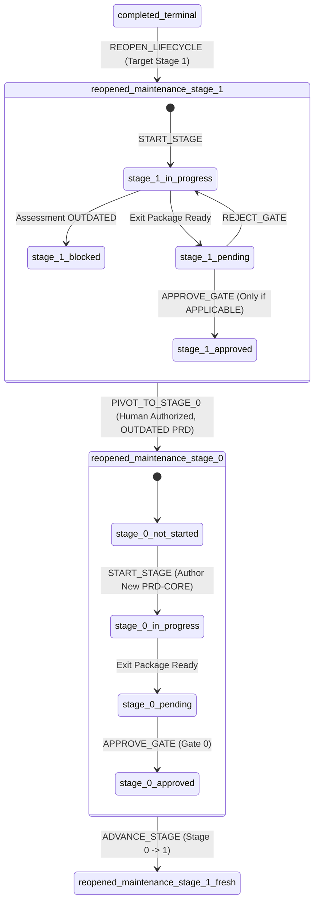

# Active Maintenance Milestone Stage Pivot Governance Design

> **Specification Version**: 1.2.0  
> **Status**: Accepted Architectural Specification (Design Only)  
> **Target Package**: `@ai-engineering-playbook/cli`  
> **Preceding Specifications**:
> - [`governance/state-machine.md`](state-machine.md) v1.3.0
> - [`governance/lifecycle-reopening-design.md`](lifecycle-reopening-design.md) v1.2.0
> - [`governance/approval-and-advancement-design.md`](approval-and-advancement-design.md)
> - [`governance/downstream-storage-convention.md`](downstream-storage-convention.md)
> - [`schemas/project-state.schema.json`](../schemas/project-state.schema.json)
> - [`schemas/project-manifest.schema.json`](../schemas/project-manifest.schema.json)

---

## 1. Executive Summary & Purpose

The AI Engineering Playbook enforces a deterministic, sequential 7-stage lifecycle (Stage 0 to Stage 6). Through Controlled Lifecycle Reopening ([`governance/lifecycle-reopening-design.md`](lifecycle-reopening-design.md)), a project in `completed_terminal` can begin a new maintenance milestone (e.g. `M-1.1.0`) at Stage 1 (Requirements & Specification), inheriting the foundational problem formulation (`docs/prd/PRD-CORE.md`) from the prior milestone.

During Stage 1 of a maintenance milestone, the author and human reviewer evaluate whether the inherited `PRD-CORE.md` remains applicable to the new milestone scope. If this assessment concludes that the core problem formulation is **`OUTDATED`**, progressing through Gate 1 is strictly blocked.

Under the baseline state machine, an active maintenance milestone cannot execute `playbook reopen --stage 0` because reopening an already reopened lifecycle is rejected with `LIFECYCLE_ALREADY_REOPENED`. Furthermore, the state machine strictly prohibits arbitrary backward jumps during normal engineering progression.

This document establishes the architectural contract, state transitions, transaction guarantees, historical preservation model, human authorization protocol, and CLI contract for **Active Maintenance Milestone Stage Pivot (`PIVOT_TO_STAGE_0`)**.

```
┌────────────────────────────────────────────────────────────────────────┐
│ Cardinal Governance Distinction                                        │
├────────────────────────────────────────────────────────────────────────┤
│ 1. ADVANCE_STAGE: Strictly monotonic forward progression (0 -> 1...6) │
│ 2. REJECT_GATE: Reverts pending_review -> in_progress within same stage│
│ 3. CLOSE_LIFECYCLE: Seals completed Stage 6 into completed_terminal    │
│ 4. REOPEN_LIFECYCLE: completed_terminal -> reopened_maintenance        │
│ 5. PIVOT_TO_STAGE_0: Explicit, human-authorized recovery transition   │
│    returning an unapproved Stage 1 maintenance milestone to Stage 0   │
│    when its foundational problem statement is OUTDATED.                │
└────────────────────────────────────────────────────────────────────────┘
```

The pivot transition is **not** ordinary stage advancement, **not** an automated rollback, and **not** a lifecycle reopening. It is a strictly controlled, emergency recovery transition requiring explicit human authority and full historical audit preservation.

---

## 2. State Transition Specification

### 2.1 State Tuple Transformation

The pivot transition executes the following deterministic mutation:

$$\Big(\text{lifecycle\_status: } \texttt{"reopened\_maintenance"},\, \text{current\_stage: } 1,\, \text{stage\_status: } \sigma\Big) \xrightarrow{\text{PIVOT\_TO\_STAGE\_0}} \Big(\text{lifecycle\_status: } \texttt{"reopened\_maintenance"},\, \text{current\_stage: } 0,\, \text{stage\_status: } \texttt{"not\_started"}\Big)$$

Where $\sigma \in \{\texttt{"not\_started"}, \texttt{"in\_progress"}, \texttt{"blocked"}, \texttt{"pending\_review"}\}$.



### 2.2 Mandatory Guard Preconditions (Authoritative Validation Under Lock)

To eliminate Time-Of-Check to Time-Of-Use (TOCTOU) races, all authoritative validations are executed **exclusively under the transaction lock** against freshly read on-disk state. Every invocation of `PIVOT_TO_STAGE_0` must satisfy all six mandatory preconditions. If any condition fails, the operation **fails closed** with zero modifications to disk or state:

| Condition # | Precondition | Authoritative Check Under Lock | Rejection Code |
| :---: | :--- | :--- | :--- |
| **C1** | **Lifecycle Status Guard** | `state.lifecycle_status === "reopened_maintenance"` | `LIFECYCLE_NOT_MAINTENANCE` |
| **C2** | **Stage Boundary Guard** | `state.current_stage === 1` | `PIVOT_INVALID_STAGE` |
| **C3** | **Unapproved Stage Guard** | `state.stage_status !== "approved"` and `state.current_stage_detail.human_approval.decision !== "GATE_APPROVED"` | `STAGE_ALREADY_APPROVED` |
| **C4** | **Assessment Status Guard** | `evaluatePrdApplicability(targetDir, state.milestone_id).status === "outdated"` | `PIVOT_PRD_NOT_OUTDATED` |
| **C5** | **Interactive Authority Guard** | `isatty(stdin) === true` with authorizer identity, role, and confirmation phrase | `TTY_REQUIRED` |
| **C6** | **Justification Guard** | Non-empty string explaining the necessity of problem reformulation | `PIVOT_REASON_REQUIRED` |

### 2.3 Pre-Prompt Baseline Fingerprint & State Drift Detection

Because an interactive human prompt may take seconds or minutes, state or files could drift concurrently while the operator is entering their confirmation phrase.

Before presenting the interactive prompt, the CLI captures an **Authoritative Pre-Prompt Baseline Fingerprint** computed over the composite tuple:

```typescript
interface PrePromptBaseline {
  lifecycleStatus: string;
  milestoneId: string;
  currentStage: number;
  stageStatus: string;
  approvalDecision: string | null;
  stateFileHash: string;      // SHA-256 of .playbook/state.json
  manifestFileHash: string;   // SHA-256 of .playbook/manifest.json
  prdCoreHash: string;        // SHA-256 of docs/prd/PRD-CORE.md
  assessmentPath: string;     // Resolved path to assessment artifact
  assessmentFileHash: string; // SHA-256 of assessment artifact
  assessmentStatus: string;   // Must be "outdated"
}
```

#### Re-Read & Drift Rejection Protocol
Immediately after acquiring `.playbook/transaction.lock`:
1. The engine re-reads `.playbook/state.json`, `.playbook/manifest.json`, `docs/prd/PRD-CORE.md`, and the applicability assessment artifact.
2. It re-computes the baseline fingerprint.
3. If any field or file hash has drifted from the pre-prompt baseline:
   - The engine **aborts immediately**.
   - It releases `.playbook/transaction.lock`.
   - It throws `STATE_CONCURRENTLY_MODIFIED` with a structured payload specifying exactly which inputs changed.

### 2.4 Prohibited Transitions & Failure Matrix

Any attempt to pivot outside the explicit preconditions must be deterministically rejected:

| Attempted Context | Prohibited Reason | Diagnostic Code |
| :--- | :--- | :--- |
| `lifecycle_status: "active"` (Greenfield) | Greenfield project is already bound to Stage 0 origin; pivot is only for maintenance. | `LIFECYCLE_NOT_MAINTENANCE` |
| `lifecycle_status: "completed_terminal"` | Terminal projects must use `playbook reopen --stage 0`, not pivot. | `LIFECYCLE_NOT_MAINTENANCE` |
| `lifecycle_status: "paused"` | Paused projects cannot execute state pivots without resuming. | `LIFECYCLE_NOT_MAINTENANCE` |
| `current_stage: 0` | Project is already at Stage 0; pivoting to Stage 0 is invalid recursion. | `PIVOT_INVALID_STAGE` |
| `current_stage: 2, 3, 4, 5, 6` | Late-stage recovery requires human exception or milestone abort; skipping backward across multiple stages is strictly barred. | `PIVOT_INVALID_STAGE` |
| `stage_status: "approved"` (Gate 1 passed) | Once Gate 1 receives formal human approval, the requirements baseline is sealed. It cannot be retroactively unapproved via pivot. | `STAGE_ALREADY_APPROVED` |
| PRD Assessment is `APPLICABLE` | If the PRD remains valid, pivoting to Stage 0 is unjustified and rejected. | `PIVOT_PRD_NOT_OUTDATED` |
| PRD Assessment is `MISSING` | Missing assessment indicates incomplete Stage 1 work, not proven obsolescence. Must author assessment before pivoting. | `PIVOT_PRD_NOT_OUTDATED` |
| PRD Assessment is from prior milestone | Stale milestone assessment cannot justify a pivot in the active milestone. | `PIVOT_PRD_NOT_OUTDATED` |
| State drifted during prompt wait | State or files modified concurrently between prompt display and lock acquisition. | `STATE_CONCURRENTLY_MODIFIED` |
| Automated / Headless Invocation | Bypasses human sovereignty. Piped or scripted execution rejected. | `TTY_REQUIRED` |
| Empty or Whitespace-only Reason | Unaudited actions violate governance accountability. | `PIVOT_REASON_REQUIRED` |

---

## 3. Human Authorization & Interactive Protocol

### 3.1 CLI Command Contract

The pivot transition is executed exclusively through the Playbook CLI:

```bash
playbook pivot --stage 0 [OPTIONS]
```

#### Command Options
- `--stage <N>`: Required integer. Must be exactly `0`. Passing any value other than `0` rejects with `PIVOT_TARGET_UNSUPPORTED`.
- `--authorized-by <NAME>`: Optional string. Human reviewer full name (e.g. `"Alice Engineer"`). Prompted interactively if omitted.
- `--role <ROLE>`: Optional string. Professional title (e.g. `"Lead Architect"`). Prompted interactively if omitted.
- `--reason <REASON>`: Optional string. Detailed rationale for why the foundational PRD is outdated. Prompted interactively if omitted.

### 3.2 Interactive TTY Guard & Confirmation Protocol

Regardless of flags supplied, the CLI command **strictly enforces an interactive TTY**:

```typescript
if (!process.stdin.isTTY) {
  throw new GovernanceError(
    "TTY_REQUIRED",
    "Stage pivot requires an interactive terminal session. Automated, scripted, or piped execution is strictly prohibited."
  );
}
```

#### Exact Confirmation Phrase
To eliminate accidental invocations, the human operator must type an exact confirmation phrase bound to the active milestone:

$$\texttt{"CONFIRM PIVOT TO STAGE 0 "} + \texttt{state.milestone\_id}$$

For example, if active milestone is `M-1.1.0`:
```text
Confirm Stage Pivot to Stage 0:
This will archive current Stage 1 work, archive the outdated PRD-CORE.md,
and return the active milestone M-1.1.0 to Stage 0 for foundational problem reformulation.
Type exact phrase 'CONFIRM PIVOT TO STAGE 0 M-1.1.0' to confirm:
> CONFIRM PIVOT TO STAGE 0 M-1.1.0
```

Any discrepancy in character casing, spacing, or milestone ID immediately aborts the transaction with `PIVOT_ABORTED` and zero filesystem or state mutations.

### 3.3 Non-Cryptographic Trust Model Disclosure

> [!NOTE]
> **Trust Boundary Disclosure**:
> Identity inputs (`--authorized-by`, `--role`) represent **asserted human identities** captured within an interactive terminal session. The system verifies interactive human agency via TTY checks and explicit typed confirmation phrases; it does **not** perform cryptographic signature validation, OIDC token exchange, or PKI verification. In solo developer environments, the trust boundary relies on the integrity of the local workstation and Git commit history. Writing an audit document to `docs/pivots/` creates the file in the local working directory; it does **not** automatically commit it to Git. Committing working tree files requires explicit human Git operations (`git add` and `git commit`).

---

## 4. Historical Preservation Architecture

A foundational rule of the AI Engineering Playbook is that **no engineering work is silently discarded or erased**. Before transitioning `current_stage` from 1 to 0, all Stage 1 artifacts, evidence, outdated problem statements, and assessment determinations must be permanently archived.

### 4.1 Unique Pivot Event Identity

Every stage pivot is assigned a unique, deterministic, non-reusable identifier:

$$\texttt{PVT-}<\text{MILESTONE\_ID}>\texttt{-}<\text{SEQ}>$$

Where `<SEQ>` is a zero-padded 3-digit monotonic sequence number within the milestone (e.g. `PVT-M-1.1.0-001`).

#### Sequence Discovery & Collision Scanner
Under the exclusive transaction lock, the sequence scanner determines the next valid sequence number by inspecting all three final artifact locations:
1. Snapshot location: `.playbook/pivots/` matching `^state-PVT-${escapedMilestone}-([0-9]{3,})\.json$`
2. Audit document location: `docs/pivots/` matching `^PVT-${escapedMilestone}-([0-9]{3,})\.md$`
3. Archived PRD location: `docs/prd/archive/` matching `^PRD-CORE\.PVT-${escapedMilestone}-([0-9]{3,})\.outdated\.md$`

The scanner collects all sequence numbers found across all three directories:
$$S = \{ s \mid s \in \text{sequences found in pivots, docs/pivots, or prd/archive} \}$$

- If $S$ is empty, candidate sequence is `1` (formatted as `001`).
- If $S$ is non-empty, candidate sequence is $\max(S) + 1$.
- **Collision Defense**: The engine verifies that **none** of the three target paths exist. If any candidate path already exists on disk, the candidate sequence is repeatedly incremented until all three target paths are confirmed unoccupied.
- **No Overwriting**: Finalized pivot records are **never overwritten**.
- **Repeated Pivots Supported**: If a project pivots to Stage 0 (`PVT-M-1.1.0-001`), progresses back to Stage 1, and again finds its PRD outdated, a second pivot is assigned `PVT-M-1.1.0-002`. Both historical records co-exist permanently.
- **Handling Partially Existing Historical Artifacts**: If an orphaned finalized artifact exists on disk from an untracked external action, the scanner advances past its sequence number, logs an audit warning, and never unlinks or overwrites it.

### 4.2 Preservation Topology

```
<project-root>/
│
├── .playbook/
│   ├── manifest.json                                 <-- Canonical Manifest (active_lifecycle_stage: 0)
│   ├── state.json                                    <-- Canonical State (current_stage: 0)
│   ├── transaction.lock                              <-- Canonical Exclusive Transaction Lock
│   ├── tx-journal.json                               <-- Canonical WAL Journal
│   └── pivots/
│       ├── state-PVT-M-1.1.0-001.json                <-- OS write-protected snapshot (0o444)
│       └── state-PVT-M-1.1.0-002.json                <-- Preserved on subsequent pivot
│
└── docs/
    ├── pivots/
    │   ├── PVT-M-1.1.0-001.md                        <-- Markdown audit record (working tree)
    │   └── PVT-M-1.1.0-002.md
    └── prd/
        ├── archive/
        │   └── PRD-CORE.PVT-M-1.1.0-001.outdated.md  <-- Archived outdated PRD with warning banner
        ├── PRD-CORE.md                               <-- REMOVED / Fresh authoring required in Stage 0
        ├── PRD-CORE-ASSESSMENT.md                    <-- Retained Stage 1 assessment record
        └── REQUIREMENTS-SPEC.md                      <-- Retained on disk & Git tracked
```

### 4.3 Pre-Pivot State Snapshot Specification (`.playbook/pivots/`)

Under the exclusive transaction lock, the full in-memory `state` object representing the pre-pivot Stage 1 context is serialized to:
```text
.playbook/pivots/state-<PIVOT_ID>.json
```
This snapshot captures:
- All Stage 1 deliverables, validation statuses, and evidence references.
- All evidence records and SHA-256 integrity hashes.
- All RFCs, ADRs, and Exceptions active in Stage 1.
- The `current_stage_detail.human_approval` state (rejection conditions, RFCs).

The snapshot is written transactionally via WAL and set to **operating-system file write protection** (`0o444` on POSIX / read-only attribute on Windows). This provides application-level write protection against accidental mutation, but does not claim immutable hardware-level optical storage.

### 4.4 Governance Audit Document Specification (`docs/pivots/`)

A dedicated markdown audit record is written transactionally to:
```text
docs/pivots/<PIVOT_ID>.md
```

#### Required Content Structure
```markdown
# Stage Pivot Audit Record: <PIVOT_ID>

## 1. Pivot Execution Metadata
- **Pivot Event ID**: `<PIVOT_ID>`
- **Milestone ID**: `<MILESTONE_ID>`
- **Source Stage**: Stage 1 (Requirements & Specification)
- **Target Stage**: Stage 0 (Discovery & Problem Formulation)
- **Executed At**: `<ISO_8601_TIMESTAMP>`
- **Authorized By**: `<HUMAN_NAME>`
- **Role / Authority**: `<HUMAN_ROLE>`
- **State Snapshot Reference**: `.playbook/pivots/state-<PIVOT_ID>.json`
- **Archived PRD Reference**: `docs/prd/archive/PRD-CORE.<PIVOT_ID>.outdated.md`

## 2. Invalidation Rationale & Assessment
- **Assessment Artifact**: `<PATH_TO_ASSESSMENT>`
- **Assessment Determination**: `OUTDATED`
- **Assessment Author**: `<ASSESSMENT_AUTHOR>`
- **Invalidation Summary**: `<SUMMARY_FROM_ASSESSMENT>`
- **Human Authorizer Justification**:
  > <EXPLICIT_REASON_STRING>

## 3. Preserved Stage 1 Artifacts & Evidence
| Deliverable ID | Name | Artifact Path | Status | Validation Status |
| :--- | :--- | :--- | :--- | :--- |
| REQ-SPEC | Requirements Specification | docs/prd/REQUIREMENTS-SPEC.md | completed | unvalidated |
...

## 4. Historical RFC, ADR, and Exception Dispositions
- **Active Exceptions in Stage 1**:
  - `EXC-20261101-001`: Disposed as `invalidated_by_pivot`. (Stage 1 exceptions do NOT carry over to Stage 0 or future Stage 1 scopes).
- **Active RFCs in Stage 1**:
  - `RFC-20261101-001`: Disposed as `superseded_by_pivot`.
- **ADRs Recorded in Stage 1**:
  - `ADR-0001`: Preserved on disk; architectural decisions flagged for re-evaluation against new Stage 0 problem formulation.

## 5. Remediation Directives for Stage 0
1. Foundational discovery must be conducted for the revised problem domain.
2. Fresh `PRD-CORE.md` must be authored from scratch (cannot reuse outdated content).
3. Fresh Exit Package must be compiled and submitted for human Gate 0 sign-off (`playbook approve --gate 0`).
```

### 4.5 PRD-CORE Historical Preservation & Fresh Stage 0 Authoring

To prevent an outdated Problem Statement from silently becoming the authoritative problem statement for Stage 0, the pivot engine enforces transactional archival and removal:

1. **Archival to Historical Path**:
   The existing `docs/prd/PRD-CORE.md` is copied transactionally to:
   ```text
   docs/prd/archive/PRD-CORE.<PIVOT_ID>.outdated.md
   ```
   A prominent governance archival banner is prepended:
   ```markdown
   > [!WARNING]
   > **ARCHIVED & OUTDATED PROBLEM STATEMENT**
   > This document was declared OUTDATED during Stage 1 under Pivot Event `<PIVOT_ID>` on `<TIMESTAMP>` by `<AUTHOR>`.
   > It is preserved strictly for audit and historical context. It is NOT the active problem statement.
   ```
2. **Active Path Unlinking**:
   The active file `docs/prd/PRD-CORE.md` is transactionally unlinked (removed) under the WAL contract.
3. **Fresh Authoring Mandate**:
   Upon entering Stage 0, `fs.existsSync("docs/prd/PRD-CORE.md")` returns `false`. Deliverable `PRD-CORE` is initialized with:
   - `status: "not_started"`
   - `validation_status: "unvalidated"`
   - `evidence: []`
4. **Honest Freshness Guarantees**:
   - **Negative Byte-Match Guardrail**: Gate 0 eligibility checks compare the SHA-256 hash of `docs/prd/PRD-CORE.md` against all archived outdated PRD hashes for the milestone. If identical, Gate 0 rejects with `PRD_CONTENT_UNALTERED`.
   - **Structural Conformance**: The automated check verifies required structural headers and sections.
   - **Semantic Freshness Boundary**: A different hash proves **only** that the byte stream differs; structural checks prove **only** syntactic conformance. Neither proves semantic validity, domain understanding, or problem viability. **Semantic freshness can be assessed and certified only through the Stage 0 human discovery process and formal human Gate 0 review.**

### 4.6 RFC, ADR, and Exception Dispositions

1. **File Retention**: Markdown records in `docs/rfcs/`, `docs/adrs/`, and `docs/exceptions/` are permanent project records tracked in Git. The pivot engine **never unlinks or deletes** these files.
2. **Exception Invalidation**: Any active exception recorded in Stage 1 is marked `invalidated_by_pivot` in the pivot audit record. A human waiver granting an exception for Stage 1 requirements has zero legal standing in Stage 0.
3. **Stage-Scoping in State**: In `state.current_stage_detail`, the `rfcs`, `adrs`, and `exceptions` arrays are initialized empty `[]` for Stage 0. This matches the standard lifecycle scoping convention in `advancement.ts`.

### 4.7 Preservation of Stage History Ledger Integrity

The state schema (`schemas/project-state.schema.json`) defines `stage_history` as:
> *"Immutable ledger of previously completed and approved lifecycle stages for the active milestone."*

Every entry in `stage_history` strictly requires:
- `status: "approved"` or `"waived"`.
- `exit_package_ref`.
- Valid `human_approval` record with `signature_reference`.

#### Why Stage 1 MUST NOT be Appended to `stage_history[]`
1. **Schema Violation**: The pivoted Stage 1 was never approved or waived. Inserting an unapproved entry violates `enum: ["approved", "waived"]`.
2. **Sequence Invariant Violation**: The lifecycle sequence requires monotonically increasing stages ($0 \to 1 \to 2 \to \dots$). Inserting Stage 1 before Stage 0 creates an illegal non-monotonic sequence ($[1, 0, 1, \dots]$) that breaks downstream consumers and progress visualizers.
3. **Duplicate Stage Anomaly**: When the milestone subsequently progresses from Stage 0 to Stage 1 and legitimately completes Gate 1, `stage_history` would contain duplicate Stage 1 records with conflicting timestamps.

#### State Model Schema Evolution Path
For runtime implementation, historical pivot events are recorded in an explicit, dedicated structure:
- **Phase 1 (Immediate Design Contract)**: File-based persistence under `.playbook/pivots/`, `docs/pivots/`, and `docs/prd/archive/`. This guarantees complete auditability without modifying `schemas/project-state.schema.json` prematurely.
- **Phase 2 (Schema Extension in Implementation Task)**: An optional top-level array `pivots: []` added to `schemas/project-state.schema.json`:
  ```json
  "pivots": {
    "type": "array",
    "description": "Audit ledger of human-authorized stage recovery pivots within the active milestone.",
    "items": {
      "type": "object",
      "required": ["pivot_id", "milestone_id", "from_stage", "to_stage", "pivoted_at", "authorized_by", "role", "reason", "snapshot_ref", "audit_ref", "archived_prd_ref"],
      "properties": {
        "pivot_id": { "type": "string", "pattern": "^PVT-M-[a-zA-Z0-9.-]+-[0-9]{3}$" },
        "milestone_id": { "type": "string" },
        "from_stage": { "type": "integer", "enum": [1] },
        "to_stage": { "type": "integer", "enum": [0] },
        "pivoted_at": { "type": "string", "format": "date-time" },
        "authorized_by": { "type": "string" },
        "role": { "type": "string" },
        "reason": { "type": "string" },
        "snapshot_ref": { "type": "string" },
        "audit_ref": { "type": "string" },
        "archived_prd_ref": { "type": "string" }
      }
    }
  }
  ```

---

## 5. Stage 0 Re-Initialization Semantics

Following the successful authorization, archival, and lock validation, the runtime initializes Stage 0 under the active maintenance milestone:

```
┌────────────────────────────────────────────────────────────────────────┐
│ State Fields After PIVOT_TO_STAGE_0                                    │
├────────────────────────────────────────────────────────────────────────┤
│ milestone_id:                 <RETAINED_UNCHANGED> (e.g. M-1.1.0)      │
│ milestone_name:               <RETAINED_UNCHANGED>                      │
│ lifecycle_status:             "reopened_maintenance" (RETAINED)         │
│ current_stage:                0 (MUTATED)                               │
│ stage_status:                 "not_started" (MUTATED)                   │
│ stage_history:                [] (RETAINED EMPTY)                       │
│ archived_milestones:          [<PRIOR_MILESTONES>] (PRESERVED INTACT)   │
│ manifest.active_lifecycle_stage: 0 (SYNCHRONIZED in .playbook/manifest)│
│ sidecar (fingerprint):        PURGED / UNLINKED                         │
└────────────────────────────────────────────────────────────────────────┘
```

### 5.1 Deliverables Initialization Rules

`current_stage_detail` is reset cleanly with Stage 0 mandatory deliverables:
- **Baseline Deliverable**: `PRD-CORE` (Problem Statement Document).
- **Initial Status**: `status: "not_started"`.
- **Validation Status**: `validation_status: "unvalidated"`.
- **Evidence Array**: `evidence: []` (strictly empty).
- **Exit Package**: `exit_package: { status: "not_started", ... }`.
- **Human Approval**: `human_approval: { status: "not_requested", ... }`.
- **RFCs / ADRs / Exceptions**: Reset to empty arrays `[]` for the new Stage 0 scope.

### 5.2 Strict Non-Inheritance Invariant

> [!CAUTION]
> **No Inheritance of Old Verification or Approval Evidence**:
> Under no circumstances may Stage 0 deliverables inherit verification hashes, validation statuses, or approval signatures from Milestone 1.0 or the pivoted Stage 1. 
> 
> The entire purpose of pivoting to Stage 0 is that the old problem formulation was found to be obsolete. The author must draft a fresh `PRD-CORE.md`, verify it against Stage 0 quality criteria, compile an Exit Package, and obtain fresh human approval at Gate 0.

---

## 6. Unified Transaction Architecture & Complete Crash Recovery

### 6.1 WAL Engine Capabilities & Multi-Operation Extension

Inspection of [`src/core/transaction/transaction-manager.ts`](file:///f:/workspace/ai-engineering-playbook/tooling/playbook-cli/src/core/transaction/transaction-manager.ts) confirms that the baseline WAL engine currently supports `FileWriteSpec` (target creation and overwriting with `.tmp` staging and `.bak` backups).

To execute the Stage Pivot safely, the transaction manager is extended to support a **Unified Multi-Operation Transaction Spec (`FileOperationSpec`)**:

```typescript
export type FileOperationSpec =
  | {
      operation: "write";
      targetPath: string;
      content: string;
      readOnlyOnCommit?: boolean; // Applies 0o444 upon final commit
    }
  | {
      operation: "unlink";
      targetPath: string;
    };
```

This ensures that **every filesystem mutation** (writing snapshot, writing audit doc, writing archived PRD, unlinking active PRD, updating state, updating manifest, unlinking sidecar) is managed under a single, durable transaction journal.

### 6.2 Canonical Transaction Execution Sequence

```
┌────────────────────────────────────────────────────────────────────────┐
│ Canonical Pivot Execution Sequence                                     │
├────────────────────────────────────────────────────────────────────────┤
│ 1. ADVISORY PRE-CHECK: Fast-fail if not TTY or project uninitialized.  │
│ 2. CAPTURE PRE-PROMPT FINGERPRINT: Compute composite SHA-256 baseline. │
│ 3. OPERATOR PROMPT: Collect name, role, reason, confirmation phrase.   │
│ 4. ACQUIRE EXCLUSIVE LOCK: Acquire .playbook/transaction.lock.         │
│ 5. AUTHORITATIVE RE-READ & DRIFT CHECK: Re-read state, manifest, PRD,  │
│    assessment. Assert C1–C6. If baseline drifted, abort with           │
│    STATE_CONCURRENTLY_MODIFIED.                                        │
│ 6. DISCOVER UNIQUE PIVOT ID: Scan 3 directories for PVT-<M>-<SEQ>.     │
│ 7. CONSTRUCT UNIFIED TRANSACTION SPEC: Assemble 7 file operations:     │
│    - write:  .playbook/pivots/state-<PVT_ID>.json (readOnly: true)     │
│    - write:  docs/pivots/<PVT_ID>.md                                   │
│    - write:  docs/prd/archive/PRD-CORE.<PVT_ID>.outdated.md            │
│    - unlink: docs/prd/PRD-CORE.md                                      │
│    - write:  .playbook/state.json                                      │
│    - write:  .playbook/manifest.json                                   │
│    - unlink: .playbook/approval-fingerprint.json                       │
│ 8. WAL PREPARE (Phase 1):                                              │
│    - Pre-stage writes to <target>.tmp.<tx_id>                          │
│    - Pre-stage backups of existing targets to <target>.bak.<tx_id>     │
│    - Write and fsync .playbook/tx-journal.json (phase: PREPARED)       │
│ 9. WAL COMMIT (Phase 2):                                               │
│    - Update journal phase to COMMITTING and fsync                      │
│    - Rename .tmp files to live targets (apply 0o444 to snapshot)       │
│    - Safe unlink active PRD and approval sidecar                       │
│    - Update journal phase to COMMITTED and fsync                       │
│ 10. WAL FINALIZE & CLEANUP:                                            │
│    - Unlink all .bak.<tx_id> files                                     │
│    - Unlink .playbook/tx-journal.json                                  │
│    - Release .playbook/transaction.lock                                │
└────────────────────────────────────────────────────────────────────────┘
```

### 6.3 Complete Boundary-by-Boundary Crash Recovery Matrix

| Transaction Boundary | State on Disk at Crash | Recovery Action on Subsequent CLI Execution | Resulting State & Safety Guarantee |
| :--- | :--- | :--- | :--- |
| **Boundary 1: Crash before Step 8** (During memory assembly or before journal write) | No journal exists. `.playbook/transaction.lock` remains on disk. Staging `.tmp` files may exist. | Stale lock reclaimed. Recovery unlinks any orphaned `.tmp.<txId>` files. | **Fail-Closed**: State and all live files 100% untouched at Stage 1. Zero partial mutation. |
| **Boundary 2: Crash during Step 8** (Journal writing or fsyncing `PREPARED`) | Incomplete/corrupted journal or valid `PREPARED` journal on disk. Live files untouched; backups exist. | Transaction manager detects `PREPARED` journal. Executes **Rollback**: unlinks all `.tmp.<txId>` files, restores any modified files from `.bak.<txId>`, deletes journal, reclaims lock. | **Fail-Closed**: Project remains safely at Stage 1. `docs/prd/PRD-CORE.md` is guaranteed intact. |
| **Boundary 3: Crash during Step 9 (Phase transition to `COMMITTING`)** | Journal marked `COMMITTING`. Live files may be partially renamed/unlinked. | Transaction manager detects `COMMITTING` journal. Executes **Roll-Forward**: ensures all 5 write targets exist with exact `target_content`, ensures active PRD and sidecar are unlinked, transitions journal to `COMMITTED`. | **Consistency Guaranteed**: Atomic forward completion. Project reliably transitions to Stage 0. |
| **Boundary 4: Crash after state write but before manifest write** | `state.json` is Stage 0; `manifest.json` is Stage 1; journal is `COMMITTING`. | Transaction manager detects `COMMITTING` journal. Executes **Roll-Forward**: writes `manifest.json` from journal target content, ensuring both files are synchronized to Stage 0. | **Consistency Guaranteed**: Eliminates state-manifest drift. Both synchronized to Stage 0. |
| **Boundary 5: Crash after writes, before unlinking active PRD** | State and manifest committed; active PRD not yet unlinked; journal is `COMMITTING`. | Transaction manager detects `COMMITTING` journal. Executes **Roll-Forward**: unlinks `docs/prd/PRD-CORE.md`, marks `COMMITTED`, unlinks backups and journal. | **Consistency Guaranteed**: Prevents obsolete PRD from lingering in active path. |
| **Boundary 6: Crash during Step 10 (Sidecar Unlink or Finalize)** | All writes and unlinks finished; journal marked `COMMITTED` or backup unlinking in progress. | Transaction manager unlinks remaining `.bak.<txId>` files and unlinks `tx-journal.json`. If sidecar unlinking was interrupted, `checkGateEligibility` detects gate mismatch ($1 \neq 0$), rejecting the sidecar with `APPROVAL_FINGERPRINT_MALFORMED`. | **Zero Security Drift**: Stale sidecar cannot authorize Stage 0. |

---

## 7. Artifact Recovery, Cleanup & Lifecycle Conventions

### 7.1 Collision-Safe Temporary Artifact Handling
- All WAL temporary files follow the standard pattern:
  `<target_path>.tmp.<tx_id>` and `<target_path>.bak.<tx_id>`
  Where `<tx_id>` incorporates high-resolution millisecond timestamps and UUID8 entropy (`tx-1793520000000-abcd1234`).
- Temporary files are private to the active transaction. If an operation crashes, orphaned `.tmp` and `.bak` files are cleaned up **only** when the transaction lock is verified dead and the journal recovery cycle executes.

### 7.2 Non-Destructive Handling of Finalized Artifacts
- Finalized artifacts (`state-PVT-*.json`, `PVT-*.md`, `PRD-CORE.PVT-*.outdated.md`) are **NEVER deleted or overwritten**.
- If a finalized artifact exists on disk without a corresponding active transaction or state reference, its transaction ownership cannot be established. The engine treats it as a historical or manual artifact: the sequence scanner advances past its number, an audit warning is reported, and the file is preserved intact.

---

## 8. Comprehensive Design Test Matrix (33 Scenarios)

> [!IMPORTANT]
> **Status of Test Scenarios**: The following 33 test scenarios represent **formal design specifications** to be implemented in the subsequent implementation task (Task 004F.2.4). They define the exact verification criteria required before any code may be merged.

| Test # | Scenario Name | Test Setup & Invariants | Expected Result |
| :---: | :--- | :--- | :--- |
| **T1** | Valid Stage 1-to-Stage 0 Pivot | `reopened_maintenance`, `current_stage: 1`, `PRD-CORE-ASSESSMENT.md` marked `OUTDATED`, valid TTY, correct phrase. | Success. Unique event ID generated (`PVT-M-1.1.0-001`). `current_stage` is 0. Snapshot in `.playbook/pivots/`, audit doc in `docs/pivots/`, PRD archived, manifest synced. |
| **T2** | Pivot Rejected from Stage 2 | `reopened_maintenance`, `current_stage: 2`. | Rejects with `PIVOT_INVALID_STAGE`. Zero disk or state mutations. |
| **T3** | Pivot Rejected After Gate 1 Approval | `reopened_maintenance`, `current_stage: 1`, `stage_status: "approved"`. | Rejects with `STAGE_ALREADY_APPROVED`. Zero mutations. |
| **T4** | Pivot Rejected for Non-Maintenance | `lifecycle_status: "active"` or `"completed_terminal"`. | Rejects with `LIFECYCLE_NOT_MAINTENANCE`. Zero mutations. |
| **T5** | Pivot Rejected without OUTDATED Assessment | Assessment is `APPLICABLE`, `MISSING`, or bound to older milestone. | Rejects with `PIVOT_PRD_NOT_OUTDATED`. Zero mutations. |
| **T6** | Non-TTY Invocation Rejected | Stdin mocked as non-interactive (`isTTY = false`). | Rejects with `TTY_REQUIRED`. Zero mutations. |
| **T7** | Incorrect Confirmation Phrase Rejected | Typo or wrong milestone ID in confirmation prompt. | Rejects with `PIVOT_ABORTED`. Zero mutations. |
| **T8** | Missing Justification Rejected | `--reason` omitted or empty string. | Rejects with `PIVOT_REASON_REQUIRED`. Zero mutations. |
| **T9** | Historical Stage 1 Preservation | Pivot executes successfully. Inspect snapshot file and audit markdown. | Snapshot matches pre-pivot state exactly. Authored files on disk preserved. |
| **T10** | Fresh Stage 0 Initialization | Pivot executes successfully. Inspect `state.current_stage_detail`. | `PRD-CORE` deliverable is `not_started`, `unvalidated`, zero evidence, exit package clean. |
| **T11** | Stale Approval Rejection | Stale Stage 1 approval sidecar left on disk. Run `playbook advance` or inspect. | Sidecar gate mismatch rejected (`APPROVAL_FINGERPRINT_MALFORMED`). Stage 0 cannot advance without Gate 0 approval. |
| **T12** | Transaction Interruption & Recovery | Process simulated crash during `COMMITTING` phase of WAL. | WAL rolls forward cleanly on next execution. Both `state.json` and `manifest.json` are consistent. |
| **T13** | Normal Stage 0 Progression & Closure | Pivot to Stage 0, author fresh `PRD-CORE`, approve Gate 0, advance 1..6, approve Gate 6. | Lifecycle completes normally. Milestone seals into snapshot; transitions to `completed_terminal`. |
| **T14** | Concurrent Pivot Attempts (Lock Contention) | Process A holds `.playbook/transaction.lock`; Process B executes pivot. | Process B times out and rejects with `LOCK_HELD_BY_ACTIVE_PROCESS`. Zero mutations. |
| **T15** | TOCTOU State Modification Under Prompt | State is valid at prompt display, but modified concurrently (e.g. Gate 1 approved) before phrase typed. | Authoritative check under lock detects drift; rejects with `STATE_CONCURRENTLY_MODIFIED`. |
| **T16** | Repeated Pivot Without Historical Overwrite | Pivot 1 executed (`PVT-M-1.1.0-001`), advance to Stage 1, second pivot executed. | Pivot 2 assigned `PVT-M-1.1.0-002`. Both snapshots and both audit docs exist side-by-side. Zero overwrites. |
| **T17** | Snapshot Staging / Write Failure | Simulated disk error or permission failure during snapshot staging write. | Staging `.tmp` files unlinked; transaction aborted; state remains at Stage 1. |
| **T18** | Audit Document Write Failure | Simulated disk error during audit markdown write. | Snapshot staging rolled back; transaction aborted; state remains at Stage 1. |
| **T19** | WAL Preparation Failure | Simulated error creating `tx-journal.json`. | Transaction aborted; lock released; state remains at Stage 1. |
| **T20** | Crash Recovery with Incomplete Artifacts | Stale `*.tmp.*` files left in `.playbook/pivots/` after simulated crash. | Subsequent CLI operation cleans up orphaned `.tmp` files during lock recovery. |
| **T21** | PRD-CORE Archival & Freshness Enforcement | Old PRD archived to `docs/prd/archive/`; active PRD unlinked; attempted Gate 0 with old PRD hash. | Gate 0 rejects identical PRD content; accepts only genuinely fresh problem formulation. |
| **T22** | Historical RFC, ADR, Exception Dispositions | Pivot executed with active RFC, ADR, and Exception in Stage 1. | Audit document records dispositions; Stage 1 exceptions marked `invalidated_by_pivot`; Stage 0 arrays initialized empty. |
| **T23** | Crash After Staging, Before WAL Prepare | Files staged in `.tmp`; crash injected immediately before writing `tx-journal.json`. | Zero live files modified; staging files cleaned up; project remains at Stage 1. |
| **T24** | Crash During PRD Archive and Unlink | Crash injected while unlinking `PRD-CORE.md` during commit phase. | Recovery detects `COMMITTING` phase, completes unlink, verifies archive write, finalizes Stage 0. |
| **T25** | Rollback Restoring Original Active PRD | Crash during `PREPARED` phase; live `PRD-CORE.md` verified unchanged. | Recovery restores from backup if touched; active PRD is preserved at Stage 1. |
| **T26** | Snapshot/Audit Cleanup Without Historical Loss | Cleanup run with pre-existing finalized `state-PVT-001.json` and orphaned `.tmp`. | Orphaned `.tmp` deleted; historical snapshot preserved untouched. |
| **T27** | Repeated Pivot Sequence Discovery Across 3 Dirs | Artifacts scattered across `pivots/`, `docs/pivots/`, `prd/archive/` with gaps (e.g. 001, 003). | Scanner identifies highest sequence (3) and selects `004` safely. |
| **T28** | Filename-Pattern Regex Correctness | Invalid naming patterns (e.g. `state-M-1.1.0.json`) ignored by scanner. | Only canonical `PVT-<M>-<SEQ>` patterns matched. |
| **T29** | Lock Path Consistency Verification | Verify lock acquired strictly at `.playbook/transaction.lock`. | No `.playbook/trans.lock` or alternative lock file created. |
| **T30** | Manifest Path Consistency Verification | Verify manifest read and written strictly at `.playbook/manifest.json`. | No root `project.manifest.json` created or expected. |
| **T31** | State Drift Involving Assessment Artifact | Assessment artifact modified from `OUTDATED` to `APPLICABLE` during prompt wait. | Re-read under lock detects hash change; rejects with `STATE_CONCURRENTLY_MODIFIED`. |
| **T32** | Hash-Different but Semantically Stale PRD | PRD edited with trivial whitespace/typo change (different hash); submitted to Gate 0. | Automated hash check passes, but human reviewer rejects at Gate 0 for semantic staleness. |
| **T33** | Sidecar Cleanup Failure Defense-in-Depth | Sidecar unlink fails during crash; stale sidecar left at Stage 0. | `checkGateEligibility` detects gate mismatch ($1 \neq 0$); rejects with `APPROVAL_FINGERPRINT_MALFORMED`. |

---

## 9. Operational Boundaries, Scientific Limitations & Non-Negotiables

1. **Asserted Identity Limitation**: Identity validation is strictly terminal-level. The CLI asserts human presence through interactive prompts and exact phrase matching; it cannot cryptographically guarantee physical user authenticity.
2. **Local Repository Boundary**: State, snapshots, and audit documents live within the repository work-tree. Trust boundaries are co-extensive with Git repository write access.
3. **No Automatic Problem Reformulation**: The pivot resets the project to Stage 0; it does **not** generate or modify `PRD-CORE.md`. Human and agent authoring must occur explicitly.
4. **Strict Forward Progression Following Pivot**: After pivoting to Stage 0, the project must re-traverse the lifecycle sequentially ($0 \to 1 \to 2 \to \dots \to 6$). Stage skipping is strictly forbidden.
5. **Irreversibility of Pivot**: Once a pivot transaction is committed, returning to Stage 1 requires normal Stage 0 completion, exit package submission, and Gate 0 human approval.
6. **Freshness Verification Boundary**: Automated hash comparisons prove only byte-level difference; automated schema checks prove only syntactic section presence. Neither proves problem validity or semantic freshness. True semantic freshness requires human discovery and Gate 0 sign-off.

---

## 10. Next Steps & Governance Handshake

Upon review and acceptance of this design specification:
1. Ensure [`governance/state-machine.md`](state-machine.md) and [`governance/lifecycle-reopening-design.md`](lifecycle-reopening-design.md) align with v1.2.0 terminology and paths.
2. Schedule implementation task (Task 004F.2.4) to implement `src/core/pivot.ts`, `src/commands/pivot.ts`, WAL `FileOperationSpec` extension, schema extensions, and the 33 automated tests.
