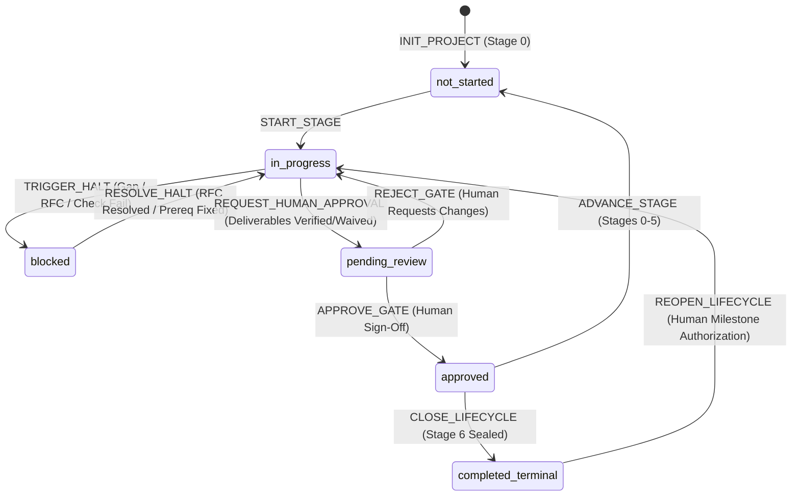

# Project State Transition Machine & Validation Specifications

> **Specification Version**: 1.1.0  
> **Applicable Scope**: Engineering Lifecycle Stages 0–6, Agent Execution Loop Steps 1–7  
> **Status**: Mandatory Governance Specification

---

## 1. Overview and Core Invariants

This document establishes the deterministic state transition rules governing the software engineering lifecycle within the AI Engineering Playbook. The system operates as a **Deterministic Finite State Machine (FSM)**. Every mutation to a project's state must satisfy strict preconditions, validation checks, and postconditions.



### The Cardinal Governance Invariants

1. **Human Sovereignty Invariant**: AI agents are strictly prohibited from setting `human_approval.status` to `approved` or transitioning `stage_status` to `approved` on their own authority. Only an authorized human engineer may sign off on a stage gate transition.
2. **Orthogonal Status Invariant**: Macro lifecycle stage statuses (`stage_status`) and micro deliverable statuses (`deliverables[].status`) are strictly separate. Stages transition through review and approval; deliverables transition through authoring, multi-modal verification, or authorized exception waiver.
3. **Evidence Precondition Invariant**: A deliverable cannot transition from `completed` to `verified` without recorded verification evidence (`result: "passed"`). Automated checks must record an exit code (0 for success); manual reviews must record a verified procedure, summary, and reviewer identity.
4. **No Unverified Advancement Invariant**: A stage cannot transition to `pending_review` or `approved` if any required deliverable is `not_started`, `in_progress`, `blocked`, or `unvalidated`, unless formally waived under an active human exception record (`EXC-YYYYMMDD-###.md`).
5. **Strict Stage 6 Boundary Invariant**: The engineering lifecycle strictly terminates at Stage 6. Any transition to a hypothetical "Stage 7" is physically barred by schema constraints (`maximum: 6`) and state machine guards. Stage 6 approval triggers `CLOSE_LIFECYCLE`.

---

## 2. Status Taxonomy Definitions

To eliminate semantic ambiguity, status definitions are cleanly divided into **Stage Status**, **Deliverable Status**, **Validation Status**, and **Project Lifecycle Status**.

### 2.1 Stage Status (`stage_status`)
Represents the macro lifecycle phase of the currently active stage:

| Stage State | Semantic Meaning | Permitted Operations | Next Legal States |
| :--- | :--- | :--- | :--- |
| `not_started` | Stage initialized in project scope; work has not begun. | Inspect, Initialize | `in_progress` |
| `in_progress` | Active development, drafting, testing, or rework is underway. | Edit, Test, Lint, Audit | `blocked`, `pending_review` |
| `blocked` | Progression halted by an open blocking RFC, failed prerequisite, or gate blocker. | Resolve RFC, Grant Exception | `in_progress` |
| `pending_review` | All stage deliverables are verified or waived; Stage Exit Package submitted. Awaiting human judgment. | Review, Audit | `approved`, `in_progress` (rejection) |
| `approved` | Authorized human engineer has formally signed off on the gate transition. | Read, Advance Stage | `not_started` (next stage) or `completed_terminal` (Stage 6) |

### 2.2 Deliverable Status (`deliverables[].status`)
Represents the micro lifecycle of an individual deliverable artifact:

| Deliverable State | Semantic Meaning | Required Precondition | Next Legal States |
| :--- | :--- | :--- | :--- |
| `not_started` | Deliverable specified in stage rules; artifact file does not exist. | Scope definition | `in_progress` |
| `in_progress` | Artifact file created; actively being drafted, implemented, or reworked. | File creation | `completed`, `blocked` |
| `completed` | Primary deliverable file authored and committed; not yet verified. | File written to disk | `verified`, `in_progress`, `blocked` |
| `verified` | Verification checks (automated or manual) passed with evidence recorded. | Evidence `result: "passed"` | `in_progress` (if regressed) |
| `waived` | Mandatory requirement waived under an active, authorized exception (`EXC-*`). | Active `EXC-*` record with TTL | `in_progress` (if remediated) |
| `blocked` | Deliverable work halted due to an external dependency or unresolved gap. | Blocker detected | `in_progress` |

### 2.3 Validation Status (`deliverables[].validation_status`)
- `unvalidated`: Initial state upon authoring (`completed`). No proof recorded yet.
- `passed`: Verification executed and validated (`result: "passed"`).
- `failed`: Verification check failed (`result: "failed"`). Deliverable requires rework.
- `waived`: Requirement waived by an active human exception record (`EXC-YYYYMMDD-###.md`).

### 2.4 Overall Project Lifecycle Status (`lifecycle_status`)
- `active`: Project actively moving through Stages 0 to 6.
- `completed_terminal`: Stage 6 approved and sealed. System is live in production under operational monitoring.
- `reopened_maintenance`: Reopened for a subsequent release cycle (e.g. v1.1 or v2.0) under explicit human authorization.
- `paused`: Project temporarily shelved by stakeholder instruction.

---

## 3. Transition Event Specifications

### 3.1 `INIT_PROJECT`
- **Purpose**: Initializes project manifest and initial state file.
- **Trigger**: Project bootstrap initiated.
- **Preconditions**:
  - `project.manifest.json` conforms to `schemas/project-manifest.schema.json`.
- **State Mutation**:
  - `lifecycle_status` set to `active`.
  - `current_stage` set to `0` (Discovery & Problem Formulation).
  - `stage_status` set to `not_started`.
  - `stage_history` initialized as empty array `[]`.
  - `current_stage_detail.deliverables` populated with Stage 0 mandatory deliverables (`PRD-CORE`).

---

### 3.2 `START_STAGE`
- **Purpose**: Commences active work within the target stage.
- **Trigger**: AI agent or engineer begins operational tasks for the stage.
- **Preconditions**:
  - `stage_status` is `not_started`.
  - If `current_stage > 0`, the preceding stage (`current_stage - 1`) must exist in `stage_history` with status `approved` (or `waived` via authorized exception).
- **State Mutation**:
  - `stage_status` transitions to `in_progress`.
  - `current_stage_detail.started_at` set to current ISO 8601 timestamp.
  - Deliverables set to `in_progress` as work starts.

---

### 3.3 `RECORD_DELIVERABLE`
- **Purpose**: Records that a deliverable artifact has been authored and saved to disk.
- **Trigger**: AI agent or engineer writes the deliverable file.
- **Preconditions**:
  - `stage_status` is `in_progress`.
  - Deliverable file physically exists at `deliverable.artifact_path`.
- **State Mutation**:
  - Deliverable `status` transitions to `completed`.
  - Deliverable `validation_status` set to `unvalidated`.

---

### 3.4 `RECORD_EVIDENCE` (Multi-Modal Verification)
- **Purpose**: Records verifiable proof of deliverable quality across automated and manual validation disciplines.
- **Trigger**: Verification check executed (test runner, linter, compiler, or manual review).
- **Preconditions**:
  - Verification procedure was executed against the project workspace.
  - Deliverable is in `completed` or `in_progress` status.
- **State Mutation**:
  - If `result == "passed"`:
    - Deliverable `validation_status` set to `passed`.
    - Deliverable `status` transitions to `verified`.
    - Evidence object appended to `deliverable.evidence[]`.
  - If `result == "failed"`:
    - Deliverable `validation_status` set to `failed`.
    - Deliverable `status` reverts to `in_progress`.
    - Evidence object appended for failure traceability.

---

### 3.5 `RECORD_EXCEPTION`
- **Purpose**: Records an authorized human waiver of a specific deliverable requirement.
- **Trigger**: Human authorizes a temporary exception per `exception-record-template.md`.
- **Preconditions**:
  - Exception record physically exists at `docs/exceptions/EXC-YYYYMMDD-###.md`.
  - Exception includes human authorizer, justification, compensating controls, and valid expiration date (`expiration_date >= current_date()`).
- **State Mutation**:
  - Exception object appended to `current_stage_detail.exceptions[]` with `status: "active"`.
  - Target deliverable `validation_status` set to `waived`.
  - Target deliverable `status` set to `waived`.
  - Target deliverable `exception_ref` populated with `EXC-YYYYMMDD-###`.

---

### 3.6 `TRIGGER_HALT` / `BLOCK_PROGRESSION`
- **Purpose**: Halts stage progression upon detecting an unresolvable requirement gap, missing prerequisite, or failing gate invariant.
- **Trigger**: Controller Halt rule triggered.
- **Preconditions**:
  - Requirement gap or validation failure identified.
- **State Mutation**:
  - `stage_status` transitions to `blocked`.
  - Affected deliverable `status` set to `blocked`.
  - Clarification RFC appended to `current_stage_detail.rfcs[]` with `status: "pending_decision"` and `is_blocking: true`.

---

### 3.7 `RESOLVE_HALT`
- **Purpose**: Unblocks a blocked stage upon RFC resolution or prerequisite fix.
- **Trigger**: Human provides decision on open RFC.
- **Preconditions**:
  - RFC markdown artifact updated with human decision and signed off.
- **State Mutation**:
  - RFC in `current_stage_detail.rfcs[]` updated: `status: "resolved"`, `resolved_at: timestamp`.
  - If zero blocking RFCs remain in `pending_decision` and zero deliverables are `blocked`:
    - `stage_status` transitions back to `in_progress`.

---

### 3.8 `REQUEST_HUMAN_APPROVAL` (Two-Phase Handshake: Phase 1)
- **Purpose**: Agent finalizes the Stage Gate Exit Package and formally requests human review.
- **Trigger**: Operational Step 7 (Stage Handover).
- **Preconditions**:
  - 100% of required stage deliverables are in `verified` or `waived` status.
  - Zero deliverables are in `not_started`, `in_progress`, `completed`, or `blocked` status.
  - Zero open RFCs with `is_blocking: true`.
  - Zero expired exceptions (`expiration_date < current_date()`).
  - Stage Gate Exit Package compiled at `current_stage_detail.exit_package.path` matching `gate-exit-package-template.md`.
- **State Mutation**:
  - `exit_package.status` set to `submitted_for_review`.
  - `exit_package.submitted_at` set to current timestamp.
  - `human_approval.status` set to `pending_review`.
  - `stage_status` transitions to `pending_review`.
  - **The AI agent's authority boundary ends here.** Agent halts execution and invites human review.

---

### 3.9 `APPROVE_GATE` (Two-Phase Handshake: Phase 2)
- **Purpose**: Authorized human grants gate exit approval.
- **Trigger**: Explicit human confirmation in development chat (Solo Mode) or approved PR review (Team Mode).
- **Preconditions**:
  - `stage_status` is `pending_review`.
  - `human_approval.status` is `pending_review`.
  - Approver is an authorized human (AI agent identity strictly prohibited).
  - Approver provides explicit verifiable reference (chat quote timestamp, PR number, commit SHA).
- **State Mutation**:
  - `human_approval.status` set to `approved`.
  - `human_approval.approved_by` populated with human name/ID.
  - `human_approval.role` populated with human title.
  - `human_approval.approval_mode` recorded (`solo` or `team`).
  - `human_approval.decision` set to `GATE_APPROVED`.
  - `human_approval.signature_reference` recorded.
  - `human_approval.approved_at` set to current timestamp.
  - `stage_status` transitions to `approved`.

---

### 3.10 `REJECT_GATE`
- **Purpose**: Human reviewer rejects gate submission due to quality or scope deficiencies.
- **Trigger**: Human issues rejection with required rework instructions.
- **Preconditions**:
  - `stage_status` is `pending_review`.
- **State Mutation**:
  - `human_approval.status` set to `rejected`.
  - `human_approval.decision` set to `REJECTED`.
  - `human_approval.conditions` records mandatory rework items.
  - `stage_status` transitions back to `in_progress`.
  - Deliverables requiring rework revert to `in_progress`.
  - `exit_package.status` reverts to `drafted`.

---

### 3.11 `ADVANCE_STAGE` (Stages 0 through 5)
- **Purpose**: Advances the repository into the next sequential lifecycle stage.
- **Trigger**: Agent or human initiates next stage following human gate approval.
- **Preconditions**:
  - `stage_status` is `approved`.
  - `human_approval.status` is `approved`.
  - `current_stage < 6` (Advancement strictly barred at Stage 6).
- **State Mutation**:
  - Completed stage summary appended to `stage_history[]`:
    - `stage`, `stage_name`, `status: "approved"`, `started_at`, `completed_at`, `approved_at`, `exit_package_ref`, `human_approval`.
  - `current_stage` incremented by `1`.
  - `stage_status` set to `not_started`.
  - `current_stage_detail` re-initialized with next stage deliverables.
  - `project.manifest.json` `active_lifecycle_stage` incremented.

---

### 3.12 `CLOSE_LIFECYCLE` (Stage 6 Terminal Transition)
- **Purpose**: Seals the lifecycle when Stage 6 (Deployment & Operational Monitoring) is approved.
- **Trigger**: Human approves Stage 6 Exit Package after observation window.
- **Preconditions**:
  - `current_stage == 6`.
  - `stage_status` is `approved`.
  - `human_approval.status` is `approved`.
- **State Mutation**:
  - Stage 6 summary appended to `stage_history[]`.
  - `lifecycle_status` transitions from `active` to `completed_terminal`.
  - `stage_status` remains `approved`.
  - `current_stage` remains `6` (Locked).
  - No further stage advancement permitted. Project is officially delivered.

---

### 3.13 `REOPEN_LIFECYCLE` (Milestone Iteration)
- **Purpose**: Reopens a sealed project for a subsequent major release or maintenance milestone (e.g. v1.1 or v2.0).
- **Trigger**: Authorized human decision to initiate a new milestone.
- **Preconditions**:
  - `lifecycle_status` is `completed_terminal`.
  - Authorized human instruction provided.
- **State Mutation**:
  - `lifecycle_status` transitions to `reopened_maintenance`.
  - `current_stage` set to target stage (Stage 0 for new problem scope, Stage 1 for defined feature expansion).
  - `stage_status` set to `not_started`.
  - `project.manifest.json` version updated to reflect new milestone target.

---

## 4. Deterministic Transition Matrix

| Current Stage Status | Event | Preconditions Satisfied? | New Stage Status | Deliverable Status Impact | Permitted Actor |
| :--- | :--- | :--- | :--- | :--- | :--- |
| `not_started` | `START_STAGE` | Prior stage approved in history | `in_progress` | All stay `not_started` | Agent / Human |
| `in_progress` | `RECORD_DELIVERABLE` | File physically exists on disk | `in_progress` | Target deliverable -> `completed` | Agent / Human |
| `in_progress` | `RECORD_EVIDENCE` | Verification `result == "passed"` | `in_progress` | Target deliverable -> `verified` | Agent / CI / Human |
| `in_progress` | `RECORD_EVIDENCE` | Verification `result == "failed"` | `in_progress` | Target deliverable -> `in_progress` | Agent / CI / Human |
| `in_progress` | `RECORD_EXCEPTION` | Valid human exception record | `in_progress` | Target deliverable -> `waived` | **Human Only** |
| `in_progress` | `TRIGGER_HALT` | Requirement gap or check failure | `blocked` | Target deliverable -> `blocked` | Controller / Agent |
| `blocked` | `RESOLVE_HALT` | Open blocking RFC resolved | `in_progress` | Blocked deliverable -> `in_progress` | Human / Agent |
| `in_progress` | `REQUEST_HUMAN_APPROVAL` | 100% deliverables verified/waived | `pending_review` | No deliverable change | Agent |
| `pending_review` | `APPROVE_GATE` | Human sign-off verified | `approved` | All deliverables remain locked | **Human Only** |
| `pending_review` | `REJECT_GATE` | Human requests rework | `in_progress` | Flagged deliverables -> `in_progress` | **Human Only** |
| `approved` | `ADVANCE_STAGE` | `current_stage < 6` | `not_started` | New stage deliverables allocated | Agent / Human |
| `approved` | `CLOSE_LIFECYCLE` | `current_stage == 6` | `approved` (terminal) | All deliverables sealed | **Human Only** |
| `completed_terminal` | `REOPEN_LIFECYCLE` | Human milestone authorization | `not_started` | Reopened stage deliverables allocated | **Human Only** |

---

## 5. Five Tiers of Governance Verification

To maintain intellectual honesty, automated tools and agents evaluate rules according to five distinct validation tiers:

| Tier | Validation Level | Capabilities | Limitations |
| :--- | :--- | :--- | :--- |
| **Tier 1** | **JSON Schema Validation** | Validates structural shape, mandatory keys, data types, and enum values. | Cannot verify semantic truth, file existence, or human identity. |
| **Tier 2** | **Deterministic CLI Checks** | Verifies physical file existence, non-empty files, git working tree state, RFC blocking flags, and exception expiration dates. | Cannot verify the quality of prose or whether tests provide real coverage. |
| **Tier 3** | **External Evidence Checks** | Verifies tool exit codes, parses test runner summaries, inspects CI artifact hashes. | Cannot prevent local mock tampering unless run in an isolated hermetic CI runner. |
| **Tier 4** | **Human Review & Authority** | Verifies business problem alignment, architecture trade-offs, UX acceptability, exception necessity, and gate sign-off. | Dependent on human diligence and domain review; not real-time. |
| **Tier 5** | **AI Semantic Reasoning** | Detects unstated assumptions, ambiguous requirements, constitutional misalignments, and drafting gaps. | Non-deterministic; prone to completion bias if unconstrained; strictly forbidden from self-approving gates. |

---

## 6. Machine Validation Invariants (Tooling Rules)

Automated governance tools (e.g. `playbook validate`) enforce compliance by evaluating these invariant rules against `.playbook/state.json`:

```
RULE 01: SCHEMA_CONFORMANCE
         state.json must strictly pass validation against schemas/project-state.schema.json.

RULE 02: ARTIFACT_EXISTENCE
         For every deliverable in current_stage_detail.deliverables:
         file_exists(deliverable.artifact_path) == TRUE.

RULE 03: VERIFICATION_EVIDENCE_INTEGRITY
         For every deliverable where status == "verified":
           - deliverable.validation_status == "passed"
           - length(deliverable.evidence) >= 1
           - At least one evidence entry has result == "passed"
           - If evidence.type IN ["automated_test", "build_typecheck", "static_analysis", "schema_validation"],
             THEN evidence.exit_code == 0.

RULE 04: WAIVER_EXCEPTION_INTEGRITY
         For every deliverable where status == "waived":
           - deliverable.validation_status == "waived"
           - deliverable.exception_ref IS NOT NULL
           - An exception record with matching exception_id exists in current_stage_detail.exceptions
           - exception.status == "active"
           - exception.expiration_date >= current_date().

RULE 05: NO_BLOCKING_RFCS_ON_REVIEW
         If stage_status IN ["pending_review", "approved"],
         THEN NO item in current_stage_detail.rfcs has (status == "pending_decision" AND is_blocking == TRUE).

RULE 06: HUMAN_SOVEREIGNTY_GUARD
         If stage_status == "approved" OR human_approval.status == "approved":
           - human_approval.approved_by IS NOT NULL AND human_approval.approved_by != ""
           - human_approval.role IS NOT NULL AND human_approval.role != ""
           - human_approval.decision == "GATE_APPROVED"
           - human_approval.signature_reference IS NOT NULL AND human_approval.signature_reference != ""
           - human_approval.approved_at IS NOT NULL.

RULE 07: STAGE_BOUNDARY_INTEGRITY
         - current_stage >= 0 AND current_stage <= 6
         - IF current_stage == 6 AND stage_status == "approved":
           lifecycle_status CANNOT be "active" (must transition to "completed_terminal").
         - ADVANCE_STAGE cannot execute when current_stage == 6.
```
