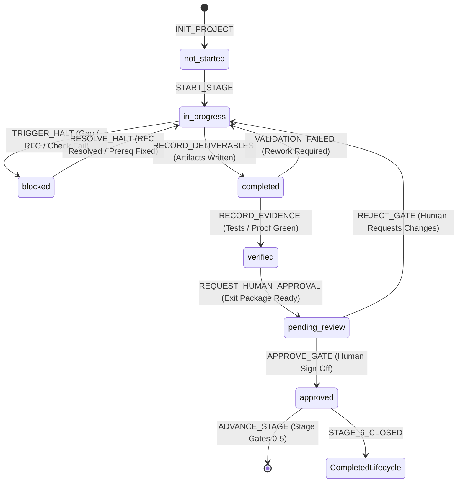

# Project State Transition Machine & Validation Specifications

> **Specification Version**: 1.0.0  
> **Applicable Scope**: Engineering Lifecycle Stages 0–6, Agent Execution Loop Steps 1–7  
> **Status**: Mandatory Governance Specification

---

## 1. Overview and Core Invariants

This document establishes the deterministic state transition rules governing the software engineering lifecycle within the AI Engineering Playbook. The system operates as a **Deterministic Finite State Machine (FSM)**. Every mutation to a project's state must follow strict preconditions, validation checks, and postconditions.



### The Three Cardinal Governance Invariants

1. **Human Sovereignty Invariant**: AI agents are strictly prohibited from setting `human_approval.status` to `approved` or transitioning `stage_status` to `approved` on their own authority. Only an authorized human engineer may sign off on a stage gate transition.
2. **Evidence Precondition Invariant**: A deliverable cannot transition from `completed` to `verified` without verifiable proof (command execution output, passing test count, zero exit code, static analysis report).
3. **No Unverified Advancement Invariant**: A stage cannot transition to `pending_review` or `approved` if any required deliverable is `not_started`, `in_progress`, `blocked`, or `unvalidated`, unless formally waived by an active human exception record (`EXC-YYYYMMDD-###.md`).

---

## 2. Status Taxonomy Definitions

The state machine operates across six non-interchangeable states for both **Stages** and individual **Deliverables**:

| State | Semantic Meaning | Permitted Operations | Next Legal States |
| :--- | :--- | :--- | :--- |
| `not_started` | Item exists in project scope or stage definition but work has not begun. | Read, Initialize | `in_progress` |
| `in_progress` | Active development, architecture drafting, or test implementation is underway. | Edit, Append, Run Tests | `completed`, `blocked` |
| `completed` | Primary artifact has been fully authored and committed to disk. | Read, Verify, Lint | `verified`, `in_progress`, `blocked` |
| `verified` | Automated checks, test suites, or contract verifications have succeeded with proof recorded. | Read, Package, Review | `approved` (via Human), `in_progress` (if regressed) |
| `blocked` | Execution is halted due to missing prerequisites, unresolved RFCs, or failing checks. | RFC Resolution, Exception | `in_progress` |
| `approved` | Authorized human engineer has formally accepted the artifact or stage transition. | Read, Lock, Advance Stage | `not_started` (next stage) |

---

## 3. Transition Event Specifications

### 3.1 `INIT_PROJECT`
- **Purpose**: Initialize a fresh project manifest and empty state file.
- **Trigger**: Human engineer or project initializer runs project bootstrap.
- **Preconditions**:
  - `project.manifest.json` conforms to `schemas/project-manifest.schema.json`.
  - Target documentation directory topology exists.
- **State Mutation**:
  - `current_stage` set to `0` (Discovery & Problem Formulation).
  - `stage_status` set to `not_started`.
  - `stage_history` initialized as empty array `[]`.
  - `current_stage_detail.deliverables` populated with Stage 0 mandatory deliverables (`PRD-CORE`).
- **Postconditions**:
  - `.playbook/state.json` written and valid against `schemas/project-state.schema.json`.

---

### 3.2 `START_STAGE`
- **Purpose**: Commences work within the active lifecycle stage.
- **Trigger**: AI agent or human starts operational steps for the stage.
- **Preconditions**:
  - `stage_status` is `not_started`.
  - If `current_stage > 0`, the preceding stage (`current_stage - 1`) must exist in `stage_history` with status `approved` (or `waived` with active exception).
- **State Mutation**:
  - `stage_status` changes to `in_progress`.
  - `current_stage_detail.started_at` set to current ISO 8601 timestamp.
  - Deliverables set to `in_progress` as work starts.
  - `last_updated` record appended.

---

### 3.3 `RECORD_DELIVERABLE`
- **Purpose**: Records that a required deliverable artifact has been created or updated.
- **Trigger**: AI agent or engineer writes the deliverable file.
- **Preconditions**:
  - `stage_status` is `in_progress`.
  - Target deliverable file exists at `deliverable.artifact_path`.
  - Deliverable conforms to relevant template standards (e.g. `prd-template.md`, `adr-template.md`).
- **State Mutation**:
  - Deliverable `status` transitions from `in_progress` to `completed`.
  - Deliverable `validation_status` set to `unvalidated`.
  - `last_updated` record updated with deliverable ID and actor.

---

### 3.4 `SUBMIT_FOR_VERIFICATION`
- **Purpose**: Flags a completed deliverable for automated testing or static validation.
- **Trigger**: Operational Step 6 (Work Verification) initiated by agent or CI runner.
- **Preconditions**:
  - Deliverable `status` is `completed`.
  - Artifact is readable and non-empty.
- **State Mutation**:
  - Deliverable remains `completed`.
  - Verification harness executes corresponding checks.

---

### 3.5 `RECORD_EVIDENCE`
- **Purpose**: Records verifiable proof (test logs, type check logs, lint outputs) for a deliverable.
- **Trigger**: Verification command finishes execution.
- **Preconditions**:
  - Command was executed in project workspace.
  - Verification exit code, summary, and log reference are captured.
- **State Mutation**:
  - If `exit_code == 0`:
    - Deliverable `validation_status` set to `passed`.
    - Deliverable `status` transitions to `verified`.
    - Evidence object appended to `deliverable.evidence`.
  - If `exit_code != 0`:
    - Deliverable `validation_status` set to `failed`.
    - Deliverable `status` transitions to `in_progress` or `blocked`.
    - Failure evidence recorded for diagnostic traceability.

---

### 3.6 `TRIGGER_HALT` / `BLOCK_PROGRESSION`
- **Purpose**: Blocks progression when an unresolvable requirement gap, missing prerequisite, or failing gate invariant is identified.
- **Trigger**: Controller Halt rule triggered (Step 3 or Step 6 failure).
- **Preconditions**:
  - Requirement ambiguity identified, or a validation check failed without immediate resolution.
- **State Mutation**:
  - Affected deliverable `status` set to `blocked`.
  - `stage_status` transitions to `blocked`.
  - Clarification RFC appended to `current_stage_detail.rfcs` with `status: "pending_decision"` and `is_blocking: true`.
  - Agent ceases all mutation tasks until RFC resolution.

---

### 3.7 `RESOLVE_HALT`
- **Purpose**: Unblocks a blocked stage upon human RFC resolution or prerequisite fix.
- **Trigger**: Authorized human engineer provides decision on open RFC or resolves prerequisite.
- **Preconditions**:
  - RFC artifact updated with human decision and approved sign-off.
  - RFC status set to `resolved` in RFC document.
- **State Mutation**:
  - RFC object in `current_stage_detail.rfcs` updated:
    - `status` set to `resolved`.
    - `resolved_at` set to ISO 8601 timestamp.
    - `decision_summary` populated.
  - If zero blocking RFCs remain in `pending_decision` and zero deliverables are `blocked`:
    - `stage_status` transitions back to `in_progress`.

---

### 3.8 `RECORD_EXCEPTION`
- **Purpose**: Records an authorized human waiver of a specific gate requirement.
- **Trigger**: Human authorizes a temporary exception per `exception-record-template.md`.
- **Preconditions**:
  - Individual exception record exists at `governance/exceptions/EXC-YYYYMMDD-###.md`.
  - Exception record includes human approver, justification, risk assessment, compensating controls, and expiration date (TTL <= 30 days).
- **State Mutation**:
  - Exception object appended to `current_stage_detail.exceptions`:
    - `status` set to `active`.
    - `expiration_date` set to authorized date.
  - Target deliverable `validation_status` set to `waived`.
  - Target deliverable `status` set to `verified` (conditional on waiver).

---

### 3.9 `REQUEST_HUMAN_APPROVAL`
- **Purpose**: Finalizes the Stage Gate Exit Package and invites formal human sign-off.
- **Trigger**: All required deliverables are `verified` (or `waived`).
- **Preconditions**:
  - 100% of required stage deliverables are in `verified` status.
  - Zero open RFCs with `is_blocking: true`.
  - Zero expired or revoked exceptions in `current_stage_detail.exceptions`.
  - Stage Gate Exit Package compiled at `current_stage_detail.exit_package.path` matching `gate-exit-package-template.md`.
- **State Mutation**:
  - `exit_package.status` set to `submitted_for_review`.
  - `exit_package.submitted_at` populated.
  - `human_approval.status` set to `pending_review`.
  - `stage_status` set to `completed` (all work done; awaiting human judgment).

---

### 3.10 `APPROVE_GATE`
- **Purpose**: Authorized human grants gate exit approval.
- **Trigger**: Explicit human confirmation in development chat (Solo Mode) or approved PR review (Team Mode).
- **Preconditions**:
  - `human_approval.status` is `pending_review`.
  - Approver is an authorized human (AI agent identity prohibited).
  - Approver provides explicit sign-off reference (chat quote, PR number, commit SHA).
- **State Mutation**:
  - `human_approval.status` set to `approved`.
  - `human_approval.approved_by` populated with human name/ID.
  - `human_approval.role` populated.
  - `human_approval.approval_mode` recorded (`solo` or `team`).
  - `human_approval.decision` set to `GATE_APPROVED`.
  - `human_approval.signature_reference` recorded.
  - `human_approval.approved_at` populated with ISO 8601 timestamp.
  - `stage_status` transitions to `approved`.
  - Deliverables in stage marked `approved`.

---

### 3.11 `REJECT_GATE`
- **Purpose**: Human reviewer rejects gate submission due to quality or scope deficiencies.
- **Trigger**: Human issues rejection with rework instructions.
- **Preconditions**:
  - `human_approval.status` is `pending_review`.
- **State Mutation**:
  - `human_approval.status` set to `rejected`.
  - `human_approval.decision` set to `REJECTED`.
  - `human_approval.conditions` records required rework.
  - `stage_status` transitions back to `in_progress`.
  - `exit_package.status` set to `drafted`.

---

### 3.12 `ADVANCE_STAGE`
- **Purpose**: Moves project state from the approved stage into the subsequent lifecycle stage.
- **Trigger**: Agent or human initiates next stage after gate approval.
- **Preconditions**:
  - `current_stage_detail.human_approval.status` is `approved`.
  - `stage_status` is `approved`.
  - `current_stage < 6`.
- **State Mutation**:
  - Current stage summary appended to `stage_history`:
    - `stage`, `stage_name`, `status: "approved"`, `started_at`, `completed_at`, `approved_at`, `exit_package_ref`, `human_approval`.
  - `current_stage` incremented by `1`.
  - `stage_status` set to `not_started`.
  - `current_stage_detail` re-initialized with target stage deliverables (per `stage-gate-rules.md`).
  - `project.manifest.json` `active_lifecycle_stage` updated to match `current_stage`.
  - `last_updated` logged.

---

## 4. Deterministic Transition Matrix

| Current Stage Status | Event | Preconditions Satisfied? | New Stage Status | Deliverable Status Impact | Permitted Actor |
| :--- | :--- | :--- | :--- | :--- | :--- |
| `not_started` | `START_STAGE` | Prior stage approved (if stage > 0) | `in_progress` | All stay `not_started` | Agent / Human |
| `in_progress` | `RECORD_DELIVERABLE` | Artifact exists on disk | `in_progress` | Target deliverable -> `completed` | Agent / Human |
| `in_progress` | `TRIGGER_HALT` | Gap / Contradiction / Fail | `blocked` | Target deliverable -> `blocked` | Controller / Agent |
| `blocked` | `RESOLVE_HALT` | Open blocking RFCs resolved | `in_progress` | Blocked deliverable -> `in_progress` | Human / Agent |
| `in_progress` | `RECORD_EVIDENCE` | Verification exit code == 0 | `in_progress` | Target deliverable -> `verified` | Agent / CI Tool |
| `in_progress` | `RECORD_EVIDENCE` | Verification exit code != 0 | `in_progress` | Target deliverable -> `in_progress` | Agent / CI Tool |
| `in_progress` | `RECORD_EXCEPTION` | Valid human exception record | `in_progress` | Target deliverable -> `verified` (waived) | Human Only |
| `in_progress` | `REQUEST_HUMAN_APPROVAL` | 100% deliverables verified | `completed` | All deliverables `verified` | Agent |
| `completed` | `APPROVE_GATE` | Human sign-off verified | `approved` | All deliverables -> `approved` | **Human Only** |
| `completed` | `REJECT_GATE` | Human requests changes | `in_progress` | Deliverables return to `in_progress` | **Human Only** |
| `approved` | `ADVANCE_STAGE` | `current_stage < 6` | `not_started` | New stage deliverables allocated | Agent / Human |

---

## 5. Machine Validation Rules (Automated Tooling Invariants)

Automated governance tools (e.g. `playbook-validate`) enforce compliance by validating the following rules against `.playbook/state.json`:

```
RULE 01: SCHEMA_VALIDITY
         state.json must strictly pass validation against schemas/project-state.schema.json.

RULE 02: ARTIFACT_EXISTENCE
         For every deliverable in current_stage_detail.deliverables, file_exists(artifact_path) == TRUE.

RULE 03: VERIFICATION_EVIDENCE_MANDATORY
         If deliverable.status == "verified" AND deliverable.validation_status != "waived",
         THEN length(deliverable.evidence) >= 1
         AND for at least one evidence entry: evidence.exit_code == 0.

RULE 04: NO_BLOCKING_RFCS
         If stage_status IN ["completed", "approved"],
         THEN NO item in current_stage_detail.rfcs has (status == "pending_decision" AND is_blocking == TRUE).

RULE 05: EXCEPTION_TTL_VALIDITY
         For every item in current_stage_detail.exceptions:
         IF item.status == "active",
         THEN item.expiration_date >= current_date()
         ELSE IF item.expiration_date < current_date(),
         THEN exception is EXPIRED and stage_status CANNOT be "approved".

RULE 06: HUMAN_SOVEREIGNTY_GUARD
         If stage_status == "approved" OR human_approval.status == "approved",
         THEN human_approval.approved_by IS NOT NULL
         AND human_approval.signature_reference IS NOT NULL
         AND human_approval.approved_at IS NOT NULL
         AND last_updated.actor_type == "human" OR (last_updated.reason CONTAINS "human sign-off").
```
