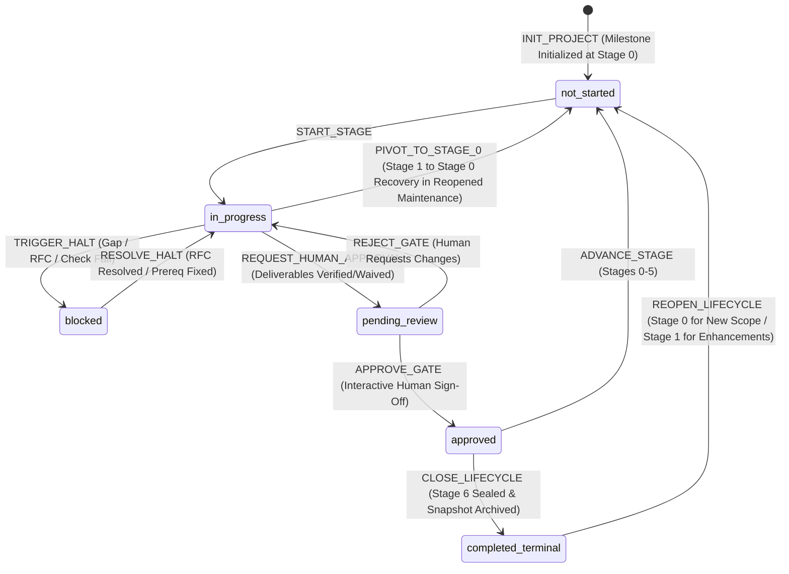

# Project State Transition Machine & Validation Specifications

> **Specification Version**: 1.3.0  
> **Applicable Scope**: Engineering Lifecycle Stages 0–6, Agent Execution Loop Steps 1–7, Milestone Cycles, Recovery Pivots  
> **Status**: Mandatory Governance Specification

---

## 1. Overview and Core Invariants

This document establishes the deterministic state transition rules governing the software engineering lifecycle within the AI Engineering Playbook. The system operates as a **Deterministic Finite State Machine (FSM)**. Every mutation to a project's state must satisfy strict preconditions, validation checks, and postconditions.



### The Cardinal Governance Invariants

1. **Human Sovereignty Invariant**: AI agents are strictly prohibited from setting `human_approval.status` to `approved` or transitioning `stage_status` to `approved` on their own authority. Only an authorized human engineer may sign off on a stage gate transition via an interactive verification workflow.
2. **Interactive TTY Enforcement Guard**: Automated or non-interactive execution of gate approval (e.g. scripts passing `--yes`, `--force`, or piping inputs) is strictly rejected by the governance engine. Gate approval requires an active interactive terminal session (`isatty`).
3. **Orthogonal Status Invariant**: Macro lifecycle stage statuses (`stage_status`) and micro deliverable statuses (`deliverables[].status`) are strictly separate. Stages transition through review and approval; deliverables transition through authoring, multi-modal verification, or authorized exception waiver.
4. **Waiver vs. Verification Invariant**: A waiver is **not** verification. A deliverable with `status: "waived"` represents an unverified requirement whose residual risk has been accepted by an authorized human under a valid, non-expired exception record (`EXC-YYYYMMDD-###.md`). Waived deliverables remain prominent in exit packages.
5. **Evidence Precondition Invariant**: A deliverable cannot transition from `completed` to `verified` without recorded verification evidence (`result: "passed"`). Automated checks must record an exit code (0 for success); manual reviews must record a verified procedure, summary, and reviewer identity.
6. **Strict Stage 6 Terminal Boundary**: The engineering lifecycle strictly terminates at Stage 6. Any transition to a hypothetical "Stage 7" is physically barred by schema constraints (`maximum: 6`) and state machine guards. Stage 6 approval triggers `CLOSE_LIFECYCLE`.
7. **Milestone History Preservation Invariant**: When a project is reopened for a new milestone, prior milestone histories and evidence snapshots must remain permanently preserved in `archived_milestones[]`. A new milestone never silently overwrites previous approved states.
8. **Authorized Recovery Pivot Invariant**: Backward stage movement is strictly prohibited during normal engineering progression. An active maintenance milestone may return from Stage 1 to Stage 0 *only* through an explicit, human-authorized `PIVOT_TO_STAGE_0` recovery transition after its foundational PRD assessment is certified as `OUTDATED`. Stage 1 work and evidence must be preserved in snapshot archives before Stage 0 is initialized.

---

## 2. Status Taxonomy Definitions

Status definitions are cleanly divided into **Stage Status**, **Deliverable Status**, **Validation Status**, and **Project Lifecycle Status**.

### 2.1 Stage Status (`stage_status`)
Represents the macro lifecycle phase of the currently active stage:

| Stage State | Semantic Meaning | Permitted Operations | Next Legal States |
| :--- | :--- | :--- | :--- |
| `not_started` | Stage scope initialized in project scope; work has not begun. | Inspect, Initialize | `in_progress` |
| `in_progress` | Active development, drafting, testing, or rework is underway. | Edit, Test, Lint, Audit | `blocked`, `pending_review` |
| `blocked` | Progression halted by an open blocking RFC, failed prerequisite, or gate blocker. | Resolve RFC, Grant Exception | `in_progress` |
| `pending_review` | All stage deliverables are verified or waived; Stage Exit Package submitted. Awaiting human judgment. | Review, Audit | `approved`, `in_progress` (rejection) |
| `approved` | Authorized human engineer has formally signed off on the gate transition. | Read, Advance Stage | `not_started` (next stage) or `completed_terminal` (Stage 6) |

### 2.2 Deliverable Status (`deliverables[].status`)
Represents the micro lifecycle of an individual deliverable artifact:

| Deliverable State | Semantic Meaning | Required Precondition | Next Legal States |
| :--- | :--- | :--- | :--- |
| `not_started` | Deliverable specified in stage rules; artifact file does not exist. | Scope definition | `in_progress` |
| `in_progress` | Artifact file created; actively being drafted, implemented, or reworked. | File creation | `completed`, `blocked` |
| `completed` | Primary deliverable file authored and committed; not yet verified. | File written to disk | `verified`, `in_progress`, `blocked` |
| `verified` | Verification checks (automated or manual) passed with proof recorded. | Evidence `result: "passed"` | `in_progress` (if regressed) |
| `waived` | Mandatory requirement waived under an active, authorized exception (`EXC-*`). | Active `EXC-*` record with TTL | `in_progress` (if remediated) |
| `blocked` | Deliverable work halted due to an external dependency or unresolved gap. | Blocker detected | `in_progress` |

### 2.3 Validation Status (`deliverables[].validation_status`)
- `unvalidated`: Initial state upon authoring (`completed`). No proof recorded yet.
- `passed`: Verification executed and validated (`result: "passed"`).
- `failed`: Verification check failed (`result: "failed"`). Deliverable requires rework.
- `waived`: Requirement waived by an active human exception record (`EXC-YYYYMMDD-###.md`).

### 2.4 Overall Project Lifecycle Status (`lifecycle_status`)
- `active`: Project actively moving through Stages 0 to 6 within current milestone.
- `completed_terminal`: Stage 6 approved and sealed. Milestone is frozen in production.
- `reopened_maintenance`: Reopened for a subsequent milestone cycle (e.g. v1.1 or v2.0) under explicit human authorization.
- `paused`: Project temporarily shelved by stakeholder instruction.

---

## 3. Transition Event Specifications

### 3.1 `INIT_PROJECT`
- **Purpose**: Initializes project manifest and initial state file for Milestone 1.
- **Trigger**: Project bootstrap initiated.
- **Preconditions**:
  - `project.manifest.json` conforms to `schemas/project-manifest.schema.json`.
- **State Mutation**:
  - `milestone_id` set to initial milestone (e.g. `M-1.0.0`).
  - `milestone_name` set to initial title (e.g. `Initial MVP Release`).
  - `lifecycle_status` set to `active`.
  - `current_stage` set to `0` (Discovery & Problem Formulation).
  - `stage_status` set to `not_started`.
  - `stage_history` initialized as empty array `[]`.
  - `archived_milestones` initialized as empty array `[]`.
  - `current_stage_detail.deliverables` populated with Stage 0 mandatory deliverables (`PRD-CORE`).

---

### 3.2 `START_STAGE`
- **Purpose**: Commences active work within the target stage.
- **Trigger**: AI agent or engineer begins operational tasks for the stage.
- **Preconditions**:
  - `stage_status` is `not_started`.
  - If `current_stage > 0`, the preceding stage (`current_stage - 1`) must exist in `stage_history` with status `approved` (or `waived` via authorized exception).
- **State Mutation**:
  - `stage_status` transitions to `in_progress`.
  - `current_stage_detail.started_at` set to current ISO 8601 timestamp.
  - Deliverables set to `in_progress` as work starts.

---

### 3.3 `RECORD_DELIVERABLE`
- **Purpose**: Records that a deliverable artifact has been authored and saved to disk.
- **Trigger**: AI agent or engineer writes the deliverable file.
- **Preconditions**:
  - `stage_status` is `in_progress`.
  - Deliverable file physically exists at `deliverable.artifact_path`.
- **State Mutation**:
  - Deliverable `status` transitions to `completed`.
  - Deliverable `validation_status` set to `unvalidated`.

---

### 3.4 `RECORD_EVIDENCE` (Multi-Modal Verification)
- **Purpose**: Records verifiable proof of deliverable quality across automated and manual validation disciplines.
- **Trigger**: Verification check executed (test runner, linter, compiler, or manual review).
- **Preconditions**:
  - Verification procedure was executed against the project workspace.
  - Deliverable is in `completed` or `in_progress` status.
- **State Mutation**:
  - If `result == "passed"`:
    - Deliverable `validation_status` set to `passed`.
    - Deliverable `status` transitions to `verified`.
    - Evidence object appended to `deliverable.evidence[]` capturing `type`, `procedure`, `result: "passed"`, `summary`, `exit_code` (nullable), `commit_sha`, `evidence_hash` (nullable), `evidence_ref`, `verified_at`, `verified_by`, `actor_type`.
  - If `result == "failed"`:
    - Deliverable `validation_status` set to `failed`.
    - Deliverable `status` reverts to `in_progress`.
    - Evidence object appended for failure traceability.

---

### 3.5 `RECORD_EXCEPTION`
- **Purpose**: Records an authorized human waiver of a specific deliverable requirement.
- **Trigger**: Human authorizes a temporary exception per `exception-record-template.md`.
- **Preconditions**:
  - Exception record physically exists at `docs/exceptions/EXC-YYYYMMDD-###.md`.
  - Exception includes human authorizer, justification, compensating controls, and valid expiration date (`expiration_date >= current_date()`).
- **State Mutation**:
  - Exception object appended to `current_stage_detail.exceptions[]` with `status: "active"`.
  - Target deliverable `validation_status` set to `waived`.
  - Target deliverable `status` set to `waived`.
  - Target deliverable `exception_ref` populated with `EXC-YYYYMMDD-###`.

---

### 3.6 `TRIGGER_HALT` / `BLOCK_PROGRESSION`
- **Purpose**: Halts stage progression upon detecting an unresolvable requirement gap, missing prerequisite, or failing gate invariant.
- **Trigger**: Controller Halt rule triggered.
- **Preconditions**:
  - Requirement gap, expired exception, or validation failure identified.
- **State Mutation**:
  - `stage_status` transitions to `blocked`.
  - Affected deliverable `status` set to `blocked`.
  - Clarification RFC appended to `current_stage_detail.rfcs[]` with `status: "pending_decision"` and `is_blocking: true`.

---

### 3.7 `RESOLVE_HALT`
- **Purpose**: Unblocks a blocked stage upon RFC resolution or prerequisite fix.
- **Trigger**: Human provides decision on open RFC.
- **Preconditions**:
  - RFC markdown artifact updated with human decision and signed off.
- **State Mutation**:
  - RFC in `current_stage_detail.rfcs[]` updated: `status: "resolved"`, `resolved_at: timestamp`.
  - If zero blocking RFCs remain in `pending_decision` and zero deliverables are `blocked`:
    - `stage_status` transitions back to `in_progress`.

---

### 3.8 `REQUEST_HUMAN_APPROVAL` (Two-Phase Handshake: Phase 1)
- **Purpose**: Agent finalizes the Stage Gate Exit Package and formally requests human review.
- **Trigger**: Operational Step 7 (Stage Handover).
- **Preconditions**:
  - 100% of required stage deliverables are in `verified` or `waived` status.
  - Zero deliverables are in `not_started`, `in_progress`, `completed`, or `blocked` status.
  - Zero open RFCs with `is_blocking: true`.
  - Zero expired exceptions (`expiration_date < current_date()`).
  - Stage Gate Exit Package compiled at `current_stage_detail.exit_package.path` matching `gate-exit-package-template.md`.
  - All waived deliverables are explicitly recorded in Section 3 and Section 7 of the Exit Package with compensating controls and residual risks.
- **State Mutation**:
  - `exit_package.status` set to `submitted_for_review`.
  - `exit_package.submitted_at` set to current timestamp.
  - `human_approval.status` set to `pending_review`.
  - `stage_status` transitions to `pending_review`.
  - **The AI agent's authority boundary ends here.** Agent halts execution and invites human review.

---

### 3.9 `APPROVE_GATE` (Two-Phase Handshake: Phase 2 — Interactive Protocol)
- **Purpose**: Authorized human grants gate exit approval through an interactive workflow.
- **Trigger**: Human executes `playbook approve --gate <N>` in interactive terminal OR issues explicit in-chat confirmation (Solo Mode) / PR review sign-off (Team Mode).
- **Interactive TTY Enforcement Guard**:
  - The CLI gate approval command requires an interactive terminal (`isatty(stdin) == true`).
  - Any non-interactive invocation (e.g. headless script, piped stdin, automated subagent call, `--yes`, `--force`) **must be rejected immediately** with an error code.
  - The human is prompted interactively to confirm:
    1. Human Reviewer Full Name.
    2. Professional Role / Authority.
    3. Approval Mode (`solo` or `team`).
    4. Typed confirmation phrase: `CONFIRM APPROVAL GATE <N>`.
- **Preconditions**:
  - `stage_status` is `pending_review`.
  - `human_approval.status` is `pending_review`.
  - Approver is an authorized human (AI agent identity strictly prohibited).
  - Verifiable signature reference provided (interactive session ID, chat quote with timestamp, PR review number).
- **State Mutation**:
  - `human_approval.status` set to `approved`.
  - `human_approval.approved_by` populated with human name/ID.
  - `human_approval.role` populated with human title.
  - `human_approval.approval_mode` recorded (`solo` or `team`).
  - `human_approval.decision` set to `GATE_APPROVED`.
  - `human_approval.signature_reference` recorded.
  - `human_approval.approved_at` set to current timestamp.
  - `stage_status` transitions to `approved`.

---

### 3.10 `REJECT_GATE`
- **Purpose**: Human reviewer rejects gate submission due to quality or scope deficiencies.
- **Trigger**: Human issues rejection with required rework instructions.
- **Preconditions**:
  - `stage_status` is `pending_review`.
- **State Mutation**:
  - `human_approval.status` set to `rejected`.
  - `human_approval.decision` set to `REJECTED`.
  - `human_approval.conditions` records mandatory rework items.
  - `stage_status` transitions back to `in_progress`.
  - Deliverables requiring rework revert to `in_progress`.
  - `exit_package.status` reverts to `drafted`.

---

### 3.11 `ADVANCE_STAGE` (Stages 0 through 5)
- **Purpose**: Advances the repository into the next sequential lifecycle stage.
- **Trigger**: Agent or human initiates next stage following human gate approval.
- **Preconditions**:
  - `stage_status` is `approved`.
  - `human_approval.status` is `approved`.
  - `current_stage < 6` (Advancement strictly barred at Stage 6).
- **State Mutation**:
  - Completed stage summary appended to `stage_history[]`:
    - `stage`, `stage_name`, `status: "approved"`, `started_at`, `completed_at`, `approved_at`, `exit_package_ref`, `human_approval`.
  - `current_stage` incremented by `1`.
  - `stage_status` set to `not_started`.
  - `current_stage_detail` re-initialized with next stage deliverables.
  - `project.manifest.json` `active_lifecycle_stage` incremented.

---

### 3.12 `CLOSE_LIFECYCLE` (Stage 6 Terminal Transition)
- **Purpose**: Seals the lifecycle when Stage 6 (Deployment & Operational Monitoring) is approved.
- **Trigger**: Human approves Stage 6 Exit Package after observation window.
- **Preconditions**:
  - `current_stage == 6`.
  - `stage_status` is `approved`.
  - `human_approval.status` is `approved`.
- **State Mutation**:
  - Stage 6 summary appended to `stage_history[]`.
  - `lifecycle_status` transitions from `active` to `completed_terminal`.
  - `stage_status` remains `approved`.
  - `current_stage` remains `6` (Locked).
  - Frozen milestone state snapshot written to `.playbook/milestones/state-<milestone_id>.json`.
  - No further stage advancement permitted. Milestone is officially sealed.

---

### 3.13 `REOPEN_LIFECYCLE` (Milestone Iteration Protocol)
- **Purpose**: Reopens a sealed project for a subsequent milestone cycle (e.g. v1.1 or v2.0) while permanently preserving prior milestone history.
- **Trigger**: Authorized human decision to initiate a new milestone.
- **Preconditions**:
  - `lifecycle_status` is `completed_terminal`.
  - Explicit human authorization provided.
- **Milestone Archival Procedure**:
  - A milestone snapshot entry is constructed and appended to `archived_milestones[]`:
    - `milestone_id`: Current milestone ID (e.g. `M-1.0.0`).
    - `milestone_name`: Current milestone title.
    - `completed_at`: Timestamp of Stage 6 closure.
    - `final_stage`: `6`.
    - `stage_history`: Full array of completed stages for that milestone.
    - `exit_package_ref`: `docs/gates/GATE-6-EXIT-PACKAGE.md`.
    - `state_snapshot_ref`: `.playbook/milestones/state-<milestone_id>.json`.
  - Active `milestone_id` updated to new milestone (e.g. `M-1.1.0` or `M-2.0.0`).
  - Active `milestone_name` updated.
  - Manifest `active_milestone_id` updated synchronously.
- **Target Stage Selection**:
  - **Stage 0 (Discovery & Problem Formulation)**:
    - Selected when the new milestone represents a fundamental domain expansion, new market audience, major architectural pivot, or new core problem statement.
    - Requires authoring a new or significantly amended PRD Core.
  - **Stage 1 (Requirements & Specification)**:
    - Selected when the new milestone represents incremental feature enhancements, technical debt remediation, or scaling where the foundational problem statement remains valid.
    - Re-links existing approved Stage 0 Problem Statement from `archived_milestones` and begins with new feature specifications (`REQ-XXX`).
- **State Mutation**:
  - `lifecycle_status` set to `reopened_maintenance`.
  - `current_stage` set to selected target stage (0 or 1).
  - `stage_status` set to `not_started`.
  - `stage_history` re-initialized to empty array `[]` for the active milestone.
  - `current_stage_detail` populated with deliverables for the target stage.

---

### 3.14 `PIVOT_TO_STAGE_0` (Active Maintenance Stage Pivot Protocol)
- **Purpose**: Authorizes an emergency recovery transition returning an active maintenance milestone from Stage 1 to Stage 0 when its inherited problem formulation (`PRD-CORE`) is determined to be `OUTDATED`.
- **Trigger**: Human operator executes `playbook pivot --stage 0` via interactive TTY.
- **Architectural Scope**: Governed by [`governance/maintenance-stage-pivot-design.md`](maintenance-stage-pivot-design.md). This transition is **not** ordinary stage advancement, **not** an automated rollback, and **not** a lifecycle reopening.
- **Mandatory Preconditions**:
  1. `lifecycle_status` is strictly `reopened_maintenance`. (All other statuses reject with `LIFECYCLE_NOT_MAINTENANCE`).
  2. `current_stage` is strictly `1`. (All other stages reject with `PIVOT_INVALID_STAGE`).
  3. `stage_status` is not `approved` and `current_stage_detail.human_approval.decision` is not `GATE_APPROVED`. (Approved stages reject with `STAGE_ALREADY_APPROVED`).
  4. Inherited PRD applicability assessment for the active milestone is certified as `OUTDATED`. (Valid, missing, or mismatched assessments reject with `PIVOT_PRD_NOT_OUTDATED`).
  5. Interactive terminal session (`isatty(stdin) == true`). (Headless/piped execution rejects with `TTY_REQUIRED`).
  6. Operator enters exact confirmation phrase: `CONFIRM PIVOT TO STAGE 0 <MILESTONE_ID>`.
  7. Non-empty justification reason recorded.
- **Historical Preservation Procedure**:
  - Pre-pivot Stage 1 state serialized to immutable snapshot: `.playbook/pivots/state-<milestone_id>-stage-1-<timestamp>.json` (mode `0o444`).
  - Governance audit document generated: `docs/pivots/PIVOT-<milestone_id>-STAGE-0.md`.
  - Authored files in working tree (`REQUIREMENTS-SPEC.md`, test logs) remain intact and tracked by Git.
  - Pivoted Stage 1 records are **never** appended to `stage_history[]` to preserve schema validity (`status: ["approved", "waived"]`) and monotonic stage sequencing.
- **State Mutation**:
  - `milestone_id` retained unchanged.
  - `current_stage` set to `0`.
  - `stage_status` set to `not_started`.
  - `current_stage_detail` freshly populated with Stage 0 baseline deliverables (`PRD-CORE` with `status: "not_started"`, `validation_status: "unvalidated"`, empty evidence).
  - No verification hashes or approval signatures are inherited from prior stages or milestones.
  - Manifest `active_lifecycle_stage` synchronized to `0`.
  - Approval sidecar `.playbook/approval-fingerprint.json` safely unlinked/purged.
  - Lifecycle status remains `reopened_maintenance`.

---

## 4. The Four Levels of Evidence Assurance

To maintain intellectual honesty, validation evidence is evaluated across four distinct assurance levels:

```
┌────────────────────────────────────────────────────────┐
│ Level 4: Validation Correctness                        │
│ (Human review & AST checks assert requirement validity)│
└────────────────────────────────────────────────────────┘
                           ▲
┌────────────────────────────────────────────────────────┐
│ Level 3: Evidence Authenticity                         │
│ (Signed Git commits, OIDC CI tokens, verified actor)   │
└────────────────────────────────────────────────────────┘
                           ▲
┌────────────────────────────────────────────────────────┐
│ Level 2: File Integrity                                │
│ (SHA-256 hash match proves file has not been altered)  │
└────────────────────────────────────────────────────────┘
                           ▲
┌────────────────────────────────────────────────────────┐
│ Level 1: File Existence                                │
│ (File physically exists at evidence_ref relative path) │
└────────────────────────────────────────────────────────┘
```

1. **Level 1: File Existence**:
   - Asserts that the referenced proof file physically exists on disk (`file_exists(evidence_ref) == true`).
   - Verified deterministically by CLI.
2. **Level 2: File Integrity (SHA-256 Hash)**:
   - For file-based proof (logs, reports, screenshots), computes SHA-256 and asserts `sha256(file) == evidence_hash`.
   - Proves the evidence file has not been tampered with or corrupted after verification was recorded.
   - *Limitation*: A hash proves file immutability; it **does not** prove authenticity (an agent or attacker could generate dummy logs and compute their valid hash).
   - *Optional for non-file reviews*: Null for inline manual review notes where no dedicated file artifact is generated.
3. **Level 3: Evidence Authenticity**:
   - Asserts that the recorded `verified_by` actor genuinely executed the verification in a trusted environment.
   - Enforced by server-side CI runners (e.g. GitHub Actions executing checks and outputting signed attestations), signed Git commits (`commit_sha`), or cryptographic identity tokens.
4. **Level 4: Validation Correctness**:
   - Asserts that the verification procedure genuinely tested the required invariant (e.g. that unit tests asserted real boundary conditions rather than empty assertions `assert True`).
   - Evaluated by Human Peer Review (Tier 4) or advanced AST semantic checkers (Tier 5).

---

## 5. Machine Validation Invariants (Tooling Rules)

Automated governance tools (e.g. `playbook validate`) enforce compliance by evaluating these invariant rules against `.playbook/state.json`:

```
RULE 01: SCHEMA_CONFORMANCE
         state.json must strictly pass validation against schemas/project-state.schema.json.

RULE 02: ARTIFACT_EXISTENCE
         For every deliverable in current_stage_detail.deliverables:
         file_exists(deliverable.artifact_path) == TRUE.

RULE 03: VERIFICATION_EVIDENCE_INTEGRITY
         For every deliverable where status == "verified":
           - deliverable.validation_status == "passed"
           - length(deliverable.evidence) >= 1
           - At least one evidence entry has result == "passed"
           - If evidence.type IN ["automated_test", "build_typecheck", "static_analysis", "schema_validation"]:
               THEN evidence.exit_code == 0
           - If evidence.evidence_hash IS NOT NULL:
               THEN file_exists(evidence.evidence_ref) == TRUE
               AND sha256(evidence.evidence_ref) == evidence.evidence_hash.

RULE 04: WAIVER_EXCEPTION_INTEGRITY
         For every deliverable where status == "waived":
           - deliverable.validation_status == "waived"
           - deliverable.exception_ref IS NOT NULL
           - An exception record with matching exception_id exists in current_stage_detail.exceptions
           - exception.status == "active"
           - exception.expiration_date >= current_date()
           - IF exception.status != "active" OR exception.expiration_date < current_date():
               THEN waiver is INVALID and stage_status CANNOT be "pending_review" or "approved".

RULE 05: NO_BLOCKING_RFCS_ON_REVIEW
         If stage_status IN ["pending_review", "approved"],
         THEN NO item in current_stage_detail.rfcs has (status == "pending_decision" AND is_blocking == TRUE).

RULE 06: HUMAN_SOVEREIGNTY_GUARD
         If stage_status == "approved" OR human_approval.status == "approved":
           - human_approval.approved_by IS NOT NULL AND human_approval.approved_by != ""
           - human_approval.role IS NOT NULL AND human_approval.role != ""
           - human_approval.decision == "GATE_APPROVED"
           - human_approval.signature_reference IS NOT NULL AND human_approval.signature_reference != ""
           - human_approval.approved_at IS NOT NULL.

RULE 07: STAGE_BOUNDARY_AND_MILESTONE_INTEGRITY
         - current_stage >= 0 AND current_stage <= 6
         - IF current_stage == 6 AND stage_status == "approved":
           lifecycle_status CANNOT be "active" (must be "completed_terminal").
         - ADVANCE_STAGE cannot execute when current_stage == 6.
         - IF lifecycle_status == "reopened_maintenance":
           length(archived_milestones) >= 1.
```
