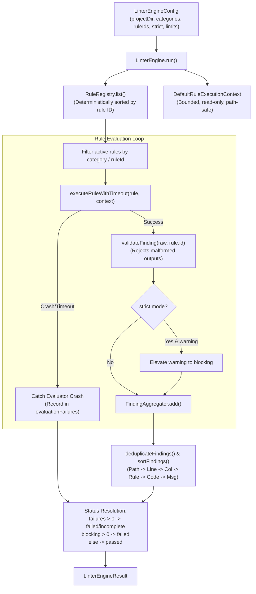

# Governance Linter Core Engine & Diagnostic Contracts

> **Implementation Subsystem**: `tooling/playbook-cli/src/core/linters/`  
> **Parent Track**: Task 008 — Governance Linters  
> **Phase**: Task 008B.5 (Category D: Technology Stack Governance Rules)  
> **Status**: ACCEPTED WITH DOCUMENTED LIMITATIONS  
> **Architecture Reference**: [`docs/architecture/governance-linters/design.md`](../../../../docs/architecture/governance-linters/design.md)  
> **Governing ADR**: [`docs/adr/ADR-20261106-001-governance-linters.md`](../../../../docs/adr/ADR-20261106-001-governance-linters.md)

---

## 1. Overview & Architectural Role

The `core/linters/` module implements the provider-neutral, deterministic foundation of the Governance Linter subsystem. It is designed to host static analysis rules for documentation consistency, schema integrity, constitutional invariants, technology stacks, and CI workflow security without relying on open-ended heuristics or modifying project state.

The engine establishes a strict separation between:
1. **Rule Definitions & Registry**: Strongly typed rule contracts registered deterministically without dynamic external plugin side-effects.
2. **Controlled Execution Context**: A sandboxed read-only interface providing bounded, safe filesystem access that rejects path traversal, symlink escapes, and invalid encodings.
3. **Severity & Enforcement Engine**: Intrinsic severity (`error`, `warning`, `info`) mapped deterministically to operational enforcement (`blocking`, `warning`, `advisory`), guaranteeing that errors cannot be downgraded.
4. **Finding Aggregation & Canonical Sorting**: Fully reproducible finding collection, deduplication, and multi-tier sorting.
5. **Execution Engine**: Orchestrates rule execution with bounded timeouts, capturing evaluator exceptions and producing a typed `LinterEngineResult`.

---

## 2. Core Contracts & Types

### 2.1 GovernanceRule (`types.ts`)
```typescript
export interface GovernanceRule {
  readonly id: string;                         // Matches ^[A-Z0-9]+(-[A-Z0-9]+)*$
  readonly category: RuleCategory;             // "documentation" | "schema" | "invariant" | "stack" | "security"
  readonly name: string;                       // Human-readable title
  readonly description: string;                // Detailed governance rationale
  readonly severity: RuleSeverity;             // "error" | "warning" | "info"
  readonly defaultEnforcement: RuleEnforcement;// "blocking" | "warning" | "advisory"
  readonly targetGlobs: string[];              // Targeted files
  readonly excludeGlobs?: string[];            // Excluded globs
  readonly evaluationMethod: RuleEvaluationMethod;
  readonly version: string;                    // Rule spec version
  readonly remediation?: string;
  readonly autofix?: RuleAutofixMetadata;
  evaluate(context: RuleExecutionContext): Promise<RuleFinding[] | void> | RuleFinding[] | void;
}
```

### 2.2 RuleFinding (`types.ts`)
```typescript
export interface RuleFinding {
  readonly ruleId: string;
  readonly diagnosticCode: string;             // Matches ^[A-Z0-9_]+(-[A-Z0-9_]+)*$
  readonly severity: RuleSeverity;
  readonly enforcement: RuleEnforcement;
  readonly message: string;
  readonly filePath?: string | null;           // POSIX normalized or null for repo-wide
  readonly line?: number | null;               // 1-based line or null
  readonly column?: number | null;             // 1-based column or null
  readonly expected?: string | null;
  readonly actual?: string | null;
  readonly remediation?: string | null;
  readonly blocksOperation: boolean;           // True iff enforcement === "blocking"
}
```

### 2.3 RuleExecutionContext (`execution-context.ts`)
```typescript
export interface RuleExecutionContext {
  readonly projectDir: string;
  readonly limits: ExecutionLimits;
  listFiles(globs?: string[], excludeGlobs?: string[]): string[];
  readFile(relativeFilePath: string): string;
  readFileBuffer(relativeFilePath: string): Buffer;
  fileExists(relativeFilePath: string): boolean;
  statFile(relativeFilePath: string): FileStat;
  normalizePath(filePath: string): string;
}
```

---

## 3. Subsystem Architecture & Execution Lifecycle



---

## 4. Key Guarantees & Non-Negotiables

1. **Zero Lifecycle State Mutation**:
   The engine provides no APIs for writing to `.playbook/manifest.json`, `.playbook/state.json`, `.playbook/journal.json`, or `.playbook/logs/`. It acquires no locks and operates strictly read-only.
2. **Crash Transparency (No Silent Clean Results)**:
   If a rule evaluator throws an unhandled exception or times out, the failure is recorded in `evaluationFailures` and the overall execution status becomes `"failed"` or `"incomplete"`. An internal error can never be disguised as a passing run.
3. **Non-Downgrade Invariant**:
   `error` severity rules strictly enforce `blocking` operational behavior. Configuration overrides cannot downgrade an error to `warning` or `advisory`.
4. **Deterministic Canonical Ordering**:
   All findings are deduplicated and ordered:
   - `filePath`: repository-wide (`null`) first, then ascending POSIX path.
   - `line`: null lines first, then numeric ascending.
   - `column`: null columns first, then numeric ascending.
   - `ruleId`: alphabetical ascending.
   - `diagnosticCode`: alphabetical ascending.
   - `message`: alphabetical ascending.

---

## 5. Resource Limits & Isolation Boundaries

- **File Size Bounding**: Default limit is **5 MB** (`maxFileSizeBytes: 5242880`). Reading larger files throws `FILE_TOO_LARGE`.
- **File Enumeration Bounding**: Default limit is **10,000 files** (`maxFilesScanned: 10000`). Exceeding throws `FILE_COUNT_EXCEEDED`.
- **Per-Rule Timeout Bounding**: Default limit is **30,000 ms** (`timeoutMs: 30000`). Exceeding triggers `RULE_TIMEOUT` and marks status `"incomplete"`.
- **Path Traversal Protection**: Rejects paths starting with `..`, absolute paths, drive-qualified paths, and UNC paths.
- **Symlink Escape Protection**: Validates that symbolic link targets resolve strictly within the real project root directory (`SYMLINK_ESCAPE_DETECTED`).
- **Encoding Safety**: Strict UTF-8 validation via `TextDecoder` fatal mode; invalid byte sequences throw `INVALID_UTF8`. BOM is transparently stripped.

---

## 6. Category A: Documentation & Reference Integrity Rules (`rules/documentation/`)

Category A implements 5 static analysis rules covering documentation consistency, cross-references, lifecycle boundaries, and command freshness across markdown files:

| Rule ID | Severity | Enforcement | Diagnostic Codes | Description |
| :--- | :--- | :--- | :--- | :--- |
| `RULE-DOC-REF-INTEGRITY` | `error` | `blocking` | `BROKEN_MARKDOWN_LINK`, `BROKEN_MARKDOWN_ANCHOR`, `PATH_TRAVERSAL_LINK` | Validates relative file links and anchors (`#heading-slug`) in markdown files, rejecting missing targets and path traversal outside repository root. |
| `RULE-DOC-ADR-INTEGRITY` | `error` | `blocking` | `INVALID_ADR_FILENAME`, `INVALID_ADR_STATUS`, `DUPLICATE_ADR_ID`, `BROKEN_ADR_REFERENCE` | Validates ADR filename formatting (`ADR-YYYYMMDD-###-slug.md`), canonical status (`proposed`, `accepted`, `rejected`, `deprecated`, `superseded`), uniqueness, and cross-document references. |
| `RULE-DOC-STAGE-BOUNDS` | `error` | `blocking` | `INVALID_STAGE_BOUNDS` | Flags invalid lifecycle stage references outside `Stage 0` through `Stage 6` (e.g. `Stage 7+`), distinguishing normative prohibitions from erroneous operational references. |
| `RULE-DOC-MANDATORY-SECTIONS` | `error` | `blocking` | `MISSING_MANDATORY_HEADING` | Enforces mandatory Markdown headings for PRD (`docs/prd/`), ADR (`docs/adr/`), RFC (`docs/rfcs/`), Gate Exit Packages (`docs/gates/`), and Exception Records (`docs/exceptions/`). |
| `RULE-DOC-DEPRECATED-COMMANDS` | `warning` | `warning` | `DEPRECATED_CLI_COMMAND` | Flags obsolete CLI invocations (`playbook run`, `playbook test`, `playbook lint --fix`) in operational guides and templates while exempting historical ADRs and explanatory migration prose. |

---

## 7. Category B: Schema & Configuration Integrity Rules (`rules/schema/`)

Category B implements 4 static analysis rules covering project manifest, machine-readable state, quality gates, and technology stack declarations:

| Rule ID | Severity | Enforcement | Diagnostic Codes | Description |
| :--- | :--- | :--- | :--- | :--- |
| `RULE-SCHEMA-MANIFEST-VALIDITY` | `error` | `blocking` | `MANIFEST_MISSING`, `MANIFEST_UNREADABLE`, `MANIFEST_PARSE_ERROR`, `MANIFEST_SCHEMA_VIOLATION` | Validates `.playbook/manifest.json` against canonical `project-manifest.schema.json` via Ajv2020, detecting syntax errors, missing properties, invalid types, and unpermitted enum values. |
| `RULE-SCHEMA-STATE-VALIDITY` | `error` | `blocking` | `STATE_MISSING`, `STATE_UNREADABLE`, `STATE_PARSE_ERROR`, `STATE_SCHEMA_VIOLATION` | Validates `.playbook/state.json` against canonical `project-state.schema.json` in a strictly read-only mode without mutating state or triggering recovery flows. |
| `RULE-SCHEMA-GATES-VALIDITY` | `error` | `blocking` | `GATES_CONFIG_MISSING`, `GATES_UNREADABLE`, `GATES_PARSE_ERROR`, `GATES_SCHEMA_VIOLATION` | Validates `.playbook/quality-gates.json` against canonical `quality-gates.schema.json` without executing quality gates or modifying files. |
| `RULE-CFG-STACK-DECLARATION` | `error` | `blocking` | `UNKNOWN_STACK_ID`, `STACK_DEFINITION_MISSING`, `STACK_DEPENDENCY_MISSING`, `CIRCULAR_STACK_DEPENDENCY`, `STACK_CONFIG_CONFLICT`, `STACK_PREREQUISITE_INCONSISTENCY` | Validates technology-stack declarations and dependency DAGs via canonical `StackManager`, enforcing discovery, prerequisite consistency (e.g. Expo requiring React Native), and conflict detection. |

---

## 8. Category C: Governance Invariant Rules (`rules/invariants/`)

Category C implements 5 static analysis rules enforcing non-negotiable constitutional invariants across state, gate exit packages, CI workflows, and stack templates:

| Rule ID | Severity | Enforcement | Diagnostic Codes | Description |
| :--- | :--- | :--- | :--- | :--- |
| `RULE-GOV-NO-AGENT-APPROVAL` | `error` | `blocking` | `AGENT_APPROVAL_PROHIBITED`, `FORGED_APPROVAL_SIDECAR` | Enforces Principle 1: AI agents are strictly forbidden from approving stage transitions. Inspects state `human_approval`, `actor_type`, historical records, approval sidecars, and gate exit package markdown for agent patterns. |
| `RULE-GOV-IMMUTABLE-WAL-CI` | `error` | `blocking` | `CI_MUTATION_PROHIBITED`, `WAL_MUTATION_IN_CI` | Scans `.github/workflows/**/*.yml` and `.playbook/quality-gates.json` to ensure Remote CI and gate checks do not attempt lifecycle mutations (`playbook advance`, `approve`, `reopen`, `recover`, `init`) or WAL writes. |
| `RULE-GOV-EVIDENCE-INTEGRITY` | `error` | `blocking` | `DELIVERABLE_UNVERIFIED_CLAIM`, `MISSING_EVIDENCE_RECORD` | Verifies that any deliverable marked `status: 'verified'` has `validation_status: 'passed'`, at least one evidence record with `result: 'passed'`, an existing file on disk, and a matching SHA-256 hash. |
| `RULE-GOV-EXCEPTION-BOUNDS` | `error` | `blocking` | `UNRESOLVED_EXCEPTION_RECORD`, `EXPIRED_EXCEPTION_IN_USE` | Asserts that deliverables marked `status: 'waived'` link to an existing, active, unexpired human exception record (`EXC-YYYYMMDD-###.md`) under `docs/exceptions/` with verified human approval evidence, role, and matching scope. |
| `RULE-GOV-STACK-SOVEREIGNTY` | `error` | `blocking` | `CORE_GOVERNANCE_OVERWRITE_ATTEMPT` | Scans technology stack templates (`stacks/**/template/**`) to ensure they do not attempt to overwrite or weaken Core Governance files (`.playbook/manifest.json`, `.playbook/state.json`, `core/**`, `governance/**`). |

---

## 9. Category D: Technology Stack Governance Rules (`rules/stack/`)

Category D implements 3 static analysis rules enforcing technology-stack modularity, canonical filesystem structure, dependency DAG acyclicity, and package override safety across stack definitions:

| Rule ID | Severity | Enforcement | Diagnostic Codes | Description |
| :--- | :--- | :--- | :--- | :--- |
| `RULE-STK-CANONICAL-METADATA` | `error` | `blocking` | `INCOMPLETE_STACK_STRUCTURE`, `MISSING_CANONICAL_STACK_FILE`, `STACK_METADATA_CONFLICT` | Verifies that every stack directory contains the 6 canonical files: `stack.json`, `spec.md`, `README.md`, `quality-gates.partial.json`, `rif-patterns.json`, and `template/`, valid `stack.json` metadata, and consistency between `spec.md` and `stack.json`. |
| `RULE-STK-DEPENDENCY-DAG` | `error` | `blocking` | `CYCLIC_STACK_DEPENDENCY`, `MISSING_STACK_DEPENDENCY`, `DUPLICATE_STACK_DEPENDENCY`, `INVALID_STACK_DEPENDENCY_ID`, `SUBORDINATE_DEPENDENCY_DECLARATION` | Verifies that the stack dependency graph is strictly acyclic, all declared dependencies exist under `stacks/`, dependency IDs are unique kebab-case strings, and subordinate files do NOT declare dependencies. |
| `RULE-STK-PACKAGE-OVERRIDES` | `error` | `blocking` | `INVALID_PACKAGE_OVERRIDE_SEMVER`, `FOUNDATION_DEPENDENCY_DELETION`, `CONTRADICTORY_PACKAGE_OVERRIDE`, `INVALID_PACKAGE_OVERRIDE_STRUCTURE` | Verifies that `packageOverrides` in `stack.json` specify valid concrete versions (exact or bounded `~`/`^`), bar comparison ranges and wildcards, avoid contradictory overrides and removals, and preserve prerequisite foundation dependencies. |

---

## 10. Documented Limitations & Future Integration Boundaries

1. **In-Process JavaScript Wrapper vs. OS Sandbox**:
   `DefaultRuleExecutionContext` is an in-process, cooperative read-only interface. It does not provide OS-level kernel isolation or protect against malicious native code execution.
2. **Categories A, B, C, and D Implemented**:
   Category A (Documentation), Category B (Schema & Config), Category C (Governance Invariants), and Category D (Technology Stack Governance) rules are fully implemented and verified. Category E (Security & CI) will be implemented sequentially in Task 008B.6.
3. **No CLI Command Registered**:
   The `playbook lint` command is not yet wired into the CLI binary; CLI and CI integration is scheduled for Task 008B.7.
4. **Static Analysis vs. Runtime Proof**:
   Static analysis detects syntactic, structural, and invariant flaws. It cannot prove runtime package resolution, native code compilation on iOS/Android, or device compatibility without external build pipelines.
5. **Separation from Mobile RIF Evaluators**:
   The standalone programmatic mobile RIF evaluators in `core/mobile/rif-rules.ts` remain separate and are not connected to this engine in this phase.
